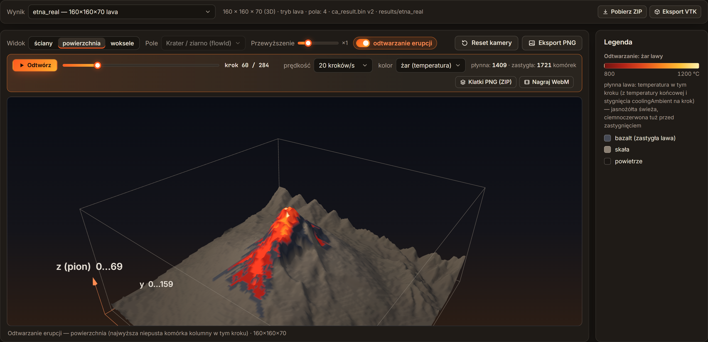
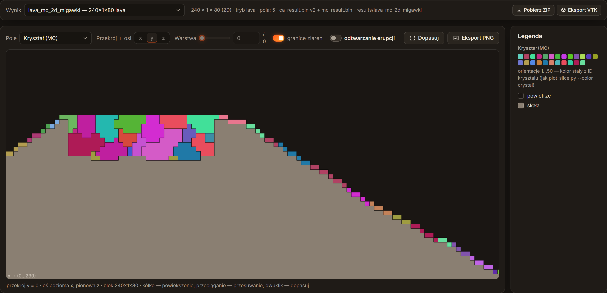
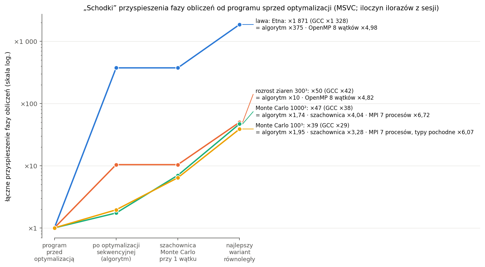

# volcano-ca-mc

Symulacja erupcji wulkanu: spływ lawy jako automat komórkowy i krystalizacja bazaltu metodą Monte Carlo (model Pottsa).



Obliczenia wykonuje silnik C++17 uruchamiany bez interfejsu (config JSON → symulacja → pliki wyników), a GUI
w przeglądarce przygotowuje konfiguracje, kolejkuje zadania i pokazuje wyniki w 2D i 3D. Dokumentacja i interfejs
są po polsku.

## Co potrafi

- **Spływ lawy jako automat komórkowy (2D i 3D).** Kratery są zarodkami z własnym identyfikatorem, a lawa rośnie
  jak ziarna: spada, rozlewa się w kierunku największego spadku terenu, wypełnia krater i przelewa się przez
  najniższy punkt krawędzi, stygnie i zastyga w bazalt. Sąsiedztwa von Neumanna, Moore'a, losowe pentagonalne
  i heksagonalne; brzegi absorbujące i periodyczne; tryb `classic` to zwykły rozrost ziaren.
- **Prawdziwy teren Etny i Wezuwiusza** z publicznych danych wysokościowych (AWS Terrain Tiles), kratery
  w zadanych miejscach wybierane kliknięciem na mapie, teren także z własnego pliku CSV albo obrazu PNG/JPG.
- **Krystalizacja Monte Carlo** (model Pottsa, akceptacja Metropolisa) na zastygłym bazalcie, z mobilnością
  zależną od czasu stygnięcia: wolno stygnące jezioro lawy daje duże kryształy, szybko zastygłe zbocze drobne.
- **Odtwarzanie erupcji krok po kroku** w 2D i 3D (suwak czasu, eksport klatek PNG i filmu WebM) bez ponownego
  liczenia: stan w kroku k wynika z zapisanych kroków przybycia i zastygnięcia lawy; także wzrost kryształów MC.
- **GUI w przeglądarce, działające bez internetu:** formularz budowany z domyślnej konfiguracji silnika,
  walidacja z komunikatami po polsku, kolejka zadań (workery, pauza, kolejność, przypięcie do rdzenia CPU),
  generator serii, porównanie wyników z wykresami, eksport ZIP i VTK (ParaView); zakładka **Wydajność** pokazuje
  wyniki optymalizacji i zrównoleglenia (przyspieszenie, efektywność, pamięć, pamięć podręczna) na interaktywnych
  wykresach z podanym źródłem i warunkami każdego pomiaru.
- **Wersja serwerowa:** `engine --config …` liczy jedną symulację, `engine --batch <folder>` całą serię configów,
  każdy w osobnym procesie; czasy faz, pamięć i rozmiary plików trafiają do `times.json`.
- **Profil wydajności:** gprof, callgrind i profiler Visual Studio, model pamięci zgodny z pomiarem w 0–4%,
  wymagania sprzętowe i analiza różnic między kompilatorami.
- **Deterministyczne wyniki:** losowość pochodzi z funkcji skrótu położenia komórki, więc wynik jest bitowo
  identyczny dla obu reprezentacji siatki (płaska tablica i `vector<vector<vector>>`), dla MSVC i GCC oraz dla każdej
  liczby wątków OpenMP (`--threads`) i procesów MPI.
- **Obliczenia równoległe OpenMP:** `--threads N` dzieli warstwy przestrzeni między wątki (harmonogram z configu,
  przypinanie do rdzeni wydajnościowych); MC liczy się wielowątkowo w trybie szachownicy (`mc.update = checkerboard`).
- **Wersja rozproszona (MPI):** `mpiexec -n 8 engine_mpi …` dzieli przestrzeń na pasy warstw między procesy
  z wymianą warstw brzegowych (MS-MPI na Windows, OpenMPI na Linuksie), także w trybie hybrydowym procesy × wątki;
  opcjonalnie wymiana i rozsyłanie configu typami pochodnymi MPI i równoległy zapis wyniku przez MPI-IO.

| Kratery na mapie (Etna) | Kryształy MC na przekroju wulkanu | Kolejka zadań z serią |
|---|---|---|
|  |  |  |

## Szybki start

**Wymagania:** Windows z Visual Studio 2022 (pakiet „Programowanie aplikacji klasycznych w języku C++”) albo
Linux/WSL z GCC lub Clang (C++17); CMake ≥ 3.20; Python ≥ 3.11 (GUI, narzędzia, testy); przeglądarka z obsługą
WebGL2. Zależności C++ (nlohmann/json, doctest) i biblioteki frontendu (three.js, Chart.js, fonty) są w repozytorium.

```powershell
# Windows, MSVC (bez środowiska vcvars)
cmake --preset msvc-release
cmake --build --preset msvc-release
ctest --preset msvc-release                    # 12 testów (doctest + testy dymne programu; 21 z MPI)

# Pierwsza symulacja: przekrój 2D wulkanu -> results\test_2d\ (ca_result.*, times.json, stats.json)
.\build\Release\engine.exe --config configs\test_2d.json --out results\test_2d

# Ta sama lawa 3D na 8 wątkach OpenMP i na 4 procesach MPI (MS-MPI; wynik bitowo ten sam)
.\build\Release\engine.exe --config configs\test_3d.json --out results\test_3d_t8 --threads 8 --high-priority
mpiexec -n 4 .\build\Release\engine_mpi.exe --config configs\test_3d.json --out results\test_3d_mpi4 --high-priority

# GUI: http://127.0.0.1:8000
python -m pip install --user -r gui\requirements.txt
python -m gui

# Testy backendu GUI (z prawdziwym silnikiem)
python -m pip install --user -r gui\requirements-dev.txt
python -m pytest gui\tests
```

Na Linuksie/WSL: `cmake --preset gcc-release`, `cmake --build --preset gcc-release -j`,
`ctest --preset gcc-release`, program `build-gcc-release/bin/engine`. Krok po kroku (VS Code, Visual Studio,
GCC w WSL, rozwiązywanie problemów) oraz pełny opis opcji silnika, parametrów configu i plików wynikowych:
[docs/uruchamianie.md](docs/uruchamianie.md).

## Architektura w skrócie

```
 configs/*.json ──► engine (C++17, bez GUI) ──► results/<nazwa>/ ◄── GUI: backend Python (FastAPI, 127.0.0.1)
 + --set, --out     teren → kratery → CA          ca_result.bin          frontend HTML + JS (three.js, Chart.js)
                    (→ MC) → zapis + times.json   mc_result.bin, ...     silnik uruchamiany jako osobny proces
```

| Katalog | Zawartość |
|---|---|
| `engine/src/core` | typy komórek, dwie reprezentacje siatki z ramką, sąsiedztwa, warunki brzegowe, `hashRand`, pomiar czasu i pamięci |
| `engine/src/terrain`, `ca`, `mc` | teren (stożek, mapa wysokości, poziomy przelewu), automat `LavaCA<Storage>`, Monte Carlo `PottsMC` |
| `engine/src/io`, `app` | config z walidacją, zapis/odczyt wyników; przebieg symulacji, `--batch`, `--benchmark`, CLI |
| `engine/src/parallel` | OpenMP: pętla z harmonogramem z configu, przypinanie wątków do rdzeni wydajnościowych, czas pracy wątków; podział na pasy warstw dla MPI |
| `engine/src/mpi` | program `engine_mpi`: rozsyłanie configu, wymiana warstw brzegowych, sumy liczników, zebranie wyniku |
| `gui/` | backend (kolejka zadań, serie, odczyt wyników, eksport) i frontend bez kroku budowania |
| `tools/`, `bench/` | podgląd PNG, seria bez GUI, pobieranie terenu, eksport VTK; pomiary profilu, testy A/B, skalowanie OpenMP i MPI |
| `configs/` | gotowe konfiguracje (m.in. `test_2d`, `lava_mc_3d`, `etna_real`, `wezuwiusz_real`) i mapy wysokości |

Droga jednej symulacji od configu do pliku wynikowego, kluczowe miejsca w kodzie i słowniczek:
[docs/architektura.md](docs/architektura.md).

## Wybrane wyniki

**Symulacja i profil:**

- Na tej samej siatce naiwne MC jest **4–56× wolniejsze** od CA. W 2D przewaga CA maleje z rozmiarem (25× → 4×),
  bo liczba kroków CA rośnie jak bok siatki; w 3D zostaje ~30×.
- Mobilność ze stygnięcia daje w wolno stygnącej lawie ziarna średnio **5,0× większe** niż w szybko zastygłej
  (`lava_mc_3d`; bez mobilności 2,2×, tyle wynika z samej geometrii cienkiej warstwy).
- Profil: w CA lawy **68–83% czasu** zajmowało przeszukiwanie sąsiadów komórek powietrza, które w 99,99% przypadków
  nic nie znajduje; różnica MSVC/GCC w MC (2–3×) to był jeden skok warunkowy w pętli energii. Model pamięci z kodu
  (~40 B na komórkę w CA 3D) zgadza się z pomiarem szczytu procesu z dokładnością 0–4%.


**Optymalizacja i obliczenia równoległe** (wynik bitowo ten sam przy 1–8 wątkach i 1–8 procesach, w MSVC i GCC):

- **Optymalizacja sekwencyjna:** automat frontalny liczy tylko komórki, które mogą się zmienić, więc erupcja Etny
  (1,8 mln komórek) trwa **0,15 s zamiast 32,3 s** ([docs/optymalizacja-sekwencyjna.md](docs/optymalizacja-sekwencyjna.md)).
- **OpenMP** (warstwy przestrzeni między wątki, 8 rdzeni wydajnościowych): faza obliczeń przyspiesza **4,8–6,7×**
  (pełny przebieg lawy 6,3×); MC w trybie szachownicy jest przy tym 3–4× szybsze już na jednym wątku
  ([docs/openmp.md](docs/openmp.md)).
- **MPI** (pasy warstw z warstwami brzegowymi): siatki o równej pracy na warstwę przyspieszają **6,7× na 7 procesach**
  (E = 0,95–0,96), lawę ogranicza nierówna praca pasów ([docs/mpi.md](docs/mpi.md)); **MPI-IO** zapisuje wynik
  tekstowy 300³ w 0,73 s zamiast 1,84 s przy 4× mniejszej pamięci procesu 0
  ([docs/mpi-typy-i-zapis.md](docs/mpi-typy-i-zapis.md)).
- **Łącznie** od programu sprzed optymalizacji: Etna **×1 871** (algorytm ×375 · OpenMP ×4,98), rozrost ziaren 300³
  ×50, MC ×39–47; przy rosnącym zadaniu (skalowanie słabe) MC i lawa utrzymują E_w = 0,87–1,00 na 8 rdzeniach, a rozrost
  ziaren ogranicza przepustowość RAM ([docs/testy-wydajnosci.md](docs/testy-wydajnosci.md)).



Zestawienie wyników przykładowych przypadków: [docs/wyniki.md](docs/wyniki.md).

## Raporty techniczne

- [docs/raport-1.pdf](docs/raport-1.pdf) (10 stron): architektura, modele CA i MC, GUI i kolejkowanie zadań, wyniki
  symulacji, profil wydajności.
- [docs/raport-2.pdf](docs/raport-2.pdf) (10 stron): optymalizacja sekwencyjna, OpenMP, MPI, typy pochodne MPI
  i MPI-IO, testy wydajności.

Źródła `docs/raport-1.md` i `docs/raport-2.md`; budowanie: `python tools/build_report.py` (oba) albo z numerem raportu.

## Dokumentacja

Spis dokumentacji (dokumenty tematyczne od automatu komórkowego po zakładkę „Wydajność”, każdy także jako PDF,
oraz architektura, uruchamianie, wyniki i raporty): [docs/README.md](docs/README.md).

## Dalszy rozwój

- Pasy MPI ważone pracą albo podział w poziomie dla lawy (dziś dolny pas dostaje prawie całą lawę).
- Równoległe etykiety ziaren MC (union-find w pasach i łączenie na granicach; dziś ~50% czasu MC przy 8 wątkach).
- Mniejszy ruch do pamięci w rozroście ziaren (mniejsze typy pól, bloki mieszczące się w L2) i tańsza lista
  kandydatów automatu frontalnego.
- Warianty MC zmieniające proces losowy (próby tylko na granicach ziaren, losowanie bez powtórzeń) z walidacją
  statystyczną.
- Uruchamianie `engine_mpi` z kolejki GUI i pomiar na klastrze z równoległym systemem plików.

## Dane terenu

Mapy `configs/heightmaps/etna.*` i `wezuwiusz.*` powstały z **AWS Terrain Tiles** (Tilezen / Mapzen „Terrain Tiles”;
na tych obszarach głównie SRTM (U.S. Geological Survey) i EU-DEM (Copernicus, Unia Europejska)). Wymagane
przypisanie danych w pełnym brzmieniu: [configs/heightmaps/README.md](configs/heightmaps/README.md).
Symulacje na prawdziwym terenie **nie są skalibrowane fizycznie**: to ilustracja modelu, nie prognoza.

## Autor

Bartosz Pajda.

Projekt powstał w ramach przedmiotu »Metody analizy dyskretnej w złożonych systemach obliczeniowych« na Akademii Górniczo-Hutniczej w Krakowie (2026).
