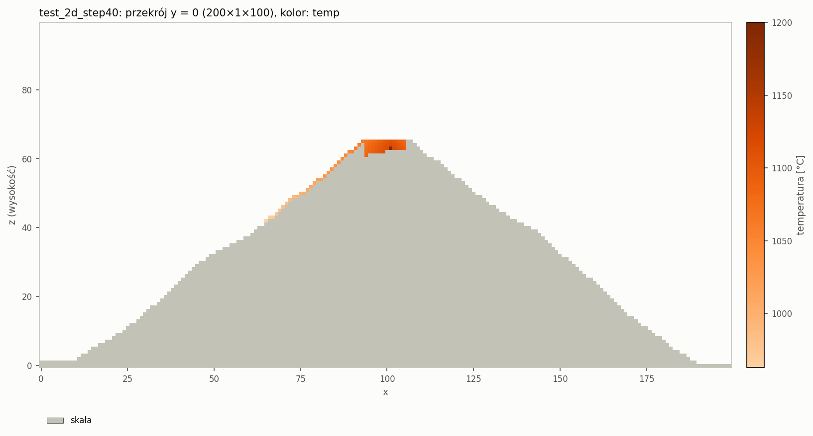
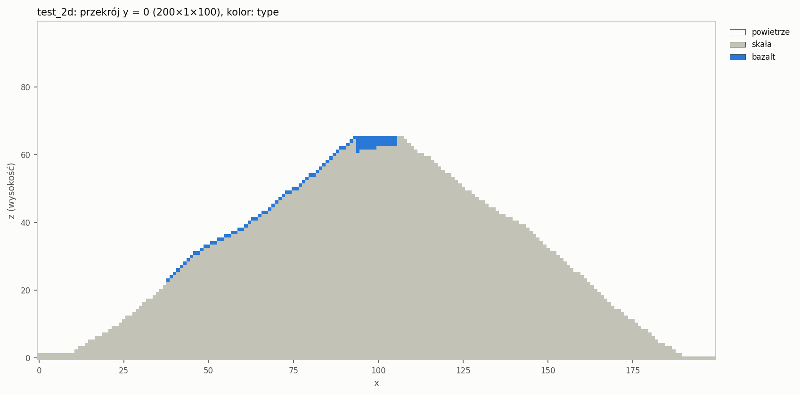
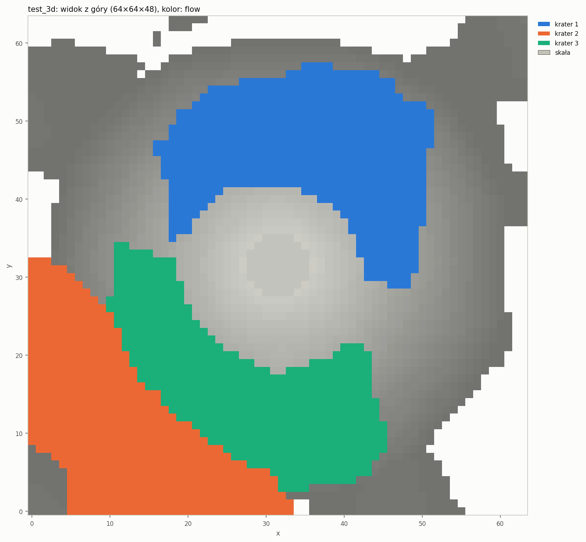
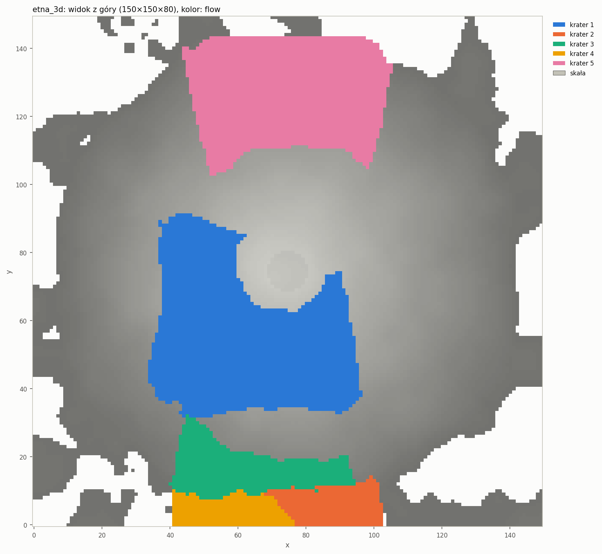
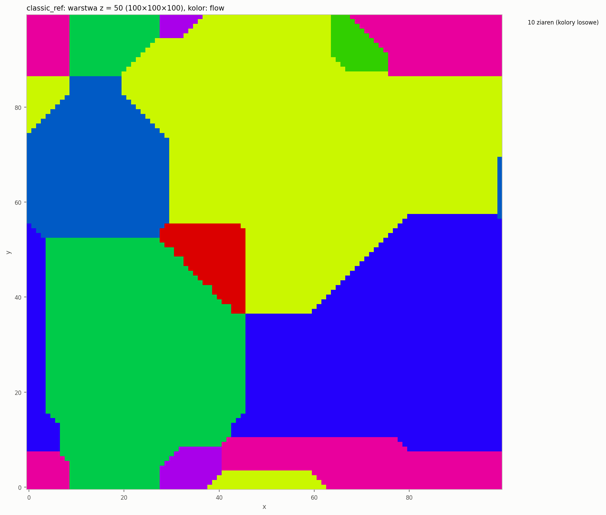

# Etap 1 — automat komórkowy, wersja serwerowa, porównanie reprezentacji siatki

**Stan na 08.10.2026.** Silnik C++17 działa bez interfejsu użytkownika: dane z pliku JSON i argumentów
`main`, zapis mikrostruktury końcowej (txt/bin), pomiar czasu z zapisem do `times.json`, dwie
reprezentacje siatki z benchmarkiem i sprawdzeniem zgodności wyników.

Sprzęt pomiarowy: **Intel Core i9-13900HX** (laptop, rdzenie P+E), Windows 11, **MSVC 19.38**
(Visual Studio 2022), build **Release** (`/O2`).

## 1. Założenia → realizacja

| Założenie | Realizacja | Gdzie w kodzie |
|---|---|---|
| Usunięcie interfejsu użytkownika, symulacja bez ingerencji | program `engine` działa od startu do zapisu bez interakcji | `src/main.cpp`, `src/app/Simulation.cpp` |
| Dane początkowe z pliku konfiguracyjnego | JSON z wartościami domyślnymi, walidacją i komunikatami po polsku; nieznane klucze = błąd | `src/io/Config.hpp/.cpp` |
| Dane początkowe z argumentów `main` | `--config`, `--out`, `--set klucz=wartość`, `--grid`, `--benchmark` | `src/app/Cli.hpp/.cpp` |
| Funkcja nasłuchująca | nie zaimplementowano — możliwe rozszerzenie (punkt 6) | — |
| Zapis mikrostruktury końcowej (txt/xml/json) | `ca_result.txt` (`x y z type flowId temp`), opcjonalnie `ca_result.bin`; `config_used.json`, `stats.json` | `src/io/ResultWriter.*`, `ResultReader.*` |
| Pomiar czasu działania, zapis do pliku | `times.json`: `readConfig, allocate, terrain, vents, caSim, save, total` [ms] + kroki, siatka, CPU; `steady_clock` | `src/core/Timer.hpp`, `src/io/TimingReport.*` |
| Sąsiedztwa: von Neumann, Moore, losowe pentagonalne, losowe heksagonalne | prekomputowane offsety; losowy wariant z hasha (seed, krok, komórka) | `src/core/Neighborhood.*` |
| Warunki brzegowe: absorbujące, periodyczne | ramka 1 komórki wypełniana przed krokiem (VOID / kopia przeciwległej warstwy) | `src/core/Boundary.*` |
| Przestrzeń 2D i 3D, dowolna liczba zarodków | `space.nx/ny/nz`, `vents.count` (kratery = zarodki z własnym `flowId`) | `src/terrain/VentPlacer.*` |
| Porównanie dwóch reprezentacji siatki + zgodność | `VectorStorage` (płaski `vector`) i `MatrixStorage` (`vector<vector<vector>>`), automat jako szablon `LavaCA<Storage>`; `--benchmark` | `src/core/Storage.hpp`, `src/ca/LavaCA.hpp`, `src/app/Benchmark.*` |
| Obiektowość, komentarze | klasy z jedną odpowiedzialnością; każda klasa i nietrywialna funkcja z komentarzem po polsku (co i dlaczego) | całe `engine/src` |

Przygotowanie pod planowane zrównoleglenie (OpenMP, MPI): płaskie tablice SoA, ramka = przyszłe komórki nadmiarowe MPI, synchroniczny
CA z podwójnym buforem (`swap` bez kopiowania), losowość wyłącznie z hasha położenia (wynik nie zależy od
kolejności przetwarzania ani od reprezentacji siatki — sprawdzone bitowo).

## 2. Model i zmiany względem opisu etapu

Tryb `lava`: teren to stożek wulkanu z kraterem i gładkim szumem (lub mapa wysokości z CSV), kratery to
zarodki. Lawa spada, rozlewa się, stygnie (`coolingFall`, `coolingLateral`, `coolingAmbient`) i poniżej
`solidusTemp` zastyga w bazalt. Nowa komórka dostaje najczęstszy `flowId` wśród kandydatów (remis → hash).
Pełny opis reguł: `engine/src/ca/CaRules.hpp`.

Reguły z opisu etapu dawały wyraźnie błędne obrazy. Każdą zmianę wprowadziłem dopiero po obejrzeniu przekroju:

| Problem (zaobserwowany na wykresie) | Zmiana |
|---|---|
| Lawa nie może się podnieść, więc nigdy nie wypływa z krateru-zagłębienia | **wypełnianie zagłębień** (`ca.ponding`): dla mapy wysokości liczony jest poziom przelewu niecek (algorytm priority-flood), a lawa podnosi się warstwami tylko do niego, potem przelewa przez najniższy punkt krawędzi |
| „Lawa podpiera lawę”: lawa wisząca nad zboczem podpiera rozlewanie, powstaje „kurtyna” i cała przestrzeń pod poziomem przelewu zostaje zalana | płynna lawa podpiera tylko w niecce (jak powierzchnia jeziora lawy); podparciem są skała, bazalt, dno |
| Spadanie po skosie odrywa lawę od stromego stoku i pod linią 45° rośnie klin lawy | po skosie lawa spływa tylko na komórkę z podparciem; z urwiska spada pionowo |
| Lawa rozlewa się do każdej niższej komórki, więc z krateru idzie wachlarzem i pokrywa cały stożek | lawa płynie w kierunku **największego spadku** (założenie „lawa woli spływać w dół”; wypływ do najniższych sąsiadów jak w modelach SCIARA) |

Pozostałe decyzje:
- Krater ma płaskie dno na wysokości krawędzi minus `craterDepth` (dosłowne „stożek − głębokość” zostawiało szczyt w środku krateru).
- Szum terenu jest gładki (szum wartości z hasha). Biały szum tworzył jamy, w których lawa grzęzła.
- Warunek stopu „brak zmian” dotyczy tylko sąsiedztw deterministycznych. Przy losowych krok bez zmian nie oznacza końca.
- W trybie `classic` ziarno ma `type = LAVA`, `temp = 0`.
- Kratery i zarodki są losowane przez `mt19937_64` z własnym Fisherem–Yatesem, bo `std::shuffle` daje różne wyniki w MSVC i GCC.
- `ca_result.bin` zawiera dodatkowo `solidStep` (wejście dla MC w etapie 2).

## 3. Wyniki symulacji

**`test_2d`** — przekrój 200×1×100, 1 krater. W kroku 40 lawa wypełnia krater i spływa lewym, niższym
zboczem (kolor = temperatura: przy kraterze 1200 °C, czoło ok. 1000 °C):



Stan końcowy (351 kroków): bazalt w kraterze i jęzor zatrzymany w ok. 2/3 zbocza (zasięg 63 komórki):



**`test_3d`** — 64×64×48, 3 kratery boczne. Widok z góry, kolor = krater (`flowId`): trzy pola lawy
spływają w dół zbocza i zatrzymują się; szczyt i duża część stoku pozostają wolne:



**`etna_3d`** — 150×150×80, 5 kraterów bocznych (284 kroki, CA 27,9 s):



**`classic_ref`** — klasyczny rozrost 100×100×100, 10 ziaren, von Neumann, periodyczne (warstwa z = 50):



Czasy z `times.json` (vector, Release):

| Config | Komórki | Kroki | caSim [ms] | save [ms] | total [ms] |
|---|---|---|---|---|---|
| `test_2d` | 20 000 | 351 | 107 | 4 (txt+bin) | 112 |
| `test_3d` | 196 608 | 284 | 2 209 (macierz: 1 740) | 29 (txt+bin) | 2 241 |
| `etna_3d` | 1 800 000 | 284 | 27 925 | 24 (bin) | 27 965 |
| `classic_ref` | 1 000 000 | 71 | 465 | 150 (txt+bin) | 621 |

## 4. Benchmark: vector vs macierz

`engine --benchmark --repeats 5`, mediana czasu samego automatu (bez alokacji, terenu i zapisu), proces
przypięty do jednego rdzenia P (`start /affinity 1`). Kolumna `zgodne` = wyniki obu reprezentacji
identyczne komórka po komórce (`type`, `flowId`, `temp` bitowo) i ta sama liczba kroków.

```
siatka      komorki  ziarna  kroki  vector [ms]  macierz [ms]  mac/vec  zgodne  tryb
10x10x10    1000     10      9      0.062        0.085         1.36     tak     classic/vn
10x10x10    1000     10      4      0.116        0.138         1.19     tak     classic/moore
25x25x25    15625    62      10     2.11         2.16          1.02     tak     classic/vn
25x25x25    15625    62      6      2.04         4.08          2.00     tak     classic/moore
50x50x50    125000   100     19     16.59        21.03         1.27     tak     classic/vn
100x100x100 1000000  100     43     312.8        415.6         1.33     tak     classic/vn
100x100     10000    10      39     3.05         6.98          2.29     tak     classic/vn
1000x1000   1000000  100     190    1643.9       2617.0        1.59     tak     classic/vn
200x1x100   20000    1       351    124.7        145.8         1.17     tak     lava/moore
64x64x48    196608   3       284    2523.0       1912.7        0.76     tak     lava/moore
```

Wnioski:
- **Zgodność: „tak” we wszystkich przypadkach.** Losowość z hasha położenia sprawia, że wynik nie zależy od
  reprezentacji siatki. Na tym samym mechanizmie ma się opierać zgodność wyników planowanych wersji OpenMP/MPI.
- W rozroście klasycznym macierz jest wolniejsza o 2–130%, najwyraźniej dla dużych siatek 2D
  (1000×1000: ×1,59) i 3D (100³: ×1,33). Każdy wiersz `x` to osobna alokacja, a dostęp wymaga dodatkowych
  odczytów wskaźników.
- Wyjątek: lawa 64×64×48, gdzie macierz bywa szybsza (×0,76–0,98 w różnych przebiegach). Dane mieszczą się
  w pamięci podręcznej, a reguły lawy są „ciężkie” obliczeniowo. Koszt indeksu płaskiej tablicy
  (2 mnożenia na każdy odczyt sąsiada) przeważa wtedy nad odczytami wskaźników z cache. To kandydat
  na optymalizację (offsety liniowe sąsiadów zamiast współrzędnych).
- Pomiary są zaszumione: przy małych przypadkach (< 5 ms) różnice między przebiegami sięgają kilkudziesięciu
  procent. Na procesorze hybrydowym bez przypięcia do rdzenia P pierwszy przebieg pełnego benchmarku dał
  np. 64×64×48: 3094 / 3024 ms (×0,98), 25³/Moore ×1,12. W etapie profilowania (etap 3): więcej powtórzeń
  i przypięcie procesu.
- Liczba kroków w tabeli referencyjnej (10³/10 ziaren → 4, 25³/62 → 7) zgadza się z naszym sąsiedztwem **Moore'a**
  (4 i 6–7 dla różnych ziaren losowania). Von Neumann daje ok. 2× więcej kroków (7–9 i 10–12), dlatego
  benchmark zawiera oba warianty.

Orientacyjne porównanie z czasami referencyjnymi innej implementacji rozrostu ziaren CA (rozrost klasyczny,
von Neumann, periodyczne; referencja na i5-9600KF 4,3 GHz, inny sprzęt i implementacja — bez wniosków o „lepszości”):

| Przypadek | Referencja | U nas (vector) |
|---|---|---|
| 100×100×100, 10 ziaren | 5,9 s | 0,46 s (`classic_ref`) |
| 1000×1000, 100 ziaren | 10,0 s | 1,64 s |
| 10×10×10, 10 ziaren (tabela benchmarku) | 9,1 ms | 0,12 ms (Moore) |
| 25×25×25, 62 ziarna (tabela benchmarku) | 215,2 ms | 2,0 ms (Moore) |

Pełne dane: `results/benchmark_doc/benchmark.csv` i `benchmark_meta.json` (folder `results/` nie trafia
do repozytorium — tabelę można odtworzyć poleceniem `engine --benchmark --repeats 5`).

## 5. Testy

`ctest --preset msvc-release`: 4 testy (48 przypadków doctest, ok. 280 tys. asercji + 3 testy dymne
programu). Wszystkie przechodzą w Release i w Debug (Debug sprawdza dostęp poza ramką asercjami).
Sprawdzane są między innymi:
- liczba sąsiadów każdego sąsiedztwa w 2D/3D, płaszczyzna 2D, pokrycie wariantów losowych, błąd hexagonal w 3D;
- zawijanie periodyczne (ściany, krawędzie, narożniki), oś z w trybie lava zawsze absorbująca;
- `classic` wypełnia całą przestrzeń i każde ziarno ma ≥ 1 komórkę (4 sąsiedztwa × 2 brzegi × 2D/3D);
  liczba kroków von Neumanna zgodna z teorią (21×21, 1 zarodek → 20 kroków);
- **VectorStorage i MatrixStorage dają identyczny wynik** (lava 2D/3D, losowe sąsiedztwa, periodyczne, classic);
- ten sam seed → identyczny wynik, inny seed → inny;
- lawa nie wchodzi w skałę, nie wspina się bez wypełniania zagłębień, na płaskim terenie tworzy jedną warstwę,
  z wypełnianiem zagłębień wypływa z krateru; brzeg periodyczny zawija lawę, absorbujący nie;
- poziom przelewu niecek (priority-flood);
- config: wartości domyślne, scalanie z plikiem, `--set`, czytelne błędy (zła wartość, nieznany klucz, typ,
  zakres, niedozwolone kombinacje);
- zapis i odczyt txt/bin (zgodność danych, rozmiar pliku), raport czasów.

## 6. Znane ograniczenia

- Model lawy to model **wzrostu** bez zachowania masy: zasięg jęzorów wyznacza „budżet temperatury”
  (koszty stygnięcia na krok i na przeskok). Parametry stygnięcia w configach są dobrane do kształtu
  wyniku, nie są wartościami fizycznymi.
- Na symetrycznym stożku krater szczytowy przelewa się równo na wszystkie strony (krawędź ma prawie
  wszędzie tę samą wysokość) — dlatego `test_3d` i `etna_3d` mają kratery boczne. Kierunkowy wypływ
  z krateru szczytowego wymagałby wyłomu w krawędzi (rozwiązane w etapie 5: mapa `kaldera_wylom`).
- Pola lawy w 3D mają kanciaste, szerokie kształty (geometria sąsiedztwa Moore'a), a nie wąskie jęzory.
- Stop „brak zmian w kroku” może zakończyć symulację, gdy krater jest jeszcze w trakcie erupcji, ale jest
  całkowicie otoczony zastygłą lawą — w wyniku zostaje wtedy jedna komórka płynnej lawy (sam krater).
- Wydajność: dostęp do sąsiadów przez współrzędne (bez offsetów liniowych), każda komórka przepisywana
  co krok; 1,8 mln komórek lawy ≈ 28 s. Optymalizacje — planowany dalszy rozwój (etap 3, punkt 2.3).
- `solidStep` jest typu `uint16`, stąd `ca.maxSteps ≤ 65535`.
- Kompilacja GCC/Clang nie była sprawdzona w tym etapie (WSL bez g++) — nadrobione w etapie 2 (GCC 11.4,
  0 ostrzeżeń, wyniki bitowo identyczne z MSVC). Kod nie używa rozszerzeń kompilatora; jedyne fragmenty zależne
  od systemu (konsola UTF-8, nazwa CPU, `localtime_s/_r`) są w `#ifdef _WIN32`.
- „Funkcja nasłuchująca” (trzecie źródło danych wejściowych obok pliku i argumentów `main`) nie jest
  zaimplementowana. Możliwe rozszerzenie: tryb `--listen <port>` przyjmujący config JSON przez gniazdo i odsyłający
  ścieżkę wyników. Jej rolę pełnią kolejka zadań GUI (HTTP na 127.0.0.1) i `engine --batch` (etap 5).

## 7. Co dalej — etap 2 (Monte Carlo)

Krystalizacja zastygłej lawy modelem Pottsa: domena = komórki `BASALT` z wyniku CA (albo cała
przestrzeń w trybie `full`), losowe orientacje 1…Q, energia `E = J·Σ(1 − δ)`, akceptacja Metropolis,
mobilność zależna od czasu stygnięcia (`solidStep` jest już zapisywany w `ca_result.bin`). Wyjście:
`mc_result.txt`, `mc_stats.csv`, czas `mcSim` w `times.json`. Kod trafi do `engine/src/mc/`, a MC będzie
mogło startować z pliku wyniku CA (`ResultReader`).
