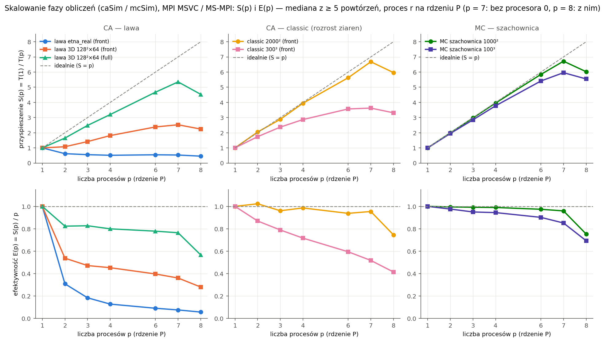
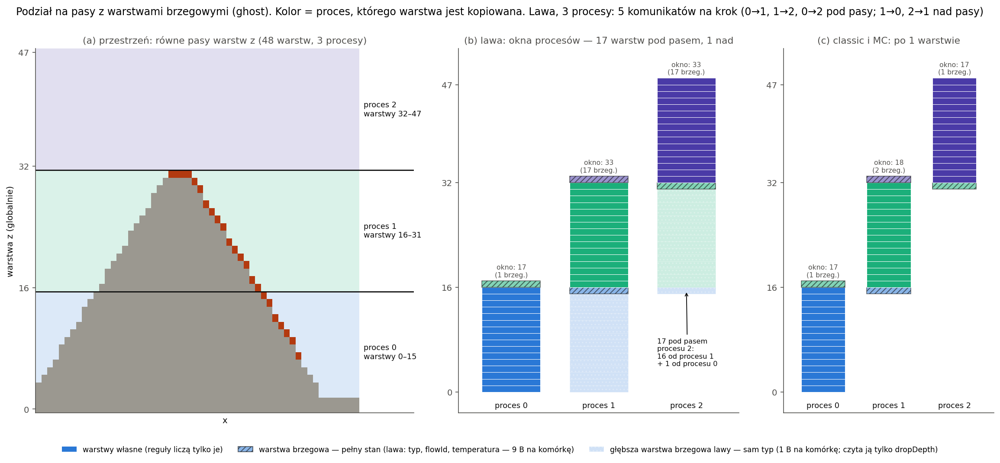
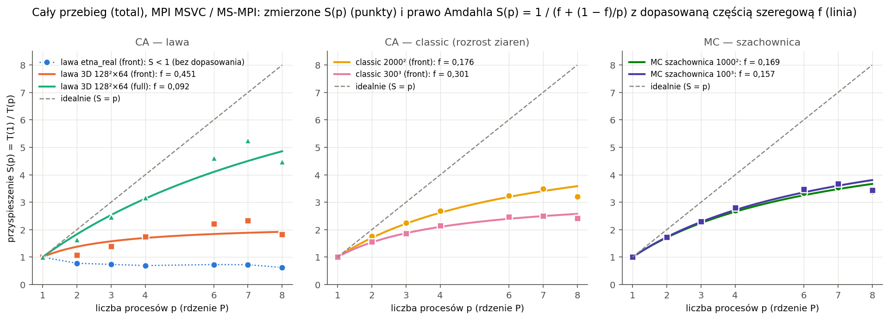
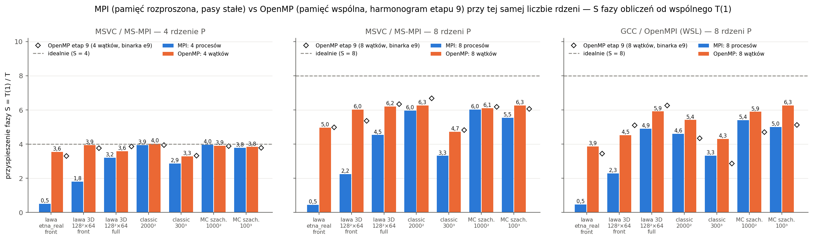
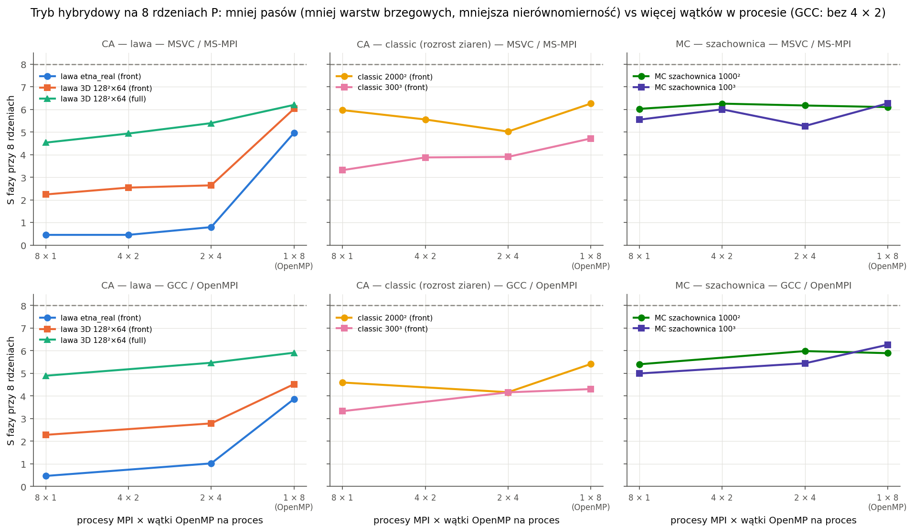
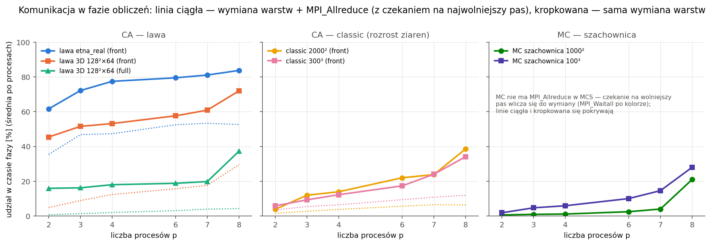
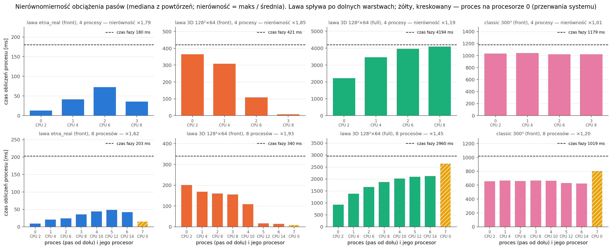
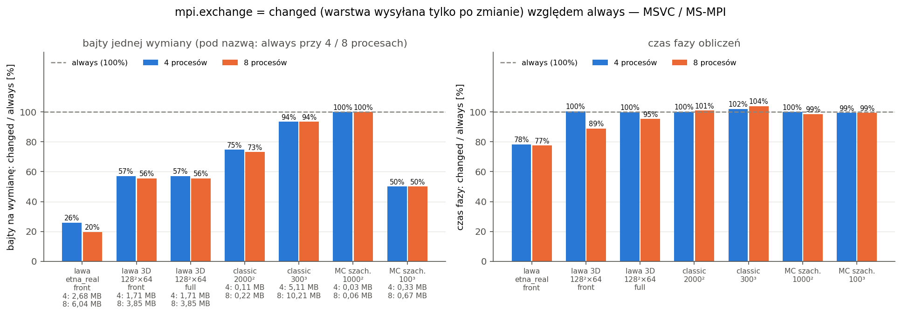

# Etap 10 — wersja rozproszona w MPI

Program **`engine_mpi`** liczy tę samą symulację co `engine` (lawa / classic, Monte Carlo na bazalcie albo na całej
przestrzeni, `--mc-from`), ale w pamięci rozproszonej: przestrzeń jest podzielona na **pasy warstw** między procesy
MPI, a każdy proces liczy swój pas tym samym kodem automatu i MC co `engine`. Trzy zasady:

- **Poprawność ponad wszystko.** Wynik przy każdej liczbie procesów jest **bitowo taki sam** jak w `engine` (pliki
  `ca_result.*`, `mc_result.*`, `mc_stats.csv`, `stats.json`): 1, 2, 3, 4, 5 i 8 procesów w testach, 1, 3 i 8 procesów
  na wszystkich configach z `configs/`, także w trybie hybrydowym (procesy × wątki OpenMP), a w pomiarze — każde
  powtórzenie każdego wariantu.
- **Ten sam podział co w etapie 9.** Jednostką jest warstwa (oś z, w płaszczyźnie x–y — y); w OpenMP warstwy dostawały
  wątki, w MPI ciągłe pasy warstw dostają procesy.
- **Program `engine` się nie zmienia** (bez MPI, te same wyniki co po etapie 9 — 15/15 configów, MSVC i GCC).
  Biblioteka silnika nie zależy od MPI; komunikację dostarcza interfejs `StripLink`, zaimplementowany w `src/mpi/`.

**Wynik w skrócie** (MSVC / MS-MPI, procesy przypięte po jednym na rdzeń P, mediana z 5–11 powtórzeń; S = T(1)/T(p),
E = S/p; „faza” = sama faza obliczeń `caSim` albo `mcSim`, „cały” = cały przebieg `total`; punkt 9):

| Przypadek | T(1) faza | T(8) faza | S(8) faza | E(8) faza | S(8) cały | najlepsze MPI na ≤ 8 rdzeniach | OpenMP, 8 wątków |
|---|---|---|---|---|---|---|---|
| MC szachownica 1000² | 2,05 s | 340 ms | **6,03** | 0,75 | 3,39 | 7 procesów: 6,72 | 6,10 |
| CA classic 2000² | 539 ms | 90 ms | **5,97** | 0,75 | 3,20 | 7 procesów: 6,68 | 6,26 |
| MC szachownica 100³ | 5,74 s | 1,03 s | **5,55** | 0,69 | 3,45 | 4 × 2 wątki: 6,00 | 6,27 |
| lawa 3D 128² × 64, pełny przebieg (`full`) | 13,41 s | 2,96 s | **4,53** | 0,57 | 4,48 | 2 × 4 wątki: 5,39 | 6,20 |
| CA classic 300³ | 3,38 s | 1,02 s | 3,32 | 0,41 | 2,42 | 2 × 4 wątki: 3,90 | 4,72 |
| lawa 3D 128² × 64, automat frontalny | 762 ms | 340 ms | 2,24 | 0,28 | 1,84 | 2 × 4 wątki: 2,64 | 6,03 |
| lawa `etna_real` (Etna, 1,8 mln komórek) | 92 ms | 203 ms | **0,45** | 0,06 | 0,63 | 2 × 4 wątki: 0,80 | 4,96 |

- **Siatka z równą pracą w każdej warstwie skaluje prawie liniowo** — MC szachownicą i classic 2000² do 7 procesów
  E = 0,95–0,96, a 7 procesów (bez procesora 0) jest szybsze niż OpenMP na 8 wątkach. Sama wymiana warstw
  brzegowych to tu 1–7% fazy.
- **Ósmy proces (na procesorze 0) zawsze pogarsza wynik** względem siedmiu: pasy są stałe, a proces na procesorze,
  który obsługuje przerwania systemu, liczy swój pas 13–30% dłużej i wszystkie czekają na niego co krok.
- **Lawa skaluje słabo:** jest skupiona w kilku warstwach (nierównomierność pasów do ×2,1), a lawa czyta 17 warstw pod
  pasem (do 6 MB na wymianę). Etna ma krok 0,3 ms — wymiana warstw trwa dłużej niż obliczenia, więc MPI ją
  **spowalnia** (S < 1). Tu wygrywa pamięć współdzielona (OpenMP z cyklicznym przydziałem warstw).

## 1. MPI w projekcie

| | Windows | Linux / WSL |
|---|---|---|
| biblioteka | MS-MPI 10.1 (`msmpisetup.exe` — `mpiexec`, `msmpisdk.msi` — nagłówki i `msmpi.lib`) | OpenMPI 4.1.2 (`openmpi-bin`, `libopenmpi-dev`) |
| kompilator | MSVC (`find_package(MPI)` szuka SDK przez `MSMPI_INC`, `MSMPI_LIB64`) | GCC 11.4 (`mpicxx`) |
| uruchomienie | `mpiexec -n 4 build\Release\engine_mpi.exe --config … --out …` | `mpiexec -n 4 build-gcc-release/bin/engine_mpi --config … --out …` |

- Opcja CMake **`VOLCANO_MPI`** (domyślnie ON): cel `engine_mpi` i testy pod `mpiexec` powstają, gdy CMake znajdzie MPI.
  Bez MPI konfiguracja wypisuje komunikat i buduje resztę (`engine`, testy) bez zmian.
- Kod jest zgodny z MPI-2.2 (MS-MPI): `MPI_Isend`/`MPI_Irecv`/`MPI_Waitall`, `MPI_Allreduce`, `MPI_Bcast`,
  `MPI_Gatherv`/`MPI_Scatterv`, `MPI_Reduce`, `MPI_Gather`, `MPI_IN_PLACE`; bufory bez `const` w wywołaniach.
  `MPI_Init_thread(MPI_THREAD_FUNNELED)` — w trybie hybrydowym MPI woła tylko wątek główny.
- W WSL silnik działa jako `root`, a OpenMPI bez `--allow-run-as-root` odmawia startu; WSL zgłasza 4 rdzenie × 2 wątki
  SMT, więc OpenMPI ma domyślnie 4 miejsca. Testy CMake uruchamiają do 8 procesów z `--oversubscribe` (dodawane, gdy
  `mpiexec --version` zgłasza Open MPI). Pomiar (`scaling_mpi.py --wsl`) używa `--use-hwthread-cpus`: 8 miejsc na
  8 procesorach wirtualnych, więc 8 procesów nie jest nadsubskrypcją (przy nadsubskrypcji OpenMPI może oddawać procesor
  podczas czekania; w próbie m8 oba sposoby dały czasy w granicach szumu).
- **Wersje i buildy:** MS-MPI 10.1.12498.52 (środowisko uruchomieniowe i SDK; nagłówek zgłasza MPI 2.0 — MS-MPI ma
  część funkcji MPI-3, kod ich nie potrzebuje), OpenMPI 4.1.2 (MPI 3.1). `engine_mpi` buduje się bez ostrzeżeń
  w MSVC (`/W4 /permissive-`) i GCC (`-Wall -Wextra`), Release i Debug.

Opcje (te same co w `engine`, plus):

| Ustawienie | Znaczenie |
|---|---|
| `mpi.exchange` | `always` (domyślnie) — warstwy brzegowe co krok CA / kolor MC; `changed` — warstwa tylko, gdy się zmieniła (punkt 4.3) |
| `parallel.priority`, `--high-priority` | `high` — proces sam podnosi swój priorytet (`HIGH_PRIORITY_CLASS`; Linux: nice −5); `mpiexec` uruchamia procesy z priorytetem normalnym, a przy 8 zajętych rdzeniach P wywłaszczony proces zatrzymuje pozostałe na wymianie (etap 9, punkt 4.2) |
| `parallel.affinity = pcores` | proces r z T wątkami na rdzeniach P nr r·T … r·T + T − 1 (procesory logiczne 2, 4, …, 14, 0 — jak wątki w etapie 9); procesy nie dzielą rdzeni |
| `parallel.threads` | wątki OpenMP w każdym procesie (tryb hybrydowy) |

`engine_mpi` nie ma `--batch`, `--benchmark`, `--validate` ani `--print-defaults` (robi to `engine`). Kombinacje
nieobsługiwane zgłasza proces 0 przed obliczeniami (komunikat + `MPI_Abort` z kodem 1): `grid = matrix`,
`mc.update = random` przy > 1 procesie (wariant naiwny jest sekwencyjny — każda próba widzi wynik poprzednich;
komunikat każe użyć `checkerboard`) i więcej procesów niż warstw.

## 2. Rozsyłanie parametrów i danych wejściowych (jeden → wszyscy)

- **Config:** proces 0 wczytuje plik, nakłada `--set`, waliduje (także kombinacje MPI) i rozsyła **scalony JSON**
  (`effective`) — `MPI_Bcast` długości, potem treści. Pozostałe procesy budują `Config` tą samą funkcją
  `Config::fromJson` i **niczego nie czytają z dysku**. Błąd configu wykrywa tylko proces 0: komunikat i `MPI_Abort(1)`
  (pozostałe procesy czekają w `MPI_Bcast`).
- **Teren:** mapę wysokości (stożek albo plik CSV) liczy / czyta proces 0 i rozsyła tablicę wysokości (`MPI_Bcast`).
- **`--mc-from`:** proces 0 czyta wynik CA z pliku i rozdziela pasy (`MPI_Scatterv` typu, `solidStep`, `arrivalStep`).
- **Czas rozsyłania** (`times.json`, `mpi.bcast`; MS-MPI, 8 procesów, mediana z pomiaru): config 0,8 KB + teren
  66 KB (duża lawa, 128 × 128 wysokości) albo 103 KB (Etna) — **0,6–0,8 ms**, przy 3 procesach 0,5–0,7 ms. To
  < 0,5% fazy obliczeń każdego przypadku. Dużo więcej kosztuje sam start środowiska MPI (`MPI_Init_thread`, punkt 7).

## 3. Podział przestrzeni i warstwy brzegowe

### 3.1 Pasy warstw i okno procesu

- **Pasy w osi warstw:** z (przestrzeń 3D i przekrój lawy x–z), a w płaszczyźnie x–y — y. To najbardziej zewnętrzna
  oś pamięci, więc pas to **ciągły fragment każdej tablicy pola** (siatki z ramką, wyniku `ca_result.bin`), a indeks
  globalny komórki okna = indeks w oknie + stała (`hashBase`) — losowość nie wymaga zmian w pętlach.
- **Równy podział:** L warstw na p procesów, pierwsze L mod p procesów dostaje o jedną warstwę więcej
  (`splitLayers`). Więcej procesów niż warstw — błąd z komunikatem.
- **Okno procesu** = pas własnych warstw + warstwy brzegowe (ghost) pod i nad nim, z własną ramką 1 komórki jak zwykła
  siatka. `LavaCA` i `PottsMC` dostają wymiary okna i zakres warstw własnych (`setStrip`): reguły liczą tylko warstwy
  własne, a warstwy brzegowe są kopiami warstw sąsiednich procesów.
- **Brzeg globalny absorbujący:** pierwszy pas nie ma warstw pod sobą, ostatni nad sobą — ramka okna to VOID, jak
  w wersji sekwencyjnej. **Periodyczny** (classic, MC `full`): pierwszy i ostatni proces wymieniają się warstwami
  (pierścień), a oś warstw okna nie jest zawijana lokalnie (`Boundary::withoutPeriodic`). Przy 2 procesach ta sama
  warstwa sąsiada leży w oknie dwa razy (pod i nad pasem).
- Przy 1 procesie okno = cała przestrzeń, bez wymiany i sum — kroki idą dokładnie ścieżką `engine`.

### 3.2 Ile warstw brzegowych — zasięg reguł w osi warstw

Grubość warstw brzegowych = ile warstw pod i nad komórką czytają reguły jednego kroku (`LavaCA::reachBelow/Above`):

| Reguły | pod pasem | nad pasem | pola w wymianie |
|---|---|---|---|
| classic (rozrost ziaren) | 1 | 1 | typ, `flowId`, `arrivalStep` |
| MC (szachownica) | 1 | 1 | orientacja |
| **lawa** | **17** (pierwsza — pełny stan, głębsze — sam typ) | 1 | typ, `flowId`, temperatura |

**Lawa nie ma promienia 1 w osi z.** Komórka powietrza c przyjmuje lawę z sąsiada tylko w kierunku największego spadku,
a spadek liczy `dropDepth()`: schodzi kolumną do 16 poziomów w dół, aż trafi na grunt, a `hasSupport()` najniższego
poziomu czyta jeszcze komórkę pod spodem (`CaRules.hpp`). To samo dla D(n) źródła (spadek sąsiednich kolumn). Komórka
na dole pasa czyta więc kolumnę do **17 warstw niżej** — przy pasach cieńszych niż 17 warstw te warstwy przychodzą od
kilku procesów pod spodem (na schemacie: proces 2 dostaje 16 warstw od procesu 1 i jedną od procesu 0). Z warstw
głębszych niż pierwsza reguły czytają tylko typ komórki (czy powietrze, czy grunt, czy lawa), więc tam wymieniamy 1 B
na komórkę; warstwa tuż pod pasem ma pełny stan (wypełnianie zagłębień czyta `flowId` i temperaturę lawy pod
komórką). W górę zasięg to 1 warstwa: lawa nad komórką jako źródło (jej D(n) proces liczy sam dla warstwy brzegowej
nad pasem — kolumny pod nią ma w oknie).

Sprawdzone mutacją (punkt 8): z 1 warstwą pod pasem zamiast 17 testy lawy 3D przy 3 procesach dają inny wynik.

### 3.3 Automat frontalny na granicy pasów

Listy frontu są na warstwę (etap 8–9): kandydaci warstwy k powstają z list `src` warstw k − 1, k, k + 1. Dla warstwy
własnej przy granicy pasa jedna z nich jest **warstwą brzegową**, więc po każdej wymianie proces odbudowuje listy
`src` swoich dwóch warstw brzegowych sąsiadujących z pasem:

- lawa — wszystkie komórki LAVA warstwy (dokładnie lista `src` właściciela, w innej kolejności — kolejność nie wpływa na
  wynik, bo reguły czytają stan z początku kroku);
- classic — ziarna powstałe w poprzednim kroku (`arrivalStep` = jego numer; nadmiar, np. zarodki w kroku 1, daje tylko
  zbędnych kandydatów, których reguły zostawiają bez zmian).

Bez tej odbudowy front gubił kandydatów na granicach pasów (mutacja w punkcie 8: 6 przypadków testowych niezgodnych).

## 4. Komunikacja

### 4.1 Wymiana warstw brzegowych

- **Kiedy:** CA — przed każdym krokiem (`LavaCA::step`), MC — po inicjalizacji i **po każdym kolorze szachownicy**
  (2 wymiany na MCS dla von Neumanna, 4 w 2D i 8 w 3D dla Moore'a).
- **Jak:** jeden komunikat do każdego procesu, który potrzebuje naszych warstw, i jeden od każdego, którego warstwy są
  u nas brzegowe; wszystkie `MPI_Irecv` + `MPI_Isend`, potem `MPI_Waitall`. Nie para `MPI_Sendrecv` „w górę i w dół”,
  bo lawa przy cienkich pasach dostaje warstwy od kilku procesów pod sobą; lista komunikatów bez ustalonej kolejności
  nie grozi zakleszczeniem, a przesył do wszystkich sąsiadów idzie naraz.
- **Pakowanie (typy pochodne MPI — etap 11):** `[flaga warstwy 1 … n][dane warstw z flagą 1]`; dane warstwy = pola
  z jej maski, każde pole to ciągły fragment tablicy z ramką w osiach x, y (kopiowany jednym `memcpy` przy
  pakowaniu i rozpakowaniu).
- **Pełny przebieg automatu** ma dwa bufory (`cur`, `next`) zamieniane po kroku — warstwy brzegowe są rozpakowywane do
  obu, żeby po zamianie okno miało ostatnio otrzymany stan (ważne przy `changed`).
- Plan komunikatów (`planStrip`) liczy każdy proces sam z tego samego podziału — nadawca wysyła warstwy w kolejności,
  w jakiej odbiorca je rozpakowuje (test `test_strip.cpp` sprawdza zgodność list dla 2–8 procesów).

### 4.2 Bajty i komunikaty na krok

Bajty jednej wymiany wynikają z planu (komórki warstwy z ramką × bajty pól):

- classic / MC: 2 sąsiadów, po 1 warstwie w każdą stronę (classic 7 B na komórkę, MC 4 B);
- lawa: warstwa nad pasem (9 B na komórkę) + warstwa tuż pod pasem (9 B) + 16 warstw samego typu (1 B), od 1–3
  procesów niżej. Np. `test_3d` (64 × 64 × 48, warstwa z ramką 66 × 66 = 4 356 komórek) na 3 procesach:
  **5 komunikatów, 291 887 B na krok** — dokładnie tyle, ile wynika z planu (2 × 104 560 B warstw pod pasami,
  2 × 39 205 B warstw nad pasami, 4 357 B jednej warstwy typu od procesu 0 do 2).

Przypadki pomiaru przy 8 procesach (`times.json`, `mpi.ca` / `mpi.mc`; bajty na wymianę nie zależą od powtórzenia):

| Przypadek | wymiany | komunikaty / wymianę | B / wymianę | wymiana warstw [ms] | na wymianę [ms] | `MPI_Allreduce` [ms] |
|---|---|---|---|---|---|---|
| lawa `etna_real`, front | 284 | 20 | 6,04 MB | 107 | 0,38 | 67 |
| lawa 3D 128² × 64, front | 260 | 25 | 3,85 MB | 100 | 0,39 | 144 |
| lawa 3D 128² × 64, full | 260 | 25 | 3,85 MB | 126 | 0,49 | 928 |
| classic 2000², VN | 199 | 16 | 0,22 MB | 6 | 0,03 | 29 |
| classic 300³, VN | 114 | 16 | 10,21 MB | 122 | 1,07 | 227 |
| MC szachownica 1000², VN | 201 | 16 | 0,06 MB | 72 | 0,36 | — |
| MC szachownica 100³, Moore | 801 | 16 | 0,67 MB | 290 | 0,36 | — |

Czasy to średnia po procesach (MSVC / MS-MPI). Wymiana kosztuje 0,06–0,13 ms na MB (przesył przez pamięć
współdzieloną, z pakowaniem i rozpakowaniem). W MC czekanie na wolniejszy pas wlicza się do wymiany (`MPI_Waitall` po kolorze), w CA —
do `MPI_Allreduce` (punkt 9.7).

### 4.3 Wariant `mpi.exchange = changed`

Wariant komunikacji „wymiana tylko zmienionych komórek” (obok „wymiany wszystkich komórek”): nadawca porównuje
spakowaną warstwę z ostatnio wysłaną (`memcmp`) i przy braku zmian wysyła samą flagę 0, a odbiorca zostawia poprzednią
kopię. Wynik jest ten sam (testy, tabela zgodności, każdy przebieg pomiaru), zmienia się liczba bajtów — zwłaszcza
w lawie, gdzie głębokie warstwy typu zmieniają się rzadko (tylko gdy lawa dopływa albo zastyga), a w pełnej warstwie
z płynną lawą temperatura zmienia się co krok. Pakowanie i porównanie nadawca robi zawsze, więc oszczędza się przesył
i rozpakowanie. Wynik pomiaru — punkt 9.9.

### 4.4 Liczniki globalne

- Liczniki kroku (komórki lawy, powietrza, zmienione) — `MPI_Allreduce` (suma) raz na krok w `LavaCA::finishStep`;
  historia `activeCells` / `changedCells` i **reguła końca** („brak lawy”, „brak zmian”, `maxSteps`) są globalne, więc
  wszystkie procesy kończą w tym samym kroku, a `stats.json` ma tę samą historię co `engine`.
- Stan początkowy (warunek końca przed 1. krokiem) — też suma po procesach.
- `MPI_Allreduce` jest jednocześnie punktem synchronizacji: czas „redukcji” procesu z mało pracy to w praktyce czekanie
  na najwolniejszy pas (nierównomierność obciążenia — punkt 9.8).

## 5. Zarodkowanie i elementy globalne

- **Kratery i zarodki** wyznacza każdy proces tą samą funkcją z tego samego ziarna (`VentPlacer`: `mt19937_64` i własne
  losowanie — wynik zależy tylko od ziarna i mapy terenu), więc **każdy proces ma tę samą globalną listę położeń i ID**.
  Proces wstawia te, które leżą w jego oknie (także w warstwach brzegowych — okno ma od początku stan globalny);
  ID = numer na liście globalnej, niezależny od liczby procesów.
- **Losowość z indeksem globalnym:** `hashRand(seed, krok, globalIndex, sól)` — w `LavaCA` w trzech miejscach
  (głosowanie i wariant sąsiedztwa w pełnym przebiegu lawy / classic oraz w regułach frontu) indeks to indeks okna +
  `hashBase`; w `PottsMC` lista komórek domeny trzyma indeks globalny (inicjalizacja orientacji, szachownica,
  wariant sąsiedztwa losowego). Znaczniki frontu i D(n) zostają w indeksach okna (pamięć lokalna procesu).
- **Kolory szachownicy** liczone z położenia globalnego (parzystość współrzędnej globalnej, klasa ostatniej warstwy
  nieparzystej osi periodycznej — wymiary całej przestrzeni).
- **Testy granic:** kratery i zarodki dokładnie na ostatniej warstwie pasa i pierwszej następnego (dla bieżącej liczby
  procesów), w narożnikach dna i sufitu; classic z brzegiem periodycznym (pierścień) i absorbującym.

Elementy globalne — liczone raz, deterministycznie:

| Element | Jak w `engine_mpi` |
|---|---|
| mapa wysokości (stożek / CSV) | proces 0 + `MPI_Bcast` |
| poziomy przelewu (priority-flood, `ca.ponding`) | każdy proces liczy na całej mapie (to samo; Etna ~12 ms), w oknie przesunięte o z okna |
| kratery / zarodki | każdy proces tę samą listę globalną |
| mobilność ze stygnięcia (MC) | koniec CA i zakres czasów — `MPI_Allreduce` (max / min / max), normalizacja w pasie (ta sama formuła co `CoolingMobility::fromCooling`) |
| liczba ziaren MC (union-find) | **`MPI_Gatherv` mapy kryształów do procesu 0 co `mc.statsEvery` i etykiety tam** — część szeregowa (punkt 6) |
| energia MC | pary „różnych” sąsiadów w pasie, `MPI_Allreduce` (liczby całkowite — wynik bitowo ten sam) |
| `stats.json`, `mc_stats.csv`, pliki wyników | proces 0 po zebraniu (`Simulation::buildStats`, `McStage::statsJson`, `McStage::save`) |

Żaden element globalny nie jest liczony w trakcie kroku CA — wszystko, co reguły czytają w kroku, jest w oknie procesu.

## 6. MC w MPI

- Przy > 1 procesie tylko **szachownica** (`mc.update = checkerboard`): w kolorze proces próbuje swoje komórki tego
  koloru, potem wymiana warstw brzegowych, potem następny kolor. Wynik = szachownica OpenMP przy 1 wątku (etap 9).
  `mc.update = random` przy 1 procesie działa jak w `engine`.
- Domena `basalt` i mobilność bez zmian (pas wyniku CA z pamięci albo z pliku); domena `full` — cała przestrzeń.
- **Statystyki ziaren** są częścią szeregową: zebranie mapy (4 B na komórkę) do procesu 0 i union-find tam. Pomiar
  (8 procesów, 10 razy na przebieg): zebranie 29–32 ms, etykiety **341 ms (1000²) i 816 ms (100³) — tyle samo przy
  1 i przy 8 procesach**. Przy 8 procesach statystyki (394 / 891 ms) trwają tyle co sama faza MC (340 / 1 035 ms),
  więc cały przebieg MC przyspiesza tylko 3,4–3,5× (punkt 9.4). Lepsze rozwiązanie (możliwość na później): etykiety
  union-find w każdym pasie, potem łączenie etykiet na granicach pasów (pary komórek dwóch sąsiednich warstw) — do
  procesu 0 szłyby tylko pary etykiet z granic, a liczba ziaren = suma lokalnych minus połączenia.

## 7. Wyniki, czasy, uruchamianie

- **Wynik:** `MPI_Gatherv` pasów do procesu 0 (5 pól CA — pas jest ciągłym fragmentem każdej tablicy, bez
  przepakowania na procesie 0), który zapisuje te same pliki co `engine`. Migawki (`output.snapshotsEvery`,
  `mc.snapshotsEvery`) też przez zebranie na proces 0. Równoległy zapis MPI-IO — etap 11. **Czas zebrania** przy
  8 procesach: lawa 8–13 ms, classic 2000² 27 ms, **classic 300³ 181 ms** (27 mln komórek, 351 MB wyniku), a potem
  zapis na procesie 0 (classic 300³: 0,5 s).
- **`times.json`** (proces 0): sekcje jak w `engine` (czasy procesu 0) i sekcja **`mpi`**: procesy, wątki na proces,
  biblioteka, `exchange`, oś i podział warstw, rozsyłanie (bajty, ms), dla CA i MC: czas fazy, komunikacji (wymiana +
  `MPI_Allreduce`), obliczeń (= faza − komunikacja) — min / średnia / maks po procesach i tablice na proces —
  wymiany, komunikaty, bajty, warstwy pominięte; zebranie wyników, procesory i priorytet każdego procesu, szczyt
  pamięci procesów.
- **`mpi.initMs`** — czas od startu programu do końca `MPI_Init_thread` (min / średnia / maks po procesach). Wchodzi
  w sekcję `total`, której `engine` nie ma: MS-MPI 12–42 ms przy 1–8 procesach (pojedyncze mediany do 114 ms), OpenMPI
  w WSL 250–266 ms przy 1 procesie i 368–394 ms przy 8 — przy porównaniu całego przebiegu z `engine` (OpenMP) trzeba go
  pamiętać; główną miarą skalowania jest faza obliczeń.
- **Priorytet i przypinanie:** `--high-priority` / `parallel.priority = high` (procesy same podnoszą priorytet);
  `parallel.affinity = pcores` — proces r z T wątkami na rdzeniach P nr r·T … r·T + T − 1 (lista 2, 4, …, 14, 0, jak
  wątki w etapie 9): silnik ustawia maskę procesu na swoje rdzenie i przypina każdy wątek (`CpuAffinity::pinThreadsFrom`).
  OpenMPI w WSL: `--bind-to none` i przypinanie przez program (procesory wirtualne — bez gwarancji rdzeni fizycznych P,
  jak w etapie 9).
- **Sprawdzone w Windows** (maski i priorytet odczytane z zewnątrz w trakcie przebiegu, `Get-Process`): 4 procesy —
  maski 0x4, 0x10, 0x40, 0x100 (procesory 2, 4, 6, 8), priorytet `High` w każdym; 2 procesy × 4 wątki — maski 0x154
  i 0x5401 (procesory {2, 4, 6, 8} i {10, 12, 14, 0}), a `--thread-stats` procesu 0 pokazuje każdy wątek tylko na jego
  procesorze. `times.json` zapisuje to samo (`mpi.cpus`, `mpi.priority`) — w pomiarze każdy przebieg miał `high`
  i procesory zgodne z planem.
- **`mpiexec -affinity` MS-MPI się nie nadaje** na procesorze hybrydowym: nie rozróżnia rdzeni P i E. `-affinity`
  (rozłożenie „jak najdalej”) posłało wątki procesu na rdzenie E (procesory 16–31), a `-affinity_layout seq:P` związało
  oba wątki procesu hybrydowego z jednym procesorem logicznym (faza MC 100³ h4×2: 1,9 s zamiast ~0,9 s). Dlatego
  przypina sam program, tak samo w Windows i w Linuksie, a `mpiexec` startuje bez `-affinity`.
- **Pomiar:** `bench/scaling_mpi.py` — przypadki z etapu 9 × warianty (`m
` procesów, `h
x<t>` hybryda, `c
`
  wymiana `changed`, `o<t>` OpenMP przy tej samej liczbie rdzeni), naprzemiennie, ≥ 5 powtórzeń, zgodność bitowa
  każdego przebiegu z pierwszym wariantem, S(p), E(p), Amdahl, udział komunikacji, nierównomierność, `--from-raw`,
  `--wsl`. Wykresy: `bench/plot_etap10.py`.
- **GUI:** bez zmian w uruchamianiu (pola `parallel.priority` i `mpi.exchange` pojawiły się w formularzu z
  `--print-defaults`, z opisami). Uruchamianie `mpiexec -n N engine_mpi` z kolejki GUI pominięte — to nie jest jedno
  pole: liczba procesów nie należy do configu symulacji (`engine` by jej nie użył), więc wymaga osobnej ścieżki
  formularz → zadanie → polecenie (`jobs.json`, odtwarzanie zadania, serie), wykrywania `engine_mpi` i `mpiexec`
  w `gui/settings.py`, wysokiego priorytetu bez przypięcia do jednego procesora (jak `parallel.threads > 1`), walidacji
  `mc.update = random` przy > 1 procesie przed startem i testów. Możliwe rozszerzenie — z linii poleceń (punkt 4.2
  w `uruchamianie.md`) wersja rozproszona działa w pełni.

## 8. Zgodność i testy

- **Testy MPI** (`engine/tests/mpi/test_mpi.cpp`, `ctest`: `mpi_np1`, `np2`, `np3`, `np4`, `np5`, `np8`): każdy proces
  liczy wynik odniesienia (`LavaCA` na całej przestrzeni, `McStage::run`), potem wersję rozproszoną; proces 0 porównuje
  wynik, liczbę kroków, powód końca, historię liczników, mapę kryształów, historię statystyk MC i sekcję `mc` pliku
  `stats.json`. Przypadki: lawa 2D i 3D (`front`, `full`, Moore / von Neumann / pentagonal, oba brzegi, ponding
  wł./wył.), kratery i zarodki na granicach pasów i przy brzegu globalnym, classic 3D i x–y (VN / Moore / pentagonal /
  hexagonal, oba brzegi), MC szachownica 2D / 3D (osie parzyste i nieparzyste, kT = 0 i > 0), lawa + MC na bazalcie
  z mobilnością, `mpi.exchange = changed`, tryb hybrydowy (procesy × 4 wątki, gdy razem ≤ 8), `random` przy 1 procesie.
  **9/9 przypadków przy 1, 2, 3, 4, 5 i 8 procesach** — MSVC/MS-MPI (Release i Debug) i GCC/OpenMPI.
- **Czułość testów (mutacje, cofnięte):** 1 warstwa brzegowa lawy pod pasem zamiast 17 → 4 przypadki niezgodne;
  bez list `src` warstw brzegowych frontu → 6; MC z wymianą tylko po ostatnim kolorze → 3.
- **Podział i plan** (`engine/tests/test_strip.cpp`, bez MPI): równy podział, 17 + 1 warstw lawy od kilku procesów,
  pierścień (także 2 procesy), zgodność list wysyłki i odbioru dla 2–8 procesów, warstwy w tablicach z ramką.
- **Zgodność wszystkich configów** (`bench/compare_results.py --launch`; 15 configów, w tym `mc_basalt` przez
  `--mc-from`; bajt po bajcie wszystkie pliki wyników poza `times.json`), wszystkie tabele na binarkach końcowych etapu:

| Tabela | Programy | Wynik |
|---|---|---|
| [`zgodnosc_e10_engine.md`](../bench/results/mpi/zgodnosc_e10_engine.md) | `engine` e9 / e10, MSVC i GCC, domyślne configi | **15/15** |
| [`zgodnosc_e10_engine_t8.md`](../bench/results/mpi/zgodnosc_e10_engine_t8.md) | to samo przy 8 wątkach i MC szachownicą | **15/15** |
| [`zgodnosc_mpi_msvc.md`](../bench/results/mpi/zgodnosc_mpi_msvc.md) | e9 (MSVC, MC szachownicą) vs `engine_mpi` MSVC/MS-MPI 1, 3, 8 procesów, 3 i 8 z `changed`, 2 × 4 wątki, **krzyżowo GCC/OpenMPI 3 procesy** | **15/15** |
| [`zgodnosc_mpi_msvc_full.md`](../bench/results/mpi/zgodnosc_mpi_msvc_full.md) | `ca.sweep = full`: e9 vs MS-MPI 3, 8 procesów, 2 × 4 wątki, GCC/OpenMPI 8 procesów | **15/15** |
| [`zgodnosc_mpi_msvc_p1_random.md`](../bench/results/mpi/zgodnosc_mpi_msvc_p1_random.md) | domyślne configi (MC `random`): e9 vs MS-MPI i OpenMPI 1 proces | **15/15** |
| [`zgodnosc_mpi_gcc.md`](../bench/results/mpi/zgodnosc_mpi_gcc.md) | e9_gcc vs `engine_mpi` GCC/OpenMPI 1, 3, 8 procesów, 3 i 8 z `changed`, 2 × 4 wątki | **15/15** |
| [`zgodnosc_mpi_gcc_full.md`](../bench/results/mpi/zgodnosc_mpi_gcc_full.md) | `ca.sweep = full`: e9_gcc vs 3, 8 procesów, 2 × 4 wątki | **15/15** |
| [`zgodnosc_mpi_gcc_p1_random.md`](../bench/results/mpi/zgodnosc_mpi_gcc_p1_random.md) | domyślne configi: e9 MSVC, e9_gcc, `engine_mpi` GCC 1 proces | **15/15** |

  Wynik MPI jest więc ten sam przy każdej liczbie procesów, w obu bibliotekach MPI i obu kompilatorach, i równy
  wynikowi `engine` z etapu 9. Do tego pomiar skalowania porównał bitowo z 1 procesem **każde powtórzenie każdego
  wariantu** (810 przebiegów MSVC i GCC, w tym 2–8 procesów, hybryda i `changed`) — bez różnic.
- **Buildy:** MSVC Release i Debug z MS-MPI, GCC Release z OpenMPI — bez ostrzeżeń, `ctest` **21/21** (12 dotychczasowych
  + `mpi_np1…8` + 3 testy dymne `engine_mpi`); GCC z `VOLCANO_MPI=OFF` — bez ostrzeżeń, `ctest` 12/12, program `engine`
  bajtowo ten sam co z MPI; `pytest gui\tests` 102/102.

### 8.1 Narzut domyślnego `engine`

Etap 10 zmienił kod automatu (`LavaCA`: pasy, `hashBase_`, granice warstw z pól), MC (`PottsMC`), `Storage`
i `Boundary`, więc `engine` (bez MPI) sprawdza test A/B z programem po etapie 9 (`bench/ab.py`: 1 wątek, procesor 2,
wysoki priorytet, naprzemiennie, wyniki bitowo zgodne w każdym powtórzeniu). Pierwsza wersja była wyraźnie wolniejsza:

| Wersja | MSVC lawa (`caSim`) | GCC lawa | GCC classic Moore 100³ / CA w `lava_mc_3d` |
|---|---|---|---|
| e10a — pierwsza wersja (`gidx = idx + hashBase_`, pętle frontu `[ownLo_, ownHi_)`) | ×1,07–1,08 | ×1,03–1,04 | — |
| e10d — `frontRulesLayer<bool>`: bez pasów pętla kandydatów bez `hashBase_` | ×1,00–1,02 | ×1,04–1,05 | ×1,16 / ×1,17 |
| **e10e — `frontStepSequential<bool Strip>`**: bez pasów stałe granice `0 … n` i bez `hashBase_` | **×1,00–1,02** | **×0,99** | **×1,00 / ×1,00** |

- **MSVC:** pomiar faz (`--timing-detail`) pokazał narzut w regułach frontu (+8–9%). Mapa linkera i `dumpbin /disasm`
  kopii e9 i e10: pięć funkcji tej fazy ma **identyczny kod maszynowy**, tylko przesunięty względem linii 64 B
  (`gatherLavaCandidates` mod 64: 0 → 48, `frontCandidatesLayer` 32 → 16 …) — to „huśtawka” układu kodu z etapów 6–9
  (wersja próbna z kodem reguł jak w e9 dalej +4,8%). Szósta, `frontRulesLayer`, miała inny przydział rejestrów przez
  dodawanie `hashBase_` przy każdym kandydacie — po rozdzieleniu wersji z pasami i bez narzut spadł do ~1%.
- **GCC** (funkcje wyrównane do 64 B) wstawia pętle kandydatów (`frontCandidatesLayer`) w `frontStepSequential`:
  z granicami warstw z pól obiektu (`ownLo_`, `ownHi_`) zamiast `0 … layers_.size()` wygenerował wolniejszy kod
  (faza reguł classic 3D +21%, lawy 3D +20–30%; próba z granicami jak w e9: +11% / +7%). Rozwiązanie: krok frontu
  jako szablon `<bool Strip>` — bez pasów (`engine`, 1 proces MPI) dokładnie kod etapu 9, w oknie pasa warstwy własne
  i indeks globalny. Wersja wielowątkowa wybiera `<true>` / `<false>` na warstwę.
- **Wynik końcowy** (`ab_e10_{msvc,gcc}_{ca_lava,ca_classic,mc}.md`): cały przebieg ×0,976–1,021 (MSVC) i ×0,968–1,017
  (GCC); faza obliczeń ≤ +2,2% poza classic Moore 100³ w MSVC (×1,042 — w granicach „huśtawki” ±4%; GCC ×0,996).
  Lawa MSVC ×0,999–1,022, GCC ×0,985–0,995; MC ×0,977–1,013 w obu.

Wniosek ogólny (jak w etapie 9): **kod gorącej pętli wspólny dla wersji sekwencyjnej i rozproszonej musi mieć
w wersji sekwencyjnej te same stałe co wcześniej** — granice i przesunięcia z pól obiektu wystarczą, żeby kompilator
wygenerował inną (wolniejszą) pętlę, mimo że wykonuje się ta sama praca.

### 8.2 Dobór przypadków pomiaru

Przypadki skalowania z etapu 9 (bez MC `random`) sprawdzone pojedynczymi przebiegami przy zwykłym użyciu komputera
([`dobor_msvc.md`](../bench/results/mpi/dobor_msvc.md), [`dobor_gcc.md`](../bench/results/mpi/dobor_gcc.md)): T(1) fazy
od 94 ms (Etna — przypadek „za mały”, celowo) do 13,9 s. Dobór pokazał dwie rzeczy, które zmieniły plan pomiaru:
proces na procesorze 0 liczył wolniej (dodany wariant m7 — 7 procesów bez procesora 0), a OpenMPI w WSL lepiej
uruchamiać z `--use-hwthread-cpus` niż z `--oversubscribe` (punkt 1). Plan z poleceniami i czasem części:
[`PLAN_POMIARU.md`](../bench/results/mpi/PLAN_POMIARU.md). Pomiar potwierdził wstępne obserwacje doboru (punkt 9).

## 9. Wyniki pomiaru

### 9.1 Warunki i metodyka

- **Cichy pomiar** w 6 częściach ≤ 6 min (22 min pomiaru): MSVC / MS-MPI — 7 przypadków × 13 wariantów (m1, m2, m3,
  m4, m6, m7, m8, h2×4, h4×2, c4, c8, o4, o8), GCC / OpenMPI w WSL — 7 przypadków × 5 wariantów (m1, m3, m8, h2×4, o8).
  Warianty naprzemiennie (kolejność odwracana co powtórzenie), 5 powtórzeń (7 dla krótkich przypadków, 11 dla Etny),
  mediana [min–max]. Dane: [`skalowanie_mpi_msvc.md`](../bench/results/mpi/skalowanie_mpi_msvc.md),
  [`skalowanie_mpi_gcc.md`](../bench/results/mpi/skalowanie_mpi_gcc.md) (+ `.csv`, części `_cz*` z `_raw.csv`), dziennik
  [`POSTEP.md`](../bench/results/mpi/POSTEP.md).
- **Tryb oszczędny** (od etapu 8): procesor bez turbo (rdzeń P pod obciążeniem 95–97% taktowania bazowego), najwyżej
  8 procesów × wątków, każdy proces / wątek na osobnym rdzeniu fizycznym P (procesory logiczne 2, 4, …, 14, 0), wysoki
  priorytet. **Tło** (programy działające w tle) 10–24% CPU na początku i końcu części, poniżej progu 30% — żadna część
  nie była powtarzana.
- **T(1) = `engine_mpi` na 1 procesie** (ta sama ścieżka co `engine`, punkt 3.1); MPI i OpenMP liczone od tego samego
  T(1) w tym samym przebiegu. Wyniki OpenMP etapu 9 (`bench/results/omp/`, binarka e9, inny dzień) służą do kontroli:
  S(8) OpenMP z tego pomiaru różni się od etapu 9 o −0,41 … +0,21 (classic 2000² 6,26 wobec 6,67, MC 100³ 6,27 wobec
  6,06), poza frontem dużej lawy (6,03 wobec 5,36 — inne T(1): 762 ms wobec 718 ms).
- **Komunikacja / faza** — średni po procesach czas wymiany warstw i `MPI_Allreduce` w fazie przez czas fazy;
  **nierówność** — maks / średnia czasu obliczeń procesów (faza bez komunikacji).

### 9.2 Skalowanie: MSVC / MS-MPI i GCC / OpenMPI

Mediany; faza / cały przebieg; f — część szeregowa całego przebiegu z dopasowania Amdahla (warianty m1–m8):

| Przypadek | | T(1) [ms] | T(8) [ms] | S(8) | E(8) | f |
|---|---|---|---|---|---|---|
| lawa `etna_real`, front | MSVC | 92,0 / 175 | 203 / 280 | 0,45 / 0,63 | 0,06 / 0,08 | — (S < 1) |
| | GCC | 81,7 / 404 | 176 / 614 | 0,46 / 0,66 | 0,06 / 0,08 | — (S < 1) |
| lawa 3D 128² × 64, 24 kratery, front | MSVC | 762 / 818 | 340 / 445 | 2,24 / 1,84 | 0,28 / 0,23 | 0,451 |
| | GCC | 681 / 976 | 298 / 722 | 2,28 / 1,35 | 0,29 / 0,17 | 0,738 |
| lawa 3D 128² × 64, full | MSVC | 13 415 / 13 475 | 2 960 / 3 008 | 4,53 / 4,48 | 0,57 / 0,56 | 0,092 |
| | GCC | 11 621 / 11 941 | 2 374 / 2 801 | 4,89 / 4,26 | 0,61 / 0,53 | 0,117 |
| classic 2000², 400 zarodków, VN | MSVC | 539 / 711 | 90,3 / 222 | 5,97 / 3,20 | 0,75 / 0,40 | 0,176 |
| | GCC | 487 / 904 | 106 / 611 | 4,59 / 1,48 | 0,57 / 0,18 | 0,591 |
| classic 300³, 100 zarodków, VN | MSVC | 3 379 / 4 539 | 1 019 / 1 877 | 3,32 / 2,42 | 0,41 / 0,30 | 0,301 |
| | GCC | 3 196 / 4 609 | 961 / 2 187 | 3,33 / 2,11 | 0,42 / 0,26 | 0,367 |
| MC szachownica 1000², VN, 100 MCS | MSVC | 2 052 / 2 571 | 340 / 758 | 6,03 / 3,39 | 0,75 / 0,42 | 0,169 |
| | GCC | 2 010 / 2 762 | 372 / 1 140 | 5,40 / 2,42 | 0,68 / 0,30 | 0,312 |
| MC szachownica 100³, Moore, 100 MCS | MSVC | 5 741 / 6 906 | 1 035 / 2 004 | 5,55 / 3,45 | 0,69 / 0,43 | 0,157 |
| | GCC | 5 391 / 6 660 | 1 079 / 2 328 | 4,99 / 2,86 | 0,62 / 0,36 | 0,235 |

S fazy przy p procesach (MSVC / MS-MPI; p = 7 — procesory 2–14, bez procesora 0):

| Przypadek | S(2) | S(3) | S(4) | S(6) | S(7) | S(8) | E(7) | E(8) |
|---|---|---|---|---|---|---|---|---|
| lawa `etna_real`, front | 0,62 | 0,55 | 0,51 | 0,54 | 0,53 | 0,45 | 0,08 | 0,06 |
| lawa 3D 128² × 64, front | 1,08 | 1,42 | 1,81 | 2,38 | 2,52 | 2,24 | 0,36 | 0,28 |
| lawa 3D 128² × 64, full | 1,65 | 2,48 | 3,20 | 4,67 | 5,35 | 4,53 | 0,76 | 0,57 |
| classic 2000², VN | 2,05 | 2,88 | 3,94 | 5,63 | **6,68** | 5,97 | 0,95 | 0,75 |
| classic 300³, VN | 1,74 | 2,37 | 2,87 | 3,57 | 3,62 | 3,32 | 0,52 | 0,41 |
| MC szachownica 1000², VN | 1,99 | 2,98 | 3,96 | 5,85 | **6,72** | 6,03 | 0,96 | 0,75 |
| MC szachownica 100³, Moore | 1,95 | 2,85 | 3,78 | 5,41 | 5,96 | 5,55 | 0,85 | 0,69 |

### 9.3 Co skaluje, a co nie — i dlaczego

- **MC szachownica i classic 2000² — prawie liniowo do 7 procesów** (E(7) = 0,95–0,96; classic 2000² przy 2 procesach
  nawet S = 2,05 — przypuszczalnie pas mieści się lepiej w pamięci podręcznej). Praca na warstwę jest równa
  (nierówność ×1,00–1,05 do 7 procesów), warstwa brzegowa mała (16–56 KB na wymianę), a obliczenia na krok długie wobec wymiany. MC 100³
  (Moore, 8 kolorów = 8 wymian na MCS) — trochę słabiej (E(7) = 0,85): 801 wymian zamiast 201.
- **Pełny przebieg lawy — E ≈ 0,8 do 7 procesów.** Dużo pracy na krok (52 ms przy 1 procesie), więc wymiana 3,85 MB
  (0,5 ms) to mało. Ogranicza nierównomierność: górne pasy (powietrze, które sprawdza sąsiadów) liczą ~2× dłużej niż
  dolny (skała — reguły kończą od razu; punkt 9.8), a krok czeka na najwolniejszy pas w `MPI_Allreduce` (przy 8 procesach
  komunikacja to 37% fazy, z tego `MPI_Allreduce` 31%). OpenMP z harmonogramem `guided` wyrównywał to dynamicznie (S(8) = 6,20).
- **Classic 300³ — E(8) = 0,41**, jak w OpenMP (E(8) = 0,59) ograniczony przepustowością pamięci (27 mln komórek, prosta
  reguła), a do tego największe warstwy brzegowe (10,2 MB na wymianę przy 8 procesach, ~1 ms) i zebranie wyniku
  351 MB na proces 0 (181 ms) przed szeregowym zapisem (0,5 s).
- **Automat frontalny dużej lawy — S ≤ 2,5.** Lawa spływa po dolnych warstwach, więc równe pasy z dają dolnym procesom
  całą pracę: przy 4 procesach 365 / 307 / 108 / 8 ms obliczeń (nierówność ×1,85, przy 7–8 procesach ×1,9–2,1).
  Do tego krok jest krótki (2,9 ms przy 1 procesie), a przy 8 procesach wymiana warstw (0,39 ms) i `MPI_Allreduce`
  zajmują 72% fazy.
- **Etna — MPI spowalnia (S = 0,45–0,62).** Krok frontu trwa 0,32 ms przy 1 procesie, a już przy 2 procesach
  wymiana (0,9 MB, 17 warstw pod pasem) i `MPI_Allreduce` co krok to 62% fazy, przy 8 procesach — 84% (6 MB na wymianę,
  0,38 ms — dłużej niż obliczenia procesu w kroku, ≤ 0,17 ms). Tu nawet `changed` (punkt 9.9) i tryb hybrydowy
  (S = 0,80) nie wystarczają. To uczciwy wynik: **przypadek za mały na pamięć rozproszoną**; OpenMP przyspiesza go 5×.

### 9.4 Prawo Amdahla i części szeregowe

| Przypadek | f (cały przebieg) | f (sama faza) | część poza fazą przy p = 1 | S(∞) = 1/f |
|---|---|---|---|---|
| lawa `etna_real`, front | — | — | 0,475 | S < 1 |
| lawa 3D 128² × 64, front | 0,451 | 0,406 | 0,069 | 2,2 |
| lawa 3D 128² × 64, full | 0,092 | 0,089 | 0,004 | 10,8 |
| classic 2000², VN | 0,176 | 0,017 | 0,242 | 5,7 |
| classic 300³, VN | 0,301 | 0,155 | 0,256 | 3,3 |
| MC szachownica 1000², VN | 0,169 | 0,014 | 0,202 | 5,9 |
| MC szachownica 100³, Moore | 0,157 | 0,033 | 0,169 | 6,4 |

- **Classic 2D i MC: f całego przebiegu ≈ część poza fazą przy 1 procesie** — jak w etapie 9 ogranicza część szeregowa:
  w MC statystyki ziaren na procesie 0 (punkt 6; przy 8 procesach tak długie jak faza MC), w classic — alokacja, zebranie
  wyniku i zapis na procesie 0. f samej fazy jest małe (0,014–0,033) — to straty komunikacji i ósmego procesu.
- **Lawa: f fazy ≈ f całości** (0,089 i 0,406), choć część poza fazą to 0,4–7% — „część szeregowa” jest tu w samej
  fazie: nierównomierność pasów i czekanie na najwolniejszy pas. Prawo Amdahla opisuje to tylko z grubsza (krzywa
  zaniża S(6), S(7) i zawyża S(8) — spadek przy 8 procesach jest skokiem, nie stałą częścią szeregową).
- Etna: S < 1 przy każdym p, więc dopasowanie nie ma sensu (koszt komunikacji rośnie z p, prawo Amdahla zakłada stały
  koszt części szeregowej).

### 9.5 MPI vs OpenMP przy tej samej liczbie rdzeni

S fazy (MSVC; T(1) wspólne; pogrubione — najlepszy wariant MPI na 7–8 rdzeniach):

| Przypadek | MPI 4 | OpenMP 4 | MPI 7 | MPI 8 | 4 × 2 | 2 × 4 | OpenMP 8 | OpenMP 8, etap 9 |
|---|---|---|---|---|---|---|---|---|
| lawa `etna_real`, front | 0,51 | 3,55 | 0,53 | 0,45 | 0,45 | **0,80** | 4,96 | 4,98 |
| lawa 3D 128² × 64, front | 1,81 | 3,95 | 2,52 | 2,24 | 2,54 | **2,64** | 6,03 | 5,36 |
| lawa 3D 128² × 64, full | 3,20 | 3,58 | 5,35 | 4,53 | 4,93 | **5,39** | 6,20 | 6,34 |
| classic 2000², VN | 3,94 | 4,02 | **6,68** | 5,97 | 5,56 | 5,02 | 6,26 | 6,67 |
| classic 300³, VN | 2,87 | 3,28 | 3,62 | 3,32 | 3,88 | **3,90** | 4,72 | 4,82 |
| MC szachownica 1000², VN | 3,96 | 3,90 | **6,72** | 6,03 | 6,26 | 6,17 | 6,10 | 6,18 |
| MC szachownica 100³, Moore | 3,78 | 3,83 | 5,96 | 5,55 | **6,00** | 5,27 | 6,27 | 6,06 |

- **Przy 4 rdzeniach MPI = OpenMP (±3%) w classic 2000² i obu MC** — tam, gdzie praca na warstwę jest równa i warstwy
  brzegowe są małe. W lawie i classic 300³ OpenMP jest lepsze (front lawy 3,95 wobec 1,81): wątki dzielą warstwy
  dynamicznie albo cyklicznie (`static,1`, `guided`), a procesy MPI mają stałe, ciągłe pasy — i nie kopiują warstw.
- **Przy 8 rdzeniach OpenMP wygrywa w 5 z 7 przypadków**, MPI 8 procesów jest blisko tylko w classic 2000² (5,97 wobec
  6,26) i MC 1000² (6,03 wobec 6,10). **7 procesów MPI jest jednak szybsze niż 8 wątków OpenMP** w tych dwóch przypadkach
  (6,68 i 6,72). 7 procesów omija procesor 0, a OpenMP na 8 wątkach go używa (w etapie 9 wątek na procesorze 0 był stale
  najwolniejszy); do tego każdy proces ma własną pamięć pasa. OpenMP na 7 wątkach bez procesora 0 nie był mierzony,
  więc nie rozdzielamy tych dwóch przyczyn.
- GCC / OpenMPI (WSL): ten sam obraz — OpenMP 8 wątków lepsze we wszystkich przypadkach poza MC 1000² (h2×4 5,98
  wobec 5,89).

### 9.6 Tryb hybrydowy (procesy × wątki)

- **2 procesy × 4 wątki to najlepszy wariant MPI w lawie (wszystkie 3 przypadki) i classic 300³**, 4 × 2 — w MC 100³.
  Mniej pasów to mniej warstw brzegowych (front lawy: 0,57 MB zamiast 3,85 MB na wymianę) i mniejsza nierównomierność
  (×1,27 zamiast ×1,93), a wewnątrz procesu wątki dzielą warstwy harmonogramem z etapu 9.
- **W classic 2000² i MC 1000² najlepsze jest czyste MPI na 7 rdzeniach** (m7). Na pełnych 8 rdzeniach w classic 2000²
  8 procesów (5,97) jest lepsze od hybryd (5,02–5,56) — przypuszczalnie przez bariery OpenMP po fazach krótkiego kroku
  (2,7 ms przy 1 procesie; etap 9, punkt 6), a pracy na warstwę jest tyle samo, więc mniej pasów nic nie daje;
  w MC 1000² hybrydy są o 2–4% lepsze od 8 procesów.
- Żaden wariant hybrydowy nie dogania samego OpenMP w lawie — dalej są tam pasy stałe między procesami.

### 9.7 Komunikacja

| Przypadek | komunikacja / faza, 2 procesy | 4 | 7 | 8 |
|---|---|---|---|---|
| lawa `etna_real`, front | 62% | 77% | 81% | 84% |
| lawa 3D 128² × 64, front | 45% | 53% | 61% | 72% |
| lawa 3D 128² × 64, full | 16% | 18% | 20% | 37% |
| classic 2000², VN | 4% | 14% | 24% | 39% |
| classic 300³, VN | 6% | 12% | 24% | 34% |
| MC szachownica 1000², VN | 1% | 1% | 4% | 21% |
| MC szachownica 100³, Moore | 2% | 6% | 15% | 28% |

- **Sama wymiana warstw jest tania** (linie kropkowane): na jednym komputerze 0,06–0,13 ms na MB (pamięć współdzielona),
  0,03 ms na wymianę w classic 2000², 0,4–0,5 ms w lawie i MC 100³, 1,1 ms w classic 300³ (10 MB). Rośnie z p, bo
  rośnie liczba warstw brzegowych (2 na proces, w lawie do 18).
- **Udział komunikacji to głównie czekanie** na najwolniejszy pas — w `MPI_Allreduce` (CA) albo w `MPI_Waitall` po
  kolorze (MC). Skok między 7 a 8 procesami (MC 1000²: 4% → 21%, classic 2000²: 24% → 39%) to głównie czekanie na
  proces na procesorze 0 (punkt 9.8), a nie bajty (te rosną o 1/7).
- To dolna granica: na klastrze ta sama wymiana szłaby siecią (typowo opóźnienie rzędu mikrosekund na komunikat
  i mniejsza przepustowość niż kopiowanie w pamięci), więc lawa z 17 warstwami pod pasem i Etna wypadłyby jeszcze gorzej, a MC i classic 2D —
  podobnie (mało bajtów na wymianę).

### 9.8 Nierównomierność obciążenia pasów i procesor 0

- **Lawa:** front dużej lawy — dolne pasy liczą, górne prawie nic (4 procesy: 365 / 307 / 108 / 8 ms, nierówność
  ×1,85); Etna — pasy środkowe (tam spływa lawa) ×1,6–1,8; pełny przebieg — odwrotnie, **górne pasy liczą więcej**
  (powietrze sprawdza sąsiadów, skała kończy od razu: 4 procesy 2 210 / 3 452 / 3 961 / 4 093 ms, ×1,19). Pasy MPI są
  stałe, więc w każdym kroku wszystkie czekają na najdłuższy.
- **Procesor 0:** przy 8 procesach ostatni pas liczy proces na procesorze 0 (8. rdzeń P; obsługuje przerwania
  systemu) — przy tej samej pracy **13–30% dłużej**: classic 300³ 805 ms wobec 624–668 ms, MC 1000² 332 wobec 255–260,
  MC 100³ 844 wobec 683–746, w każdym powtórzeniu. W pełnym przebiegu lawy ten proces ma do tego najcięższy (górny)
  pas: 2 652 ms wobec 2 121 ms następnego. Dlatego **S(8) < S(7) we wszystkich 7 przypadkach**, a w przypadkach
  z równą pracą na warstwę nierówność skacze z ×1,01–1,05 (7 procesów) do ×1,14–1,24 (8 procesów). W OpenMP ten sam wątek mniej szkodził: harmonogramy `dynamic` /
  `guided` dają mu mniej warstw.
- Wnioski: pasy ważone szacowaną pracą (lawa — liczbą komórek frontu z poprzedniego kroku, pełny przebieg — liczbą
  komórek powietrza) albo podział w poziomie (x / y — lawa spływa po zboczach we wszystkich kierunkach), a na tym
  komputerze — rdzeń 0 pomijany albo z mniejszym pasem.

### 9.9 Wymiana `always` vs `changed`

| Przypadek | B / wymianę `always` (4 / 8 procesów) | `changed` / `always` — bajty (4 / 8) | warstwy pominięte (8 procesów) | `changed` / `always` — czas fazy (4 / 8) |
|---|---|---|---|---|
| lawa `etna_real`, front | 2,68 / 6,04 MB | 26% / 20% | 30 432 | ×0,782 / ×0,775 |
| lawa 3D 128² × 64, front | 1,71 / 3,85 MB | 57% / 56% | 14 985 | ×1,005 / ×0,889 |
| lawa 3D 128² × 64, full | 1,71 / 3,85 MB | 57% / 56% | 15 005 | ×0,999 / ×0,953 |
| classic 2000², VN | 0,11 / 0,22 MB | 75% / 73% | 852 | ×1,002 / ×1,010 |
| classic 300³, VN | 5,11 / 10,21 MB | 94% / 94% | 118 | ×1,020 / ×1,039 |
| MC szachownica 1000², VN | 0,03 / 0,06 MB | 100% / 100% | 0 | ×1,001 / ×0,987 |
| MC szachownica 100³, Moore | 0,33 / 0,67 MB | 50% / 50% | 6 400 | ×0,993 / ×0,993 |

- **Lawa:** `changed` wysyła 20–57% bajtów — głębokie warstwy typu i powietrze nad lawą zmieniają się rzadko. Etna
  zyskuje 22% czasu fazy (wymiana to tam większość kroku), duża lawa 5–11% przy 8 procesach, przy 4 — nic.
- **MC 100³ — dokładnie 50% bajtów:** w Moore 3D kolor zależy od parzystości z, więc warstwa brzegowa ma komórki tylko
  4 z 8 kolorów — po pozostałych 4 kolorach się nie zmienia i jej nie wysyłamy. **MC 1000²** (von Neumann, 2 kolory) —
  każda warstwa zmienia się po każdym kolorze, `changed` nic nie daje.
- **Classic:** warstwy brzegowe zmieniają się prawie w każdym kroku (front przechodzi przez całą objętość), 73–94%
  bajtów; w classic 300³ porównanie 10 MB (`memcmp`) kosztuje więcej, niż oszczędza przesył (+2–4% czasu).
- Wniosek: `changed` opłaca się tam, gdzie warstwy brzegowe są w dużej części statyczne, a wymiana jest znaczącą częścią
  kroku. Na jednym komputerze bajty kosztują mało, więc zysk czasu jest mniejszy niż zysk bajtów — w sieci byłby
  większy.

### 9.10 MSVC / MS-MPI vs GCC / OpenMPI

- **Faza obliczeń skaluje podobnie** w przypadkach z długim krokiem (pełny przebieg lawy: GCC S(8) = 4,89, MSVC 4,53;
  classic 300³ 3,33 / 3,32), słabiej w GCC tam, gdzie krok jest krótki albo w pełni równoległy (classic 2000² 4,59
  wobec 5,97, MC 1000² 5,40 wobec 6,03) — procesory wirtualne WSL bez gwarancji rdzeni fizycznych P i bez wolnego
  procesora dla wątków jądra maszyny wirtualnej (jak w etapie 9, punkt 5.1).
- **Cały przebieg w WSL skaluje dużo gorzej** (classic 2000² S(8) = 1,48, f = 0,591): `total` zawiera start OpenMPI —
  250–266 ms przy 1 procesie i 368–394 ms przy 8 (MS-MPI: 12–42 ms). Z tego samego powodu S całego przebiegu OpenMP
  w tabeli GCC (od T(1) procesu MPI) jest zawyżone.
- Tryb hybrydowy 2 × 4 jest w GCC najlepszym wariantem MPI w 6 z 7 przypadków (wyjątek: classic 2000², m8).
- W GCC pierwsze 3 powtórzenia m1 dużej lawy były ~8% wolniejsze niż ostatnie 2 (pełny przebieg 11,75 → 10,72 s) —
  procesory wirtualne; mediany to wygładzają, wyniki GCC traktujemy jak w etapie 9 — porównawczo.

## 10. Ograniczenia

- **Jeden komputer:** komunikacja idzie przez pamięć współdzieloną, nie przez sieć — koszty komunikacji (punkt 9.7)
  są dolną granicą względem klastra. Pomiar mówi, jak skaluje się podział i synchronizacja, nie jak zachowa się sieć.
- **GCC/OpenMPI w WSL** — procesory wirtualne, bez gwarancji rdzeni fizycznych P i bez przypinania do rdzeni
  fizycznych (wyniki porównawcze, jak GCC w etapie 9); start OpenMPI ~0,25–0,4 s wliczony w `total`. Pomiar główny:
  MSVC/MS-MPI z przypięciem do rdzeni P.
- **Najwyżej 8 procesów** (tryb oszczędny: rdzenie P, jeden proces na rdzeń fizyczny) — świadoma decyzja (etap 8),
  spełnia wymaganie ≥ 3 procesów; skalowania powyżej 8 nie mierzymy.
- **Procesor 0** (8. rdzeń P) jest wolniejszy dla obliczeń (przerwania systemu) — przy 8 procesach i stałych pasach
  wyznacza czas kroku; S(8) < S(7) we wszystkich przypadkach (punkt 9.8).
- **Lawa: 17 warstw brzegowych pod pasem** — dużo bajtów na krok przy cienkich pasach (64 warstwy na 8 procesów: pas ma
  8 warstw, a okno ~26; 3,85 MB na wymianę). Możliwe zmniejszenie: zamiast warstw samego typu — podsumowanie kolumny
  („pierwsza komórka nie-powietrza pod pasem i jej typ”, 2 B na kolumnę), liczone przez proces pod spodem (przy pasach
  cieńszych niż 17 warstw — łańcuchowo od dołu).
- **Nierównomierność pasów** (lawa ×1,2–2,1) — pasy są równe w warstwach, nie w pracy; kierunki w punkcie 9.8.
- **Statystyki MC** — zebranie mapy i union-find na procesie 0 (punkt 6), przy 8 procesach tak długie jak faza MC.
- **Zapis wyniku** — zebranie na proces 0 i zapis szeregowy (classic 300³: 0,18 s + 0,5 s przy fazie 1,0 s); pamięć
  procesu 0 musi pomieścić cały wynik.
- **`etna_real`** i podobne małe przypadki (krok < ~1 ms) są w MPI wolniejsze niż w jednym procesie.

## 11. Wnioski dla etapu 11 (typy MPI i MPI-IO)

- **`MPI_Type_create_struct` zamiast ręcznego pakowania warstw.** Komunikat to dziś `[flagi][pola warstw]` kopiowane
  `memcpy` do bufora i z bufora (punkt 4.1). Warstwa okna to ciągły fragment każdej tablicy pola, więc:
  - warstwa pełnego stanu = struktura z 2–3 bloków o adresach w osobnych tablicach SoA (lawa: typ `uint8`, `flowId`
    `int32`, temperatura `float`; classic: typ, `flowId`, `arrivalStep`) — `MPI_Type_create_struct` z adresami
    bezwzględnymi (`MPI_Get_address`, wysyłka od `MPI_BOTTOM`) albo `MPI_Type_create_hindexed`;
  - **16 głębszych warstw samego typu lawy leży w tablicy typu obok siebie** (oś z jest zewnętrzna) — to jeden ciągły
    blok (`MPI_Type_contiguous` / jeden blok struktury), a nie 16 komunikatów;
  - komunikat do jednego sąsiada = struktura złożona z typów warstw (warstwa pełna + blok warstw typu), budowana raz
    po `planStrip` i zatwierdzana `MPI_Type_commit` — wysyłka bez bufora pośredniego, odbiór wprost do okna (także do
    obu buforów `cur` / `next` pełnego przebiegu — dwa typy odbioru);
  - MC: jedna warstwa orientacji (`int32`) — wystarczy `MPI_Type_contiguous`; jeśli kiedyś warstwa będzie zawierać tylko
    komórki koloru, `MPI_Type_vector` ze skokiem 2;
  - wariant `changed` — flagi zostają osobnym małym komunikatem (albo typ budowany na wymianę z listy zmienionych
    warstw — `MPI_Type_indexed`; do zmierzenia, czy budowa typu nie kosztuje więcej niż `memcpy`).
  Spodziewany zysk na jednym komputerze jest mały (wymiana to 0,03–1 ms, pakowanie część tego), więc w etapie 11 warto
  zmierzyć obie wersje tym samym `scaling_mpi.py` (bajty te same, czas wymiany `haloAvg`).
- **MPI-IO zamiast `MPI_Gatherv` + zapisu na procesie 0.** `ca_result.bin` = nagłówek (`"VOLC"`, wersja, wymiary) +
  5 tablic (`type`, `flowId`, `temp`, `solidStep`, `arrivalStep`), a pas procesu jest ciągłym fragmentem każdej z nich —
  każdy proces zapisuje 5 fragmentów pod znanym przesunięciem (`MPI_File_write_at_all`, przesunięcie = nagłówek +
  początek tablicy + `lo`·warstwa·rozmiar elementu; albo `MPI_File_set_view` z typem 5 bloków); nagłówek pisze proces 0.
  To samo dla `mc_result.bin` (1 tablica) i migawek `snapshots/`, `mc_snapshots/`. Zysk największy w classic 300³
  (dziś 181 ms zebrania + 0,5 s zapisu na procesie 0 przy fazie 1,0 s) i zniknie wymaganie, by proces 0 miał pamięć na
  cały wynik.
  - Pliki tekstowe (`ca_result.txt`, `mc_result.txt`) mają wiersze zmiennej długości: przesunięcie pasa = suma długości
    tekstu poprzednich pasów (`MPI_Exscan`), potem `MPI_File_write_at_all` — albo zostają na procesie 0 (są opcjonalne).
  - Zgodność bitowa zostaje kryterium: pliki z MPI-IO mają być bajt w bajt takie jak dziś (`compare_results.py`).
- Poza zakresem etapu 11, ale z pomiaru: pasy ważone pracą (lawa), równoległe etykiety ziaren MC (łączenie na granicach
  pasów) i pominięcie procesora 0 dałyby więcej niż typy pochodne.

## 12. Pliki etapu

| Plik | Co |
|---|---|
| `engine/src/parallel/Strip.*` | podział warstw, plan okna i komunikatów, interfejs `StripLink` |
| `engine/src/ca/LavaCA.hpp` | `setStrip`, `reachBelow/Above`, warstwy własne w krokach, D(n) warstwy nad pasem, wymiana przed krokiem, listy `src` warstw brzegowych, sumy liczników; krok frontu `<bool Strip>` (bez pasów — kod etapu 9, punkt 8.1) |
| `engine/src/mc/PottsMC.*` | `setStrip`, kolory z położenia globalnego, wymiana po kolorze, energia — suma po procesach, warstwy tablicy orientacji |
| `engine/src/core/Boundary.hpp`, `Storage.hpp` | `withoutPeriodic`, warstwy osi zewnętrznej i surowe tablice pól |
| `engine/src/mc/CoolingMobility.*`, `app/McStage.*` | składniki mobilności (koniec CA, zakres czasów, normalizacja), `McStage::statsJson` |
| `engine/src/io/Config.*`, `app/Cli.cpp`, `app/Simulation.cpp`, `parallel/Affinity.*` | `parallel.priority`, `mpi.exchange`, `--high-priority`, `raisePriority`, `pinThreadsFrom` |
| `engine/src/mpi/MpiHalo.*` | wymiana warstw brzegowych (`Isend`/`Irecv` + `Waitall`, pakowanie, `always` / `changed`), `MPI_Allreduce`, liczniki |
| `engine/src/mpi/MpiSimulation.*`, `main_mpi.cpp` | program `engine_mpi`: rozsyłanie, pasy CA i MC, zebranie wyników, `times.json` z sekcją `mpi` |
| `engine/tests/test_strip.cpp`, `engine/tests/mpi/*` | testy podziału; testy MPI 1–8 procesów |
| `engine/CMakeLists.txt` | `VOLCANO_MPI`, cele `engine_mpi`, `engine_mpi_tests`, testy pod `mpiexec` |
| `bench/scaling_mpi.py`, `bench/compare_results.py` | pomiar skalowania MPI (warianty m / h / c / o, `initMax`, WSL `--use-hwthread-cpus`); `--launch` (program pod `mpiexec`) |
| `bench/plot_etap10.py` | wykresy `docs/img/etap10_*.png` (schemat podziału, skalowanie, Amdahl, MPI vs OpenMP, hybryda, komunikacja, nierównomierność, `changed`) |
| `bench/results/mpi/` | dziennik `POSTEP.md`, `PLAN_POMIARU.md`, skalowanie `skalowanie_mpi_{msvc,gcc}*` (`.md`, `.csv`, `_raw.csv`), tabele zgodności `zgodnosc_*.md`, narzut `ab_e10_*.md` (wersje pośrednie `ab_e10a_*`, `ab_e10d_*`), dobór przypadków `dobor_{msvc,gcc}.*` |
| `docs/uruchamianie.md` | MS-MPI / OpenMPI w wymaganiach, `VOLCANO_MPI`, testy MPI, punkt 4.2 (`engine_mpi`), 7.3 (skalowanie MPI, wykresy) |
| `gui/static/js/form.js` | opisy pól `parallel.priority` i `mpi.exchange` |
