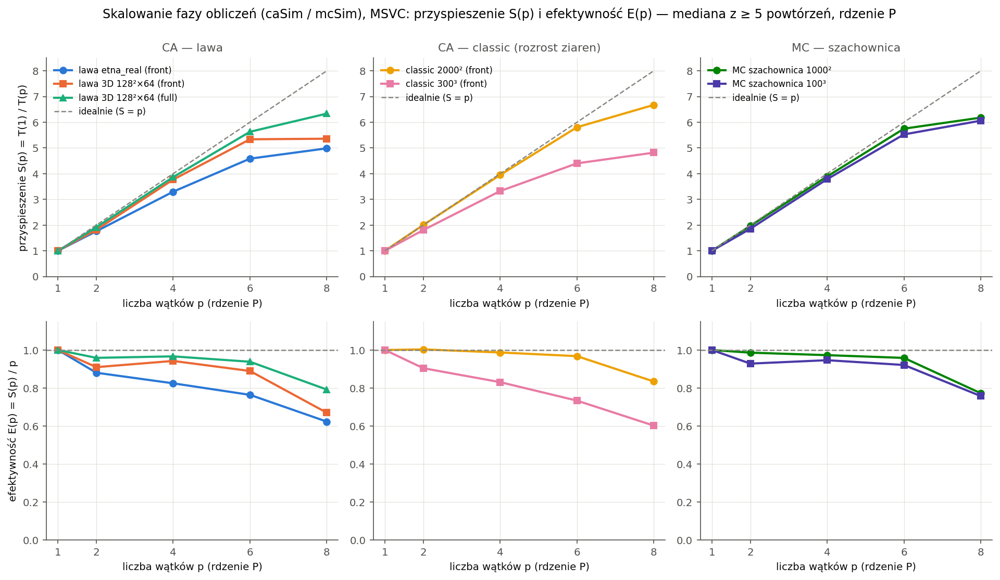
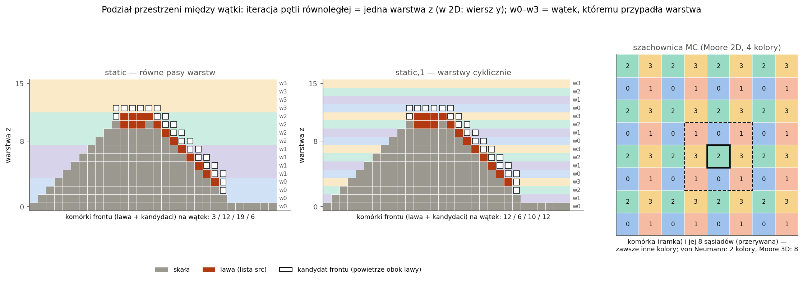
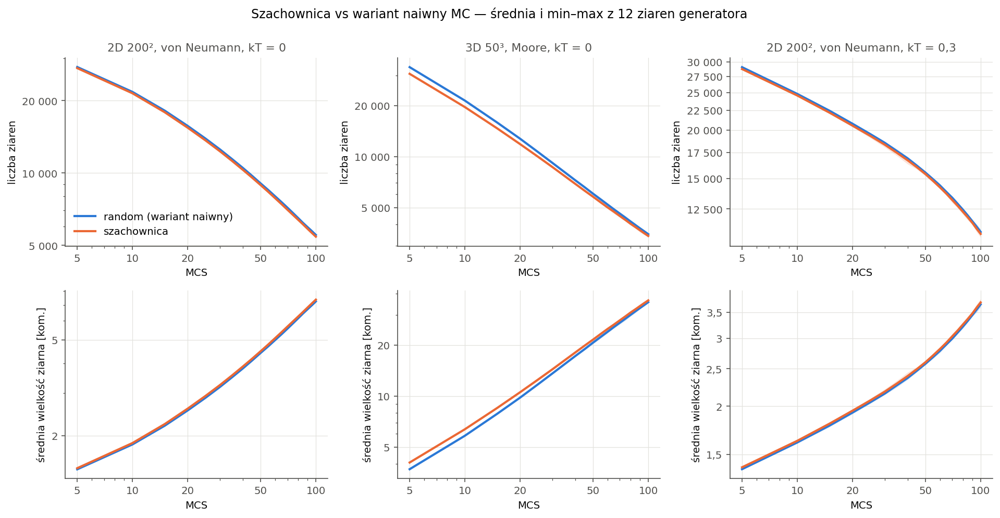
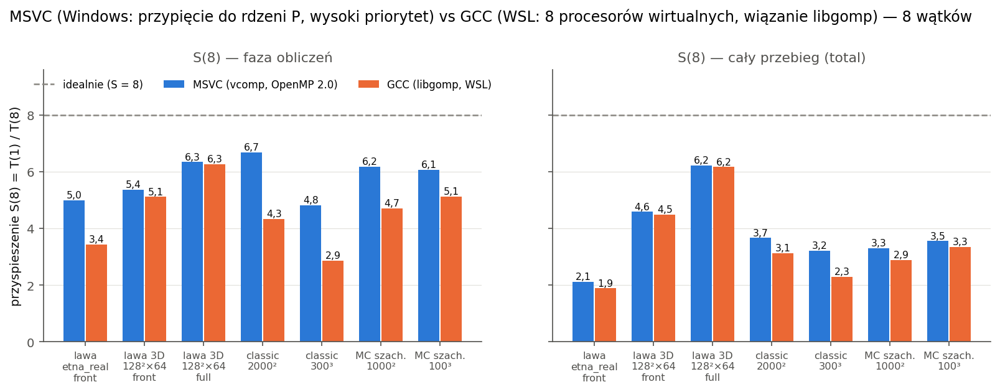
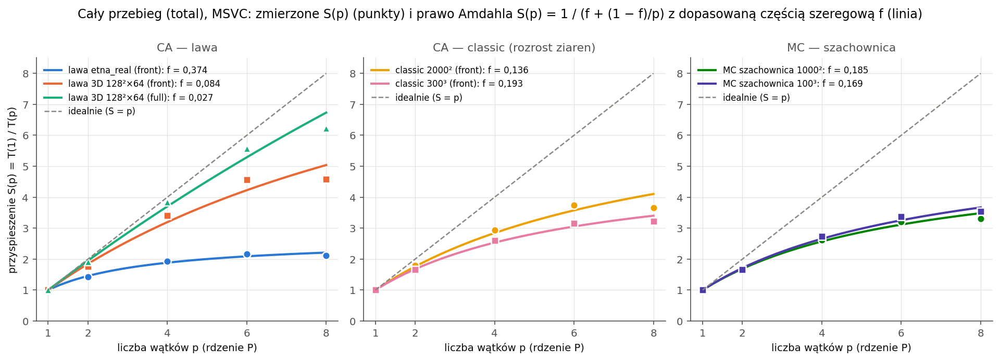
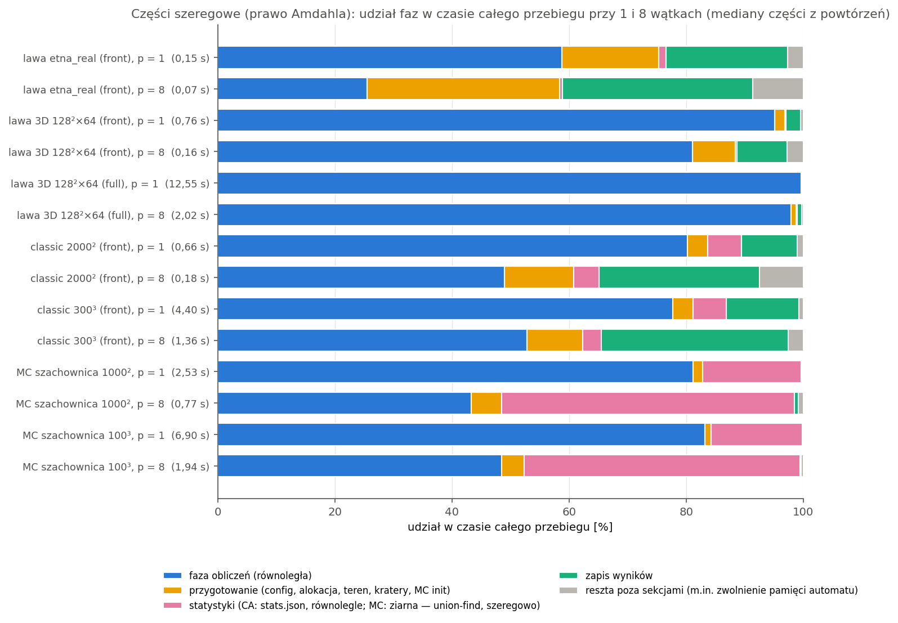
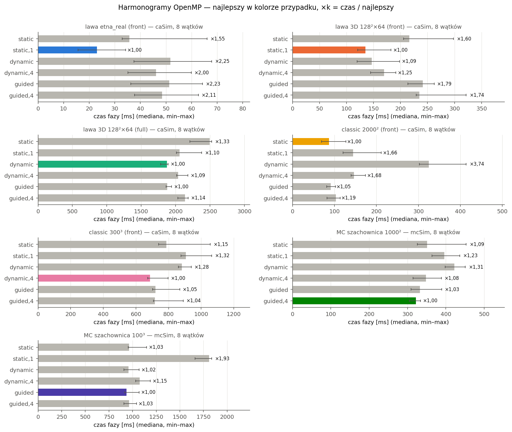
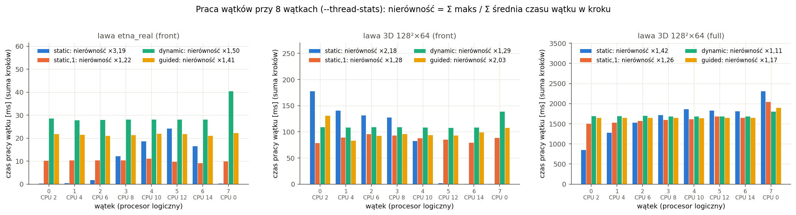

# Etap 9 — zrównoleglenie w OpenMP

Silnik (CA i MC) liczy na wielu wątkach w pamięci współdzielonej: przestrzeń jest dzielona na **warstwy z**
(w przekroju 2D — wiersze y), a każda warstwa jest w danej fazie kroku liczona w całości przez jeden wątek. To ten sam
podział, który w etapie 10 (MPI) przejdzie na procesy. Trzy zasady:

- **Poprawność ponad wszystko.** Przy 1 wątku wynik jest **bitowo identyczny** z programem po etapie 8, a CA — także
  przy każdej liczbie wątków i każdym harmonogramie. Monte Carlo ma nowy tryb **szachownicy** (`mc.update =
  checkerboard`), który w swoim trybie daje ten sam wynik dla 1, 2, 3, 4 i 8 wątków. Jego zgodność z wariantem naiwnym
  sprawdza walidacja statystyczna.
- **Pomiary tylko na rdzeniach wydajnych (P), najwyżej 8 wątków, jeden wątek na rdzeń fizyczny.** Program uruchamiamy
  z wysokim priorytetem, przy procesorze bez turbo (tryb oszczędny z etapu 8). Każde powtórzenie każdej liczby wątków
  jest porównywane bitowo z wynikiem 1 wątku.
- **Część szeregowa jest mierzona osobno** (przygotowanie terenu, statystyki ziaren, zapis) — to ona ogranicza
  przyspieszenie całego przebiegu (prawo Amdahla).

**Wynik w skrócie** (MSVC, 8 wątków na 8 rdzeniach P; S = T(1)/T(8), E = S/8; „faza” = sama faza obliczeń `caSim`
albo `mcSim`, „cały” = cały przebieg `total`; punkt 5):

| Przypadek | T(1) faza | T(8) faza | S(8) faza | E(8) faza | S(8) cały |
|---|---|---|---|---|---|
| lawa 3D 128² × 64, pełny przebieg (`full`) | 12,49 s | 1,97 s | **6,34** | 0,79 | 6,22 |
| CA classic 2000², automat frontalny | 530 ms | 79 ms | **6,67** | 0,83 | 3,66 |
| MC szachownica 1000² | 2,06 s | 0,33 s | **6,18** | 0,77 | 3,30 |
| MC szachownica 100³ | 5,74 s | 0,95 s | **6,06** | 0,76 | 3,55 |
| lawa 3D 128² × 64, automat frontalny (`front`) | 718 ms | 134 ms | 5,36 | 0,67 | 4,59 |
| CA classic 300³ | 3,41 s | 0,71 s | 4,82 | 0,60 | 3,22 |
| lawa `etna_real` (Etna, 1,8 mln komórek) | 85 ms | 17 ms | 4,98 | 0,62 | **2,12** |

Sama faza obliczeń przyspiesza 4,8–6,7× przy 8 wątkach. Cały przebieg przyspiesza mniej: w MC statystyki ziaren
(union-find) są sekwencyjne, a w `etna_real` przygotowanie terenu i zapis to ~40% czasu jednego wątku. Szachownica jest
też **3,3–4,0× szybsza od wariantu naiwnego już przy 1 wątku**, bo przegląda komórki po kolei zamiast losowych adresów
(punkt 3.3). Razem z 8 wątkami faza MC 1000² liczy się 25× krócej niż wariant naiwny w jednym wątku (8,3 s → 0,33 s).

## 1. OpenMP w projekcie

### 1.1 MSVC: `/openmp` (OpenMP 2.0), nie `/openmp:llvm`

MSVC ma dwie implementacje OpenMP:

- **`/openmp`** — OpenMP 2.0 (makro `_OPENMP` = 200203), biblioteka `vcomp140` z pakietu redystrybucyjnego Visual C++.
  Ograniczenia: indeks pętli równoległej musi być typu ze znakiem, nie ma `collapse`, zadań (`task`)
  ani `omp_set_schedule()`.
- **`/openmp:llvm`** — OpenMP 3.1+, biblioteka `libomp140`. W Visual Studio 17.8 leży ona tylko w katalogu
  `debug_nonredist`, więc program nie dałby się rozpowszechniać bez kopiowania biblioteki „debug”.

Mikrotest narzutu (`bench/micro/omp_overhead.cpp`, 8 wątków; „krok” = region + 3 pętle `omp for` po 64 iteracje + 2 bariery):

| | `/openmp` (vcomp) | `/openmp:llvm` (libomp) |
|---|---|---|
| region równoległy | 3–4 µs (6,5 µs z przypięciem) | 71 µs, ~300 µs z przypięciem wątków |
| krok, `static` / `dynamic` / `guided` | 15,6 / 164 / 138 µs | — |
| stabilność | 5000 regionów, wątki puli trwałe | **drugi przebieg zawiesił się** (przerwany po 2 min) |

**Wybór: `/openmp`.** Kod jest zgodny z OpenMP 2.0:

- indeks pętli to `std::ptrdiff_t`;
- harmonogramu z configu nie da się przekazać przez `schedule(runtime)` (w 2.0 brak `omp_set_schedule`), więc funkcja
  `ompFor()` (`engine/src/parallel/Omp.hpp`) wybiera jeden z sześciu wariantów dyrektywy
  (`static`/`dynamic`/`guided`, z porcją i bez) instrukcją `switch`.

Opcja CMake `VOLCANO_MSVC_OPENMP_LLVM=ON` buduje wariant `/openmp:llvm` tylko do porównań. GCC (WSL, g++ 11) używa
libgomp (OpenMP 4.5) i tego samego kodu.

### 1.2 Budowanie z OpenMP i bez

- Opcja CMake **`VOLCANO_OPENMP`** (domyślnie ON) włącza `find_package(OpenMP)`. Z OFF albo w kompilatorze bez OpenMP
  powstaje ten sam program w jednym wątku: zastępcze `omp_get_thread_num()`, `omp_get_wtime()` itd. są w jednym
  nagłówku `Omp.hpp`, a dyrektywy stoją w `#ifdef _OPENMP`, więc nie ma ostrzeżeń `-Wunknown-pragmas`.
- `--threads 8` w takim buildzie wypisuje ostrzeżenie „program zbudowano bez OpenMP” i liczy w jednym wątku.
- Wszystkie buildy (MSVC Release i Debug, GCC Release, GCC bez OpenMP) przechodzą bez ostrzeżeń (`/W4`, `-Wall -Wextra`).

### 1.3 Konfiguracja i linia poleceń

| Ustawienie | Znaczenie |
|---|---|
| `parallel.threads` | liczba wątków; **domyślnie 1** (kod sekwencyjny jak w etapie 8, bez regionów OpenMP); 0 = `omp_get_max_threads()` |
| `parallel.schedule` | `static` / `dynamic` / `guided` — podział warstw (pasów) między wątki |
| `parallel.chunk` | rozmiar porcji; 0 = domyślny OpenMP (`static` — równe ciągłe bloki, `dynamic` — 1) |
| `parallel.affinity` | `none` (o rdzeniach decyduje system) / `pcores` (jeden wątek na rdzeń fizyczny P, punkt 4.1) |
| `mc.update` | `random` (domyślny, wariant naiwny jak dotąd) / `checkerboard` (szachownica, punkt 3) |
| `--threads N` | nadpisuje `parallel.threads` |
| `--thread-stats` | czas pracy każdego wątku w każdej fazie kroku → `times.json`, sekcja `threadStats` (punkt 6) |

- `times.json` zapisuje faktyczną liczbę wątków, harmonogram, porcję, przypinanie, procesory logiczne wątków
  i wersję OpenMP, a `stats.json` — sekcję `parallel` i `mc.update`.
- Formularz GUI pokazuje nowe pola sam (z `--print-defaults`), z polskimi opisami w grupie „Równoległość (OpenMP)”.

## 2. Podział przestrzeni

### 2.1 Warstwy z jako jednostka pracy

Iteracja pętli równoległej to **jedna warstwa** (wszystkie komórki o danym z; w 2D x–y — o danym y). Harmonogram decyduje,
które warstwy dostaje wątek: `static` bez porcji — równe ciągłe pasy, `static,1` — warstwy cyklicznie, `dynamic` /
`guided` — warstwy pobierane w trakcie. Na krok przypada jeden region równoległy z fazami rozdzielonymi barierami:

| Tryb | Fazy kroku (bariera między fazami) | Co pisze faza warstwy k |
|---|---|---|
| **automat frontalny** (`front`, domyślny) | D(n) lawy → kandydaci + reguły → zmiany | D(n) komórek lawy warstwy; listy kandydatów, znaczniki i listy zmian warstwy; komórki warstwy w `cur` + ich kopie w ramce + nowa lista `src` warstwy |
| **pełny przebieg** (`full`) | ramka → D(n) → reguły | ścianę ramki (pętla po ścianach osi); D(n) komórek warstwy; komórki warstwy w buforze `next` |
| **classic** (rozrost ziaren) | jak wyżej, bez D(n) | — |

- **Kandydaci warstwy k** powstają z list `src` warstw k − 1..k + 1. Te listy w fazie reguł się nie zmieniają (zmienia
  je dopiero faza zmian po barierze), więc wyszukiwanie kandydatów i reguły są jedną fazą.
- **Reguły czytają tylko `cur`** (stan z początku kroku), więc kolejność warstw nie ma znaczenia.
- **Kopie w ramce periodycznej** (`Boundary::syncCell`) to różne komórki ramki dla różnych komórek wnętrza, bez konfliktu
  między wątkami.
- **Liczniki kroku** (lawa, powietrze, zmiany; reguła „krok bez zmian”) są sumowane przez `reduction(+)` na liczbach
  całkowitych, więc suma nie zależy od kolejności.

### 2.2 Dlaczego wynik CA nie zależy od liczby wątków

- **Losowość z położenia, nie z generatora ze stanem:** `hashRand(seed, krok, globalIndex, sól)` daje dla komórki tę samą
  liczbę niezależnie od tego, który wątek i kiedy ją liczy.
- **Synchroniczny automat:** pełny przebieg ma dwa bufory (`cur` → `next`). Automat frontalny ma jeden bufor i listy
  zmian, stosowane do `cur` dopiero po regułach wszystkich warstw (bariera).
- **Warstwa w całości u jednego wątku, tą samą funkcją:** nawet kolejność elementów list jest taka sama jak przy
  1 wątku. Dlatego historia liczników w `stats.json` i dalszy przebieg automatu (który zależy od kolejności list) są
  bitowo te same.
- **Każda faza pisze tylko elementy swojej warstwy** i czyta stan z początku kroku albo wynik poprzedniej fazy, oddzielonej
  barierą.

Przy 1 wątku krok idzie zwykłymi pętlami **bez regionów OpenMP** — to ścieżka z etapu 8 (punkt 7). Funkcje frontu dostają
zakres warstw: 1 wątek — jedno wywołanie na wszystkie warstwy, wiele wątków — wywołanie na warstwę.

### 2.3 Co jeszcze liczy się równolegle, a co zostało sekwencyjne

| Część | Wątki | Uwagi |
|---|---|---|
| kroki CA (front, full, classic) | tak | punkt 2.1 |
| ramka (`Boundary::applyWith`) | tak | ściany osi po kolei, bariera po osi (narożniki ramki biorą kopie poprzednich osi) |
| wpisanie terenu do siatki, stan początkowy, listy frontu przed 1. krokiem | tak | warstwy |
| kopia wyniku do `Microstructure` (sekcja `save`) | tak | wiersze |
| statystyki CA `stats.json` (nowa sekcja `caStats`) | tak | sumy na wątek, łączenie: suma liczników, maksimum zasięgu |
| MC: szachownica, energia całkowita, mapa kryształów | tak | punkt 3 |
| wczytanie mapy wysokości, wypełnianie zagłębień (priority-flood) | **nie** | kolejka priorytetowa — z natury sekwencyjna; `etna_real` 12 ms |
| alokacja siatki | **nie** | `etna_real` 9 ms, classic 300³ 121 ms |
| kratery / zarodki | nie | generator ze stanem (`mt19937_64`) — liczone raz |
| MC: etykiety ziaren (union-find) | **nie** | statystyki MC (głównie etykiety) przy `statsEvery` 10: 0,43 → 0,39 s (MC 1000², 1 → 8 wątków), 1,07 → 0,92 s (MC 100³) |
| zapis plików wynikowych | nie | ograniczony dyskiem (classic 300³: 351 MB, 0,43–0,54 s) |

Statystyk CA wcześniej nie było w żadnej sekcji czasu. Wykres części szeregowych pokazał dużą „resztę poza sekcjami”
(classic 2000² przy 8 wątkach ~30%), z której wyszła nowa sekcja `caStats` i jej zrównoleglenie (classic 2000²:
38 → 7 ms przy 8 wątkach).

## 3. Monte Carlo — szachownica

### 3.1 Dlaczego nowy tryb

Wariant naiwny (`mc.update = random`) losuje komórkę i od razu zmienia jej orientację. Każda zaakceptowana zmiana wpływa
na następne próby, więc kolejność prób definiuje trajektorię i pętli nie da się podzielić między wątki bez zmiany wyniku.
Tryb **`mc.update = checkerboard`**:

- komórki są podzielone na **kolory** tak, że żadne dwie komórki jednego koloru nie są sąsiadami w żadnym wariancie
  używanego sąsiedztwa:
  - von Neumann — 2 kolory (parzystość x + y + z);
  - Moore — 4 kolory w 2D i 8 w 3D (parzystość każdej współrzędnej osobno);
  - sąsiedztwa losowe pentagonalne i heksagonalne mieszczą się w Moore, więc dostają kolory Moore;
  - przy osi periodycznej o nieparzystej długości ostatnia warstwa osi jest trzecią klasą, bo inaczej komórki
    x = 0 i x = nx − 1 (sąsiadki przez ramkę) miałyby ten sam kolor;
- **1 MCS = kolory po kolei**, a w kolorze każda komórka domeny dokładnie raz. Próba komórki czyta tylko sąsiadów
  innych kolorów, w tej fazie niezmiennych. Komórki koloru dzielą się między wątki po warstwach, z barierą po kolorze;
- losowość z `hashRand(seed, MCS, globalIndex, sól)`, więc **wynik nie zależy od liczby wątków ani harmonogramu**;
- domena `basalt` i mobilność ze stygnięcia działają bez zmian: komórka spoza domeny nie próbuje, a mobilność decyduje,
  czy próba w ogóle się odbywa.

Poprawność kolorów (żadne dwie komórki jednego koloru nie są sąsiadami — wszystkie sąsiedztwa, 2D i 3D, osie parzyste
i nieparzyste, periodyczne) i ten sam wynik dla 1, 2, 3, 4 i 8 wątków sprawdzają testy `engine/tests/test_parallel.cpp`.

### 3.2 Walidacja statystyczna względem wariantu naiwnego

Szachownica to inny, deterministyczny porządek prób, więc nie ma dawać tej samej trajektorii, tylko **tę samą kinetykę
rozrostu ziaren**. `bench/mc_validation.py` porównuje oba tryby dla 12 ziaren generatora (100 MCS):

| Przypadek | liczba ziaren po 100 MCS | t Welcha | wykładnik wzrostu n (random / szachownica) | współczynnik akceptacji |
|---|---|---|---|---|
| 2D 200², von Neumann, kT = 0 | −1,7% | −9,3 | **0,660 / 0,660** | +0,4% |
| 3D 50³, Moore, kT = 0 | −2,3% | −5,1 | 0,806 / 0,777 (−3,6%) | −0,7% |
| 2D 200², von Neumann, kT = 0,3 | −1,1% | −3,0 | **0,405 / 0,406** | −0,2% |

(n — średnia wielkość ziarna ~ MCS^n dla MCS 20–100; pełna tabela z energią i przedziałami ufności:
[`bench/results/omp/mc_walidacja.md`](../bench/results/omp/mc_walidacja.md).)

- **Różnice 1–2,4% są istotne statystycznie** (|t| 3–9). Szachownica jest o kilka MCS „przed” wariantem naiwnym, bo
  każda komórka dostaje w MCS dokładnie jedną próbę. W wariancie naiwnym (losowanie ze zwracaniem) ~37% komórek
  (1/e) w danym MCS nie dostaje żadnej próby, a inne dostają kilka. Część prób „przepada”, więc rozrost jest nieco
  wolniejszy na jednostkę czasu.
- **Kinetyka jest ta sama:** w 2D identyczny wykładnik wzrostu (0,660 i 0,405–0,406) i współczynnik akceptacji (±0,7%).
  W 3D Moore wykładnik szachownicy jest o 3,6% niższy (różnica istotna). To różnica między dwoma procesami losowymi,
  nie błąd (wynik szachownicy jest bitowo ten sam dla każdej liczby wątków, a kolory są sprawdzone testem).
  Prawdopodobna przyczyna: w 3D jest 8 kolorów w ustalonej kolejności, więc w jednym MCS komórka zawsze widzi sąsiadów
  z tych samych 0–7 wcześniejszych kolorów już zmienionych, a w procesie z losową kolejnością — przypadkową część
  sąsiadów. Dłuższe przebiegi (więcej MCS) pokazałyby, czy różnica wykładnika maleje.
- Trzeci przypadek ma kT = 0,3, bo pierwsza próba z kT = 0,5 była powyżej temperatury przejścia modelu Pottsa 2D dla
  Q = 50 (kT_c = 1 / ln(1 + √50) ≈ 0,48): ziarna nie rosły (wykładnik 0,02), więc porównanie nic nie mówiło.

### 3.3 Szachownica przy 1 wątku

Ta sama siatka i liczba MCS (pomiar skalowania, MSVC, 1 wątek): MC 1000² `random` 8,32 s, szachownica 2,06 s (×4,0);
MC 100³ 18,9 s → 5,74 s (×3,3). Wariant naiwny skacze po pamięci losowo, a szachownica przegląda listę komórek koloru
warstwa po warstwie, więc procesor może pobierać dane z wyprzedzeniem. Liczba prób jest ta sama.

## 4. Przypinanie wątków i warunki pomiaru

### 4.1 Rdzenie P, jeden wątek na rdzeń fizyczny

Procesor pomiarowy (i9-13900HX) jest hybrydowy (odczyt `GetLogicalProcessorInformationEx`):

- **8 rdzeni P** (klasa wydajności 1, z SMT — procesory logiczne {0, 1}, {2, 3}, …, {14, 15});
- **16 rdzeni E** (klasa 0, bez SMT, procesory 16–31).

Przy `parallel.affinity = pcores` program bierze z każdego rdzenia P pierwszy procesor logiczny, ustawia maskę procesu
i przypina wątek i do i-tego procesora z listy **2, 4, 6, …, 14, 0** (`engine/src/parallel/Affinity.*`). Procesor 0
obsługuje część przerwań systemu, więc dostaje wątek dopiero przy 8 wątkach. Wątki puli OpenMP są trwałe (0 zmian
wątku systemu w 5000 regionów w mikroteście), więc przypięcie robi się raz.

To świadoma decyzja metodyczna:

- **rdzenie P i E mają różną wydajność**, więc wątki rozrzucone przez system na oba rodzaje zaburzałyby przyspieszenie
  i efektywność (wątek na rdzeniu E kończy fazę później, a reszta czeka na barierze);
- **drugi wątek SMT** dzieli rdzeń z pierwszym, więc nie byłby „kolejnym procesorem” w sensie prawa Amdahla;
- **8 wątków to górna granica** w trybie oszczędnym (laptop przy pełnym obciążeniu wszystkich rdzeni się restartował,
  etap 8, punkt 1.3). Rdzenie E zostają dla systemu i programów w tle.

### 4.2 Wysoki priorytet procesu

W krótszym wariancie pełnego przebiegu dużej lawy (1 wątek: `caSim` 2,8 s) 8 wątków z **priorytetem normalnym**
liczyło **9,7 s** (dwa przebiegi), a z `HIGH_PRIORITY_CLASS` — **0,38 s**. `--thread-stats` pokazało, że przy priorytecie
normalnym każdy wątek czekał ~10 ms na krok w fazie ramki. Przyczyna:

- przy 8 zajętych rdzeniach P wątek o priorytecie normalnym jest co jakiś czas wywłaszczany przez program w tle na cały
  kwant czasu systemu;
- pozostałe 7 wątków czeka wtedy na barierze, a krok ma kilka barier;
- przy 6 wątkach zostają wolne rdzenie P i problem znika.

Dlatego `bench/scaling.py` (jak `ab.py` w etapie 8) uruchamia silnik z wysokim priorytetem. GUI uruchamiało silnik
z priorytetem normalnym i w serii „OpenMP: liczba wątków” 8 wątków nie było szybsze od 6 (lawa `full`: 541 ms przy 6
i 579 ms przy 8 wątkach; MC 95 i 109 ms). Teraz GUI uruchamia zadania wielowątkowe z wysokim priorytetem — punkt 9.

### 4.3 GCC w WSL

WSL 2 to maszyna wirtualna z 8 procesorami wirtualnymi (tryb oszczędny), zgłaszanymi jako 4 rdzenie × 2 wątki SMT.
Maszyna nie mówi, na których rdzeniach fizycznych (P czy E) pracuje. Dlatego:

- wątki wiąże libgomp (`OMP_PROC_BIND=close`, `OMP_PLACES=cores`), a program ma `parallel.affinity = none`. Przypięcie
  przez program i libgomp naraz dawało przy zmianie liczby wątków regiony po kilkadziesiąt ms;
- przypinanie programu w Linuksie miało błąd, poprawiony w trakcie etapu. Z `OMP_PROC_BIND` libgomp przypina wątek główny
  do jednego procesora przed `main()`, a lista procesorów była brana z maski procesu (`sched_getaffinity`), więc
  wszystkie wątki trafiały na 1 procesor (`test_3d` full 4 wątki: 51 s). Teraz lista pochodzi
  z `/sys/devices/system/cpu/online`: najpierw pierwszy wątek SMT każdego rdzenia, potem drugie;
- **wyniki GCC są porównaniem, a główne wyniki skalowania pochodzą z MSVC.** Przy 8 wątkach na 8 procesorach wirtualnych
  nie zostaje procesor dla wątków jądra maszyny wirtualnej (punkt 5.1).

### 4.4 Metodyka — `bench/scaling.py`

- Przypadki × p ∈ {1, 2, 4, 6, 8} wątków, **naprzemiennie**: rosnąco w parzystych powtórzeniach, malejąco
  w nieparzystych.
- 5–11 powtórzeń (krótkie przypadki więcej), mediana i [min–max].
- **Po każdym powtórzeniu** wyniki wszystkich p są porównywane bitowo z wynikiem p = 1. W całym pomiarze było
  868 przebiegów i **0 różnic**.
- Miary: `total` i faza obliczeń (`caSim` / `mcSim`); S(p) = T(1)/T(p), E(p) = S(p)/p; **część szeregowa f z prawa
  Amdahla** S(p) = 1/(f + (1 − f)/p) — metoda najmniejszych kwadratów na 1/S, liniowa w f.
- `--schedules`: te same przypadki przy 8 wątkach i 6 harmonogramach. `--thread-stats`: dodatkowy przebieg na wariant
  (poza pomiarem czasu) z czasem pracy wątków.
- Tło CPU na początku i końcu każdej części. Części ≤ 10 min scala `--from-raw`. `--wsl` — ten sam skrypt w WSL
  (program i dane na ext4 maszyny wirtualnej).
- Pomiar 20.10.2026, 04:59–05:28, w 7 częściach. Komputer w tym czasie bez użytkownika, procesor bez turbo
  (95,7–97,0% taktowania bazowego pod obciążeniem). **Tło 10–15% CPU** w każdej części, bez skoków: stałe ~1,3–2,1
  procesora to usługa WMI odpytywana przez programy w tle (narzędzia producenta laptopa).

Dziennik pomiarów: [`bench/results/omp/POSTEP.md`](../bench/results/omp/POSTEP.md). Tabele:
`bench/results/omp/skalowanie_msvc.md`, `skalowanie_gcc.md`, `harmonogramy_msvc.md`, `harmonogramy_gcc.md`.

## 5. Wyniki skalowania

### 5.1 Tabela: MSVC i GCC

Mediany; faza / cały przebieg; f — część szeregowa całego przebiegu z dopasowania Amdahla:

| Przypadek | | T(1) [ms] | T(8) [ms] | S(8) | E(8) | f |
|---|---|---|---|---|---|---|
| lawa `etna_real`, front (`static,1`) | MSVC | 85,5 / 146 | 17,1 / 68,8 | 4,98 / 2,12 | 0,62 / 0,26 | 0,374 |
| | GCC | 79,1 / 128 | 23,0 / 67,8 | 3,44 / 1,89 | 0,43 / 0,24 | 0,430 |
| lawa 3D 128² × 64, 24 kratery, front (`static,1`) | MSVC | 718 / 755 | 134 / 165 | 5,36 / 4,59 | 0,67 / 0,57 | 0,084 |
| | GCC | 666 / 704 | 130 / 157 | 5,11 / 4,49 | 0,64 / 0,56 | 0,099 |
| lawa 3D 128² × 64, full (`guided`) | MSVC | 12 489 / 12 550 | 1 971 / 2 017 | 6,34 / 6,22 | 0,79 / 0,78 | 0,027 |
| | GCC | 12 227 / 12 267 | 1 953 / 1 990 | 6,26 / 6,16 | 0,78 / 0,77 | 0,031 |
| classic 2000², 400 zarodków, VN (`static`) | MSVC | 530 / 659 | 79,4 / 180 | 6,67 / 3,66 | 0,83 / 0,46 | 0,136 |
| | GCC | 491 / 636 | 113 / 203 | 4,33 / 3,13 | 0,54 / 0,39 | 0,172 |
| classic 300³, 100 zarodków, VN (`dynamic,4`) | MSVC | 3 406 / 4 396 | 707 / 1 365 | 4,82 / 3,22 | 0,60 / 0,40 | 0,193 |
| | GCC | 3 151 / 4 196 | 1 103 / 1 835 | 2,86 / 2,29 | 0,36 / 0,29 | 0,265 |
| MC szachownica 1000², VN, 100 MCS (`guided,4`) | MSVC | 2 059 / 2 532 | 333 / 768 | 6,18 / 3,30 | 0,77 / 0,41 | 0,185 |
| | GCC | 1 919 / 2 334 | 408 / 808 | 4,70 / 2,89 | 0,59 / 0,36 | 0,209 |
| MC szachownica 100³, Moore, 100 MCS (`dynamic`) | MSVC | 5 743 / 6 902 | 948 / 1 944 | 6,06 / 3,55 | 0,76 / 0,44 | 0,169 |
| | GCC | 5 273 / 6 272 | 1 029 / 1 878 | 5,13 / 3,34 | 0,64 / 0,42 | 0,170 |

Odniesienie, MC `random` przy 1 wątku (MSVC): 1000² 8 324 / 8 788 ms, 100³ 18 860 / 19 982 ms.

**GCC (WSL) skaluje gorzej niż MSVC** poza przypadkami z długim krokiem (lawa `full`, duża lawa `front` — tu oba
kompilatory dają to samo). Dwie przyczyny:

- **Procesory wirtualne.** Maszyna wirtualna nie gwarantuje, że 8 procesorów wirtualnych to 8 osobnych rdzeni P.
  Hiperwizor może je umieścić na dwóch wątkach SMT jednego rdzenia albo na rdzeniach E. Classic 2000² ma w GCC
  S(6) = 4,31, a w MSVC 5,81.
- **Przy 8 wątkach na 8 procesorach wirtualnych nie zostaje procesor dla wątków jądra** maszyny wirtualnej (np. zapis na
  dysk wirtualny 351 MB wyniku poprzedniego przebiegu). Taki wątek zabiera procesor jednemu wątkowi obliczeń, a reszta
  czeka na barierze. Classic 300³ przy p = 8 liczył się 630–703 ms, gdy szedł w powtórzeniu pierwszy, i 1 103–1 236 ms,
  gdy szedł zaraz po p = 6; mediana S(8) = 2,86 przy S(6) = 4,08.

W przypadkach z dużym zapisem albo krótkim krokiem GCC przy 8 wątkach nie przyspiesza już względem 6.

### 5.2 Co skaluje, a co nie — i dlaczego

- **Pełny przebieg lawy skaluje najlepiej** (S(8) = 6,3, E(6) = 0,94). Dużo pracy na komórkę, cała siatka w każdym kroku,
  równe fazy — to wzorzec, jak skaluje się sama siatka. f = 0,027: przygotowanie i zapis to 0,5% czasu.
- **Automat frontalny dużej lawy** skaluje do 6 wątków (S(6) = 5,34), a 8 wątków nie daje już nic (5,36). Lawa zajmuje
  kilkadziesiąt z 64 warstw, a krok frontu trwa ~2,6 ms przy 1 wątku i ~0,5 ms przy 8. Przy tak krótkim kroku
  3 bariery i nierówny podział (punkt 6) stanowią dużą część czasu.
- **`etna_real` — front za mały, żeby skalować cały przebieg.** Faza automatu przyspiesza 5× (85 → 17 ms), ale to tylko
  58% czasu przy 1 wątku. Przygotowanie terenu (mapa wysokości 12 ms, priority-flood), alokacja (9 ms) i zapis (22–30 ms)
  są sekwencyjne, więc S(8) całości = 2,1, a z dopasowania S(∞) = 1/f ≈ 2,7. Uczciwy wynik: zrównoleglenie kroków CA
  przyspiesza Etnę mniej niż etap 8 (automat frontalny: ×200).
- **Classic 2000²** — faza prawie liniowo do 6 wątków (E(6) = 0,97), cały przebieg ograniczają zapis i alokacja.
  **Classic 300³** (27 mln komórek, 351 MB wyniku) skaluje słabiej (E(8) = 0,60). Front rośnie tu do całej objętości,
  a reguła na komórkę jest prosta, więc krok jest przypuszczalnie ograniczony przepustowością pamięci (nie mierzone
  osobno). Do tego dochodzi sekwencyjny zapis 0,43 s.
- **MC szachownica** — faza 6,1–6,2× przy 8 wątkach. Cały przebieg tylko 3,3–3,6×, bo statystyki ziaren (union-find,
  sekwencyjne, co 10 MCS) zajmują przy 8 wątkach ~50% czasu (punkt 5.3).
- **Ósmy wątek daje mniej niż poprzednie** we wszystkich przypadkach (np. MC 2D: E(6) = 0,96 → E(8) = 0,77). Wątek 8 pracuje
  na procesorze 0, który obsługuje część przerwań systemu. Przy 8 wątkach nie ma też wolnego rdzenia P dla programów
  w tle, a każde ich wejście opóźnia jeden wątek i wszystkie czekają na barierze. W `--thread-stats` wątek na procesorze 0
  jest stale najwolniejszy przy tej samej pracy: MC 1000², `static,1` — 416 ms wobec 301–310 ms pozostałych wątków;
  MC 100³, `guided` — 962 wobec 725–734 ms; `etna_real`, `dynamic` — 40 wobec 28 ms.

### 5.3 Prawo Amdahla i części szeregowe

| Przypadek | f (cały przebieg) | f (sama faza) | część poza fazą przy p = 1 | S(∞) = 1/f |
|---|---|---|---|---|
| lawa `etna_real` | 0,374 | 0,080 | 0,414 | 2,7 |
| lawa 3D front | 0,084 | 0,047 | 0,050 | 11,9 |
| lawa 3D full | 0,027 | 0,024 | 0,005 | 37 |
| classic 2000² | 0,136 | 0,012 | 0,196 | 7,4 |
| classic 300³ | 0,193 | 0,082 | 0,225 | 5,2 |
| MC szachownica 1000² | 0,185 | 0,021 | 0,187 | 5,4 |
| MC szachownica 100³ | 0,169 | 0,034 | 0,168 | 5,9 |

- **f całego przebiegu ≈ część czasu poza fazą obliczeń przy 1 wątku** (kolumna „część poza fazą”). Prawo Amdahla
  dobrze opisuje cały przebieg: ograniczenie to części sekwencyjne, które wykres pokazuje wprost. Przy 8 wątkach są to:
  - w MC — statystyki ziaren: 50% czasu (1000²) i 47% (100³);
  - w `etna_real` — teren, alokacja i zapis: 63%;
  - w classic 300³ — zapis: 31%.
- **f samej fazy** (0,01–0,08) to nie „kod szeregowy”, tylko efektywne straty: bariery, nierówny podział, ósmy rdzeń.
  Dlatego krzywa Amdahla zawyża S(8) i zaniża S(6). Spadek efektywności między 6 a 8 wątkami jest większy, niż wynika
  z jednej stałej f.
- Kierunki dalszego przyspieszenia całego przebiegu: równoległe etykiety ziaren (etykiety w pasach + łączenie na
  granicach pasów — to samo przyda się w MPI), rzadsze statystyki MC (`statsEvery`), zapis binarny zamiast tekstowego
  (już domyślny w pomiarach), mapa wysokości z pliku binarnego.

## 6. Harmonogramy i nierównomierność obciążenia

Najlepszy harmonogram przy 8 wątkach (czas fazy; w nawiasie najgorszy jako krotność najlepszego):

| Przypadek | MSVC (vcomp) | GCC (libgomp) |
|---|---|---|
| lawa `etna_real`, front | **`static,1`** 23 ms (`dynamic` ×2,25) | **`static,1`** 21 ms (`static` ×2,07; `dynamic` ×1,12) |
| lawa 3D, front | **`static,1`** 135 ms (`guided` ×1,79) | **`dynamic`** 132 ms (`static,1` ×1,03; `guided` ×1,93) |
| lawa 3D, full | **`dynamic`** / `guided` 1 874 / 1 879 ms (`static` ×1,33) | **`dynamic`** 1 857 ms (`static` ×1,35) |
| classic 2000² | **`static`** 87 ms (`dynamic` ×3,74) | — |
| classic 300³ | **`dynamic,4`** 686 ms (`static,1` ×1,32) | — |
| MC szachownica 1000² | **`guided,4`** 322 ms (`dynamic` ×1,31) | — |
| MC szachownica 100³ | **`guided`** 935 ms (`static,1` ×1,93) | — |

Nierówność = Σ po krokach (maksimum czasu pracy wątku w kroku) / Σ (średnia), mierzone `--thread-stats` bez czekania na
barierach (wykres wyżej):

- **Front lawy: `static,1`.** Lawa jest skupiona w kilku warstwach (spływa po zboczu), więc równe ciągłe pasy (`static`)
  dają jednym wątkom całą pracę, a innym nic. W `etna_real` wątki z dolnymi i górnymi warstwami mają po ~0,3 ms pracy,
  a wątek środkowy 24 ms — nierówność ×3,19. Cykliczny przydział warstw rozkłada front równo (×1,22) bez kosztu
  pobierania porcji.
  - `dynamic` też wyrównuje pracę (×1,29–1,50), ale w vcomp pobranie porcji jest drogie: mikrotest — krok `dynamic`
    164 µs wobec 15,6 µs `static`. W `etna_real` każdy wątek pracuje w `dynamic` 28 ms wobec 10 ms w `static,1`.
  - W libgomp `dynamic` kosztuje 19–26 µs na krok, więc w GCC dla dużej lawy `dynamic` i `static,1` są równe.
- **Pełny przebieg: `dynamic` / `guided`.** Dolne warstwy to w większości skała (reguły od razu kończą), górne —
  powietrze, które sprawdza sąsiadów. Przy `static` wątek 0 (dół) ma 0,85 s pracy, a wątek 7 (góra) 2,31 s (×1,42).
  `dynamic` wyrównuje to do ×1,11. Krok trwa tu ~8 ms, więc koszt pobierania porcji jest pomijalny.
- **Classic 2D: `static`.** Praca na wiersz jest prawie równa, a 2000 wierszy po 1 przy `dynamic` to 2000 pobrań porcji
  na fazę — ×3,74 w vcomp. `guided` (porcje malejące) jest blisko `static` (×1,05).
- **Classic 3D: `dynamic,4`**, a `guided` i `guided,4` są w granicy 5%. Zarodki są losowe, więc warstwy mają różną
  liczbę komórek frontu. Porcje po 4 warstwy wyrównują to taniej niż `dynamic` po jednej (×1,28), a `static` jest
  o 15% gorszy.
- **MC szachownica: różnice ≤ 31%**, najlepsze `guided` / `guided,4`, a `static` jest w granicy 3–9%. Wyjątek to
  `static,1` w 3D (×1,93). Kolor Moore 3D zależy od parzystości z, więc warstwa z ma komórki tylko 4 z 8 kolorów.
  Przy `static,1` i 8 wątkach wątek t dostaje warstwy t, t + 8, t + 16, … o stałej parzystości, więc w każdym kolorze
  **połowa wątków nie ma nic do roboty**. `--thread-stats`, kolor 0: wątki 0, 2, 4, 6 — 172–188 ms, wątki 1, 3, 5, 7 —
  0 ms. W 2D (von Neumann, kolor = parzystość x + y) każdy wiersz ma komórki obu kolorów i problemu nie ma (×1,23).

Harmonogramy przypadków w pomiarze skalowania wybrano we wstępnym porównaniu (3 powtórzenia). Cichy pomiar potwierdził
wybór albo dał wynik w granicy 5% od najlepszego.

## 7. Narzut OpenMP przy 1 wątku

Test A/B (`bench/ab.py`, 13 przypadków z etapu 8, 5–15 powtórzeń): program po etapie 8 (`e8`) vs końcowy program etapu 9
(`e9`) z domyślnym `parallel.threads = 1`. Tabele: [`ab_e9_msvc.md`](../bench/results/omp/ab_e9_msvc.md),
[`ab_e9_gcc.md`](../bench/results/omp/ab_e9_gcc.md).

| Grupa | MSVC e9/e8 | GCC e9/e8 |
|---|---|---|
| cały przebieg (`total`), wszystkie 13 przypadków | ×0,989–1,014 | ×0,968–1,022 |
| CA lawa `test_3d`, `etna_real` (faza) | ×0,997 / ×1,002 | ×1,023 / ×1,035 |
| CA lawa krótka: `lava_mc_2d` (6 ms), CA w `lava_mc_3d` (63 ms) | ×1,055 / ×1,034 | ×1,023 / ×1,033 |
| CA classic (faza) | ×0,998–1,020 | ×0,961–1,001 |
| MC (faza), statystyki MC | ×0,995–1,009, ×1,00–1,01 | ×0,996–1,012, ×0,98–1,00 |

**Narzut ≤ 3% w całym przebiegu wszystkich przypadków i w fazie obliczeń przypadków dłuższych niż ~0,1 s.** W krótkich
przypadkach lawy faza CA wychodzi +2…5,5% (0,1–3 ms). To granica szumu układu kodu:

- **„huśtawka” układu kodu w MSVC.** Kilka wariantów kodu (e9d–e9g) przy tej samej ścieżce wykonania dawało narzut od
  −0,3% do +4%. Mapa linkera pokazała gorące funkcje automatu przesunięte względem linii 64 B pamięci podręcznej
  instrukcji (np. `gatherLavaCandidates` mod 64 = 0 → 48) — ten sam mechanizm co w etapie 6 (punkt 7) i etapie 8
  (punkt 3.6). Wybrany wariant (e9f) ma najmniejszy narzut w dużych przypadkach;
- **w GCC** z wyrównaniem funkcji do 64 B (`-falign-functions=64`, etap 8) narzut wynosi +2…3,5%.

Dwie **prawdziwe przyczyny** narzutu, znalezione testem A/B i usunięte:

1. **Liczniki przez referencję.** Funkcje liczące stan początkowy (`countLayers`, `scanLayer`) i próby szachownicy
   (`colorTrials`) dodawały do liczników w strukturze przekazanej przez referencję. MSVC (bez analizy aliasów według
   typów) zapisywał je wtedy do pamięci i przeładowywał wskaźniki siatki w każdej iteracji: sekcja `vents` classic 300³
   29 → 87 ms, ×3. Teraz liczniki są lokalne i dodawane na końcu — to zasada dla całego kodu gorących pętli.
2. **Wywołania funkcji na warstwę.** 80 warstw × 4 fazy × kilkaset kroków dawało w krótkiej lawie 2D +4–5%. Teraz
   funkcje frontu dostają zakres warstw: przy 1 wątku jedno wywołanie z pętlą w środku jak w etapie 8, przy wielu
   wątkach — wywołanie na warstwę.

Regionów OpenMP przy 1 wątku nie ma (ścieżka sekwencyjna). Region `num_threads(1)` kosztowałby 0,12 µs, a nawet tego
nie płacimy.

## 8. Zgodność, testy i weryfikacja

- **Zgodność bitowa wszystkich configów** (`bench/compare_results.py`, wszystkie `configs/*.json`;
  `mc_basalt` w trybie `--mc-from`):
  - [`zgodnosc_e9.md`](../bench/results/omp/zgodnosc_e9.md) — **15/15: e8 = 1 wątek = 8 wątków, MSVC i GCC** (6 programów
    i wariantów w jednej tabeli);
  - [`zgodnosc_e9_full.md`](../bench/results/omp/zgodnosc_e9_full.md) — `ca.sweep = full`, 8 wątków (MSVC `guided`,
    GCC `dynamic`): 13/13, e8 = 8 wątków w obu kompilatorach;
  - [`zgodnosc_e9_szachownica.md`](../bench/results/omp/zgodnosc_e9_szachownica.md) — `mc.update = checkerboard`, configi
    z MC: 6/6, 1 wątek = 8 wątków (`dynamic`) = 3 wątki (`guided`, porcja 2) = GCC 1 = GCC 8.
- **Pomiar skalowania i harmonogramów:** 868 przebiegów, każdy porównany bitowo z p = 1 (albo z pierwszym
  harmonogramem) — 0 różnic.
- **doctest** (`engine/tests/test_parallel.cpp`):
  - wyniki CA bitowo identyczne dla 1, 2, 3, 4 i 8 wątków i każdego harmonogramu — lawa 2D i 3D, classic VN / Moore /
    sąsiedztwa losowe, oba brzegi, ponding, `front` i `full`;
  - szachownica: ten sam wynik dla 1, 2, 3, 4 i 8 wątków; poprawność kolorów na wszystkich sąsiedztwach;
  - MSVC 119/119 przypadków (314 574 asercji).
- **Buildy:**
  - MSVC Release i GCC Release bez ostrzeżeń, `ctest` 12/12;
  - MSVC Debug bez ostrzeżeń, `ctest` 12/12;
  - GCC z `VOLCANO_OPENMP=OFF` bez ostrzeżeń, `ctest` 12/12.
- `python -m pytest gui\tests` — 100/100 po zmianach etapu, 102/102 z testami priorytetu zadań wielowątkowych
  (punkt 9).
- **ThreadSanitizer** (GCC 11, `-fsanitize=thread`, 4 wątki, małe przypadki CA i MC) — **wynik nierozstrzygający.**
  - Raportów było 66–403 na przypadek, ale każda para miejsc to dostępy rozdzielone barierą albo końcem regionu.
    Przykłady: odczyt typu komórki w regułach ↔ zapis w fazie zmian; mapa kryształów w regionie ↔ etykiety ziaren po
    regionie.
  - libgomp z WSL nie jest instrumentowana, więc TSan nie widzi synchronizacji barier — to fałszywe alarmy na granicach
    faz (Clanga z libomp/Archer w WSL nie ma).
  - Brak wyścigów potwierdzają testy bitowe (1/2/3/4/8 wątków × harmonogramy) i porównania wszystkich configów.

## 9. GUI i poprawki po drodze

- **Formularz:** grupa „Równoległość (OpenMP)” (`parallel.threads`, `schedule`, `chunk`, `affinity`) i `mc.update`
  w grupie MC, z opisami po polsku.
- **Tabela porównania:** kolumny „wątki OpenMP” i „harmonogram OpenMP”. Karta „Przebieg” pokazuje wątki, harmonogram,
  porcję, przypinanie i procesory.
- **Szablon serii „OpenMP: liczba wątków”** (`openmp_threads`): lawa `test_3d` (full) i MC szachownica 500² × 1, 2, 4,
  6, 8 wątków. Wykres porównania czas vs wątki.
  - Pierwsza próba rysowała oś X „liczba komórek”, bo `compare.js` ma listę dozwolonych osi X (`X_KEYS`). Dopisane
    `threads` i `schedule`.
- **Priorytet zadań wielowątkowych w GUI** (`gui/jobs.py`, `launch_mode()`):
  - zadanie z `parallel.threads > 1` startuje z `HIGH_PRIORITY_CLASS` (Windows). Wcześniej wysoki priorytet dostawało
    tylko zadanie przypięte do procesora;
  - zadanie wielowątkowe **nie jest przypinane do jednego procesora** nawet przy włączonym przypinaniu w kolejce, bo
    wszystkie wątki trafiłyby na jeden rdzeń. Rdzenie wątków wybiera silnik (`parallel.affinity`);
  - `threads = 0` (wszystkie procesory logiczne, także rdzenie E) zostaje przy priorytecie normalnym, żeby nie
    zagłodzić systemu;
  - log zadania zapisuje wybrany tryb. Testy: `gui/tests/test_series.py` (`launch_mode` dla 1, 2, 8 i 0 wątków;
    zadanie z 2 wątkami przy włączonym przypinaniu — bez przypięcia, wysoki priorytet, `times.json` z 2 wątkami).

  Seria „OpenMP: liczba wątków” przez kolejkę GUI po zmianie (jeden przebieg, komputer w normalnym użyciu, tło ~15%):

  | Wątki | 1 | 2 | 4 | 6 | 8 |
  |---|---|---|---|---|---|
  | lawa `test_3d` full, `caSim` [ms] — przed / po | 2 609 / 2 691 | 1 477 / 1 369 | 784 / 680 | 541 / 473 | **579 / 449** |
  | MC szachownica 500², `mcSim` [ms] — przed / po | 522 / 543 | 391 / 265 | 138 / 139 | 95 / 93 | **109 / 74** |

  Przy 8 wątkach GUI pokazuje teraz przyspieszenie zgodne z pomiarem `scaling.py` (8 wątków szybciej niż 6). Dokładne
  przyspieszenie (powtórzenia, mediany, zgodność) mierzy nadal `bench/scaling.py`.
- **Poprawki znalezione w trakcie:**
  - przypinanie w Linuksie (punkt 4.3);
  - statystyki CA bez sekcji czasu (nowa sekcja `caStats`, punkt 2.3);
  - liczniki przez referencję i wywołania na warstwę (punkt 7);
  - w skryptach pomiarowych: domyślny program dla `scaling.py --wsl` i wyjście w UTF-8 przy przekierowaniu do pliku.

## 10. Wnioski dla etapu 10 (MPI)

- **Ten sam podział, inne granice.** Warstwa z (w 2D wiersz y) jako jednostka pracy przechodzi wprost na procesy.
  Proces dostaje blok warstw [z0, z1) i po jednej warstwie **komórek brzegowych (ghost cells)** z każdej strony — to
  ramka 1 komórki, którą już mamy, tylko wypełniana z sąsiedniego procesu zamiast z warunku brzegowego.
  - Brzegi periodyczne = wymiana w pierścieniu (pierwszy i ostatni proces są sąsiadami).
  - Losowość z `hashRand(seed, krok, globalIndex)` po indeksie globalnym daje **ten sam wynik dla każdej liczby
    procesów** — test bitowy jak w tym etapie (1 proces = 3 procesy = 8 procesów = wynik sekwencyjny).
- **Co wymieniać w pełnym przebiegu i classic:**
  - po każdym kroku warstwa brzegowa `cur` (pola czytane przez reguły: typ, `flowId`, temperatura, kroki
    przybycia/zastygnięcia — 13 B na komórkę);
  - w lawie dodatkowo D(n) komórek brzegowych (reguły czytają D(n) źródeł z sąsiednich warstw): druga wymiana albo
    dwie warstwy ghost i liczenie D(n) warstwy brzegowej lokalnie;
  - liczniki kroku (reguła „krok bez zmian”) — `MPI_Allreduce` raz na krok.
- **Automat frontalny między procesami:**
  - listy są na warstwę, więc lokalne. Kandydaci warstwy brzegowej potrzebują list `src` warstwy sąsiada — wystarczy
    przesłać **tylko zmienione komórki** warstwy brzegowej (indeks + pola), bo front jest mały;
  - **nierówność obciążenia.** Ten etap pokazał, że ciągłe pasy z (`static`) dają w lawie nierówność ×2,2–3,2, a pomaga
    przydział cykliczny (`static,1`). W MPI cykliczny przydział warstw oznaczałby wymianę przy każdej warstwie. Dla lawy
    lepszy będzie więc podział wzdłuż x albo y (lawa spływa po zboczach we wszystkich kierunkach, a każdy pas x ma
    swoją część zbocza) albo pasy z o rozmiarach ważonych szacowaną pracą;
  - pełny przebieg ma przy pasach z nierówność ×1,42 (skała na dole, powietrze u góry) — tu też pomoże podział
    w poziomie.
- **Szachownica MC:** proces aktualizuje swoje komórki koloru, potem **wymiana warstwy brzegowej przed następnym
  kolorem** — 2 wymiany na MCS dla von Neumanna, 4 w 2D i 8 w 3D dla Moore'a. Wynik nie zależy od podziału, bo losowość
  idzie po indeksie globalnym. Energia całkowita — `MPI_Allreduce`. Etykiety ziaren: union-find w pasie + łączenie
  etykiet na granicach pasów (równoległe etykietowanie składowych) albo zebranie mapy na procesie 0 (dziś ~50% czasu
  przy 8 wątkach, więc warto zrównoleglić).
- **Rozsyłanie parametrów:**
  - proces 0 czyta config i rozsyła pełny JSON po scaleniu (`effective`) przez `MPI_Bcast`; każdy proces buduje `Config`
    tą samą funkcją `fromJson`;
  - teren (priority-flood, 12 ms dla Etny) i kratery (deterministyczne z ziarna) każdy proces może policzyć sam;
  - wynik: zbieranie na proces 0 albo zapis równoległy MPI-IO — pas z jest w `ca_result.bin` ciągłym fragmentem każdej
    tablicy, a pas x wymaga typu pochodnego (`MPI_Type_create_subarray`).
- **Pomiar:** jak tutaj — procesy przypięte po jednym na rdzeń fizyczny P, 1–8 procesów (w tym ≥ 3), wysoki priorytet,
  zgodność bitowa każdego powtórzenia z 1 procesem, osobno czas wymiany komórek brzegowych.

## 11. Pliki etapu

| Plik | Co |
|---|---|
| `engine/src/parallel/Omp.hpp` | `omp_*` zastępcze, `ParallelSettings`, `ompFor` (harmonogram przez `switch`), `ompBarrier` |
| `engine/src/parallel/Affinity.*` | rdzenie P (`GetLogicalProcessorInformationEx` / `/sys`), przypinanie wątków |
| `engine/src/parallel/ThreadStats.*` | `--thread-stats`: czas pracy wątków w fazach, nierówność |
| `engine/src/ca/LavaCA.hpp` | kroki `front` / `full` / classic w jednym regionie na krok, stan początkowy i teren w wątkach |
| `engine/src/core/Boundary.hpp`, `Storage.hpp` | `Boundary::applyWith` (ramka w pętli podanej z zewnątrz), `toMicrostructure` w wątkach |
| `engine/src/mc/PottsMC.*`, `app/McStage.cpp` | szachownica (`buildColors`, `colorTrials`, `sweepColors`), energia i mapa kryształów w wątkach |
| `engine/src/app/Simulation.cpp`, `Cli.*`, `Batch.cpp`, `io/Config.*`, `io/TimingReport.*` | `parallel.*`, `mc.update`, `--threads`, `--thread-stats`, sekcja `caStats`, pola w `times.json` / `stats.json` |
| `engine/CMakeLists.txt` | `VOLCANO_OPENMP`, `VOLCANO_MSVC_OPENMP_LLVM`, cel `omp_overhead` |
| `engine/tests/test_parallel.cpp` | testy bitowe 1/2/3/4/8 wątków × harmonogramy, kolory szachownicy |
| `bench/scaling.py` | pomiar skalowania i harmonogramów (S, E, Amdahl, zgodność, `--thread-stats`, `--wsl`, `--from-raw`) |
| `bench/mc_validation.py` | walidacja statystyczna szachownicy → `mc_walidacja.*`, `docs/img/etap9_mc_walidacja.png` |
| `bench/plot_etap9.py` | wykresy `docs/img/etap9_*.png` |
| `bench/micro/omp_overhead.cpp` | mikrotest: region, bariera, krok z harmonogramami |
| `bench/ab.py` | sekcja `caStats`; `parallel` i `update` w `stats.json` pomijane w porównaniu (opis liczenia, nie wynik) |
| `bench/results/omp/` | dziennik `POSTEP.md`, skalowanie, harmonogramy, A/B narzutu, zgodność, walidacja, wstępne porównanie harmonogramów |
| `gui/static/js/form.js`, `stats.js`, `compare.js`, `gui/compare.py`, `gui/series.py` | pola `parallel.*` i `mc.update`, karta „Przebieg”, kolumny i oś „wątki”, szablon serii `openmp_threads` |
| `gui/jobs.py`, `gui/tests/test_series.py` | `launch_mode()`: zadania wielowątkowe z wysokim priorytetem, bez przypięcia do jednego procesora; testy |
