# Kolejka zadań, serie, dane wejściowe

Dane wejściowe i wyjściowe, seria zadań, kolejkowanie, automatyzacja wersji serwerowej, porównanie CA vs MC.

**Stan na 10.10.2026.** Ta część domyka podstawową funkcjonalność projektu. GUI ma nową zakładkę **„Seria”**
(generator serii: config bazowy + 1–3 parametry zmienne → iloczyn kartezjański, parowanie parametrów,
gotowe szablony), rozbudowaną **kolejkę** w zakładce „Zadania” (workery, pauza, kolejność, anulowanie
serii, ponowienie, przypięcie do rdzenia P, grupowanie po serii z czasem do końca) i zakładkę
**„Porównanie”** (tabela wyników serii, wykres Chart.js z wyborem osi, eksport PNG/CSV, galeria
mikrostruktur). Wersja serwerowa dostała tryb **`engine --batch`**, a obok niego jest skrypt
**`tools/make_series.py`**: ten sam generator serii co w GUI (wspólny moduł `gui/series.py`).
Do mechanizmów wejścia/wyjścia doszły: **import mapy wysokości z CSV albo obrazu PNG/JPG**, trzy
przykładowe mapy z configami, **eksport wyniku do ZIP** i **do VTK (`.vti`, ParaView)**, eksport tabeli serii do CSV.

Algorytmy CA i MC się nie zmieniły: wyniki są bitowo identyczne z programem sprzed tych zmian (punkt 7).
Raport techniczny powstał później ([raport-1.md](raport-1.md)); razem z kolejką powstały dwa przewodniki:
**[architektura.md](architektura.md)** i **[uruchamianie.md](uruchamianie.md)**.

## 1. Funkcje → realizacja

| Funkcja | Realizacja | Gdzie (GUI / kod) |
|---|---|---|
| **Wykorzystanie aplikacji** | cała praca z projektem przez GUI: formularz albo seria → pliki configów i folderów → kolejka → podgląd 2D/3D → czasy → porównanie; to samo bez GUI: `engine --batch`, `tools/make_series.py` | wszystkie zakładki; `gui/`, `engine/src/app/Batch.*`, `tools/` |
| **Wizualizacja przykładowych mikrostruktur** | galeria miniatur przekrojów 2D wszystkich wyników serii (klik → podgląd 2D, „widok 3D” → podgląd 3D), podglądy 2D/3D z interfejsu graficznego, nowe mapy wysokości (lawa w kalderze, w kanionie, na przełęczy) | „Porównanie” → Galeria; `gui/static/js/compare.js` (`thumb()`), `GET /api/result/slice?maxSide=` |
| **Porównanie czasów CA i MC** (kilka symulacji, prosty wykres) | szablon serii „CA vs MC: rozmiar siatki” (16 zadań) policzony przez GUI; wykres czasu symulacji CA i MC vs liczba komórek (log–log, osobno 2D i 3D) + koszt jednostkowy; tabela i CSV | „Seria” → szablon, „Porównanie”; `docs/img/ca_vs_mc.png`, `docs/data/ca_vs_mc.csv`; punkt 4 |
| **Automatyzacja uruchamiania wersji serwerowej: po wygenerowaniu kilku plików zlecenie obliczeń** | „Uruchom serię”: backend najpierw zapisuje WSZYSTKIE configi `configs/gui/series/<id>/NN_<opis>.json` + `series.json` i tworzy foldery `results/gui/series/<id>/NN_<opis>/`, dopiero potem dodaje zadania do kolejki; bez GUI: `tools/make_series.py` (pliki) → `engine --batch` (obliczenia) | `gui/series.py` (`write_series`), `gui/jobs.py` (`JobManager.create_series`), `engine/src/app/Batch.*` |
| **Uruchamianie wersji serwerowej z różnymi zestawami danych** | `engine --batch <folder> --out <folder>`: każdy config w osobnym procesie, błąd jednego nie przerywa serii, `batch_summary.csv`; seria w GUI to zadania kolejki z osobnym procesem silnika | punkt 3 |
| **Mechanizmy do obsługi danych wejściowych/wyjściowych** (dane wejściowe z plików) | wejście: config z pliku (interfejs graficzny), mapa wysokości z CSV/PNG/JPG (import w GUI, walidacja z komunikatami po polsku), MC na wyniku CA z pliku (`--mc-from`, przycisk „MC” na liście wyników); wyjście: ZIP, VTK (`.vti`), CSV serii, `batch_summary.csv` | punkt 5 |
| **Kolejkowanie zadań w GUI** | kolejka: 1–16 workerów (ostrzeżenie o zaburzeniu pomiarów), pauza/wznowienie, ▲/▼ kolejność oczekujących, anulowanie zadania i całej serii, ponowienie zadania z błędem, postęp serii „X z N”, czas, szacowany czas do końca, przypięcie do rdzenia P; stan w `results/gui/jobs.json` przeżywa restart | „Zadania”; `gui/jobs.py`, `gui/static/js/jobs.js` |

## 2. Seria zadań w GUI

### 2.1 Zakładka „Seria” (generator)

Wybrałem osobną zakładkę zamiast sekcji w „Nowej symulacji”: seria ma własny config bazowy, edytor osi
i podgląd tabeli zadań, które obok długiego formularza byłyby nieczytelne.

1. **Gotowe szablony** (jeden klik ustawia config bazowy, osie, nazwę i domyślny widok wykresu):

   | Szablon | Zadania | Config bazowy | Parametry zmienne |
   |---|---|---|---|
   | **CA vs MC: rozmiar siatki** | 16 | `ca.mode = classic`, 100 zarodków, von Neumann, periodyczne; MC: Q = 50, 100 MCS; wyjście bin | rozmiar 2D {100², 200², 500², 1000²} i 3D {10³, 25³, 50³, 100³} (sparowane `space.nx, ny, nz`) × algorytm {CA: `mc.enabled = false`; MC: `mc.enabled = true, mc.domain = full`} |
   | Wpływ liczby zarodków | 8 | jak wyżej (CA classic) | rozmiar {500², 50³} × `vents.count` {1, 10, 100, 1000} |
   | Wpływ sąsiedztwa (2D) | 8 | 300×300, 100 zarodków, MC Q = 50, 100 MCS | `neighborhood` {VN, Moore, pentagonal, hexagonal} × algorytm {CA, MC} |
   | Lawa: liczba kraterów | 4 | preset `test_3d` | `vents.count` {1, 3, 5, 8} |

   Szablony są zdefiniowane w jednym miejscu (`gui/series.py`, `TEMPLATES`) i dostępne też z linii poleceń
   (`tools/make_series.py --template ca_vs_mc`).
2. **Config bazowy**: „aktualny formularz «Nowa symulacja»”, preset z `configs/`, plik JSON albo szablon.
   Pod spodem skrót (tryb, wymiary, sąsiedztwo…) i pełny JSON.
3. **Parametry zmienne (osie, 1–3).** Każda oś ma nazwę, listę kluczy configu (lista budowana z
   `engine --print-defaults`, pogrupowana jak formularz, z polskimi etykietami) i wartości: **lista**,
   **zakres** (od, do, krok) albo **potęgi** (od, do, mnożnik). Zadania to **iloczyn kartezjański** osi
   (pierwsza oś zmienia się najwolniej).

   **Parowanie w UI:** do osi dodaje się kolejny klucz z listy „+ dodaj klucz…”; wtedy oś dostaje znaczek
   „sparowane: zmieniają się razem”. Wartość pojedyncza trafia do wszystkich sparowanych kluczy
   (`100, 200` przy `space.nx + space.ny` daje siatki 100² i 200²), krotka `a;b;c` przypisuje wartości
   po kolei (`100;100;1` = 100×100×1), a `[etykieta]` nadaje nazwę punktowi (`[CA] false;basalt, [MC] true;full`).
   Ta sama składnia działa w `tools/make_series.py --vary`.
4. **Podgląd przed uruchomieniem** (odświeżany 0,35 s po zmianie, `POST /api/series/preview`): liczba zadań
   z rozkładem na osie, tabela parametrów każdego zadania (nazwa pliku `NN_<opis>`, etykiety osi, tryb, wymiary,
   szacowane kroki, czas i pamięć z heurystyki profilu aplikacji, `estimate.js`), łączny czas, największa pamięć,
   rozmiar plików, ostrzeżenia (> 50 zadań, pamięć > 2/8 GB, czas > 10 min). Błędy opisu serii (nieznany
   klucz, zła krotka, pusty zakres) są wyświetlane po polsku od razu.
5. **Uruchom serię** (`POST /api/series`): walidacja **wszystkich** configów silnikiem (`engine --validate`,
   równolegle); błąd któregokolwiek = nic nie powstaje, a komunikat wskazuje zadanie (`02_octagonal: …`);
   potem zapis wszystkich plików, potem kolejka:

   ```
   configs/gui/series/20261010-212000_ca_vs_mc/01_2D_100x100_CA.json … 16_3D_100x100x100_MC.json, series.json
   results/gui/series/20261010-212000_ca_vs_mc/01_2D_100x100_CA/ … 16_3D_100x100x100_MC/, series.json
   ```

   Każdy config zawiera metadane w kluczu `_series` (silnik pomija klucze `_`), a `series.json` opis serii,
   osie, config bazowy, domyślny widok wykresu i listę zadań ze ścieżkami. Dzięki temu folder serii da się
   policzyć ponownie bez GUI: `engine --batch configs/gui/series/<id> --out results/gui/series/<id>`.
   Przy szablonach pomiarowych panel przypomina o 1 workerze i przypięciu (przycisk „Ustaw 1 worker + przypięcie”).

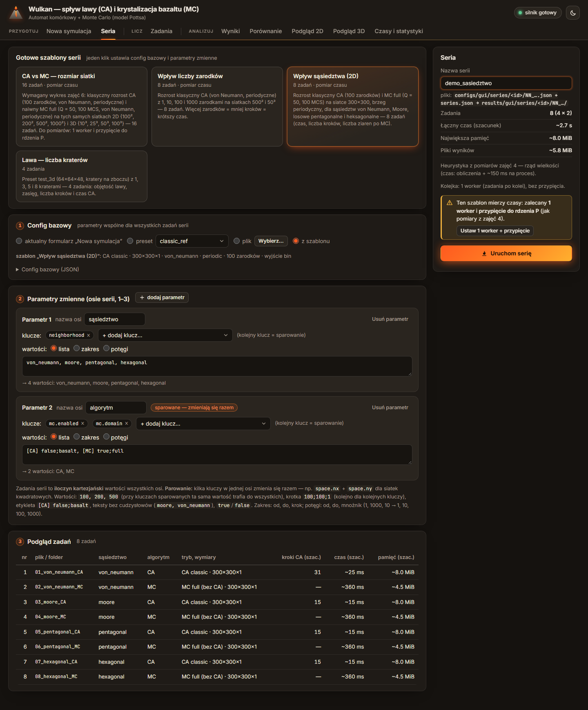
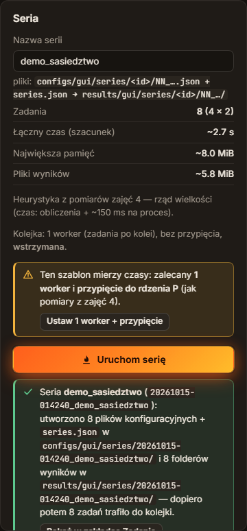

### 2.2 Kolejka zadań (zakładka „Zadania”)

| Funkcja | Działanie | Kod |
|---|---|---|
| liczba workerów | lista 1…16 (1 = „po kolei”); zmiana działa od razu: nowe wątki startują, nadmiarowe kończą się po bieżącym zadaniu. Przy > 1: ostrzeżenie, że równoległe zadania zaburzają pomiary (wspólne L3, pasmo pamięci, limit mocy) | `JobManager.set_workers()` |
| pauza / wznowienie | działające zadania kończą się normalnie, nowe nie startują | `pause()`, `resume()` |
| kolejność oczekujących | ▲ / ▼ przy zadaniu (API także `top`, `bottom`); pozycja „w kolejce (#3)” | `move()` |
| anulowanie | zadania (usunięcie z kolejki albo zabicie procesu) i **całej serii** (przycisk w nagłówku grupy) | `cancel()`, `cancel_series()` |
| ponowienie | zadanie z błędem / anulowane / przerwane wraca na koniec kolejki (ten sam config i folder) | `retry()` |
| przypięcie | „przypnij silnik do rdzenia P + wysoki priorytet”: worker i → procesor logiczny `pinCpus[i mod n]` (domyślnie 2, 4, 6…, rdzenie P i9-13900HX; `gui/settings.json` → `pinCpus`), na Windows `HIGH_PRIORITY_CLASS`, jak pomiary profilu aplikacji; numer CPU w wierszu zadania i w `engine.log` | `_pin_process()` |
| grupowanie po serii | nagłówek grupy: pasek postępu, „X z N gotowe · działa · oczekuje · błąd”, łączny czas, **szacowany czas do końca**, foldery serii, „Porównanie”, „Anuluj serię”; grupy można zwijać | `jobs.js` |
| filtr statusu | wszystkie / aktywne / oczekuje / działa / gotowe / błąd / anulowane / przerwane | `jobs.js` |
| trwałość | `results/gui/jobs.json` w wersji 2: zadania + `queue` (pauza, workery, przypięcie, **kolejność oczekujących**); po restarcie „działa” → „przerwane”, oczekujące wracają w zapisanej kolejności | `_load()`, `_save()` |

**Czas do końca serii** = Σ szacunków pozostałych zadań (heurystyka z profilu aplikacji + ~150 ms na start procesu)
× współczynnik „czas rzeczywisty / szacunek” z już policzonych zadań serii, podzielone przez liczbę
workerów; bez szacunków średni czas zadania × liczba pozostałych. Heurystyka bywa kilkukrotnie od prawdy,
a współczynnik koryguje ją po pierwszych zadaniach (na zrzucie: „6 z 8 gotowe · do końca ~137 ms”).

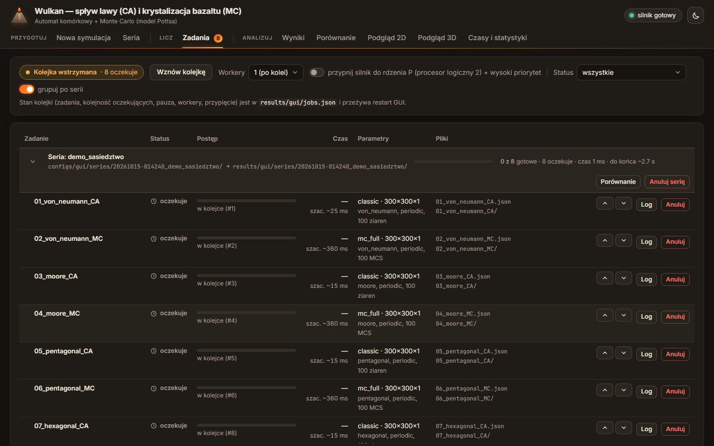


### 2.3 Nowe endpointy

| Metoda i adres | Opis |
|---|---|
| `GET /api/queue`, `POST /api/queue` | stan kolejki; `{paused?, workers?, pin?: {enabled, cpus}}` |
| `POST /api/jobs/{id}/move`, `/retry` | `{direction: up\|down\|top\|bottom}`; ponowienie |
| `GET /api/series/templates` | szablony (osie w zapisie tekstowym, config bazowy, liczba zadań) |
| `POST /api/series/preview`, `POST /api/series` | `{spec, estimates?}` → lista zadań bez zapisu / zapis + kolejka |
| `GET /api/series`, `POST /api/series/{id}/cancel` | serie z GUI i ich postęp; anulowanie serii |
| `GET /api/compare/sources`, `GET /api/compare?series=`, `POST /api/compare {ids}` | serie do porównania, tabela serii, tabela dowolnych wyników |
| `GET /api/compare/csv?series=`, `POST /api/compare/csv` | to samo jako CSV |
| `GET /api/heightmaps`, `GET /api/heightmaps/data?file=`, `POST /api/heightmaps` | lista map, wartości mapy (miniatura), import CSV/obrazu |
| `GET /api/result/zip?id=`, `GET /api/result/vtk?id=&format=` | ZIP folderu wyniku, plik `.vti` |

Identyfikatory wyników mają teraz do 4 członów (`gui/series/<seria>/<zadanie>`), a lista wyników przeszukuje
`results/` do tej głębokości (serie z GUI i foldery po `engine --batch`). Ochrona przed wyjściem poza
`results/` i `configs/heightmaps/` jak wcześniej (testy).

## 3. Automatyzacja bez GUI (wersja serwerowa)

### 3.1 `engine --batch <folder_z_configami> --out <folder_wyników>`

```
engine --batch configs\gui\series\20261010-212000_ca_vs_mc --out results\seria_cli [--set k=w]… [--progress]
```

- Bierze wszystkie `*.json` z folderu **w kolejności nazw**, pomija `series.json` (opis serii z generatora)
  i pliki `_*.json`; `--set`, `--grid` i `--timing-detail` dotyczą wszystkich przebiegów.
- **Każdy config w osobnym procesie silnika** (`engine --config <plik> --out <out>/<nazwa>`; ścieżka programu
  z `GetModuleFileNameW` / `/proc/self/exe`, uruchomienie `CreateProcessW` / `posix_spawn`, kod systemowy
  w `#ifdef` w `core/ChildProcess.*`). Powód: szczyt pamięci procesu (`PeakWorkingSetSize`, `ru_maxrss`)
  jest monotoniczny: w jednym procesie kolejny przebieg „widziałby” szczyt poprzedniego, a `times.json` ma
  opisywać jeden przebieg (profil aplikacji); awaria jednego przebiegu nie kończy serii; wyniki i czasy są takie
  same jak przy ręcznym uruchomieniu (sprawdzone `cmp`, punkt 7).
- Wyjście programu każdego przebiegu → `<out>/<nazwa>/engine.log` (ten sam format co w GUI).
- **Błąd jednego configu nie przerywa serii**: trafia do podsumowania (ostatnia linia „Błąd…” z logu).
- `<out>/batch_summary.csv` jest zapisywany od nowa **po każdym przebiegu** (przerwana seria też ma podsumowanie):
  `name, status (ok|error), exitCode, error, mode, nx, ny, nz, cells, grid, neighborhood, boundary, seeds, steps,
  stopReason, mcs, Q, domainCells, readConfig … total` (wszystkie sekcje `times.json`), `wallMs` (czas procesu
  mierzony przez `--batch`), `peakRssBytes, peakPrivateBytes, modelPeakBytes`, rozmiary `ca_result.txt/.bin`,
  `mc_result.txt/.bin`, `outputBytes, compiler, build, config, outDir`.
- Konsola: linia po każdym przebiegu i tabela na końcu; `--progress` dodaje `PROGRESS batch i/N`.
- **Kod wyjścia 5**, gdy któryś przebieg zakończył się błędem (0: wszystkie OK).

Przykład (test dymny `cli_smoke_batch`: folder z poprawnym i błędnym configiem oraz `series.json`):

```
=== Seria (--batch): 2 configi z build/smoke/batch_in -> "build/smoke/batch out" ===
[1/2] a_ok                         ok    caSim 0.8 ms  (0.07 s)
[2/2] b_zly                        BŁĄD  Błąd konfiguracji: Parametr „neighborhood” ma nieprawidłową wartość "octagonal"; …
config  status    kroki    MCS   caSim [ms]   mcSim [ms]   total [ms]  pamięć [MiB]
a_ok    ok           19      —          0.8            —          2.5           5.2
b_zly   BŁĄD
Razem: 2 przebiegi: 1 ok, 1 z błędem; czas serii 0.08 s
```

Kod: `engine/src/app/Batch.hpp/.cpp` (`BatchRunner::collect`, `run`, `summaryRow`, `runFromCli`),
`engine/src/core/ChildProcess.hpp/.cpp`, opcja w `app/Cli.*`, `main.cpp`. Testy: `engine/tests/test_batch.cpp`
(5 przypadków: parser, kolejność i pomijanie plików, podsumowanie z funkcją testową zamiast procesu,
**prawdziwy program** z poprawnym i błędnym configiem w folderze ze spacją i polskimi literami, cytowanie
argumentów Windows) + test dymny ctest `cli_smoke_batch`.

### 3.2 `tools/make_series.py`: ten sam generator co GUI

Skrypt używa modułu `gui/series.py` (bez FastAPI) i **nie kopiuje logiki**: iloczyn kartezjański, parowanie,
zakresy, potęgi, nazwy `NN_<opis>.json`, `series.json` i szablony są wspólne z zakładką „Seria”.
Najpierw zapisuje wszystkie configi (`configs/series/<id>/`) i foldery (`results/series/<id>/`), a z `--run`
zleca obliczenia `engine --batch`, po czym wypisuje tabelę porównania (`gui/compare.py`) i zapisuje
`porownanie.csv`. `--cpu 2` przypina proces skryptu do rdzenia P; `engine --batch` i jego przebiegi dziedziczą maskę.

```
python tools/make_series.py --list-templates
python tools/make_series.py --template ca_vs_mc --run --cpu 2
python tools/make_series.py --template ca_vs_mc --name ca_vs_mc_mala --run --cpu 2 --vary "rozmiar:space.nx,space.ny,space.nz=[2D_100x100] 100;100;1, [2D_200x200] 200;200;1, [2D_500x500] 500;500;1, [3D_10x10x10] 10, [3D_25x25x25] 25, [3D_50x50x50] 50"
python tools/make_series.py --base configs/classic_ref.json --set space.nz=1 --vary "space.nx,space.ny=100, 200" --pow "vents.count=1:100:10" --dry-run
```

Mniejsza wersja serii CA vs MC (12 zadań, oś „rozmiar” zastąpiona krótszą listą: trzecie polecenie wyżej)
policzona tak bez GUI tuż po pomiarze z punktu 4.2: 12/12 ok, 3,0 s; wyniki zgodne z serią z GUI (500²: CA 192 ms /
MC 1 138 ms wobec 197 / 1 199 ms w GUI; 50³: 22,7 / 634 ms wobec 22,8 / 678 ms). Folder:
`results/series/20261010-212355_ca_vs_mc_mala/` (`batch_summary.csv`, `porownanie.csv`, `series.json`). Seria z linii poleceń pojawia się też w zakładce
„Porównanie” (źródło „tools/make_series.py”).

## 4. Wyniki serii i wykres CA vs MC

### 4.1 Zakładka „Porównanie”

- **Źródło:** seria z GUI, seria z linii poleceń (folder z `series.json` albo samo `batch_summary.csv` po
  `engine --batch`) albo **dowolne zaznaczone wyniki**; wtedy parametry zmienne są wykrywane z
  `config_used.json` (klucze, których wartości się różnią).
- **Tabela** (`gui/compare.py` czyta tylko `times.json`, `stats.json`, `config_used.json`): osie serii,
  status (także „oczekuje / działa / błąd” z kolejki), algorytm (CA / MC / CA+MC), wymiar, komórki, kroki CA,
  MCS, `caSim`, `mcSim`, czas symulacji, `save`, `total`, **koszt jednostkowy** (CA: ns/(komórka·krok),
  MC: ns/próbę), szczyt pamięci, model pamięci, B/komórkę, pliki, objętość i zasięg lawy, ziarna CA i po MC;
  zestawy kolumn (czasy / pamięć i pliki / statystyki / wszystkie), sortowanie, **eksport CSV**.
- **Wykres (Chart.js 4.4.1):** X (komórki, nx, zarodki, kroki, MCS, sąsiedztwo, algorytm, wymiar, oś serii,
  dowolny parametr liczbowy), Y (jedna miara, nigdy dwie osie Y), serie (np. algorytm), osobne wykresy
  (np. 2D i 3D), log X / log Y; dla kategorii na osi X słupki. Kolor należy do wartości serii (CA ma ten sam
  kolor w obu panelach), paleta kategoryczna projektu (`palette.js`, sprawdzona walidatorem: 2–4 serie
  przechodzą próg rozróżnialności dla daltonistów; identyfikację wspierają legenda z kreską w kolorze serii,
  podpowiedź z nazwą zadania i tabela). Od nowego wyglądu interfejsu: CA = lawa, MC = chłodny fiolet, CA+MC = turkus, stałe kolory
  w Porównaniu i w Czasach, inne podziały: paleta kategoryczna motywu ([wyglad-interfejsu.md](wyglad-interfejsu.md)). Na osiach log podpisy tylko przy 1, 2 i 5 × 10ᵏ.
  **Eksport PNG** skleja panele w jeden obraz z tytułem. Domyślny widok z `series.json` → `chart`;
  dla „CA vs MC”: **czas symulacji CA i MC vs liczba komórek, log–log, osobno 2D i 3D**.
- **Galeria mikrostruktur:** miniatury przekrojów wszystkich wyników (2D: płaszczyzna siatki; 3D classic / MC:
  środkowa warstwa z; 3D lawa: przekrój pionowy przez środek), pole automatycznie (kryształ MC / ziarno CA),
  do wyboru typ / flowId / kryształ. Backend wysyła przekrój próbkowany do 160 komórek na dłuższym boku
  (`GET /api/result/slice?maxSide=160`), kolory jak w podglądzie 2D. Klik → podgląd 2D, „widok 3D” → podgląd 3D.
- Seria w trakcie liczenia odświeża się co 3 s.

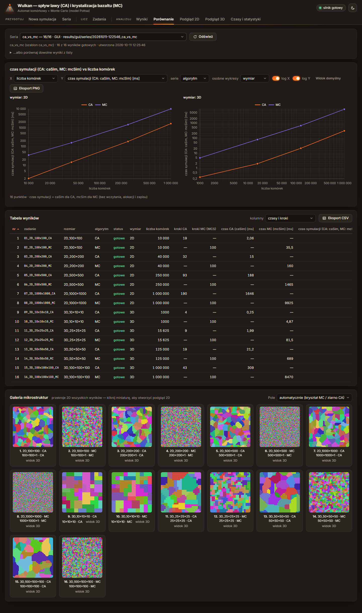

### 4.2 Wynik: czas symulacji CA i MC (szablon „CA vs MC: rozmiar siatki”, policzony przez GUI)

Warunki: MSVC Release, **1 worker**, proces silnika **przypięty do procesora logicznego 2 (rdzeń P)**,
priorytet wysoki; seria `results/gui/series/20261010-212000_ca_vs_mc` (10.10.2026, 16/16 gotowe, 21,4 s).
Obie wielkości to czas samej symulacji z `times.json` (CA: `caSim`, MC: `mcSim`; bez wczytania, alokacji,
zapisu i statystyk MC). Skrypt `gui/tests/run_ca_vs_mc.py` przechodzi ten scenariusz w Chromium (te same
kliknięcia co ręcznie) i eksportuje wykres i CSV przyciskami GUI.

**Tło w czasie pomiaru:** przed uruchomieniem skryptu 7,4–10,0% całego CPU (psutil, 3 × 4 s), bez gier i dużych
programów: zamknięte programy działające w tle (np. narzędzie producenta laptopa, które wysyłało prawie wszystkie
zapytania WMI stale zajmujące `WmiPrvSE.exe` ~2 procesory logiczne; ślad w dzienniku *WMI-Activity*).
Skrypt zapisał w `ca_vs_mc_meta.json` 13,2% przed i 13,0% po serii; ten odczyt robi już po starcie własnego
serwera GUI i Chromium, więc obejmuje też je (python ~0,25 procesora), Defendera skanującego nowe procesy
(~0,7) i `WmiPrvSE` (~1,0–1,3; usługa narzędzia producenta działała dalej).

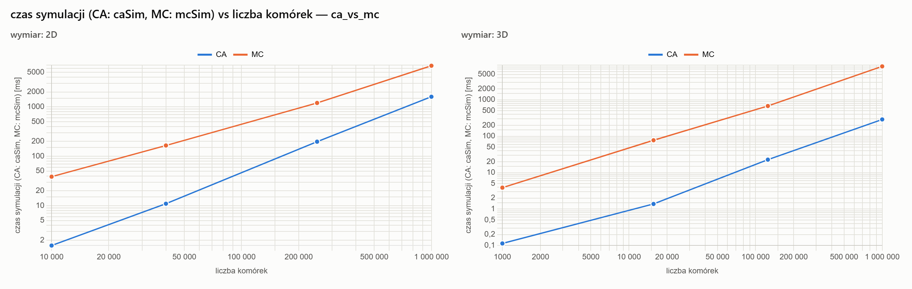

| Siatka | Komórki | Kroki CA | CA `caSim` [ms] | MC `mcSim` [ms] (100 MCS) | MC / CA | CA ns/(kom·krok) | MC ns/próbę | Szczyt RSS CA / MC [MiB] |
|---|---|---|---|---|---|---|---|---|
| 100×100 | 10 000 | 19 | 1,6 * | 38,6 | 25 | 8,2 | 38,6 | 6,0 / 5,5 |
| 200×200 | 40 000 | 32 | 11,0 | 165 | 15 | 8,6 | 41,2 | 8,6 / 7,1 |
| 500×500 | 250 000 | 93 | 197 | 1 199 | 6,1 | 8,5 | 47,9 | 26,9 / 18,0 |
| 1000×1000 | 1 000 000 | 190 | 1 602 | 6 789 | 4,2 | 8,4 | 67,9 | 92,3 / 54,5 |
| 10×10×10 | 1 000 | 4 | 0,1 * | 3,9 * | (34) | (28,5) | 38,8 | 5,1 / 5,2 |
| 25×25×25 | 15 625 | 9 | 1,4 * | 77,6 | 56 | 9,8 | 49,7 | 5,7 / 5,7 |
| 50×50×50 | 125 000 | 19 | 22,8 | 678 | 30 | 9,6 | 54,2 | 10,1 / 10,1 |
| 100×100×100 | 1 000 000 | 43 | 290 | 8 306 | 29 | 6,7 | 83,1 | 43,9 / 46,5 |

\* < 5 ms: zaszumione (dokument „Profil aplikacji”, punkt 1.3). Pełne dane: `docs/data/ca_vs_mc.csv`, warunki: `docs/data/ca_vs_mc_meta.json`.

**Powtarzalność:** te same configi uruchomione bezpośrednio (bez GUI), przypięte do CPU 2, 3 razy: MC 1000²
6,49–6,69 s, MC 100³ 7,46–7,58 s, CA 1000² 1,51–1,52 s; seria przez GUI jest o 5–10% wolniejsza (obok pracują
serwer GUI i Chromium skryptu). Wyniki (`ca_result.bin`, `mc_result.bin`, `stats.json`, `mc_stats.csv`) są
bitowo identyczne z poprzednimi przebiegami tej serii, różnią się tylko czasy.

Wnioski:
- **MC jest 4–56× wolniejsze od CA na tej samej siatce.** Krok CA to jedno przejście po komórkach w kolejności
  pamięci (7–10 ns na komórkę), krok MCS to N losowych dostępów, dwa przejścia po sąsiadach i kilka hashy na
  próbę (39–83 ns). Do tego MC robi zawsze 100 MCS, a CA kończy po 4–190 krokach.
- **W 2D przewaga CA maleje z rozmiarem** (25× → 4×): liczba kroków CA rośnie jak bok siatki (19 → 190), więc
  czas CA rośnie jak N^1,52 (nachylenie log–log z 4 punktów; teoretycznie N^1,5), a MC jak N^1,12 (stała liczba
  MCS × koszt próby rosnący przez chybienia pamięci podręcznej). **W 3D stosunek maleje wolniej** (56× → 29×, dla
  50³ i 100³ stały ~30×): kroki CA rosną tylko jak N^(1/3) (9 → 43), nachylenie CA 1,28 (teoretycznie 4/3),
  MC 1,12 (bez punktu 10³).
- **Koszt jednostkowy pokazuje, że różnica to nie tylko liczba kroków:** CA kosztuje stałe ~8–10 ns/(komórka·krok)
  niezależnie od rozmiaru (przejście sekwencyjne, prefetcher), a próba MC drożeje z 39 do 68 ns (2D) i do 83 ns (3D),
  gdy dane (orientacje + listy domeny, ~20 B/komórkę) przestają mieścić się w L2/L3: losowy wybór komórki to
  losowy dostęp do pamięci. Wykres „koszt jednostkowy” w GUI: miara „koszt jednostkowy (CA: ns/kom./krok, MC: ns/próbę)”.
- Pamięć: MC full ma mniejszy szczyt niż CA classic w 2D (54,5 vs 92,3 MiB dla 1000²), bo CA w 2D trzyma ramkę
  w nieużywanej osi z (dokument „Profil aplikacji”, punkt 2.2); w 3D podobnie (~44–47 MiB dla 10⁶ komórek).
- **MC jest dużo wrażliwsze na obciążenie komputera niż CA.** Poprzedni przebieg tej serii (`20261010-031315_ca_vs_mc`,
  tło 35–42% CPU: gra i inne programy w tle, `WmiPrvSE`) dał identyczne wyniki, ale czasy CA dłuższe 1,1–1,7×, a MC 1,5–2,8×
  (najwięcej dla największych siatek: MC 1000² 19,1 s zamiast 6,8 s, 100³ 18,8 s zamiast 8,3 s), więc MC/CA dla
  1000² wychodziło 8,2 zamiast 4,2. Przypięty rdzeń P nie jest współdzielony, ale L3, pamięć i limit mocy laptopa
  tak, a sekwencyjne CA korzysta z prefetchera, podczas gdy MC czeka na każdy losowy odczyt z pamięci.
  Do porównań czasów MC (także przy dalszej optymalizacji) potrzebny jest wolny komputer.
- Zgodność z profilem aplikacji (punkt 3.3, MSVC, przypięte, mediana z 3): CA 1000² 1 602 vs 1 663 ms, CA 100³ 290 vs 299 ms,
  MC 200² 165 vs 164 ms, w granicach kilku procent. Duże MC jest teraz szybsze niż w profilu (1000² 6,8 vs 10,5 s,
  100³ 8,3 vs 10,9 s); tamten pomiar był robiony przy tle 15–26% ze stałym `WmiPrvSE`, który najmocniej spowalnia
  właśnie MC. Punktu odniesienia profilu nie przeliczam (zasada: pomiary odniesienia się nie nadpisuje); porównania
  przed/po optymalizacji trzeba robić w tych samych warunkach.
- Pomiar powtarza się poleceniem `python gui/tests/run_ca_vs_mc.py` (≈ 25 s na wolnym komputerze).

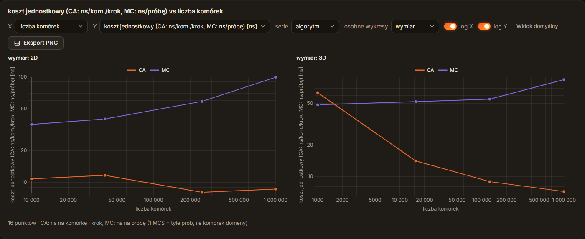

**Wpływ sąsiedztwa** (szablon, 300×300; policzony też bez GUI na wolnym komputerze, przypięty:
`python tools/make_series.py --template neighborhood --run --cpu 2`): CA classic 36–50 ms (40–60 kroków; Moore
najszybszy: najmniej kroków), MC 371–544 ms (pentagonalne i von Neumann najtańsze, Moore i heksagonalne, z większą liczbą
sąsiadów na próbę, najdroższe); w GUI wykres słupkowy (oś X kategoryczna; zrzut z przebiegu `screenshots.py`):

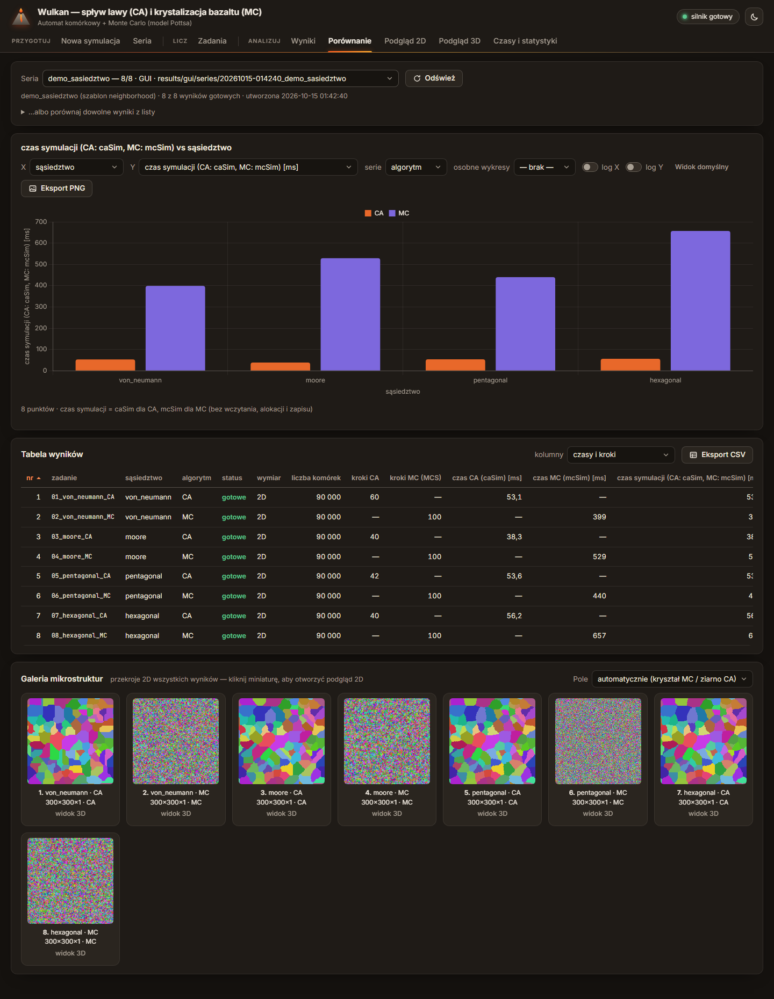

### 4.3 Galeria

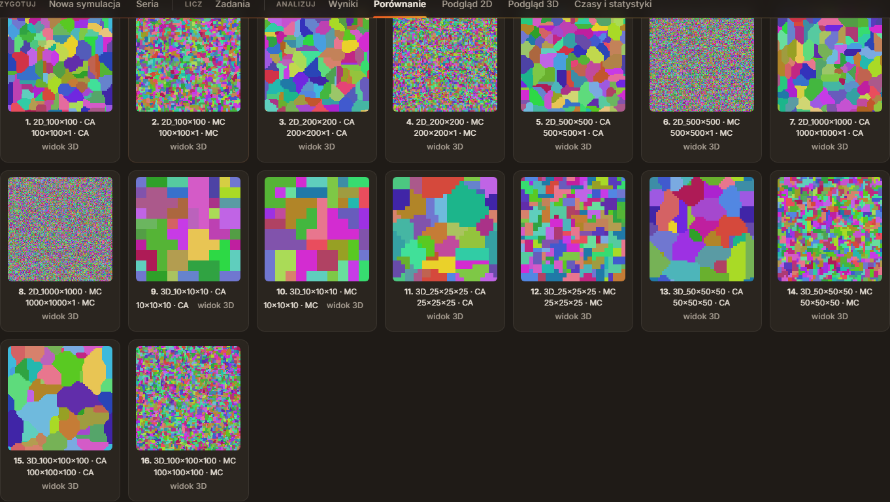

Rozrost CA tworzy duże, wypukłe ziarna (100 zarodków), MC po 100 MCS drobne ziarna z wielu orientacji
(Q = 50), coraz drobniejsze względem siatki przy większych rozmiarach (MC zgrubia w stałym tempie na MCS).

## 5. Mechanizmy danych wejściowych i wyjściowych

### 5.1 Wejście

**Mapa wysokości z pliku w GUI** (karta „Mapa wysokości terenu” w „Nowej symulacji”):
- lista map z `configs/heightmaps/` z miniaturą (jasne = wyżej, północ u góry, jak rzut z góry w podglądzie 2D);
  wybór ustawia `terrain.type = file`, `terrain.file` i `space.nx × ny` z mapy, a `nz` podnosi do najwyższego
  punktu + 15 komórek, jeśli było za małe; „stożek z generatora” wraca do `terrain.type = cone`;
  niezgodne wymiary siatki i mapy są zgłaszane przy mapie;
- **import CSV**: sprawdzenie formatu tymi samymi regułami co silnik (`HeightmapLoader.cpp`), opcjonalnie
  przeskalowanie do nx × ny z formularza;
- **import obrazu PNG / JPG** (także BMP, GIF, WEBP, TIFF; 8 i 16 bitów) w odcieniach szarości; backend
  (`gui/heightmap.py`, Pillow): jasność 0..1 (luminancja dla obrazów kolorowych) → wysokość
  `podstawa + jasność · (wysokość maks. − podstawa)`, opcje: odwróć, rozciągnij zakres jasności,
  wygładzanie (3 przebiegi filtra pudełkowego ≈ Gauss), skalowanie do nx × ny (interpolacja dwuliniowa
  z wygładzeniem przy zmniejszaniu), przycięcie do [0, nz]; zapis `configs/heightmaps/<nazwa>.csv`
  z komentarzem o źródle (istniejący plik nie jest nadpisywany: `-2`, `-3`…).

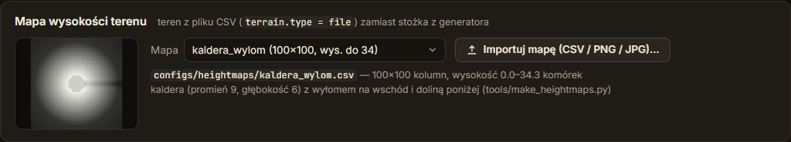
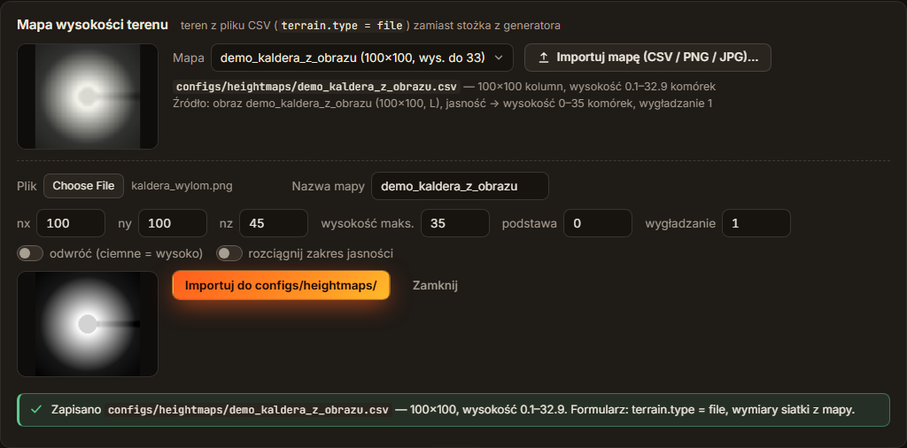

**Walidacja wejścia: komunikaty po polsku** (sprawdzane w `gui/tests/test_heightmap.py`):

| Błąd | Komunikat (przykład) |
|---|---|
| zły format CSV | `mapa.csv, wiersz 2, kolumna 2: „x” nie jest liczbą` |
| nierówne wiersze | `mapa.csv, wiersz 2: 1 wartości, a wiersz 1 ma 2 — mapa musi mieć tyle samo wartości w każdym wierszu (nx)` |
| wysokość ujemna / pusty plik | `…: wysokość ujemna (-2)`, `…: brak wierszy z liczbami (plik pusty albo same komentarze „#”)` |
| złe wymiary (config ≠ mapa) | silnik (`--validate`): `Mapa wysokości configs/heightmaps/x.csv, wiersz 3: 40 wartości, oczekiwano nx = 41` (formularz pokazuje to także przy wyborze mapy) |
| za duży obraz | `obraz.png: obraz 6000×5000 = 30.0 Mpx jest za duży (maksimum 25 Mpx) — zmniejsz go przed importem` |
| nie-obraz / uszkodzony | `…: to nie jest obraz PNG ani JPG (albo plik jest uszkodzony)` |
| za duża mapa wynikowa | `Mapa 3000×3000 ma więcej niż 4 000 000 komórek` |

**Przykładowe mapy** (`tools/make_heightmaps.py`, deterministyczne; CSV + obraz PNG w skali szarości,
który służy też za przykład do importu obrazu) i configi:

| Mapa / config | Teren | Wynik (MSVC Release) |
|---|---|---|
| `kaldera_wylom.csv` / `heightmap_kaldera.json` (+ MC) | kaldera r = 9, głęb. 6, **wyłom** w krawędzi na wschód i dolina | lawa wypełnia kalderę i wypływa **tylko przez wyłom** doliną na wschód; rozwiązuje znany problem „krater szczytowy przelewa się równo na wszystkie strony” (dokument „Automat komórkowy: spływ lawy i rozrost ziaren”, punkt 6); 234 kroki, 1 511 komórek lawy, zasięg 41 |
| `kanion.csv` / `heightmap_kanion.json` | stożek z kraterem r = 4 i **krętym kanionem** (głęb. 5) na południowy wschód | lawa przelewa się z krateru do kanionu i płynie jego dnem do brzegu mapy: wąski jęzor zamiast wachlarza; 254 kroki, 234 komórki |
| `podwojny_wulkan.csv` / `heightmap_podwojny.json` | główny stożek + niższy starszy stożek na NE, obniżona krawędź i rynna w stronę przełęczy | lawa spływa na przełęcz, a starszy stożek **rozdziela strumień** na dwa jęzory po swoich bokach; 214 kroków, 1 134 komórki |

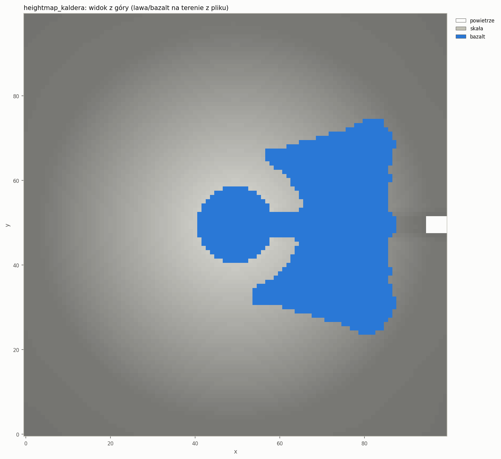
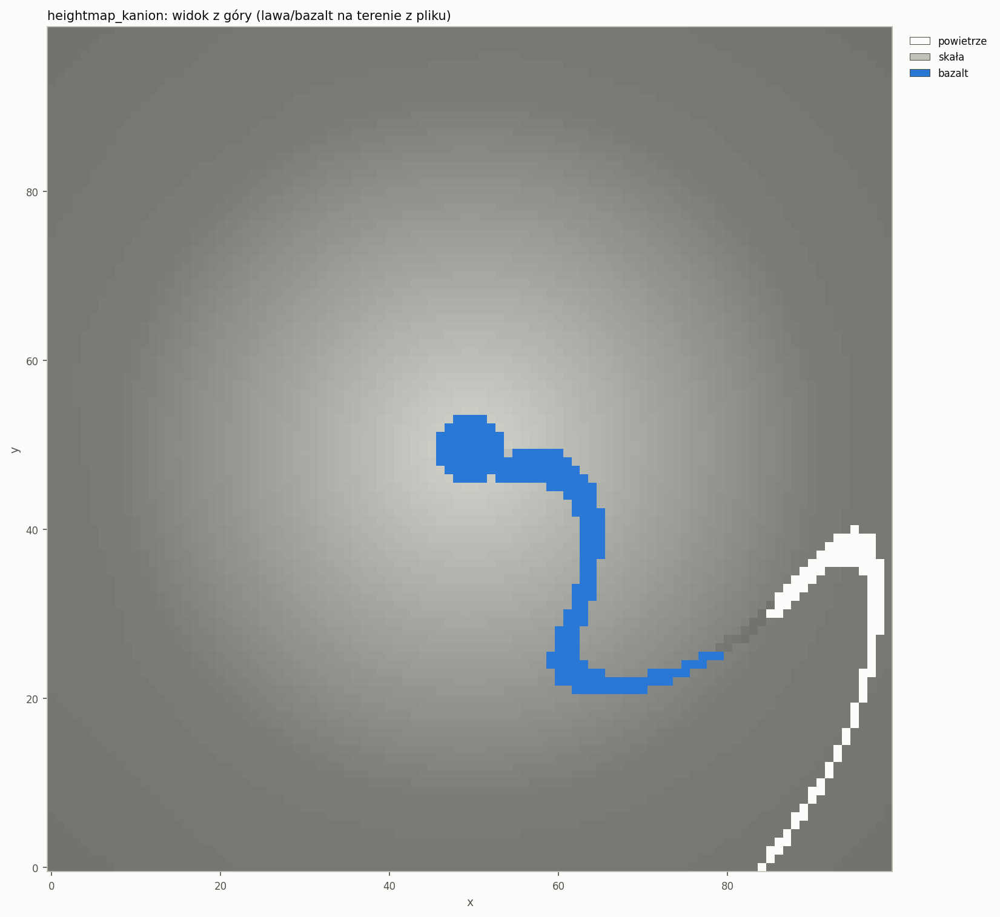
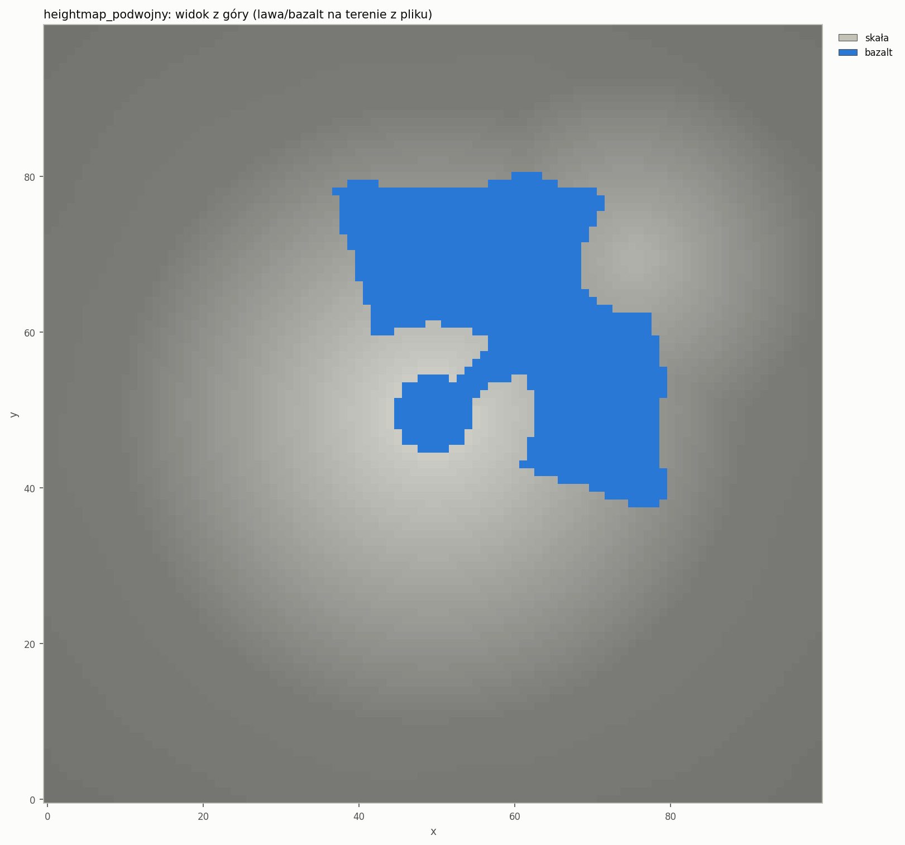

Przekrój pionowy przez wyłom kaldery (y = 49), kryształy MC: jezioro lawy w kalderze, przelew przez wyłom
i warstwa na zboczu doliny:

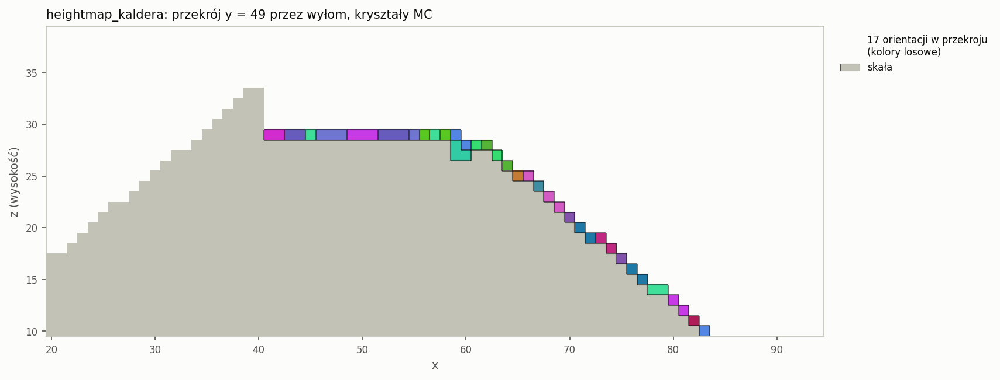
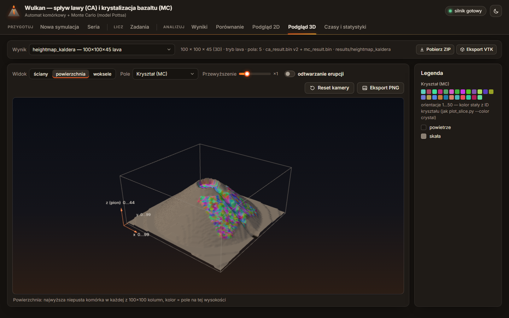

**MC z pliku wyniku CA (`--mc-from`)**: w GUI dwa wejścia: pole „Źródło danych” w „Nowej symulacji”
(z opisem: wymiary i bazalt z `ca_result.bin`, parametry MC z formularza) i nowy przycisk **„MC”** przy wynikach
lawy na liście „Wyniki” (ustawia preset `mc_basalt` i źródło danych jednym kliknięciem).

### 5.2 Wyjście

- **ZIP** (przycisk „ZIP” w „Wynikach”, „Pobierz ZIP” nad podglądami; `GET /api/result/zip`): cały folder wyniku
  (`config_used.json`, `ca_result.*`, `mc_result.*`, `times.json`, `stats.json`, `mc_stats.csv`, `engine.log`,
  `gui_job.json`, `snapshots/`), deflate, plik tymczasowy usuwany po wysłaniu.
- **VTK ImageData (`.vti`)**: format wymiany z zewnętrznymi narzędziami (ParaView, VisIt, biblioteka VTK):
  siatka `nx × ny × nz` wokseli (`WholeExtent 0..nx × 0..ny × 0..nz` w punktach), wartości jako **pola komórek**
  (`CellData`): `type` (UInt8), `flowId` (Int32), `temp` (Float32), `solidStep`, `arrivalStep`, `cooling`
  (UInt16) i `crystal` (Int32). Kolejność komórek VTK (x najszybciej) = kolejność w plikach `.bin`, więc tablice
  idą bez przestawiania, warstwami (memmap nie trafia cały do RAM). Kodowanie: **zlib** (domyślne; base64,
  bloki 64 KiB, wyniki to głównie zera), **binary** (base64 bez kompresji) albo **ascii** (do 2 mln komórek).
  Przycisk „VTK” w GUI (`GET /api/result/vtk`) i `python tools/export_vtk.py <folder> [--format …]`
  ten sam kod (`gui/export.py`).

  | Wynik | zlib | binary | ascii |
  |---|---|---|---|
  | `lava_mc_3d` (320 tys. komórek, 7 pól) | 61 KB | 8,1 MB | 5,8 MB |
  | `etna_3d` (1,8 mln komórek, 6 pól) | 158 KB || 36 MB | brak ||

  **Sprawdzenie:** test `gui/tests/test_export.py` czyta plik zwykłym parserem XML (nagłówki UInt64, base64,
  bloki zlib) i porównuje każde pole z danymi źródłowymi (3 kodowania). Dodatkowo czytnik VTK z ParaView 5.13.2
  (`pvpython`, `vtkXMLImageDataReader`) wczytał pliki `lava_mc_3d`, `mc_full_2d`, `etna_3d` we wszystkich
  kodowaniach: wymiary 81×81×51 punktów / 320 000 komórek, nazwy i typy pól, zakresy i sumy kontrolne
  (np. `crystal` 0–50, suma 110 874; `temp` suma 3 424 610) identyczne z danymi z plików `.bin`.
  W ParaView: *File → Open* → `.vti` → *Apply*, kolor wg `crystal` albo `flowId`, filtr *Threshold* `type ≥ 2`
  pokazuje samą lawę i bazalt.
- **CSV wyników serii**: „Eksport CSV” w „Porównaniu” (`index, name, <osie>, <parametry>, status, algorithm, …`),
  `porownanie.csv` z `make_series.py`, `batch_summary.csv` z `engine --batch`.

## 6. Testy

| Zestaw | Co sprawdza |
|---|---|
| doctest `engine/tests/test_batch.cpp` (5 przypadków) | parser `--batch` i niedozwolone połączenia; `collect` (kolejność nazw, pomijanie `series.json`, `_*.json`, plików innych niż json, podfolderów); podsumowanie z błędem w środku serii (seria trwa dalej, statusy, komunikat z logu, kolumny CSV); **prawdziwy `engine`** jako proces potomny: poprawny + błędny + MC config w folderze `batch real ąść`, wyniki w podfolderach, `--set` dociera do przebiegów, rozmiary plików w CSV; cytowanie argumentów `CommandLineToArgvW` |
| ctest `cli_smoke_batch` | `engine --batch` na folderze z dobrym i złym configiem → „1 ok, 1 z błędem” |
| `gui/tests/test_series.py` (13) | składnia wartości (listy, krotki, etykiety, liczby, teksty), zakresy, potęgi i błędy; iloczyn kartezjański, parowanie, nazwy plików, niezmieniony config bazowy; błędy opisu serii; szablony (zapis tekstowy = punkty); `write_series`; **seria: wszystkie configi + `series.json` + foldery istnieją przed startem**, nic nie wystartowało, potem wszystkie gotowe; błędny config w serii → 422 i nic nie powstaje; kolejność (▲▼, top/bottom) i kolejność wykonania; pauza; trwałość kolejki po restarcie; anulowanie serii; ponowienie; **dwa workery naraz** i zmiana liczby workerów w trakcie; przypięcie do CPU; API serii, kolejki, listy wyników (4-członowe id), porównania i CSV |
| `gui/tests/test_heightmap.py` (5) | CSV jak silnik (komunikaty), zapis/odczyt, przeskalowanie i przycięcie; obraz → mapa: orientacja (północ = y max), odwrócenie, wygładzanie, JPG/RGB, PNG 16-bit; błędy (nie-obraz, za duży, za duża mapa); API: import, nazwa bez nadpisania, lista, dane mapy, ścieżki spoza `configs/heightmaps` → 404; **silnik przyjmuje zapisany CSV** (walidacja, symulacja), zły wymiar → komunikat silnika |
| `gui/tests/test_export.py` (7) | `.vti` w 3 kodowaniach = tablice źródłowe (także `cooling`), MC full bez CA, ZIP (cały folder, `testzip`), API ZIP/VTK; tabela porównania bez silnika (wiersze CA/MC, koszt jednostkowy, folder bez wyniku, CSV, wybrane wyniki, błędy id) |

Razem: **`pytest gui/tests`: 84 testy** (59 z interfejsu graficznego + 25 nowych), `ctest`: 12 testów w każdej konfiguracji.

## 7. Weryfikacja

Pełna weryfikacja z 10.10.2026 (wieczór), po ostatnich poprawkach (punkt 11).

| Sprawdzenie | Wynik |
|---|---|
| Build MSVC Release i Debug (`/W4`, czysta przebudowa) | **0 ostrzeżeń**; `ctest` 12/12 w obu |
| Build GCC 11.4 Release i Debug (WSL, `-Wall -Wextra`, czysta przebudowa) | **0 ostrzeżeń**; `ctest` 12/12 w obu (w tym prawdziwy `--batch` przez `posix_spawn`) |
| `pytest gui/tests` | **84 passed** (~11 s), także z `-W default` bez ostrzeżeń |
| Wyniki bitowo identyczne jak przed zmianami | program sprzed zmian (MSVC, zachowany przed zmianami) vs nowy MSVC: `ca_result.bin/.txt`, `mc_result.bin/.txt`, `mc_stats.csv`, `stats.json`, `config_used.json` dla `test_2d`, `lava_mc_2d`, `mc_full_2d`, `classic_ref`: 20 plików identycznych (`cmp`); `engine --batch` = uruchomienie bezpośrednie (te same 20 plików); GCC = MSVC: pliki `.bin` identyczne, tekstowe identyczne poza końcami linii (CRLF na Windows); seria CA vs MC: 56 plików wyników identycznych z przebiegiem sprzed kilku godzin |
| Pełna seria „CA vs MC” przez GUI | 16/16, 21,4 s, 1 worker, CPU 2, wykres i CSV wyeksportowane przyciskami GUI (`gui/tests/run_ca_vs_mc.py`, punkt 4.2) |
| Mniejsza seria bez GUI | `tools/make_series.py --template ca_vs_mc --vary … --run --cpu 2` → `engine --batch`: 12/12, 3,0 s; szablony `seeds` 8/8, `neighborhood` 8/8 |
| Konsola przeglądarki | `gui/tests/screenshots.py` (scenariusze interfejsu i kolejki, dwa przebiegi) i przejście demo z `uruchamianie.md` §8 w Chromium: brak błędów i ostrzeżeń JS |
| Polecenia z `uruchamianie.md` §2–7 | uruchomione i działają (PowerShell, Git Bash, WSL z PowerShella, start GUI trzema sposobami); bez instalacji programów, `run_profile.py --full --gcc` i profilerów (oznaczone w tekście) |
| `.vti` w ParaView | `pvpython` (ParaView 5.13.2): zgodne wymiary, pola i sumy kontrolne (punkt 5.2; sprawdzone przy tworzeniu eksportu, kod `gui/export.py` od tego czasu bez zmian) |

## 8. Decyzje i odstępstwa

- **Seria w GUI liczy się przez kolejkę GUI, nie przez `engine --batch`.** Kolejka daje postęp każdego
  zadania, anulowanie, kolejność, pauzę i wiele workerów; `--batch` jest dla wersji serwerowej bez GUI.
  Struktura folderów jest ta sama, więc folder serii z GUI można policzyć `--batch` (i odwrotnie: wynik
  `--batch` z `series.json` widać w „Porównaniu”).
- **`--batch` uruchamia osobny proces na config** (uzasadnienie w 3.1), a nie pętlę w jednym procesie.
- `series.json` i pliki `_*.json` są pomijane przez `--batch`; pozwala to trzymać opis serii obok configów.
- **Kod wyjścia 5** dla serii z błędem (nowy; 0–4 bez zmian).
- Pillow doszedł do `gui/requirements.txt` (dekodowanie PNG/JPG). Był już zależnością pośrednią matplotlib;
  bez niego GUI działa, a import obrazu zgłasza „zainstaluj Pillow”.
- Domyślne CPU do przypinania (2, 4, 6…) są dobrane do i9-13900HX (profil aplikacji); na innym komputerze:
  `gui/settings.json` → `pinCpus`. Przypięcie jest ustawiane zaraz po starcie procesu (ułamek milisekundy
  bez przypięcia; priorytet od startu, flaga `CreateProcess`).
- `tools/make_heightmaps.py` zapisuje obok CSV obraz PNG mapy (przykład do importu obrazu w GUI).
- Szablon „Lawa: liczba kraterów” korzysta z presetu `test_3d`, a przykładowe mapy mają 100×100×45, mniejsze
  niż w pierwszej wersji (120×120×60, 10–20 s), żeby demonstracja trwała ~3 s.
- Raport techniczny (`docs/raport-1.md`) wtedy jeszcze nie powstał; zamiast niego przewodniki
  `docs/architektura.md` i `docs/uruchamianie.md`.

## 9. Ograniczenia i co dalej

- Czasy MC (losowy dostęp do pamięci) mocno zależą od obciążenia komputera: przy grze w tle MC 1000² trwało
  2,8× dłużej, CA 1,5× (punkt 4.2). Pomiary porównawcze tylko na wolnym komputerze (zamknięte gry i programy
  działające w tle, np. narzędzia producenta laptopa); skrypt zapisuje obciążenie tła do `docs/data/ca_vs_mc_meta.json`.
  Punkt odniesienia profilu dla MC powstał przy stałym `WmiPrvSE` w tle (MC 1000² 10,5 s wobec 6,8 s teraz);
  przed/po optymalizacji trzeba mierzyć w tych samych warunkach.
- Szacunek czasu w podglądzie serii to heurystyka z profilu aplikacji (rząd wielkości); czas do końca serii koryguje się
  po pierwszych zadaniach.
- Mapy wysokości: lawa na stożku rozchodzi się wachlarzem (kierunek największego spadku przy symetrii stożka);
  wąskie jęzory powstają tam, gdzie teren ma doliny (kanion, rynna).
- Symulacje lawy 100×100×45 trwają ~3 s, bo CA przetwarza w każdym kroku całą siatkę; automat frontalny to
  pierwsza planowana optymalizacja (dokument „Profil aplikacji”, punkt 2.3).
- Równoległe workery dzielą jeden komputer, więc do pomiarów 1 worker (GUI ostrzega).
- GUI testowane w Chromium (Playwright); pole wyboru pliku ma natywny napis przeglądarki („Choose File”).

## 10. Pliki

- Silnik: `engine/src/app/Batch.hpp/.cpp`, `engine/src/core/ChildProcess.hpp/.cpp`, zmiany w `app/Cli.*`, `main.cpp`,
  `engine/CMakeLists.txt` (źródła, `test_batch.cpp`, `VOLCANO_ENGINE_EXE`, test `cli_smoke_batch`); `engine/tests/test_batch.cpp`.
- Backend: `gui/series.py` (generator serii, szablony, wspólny z `tools/make_series.py`), `gui/compare.py` (tabela
  porównania, CSV), `gui/heightmap.py`, `gui/export.py` (ZIP, VTK), `gui/names.py`; zmiany w `gui/jobs.py` (kolejka,
  serie, przypięcie), `gui/app.py` (endpointy), `gui/results.py` (id do 4 członów, miniatury), `gui/settings.py`,
  `gui/requirements.txt`, `gui/run_gui.bat`, `gui/settings.example.json`.
- Frontend: `gui/static/index.html`, `css/style.css`, `js/main.js`, `js/form.js`, nowe `js/series.js`, `js/jobs.js`,
  `js/compare.js`, `js/heightmap.js`, `js/util.js`.
- Narzędzia: `tools/make_series.py`, `tools/export_vtk.py`, `tools/make_heightmaps.py`.
- Dane: `configs/heightmaps/{kaldera_wylom,kanion,podwojny_wulkan}.{csv,png}`, `configs/heightmap_{kaldera,kanion,podwojny}.json`,
  `docs/data/ca_vs_mc.csv`, `docs/data/ca_vs_mc_meta.json`.
- Testy i skrypty: `gui/tests/test_series.py`, `test_heightmap.py`, `test_export.py`, `run_ca_vs_mc.py`, rozszerzony
  `screenshots.py` (`--only-series`, `--skip-series`).
- Dokumentacja: `docs/kolejka-serie-dane.md`, `docs/architektura.md`, `docs/uruchamianie.md`, `docs/img/ca_vs_mc.png`,
  `docs/img/gui_seria*.png`, `gui_zadania_seria*.png`, `gui_porownanie*.png`, `gui_heightmap*.png`, `heightmap_*.png`.
- `.gitignore`: `configs/series/` (configi z `make_series.py`, generowane jak `configs/gui/`).

## 11. Ostatnie poprawki (10.10.2026)

- **Kontrola kompletności:** wszystkie funkcje (seria, kolejka, `--batch`, `make_series.py`, porównanie, mapy
  wysokości, ZIP/VTK, testy, przewodniki) działają; składnia JS poprawna (`node --check`), importy/eksporty modułów
  i wszystkie wywołania `/api/…` z frontendu mają odpowiedniki w `gui/app.py`.
- **Poprawki:** podgląd 2D chował podpowiedź komórki tylko przy ruchu myszy; po zmianie wyniku zostawała
  podpowiedź z poprzedniego wyniku (widoczna na zrzucie `gui_2d_krysztaly_mc_full.png`); teraz `Viewer2D.setResult()`
  ją chowa (`gui/static/js/viewer2d.js`). W dokumentach: zakres linii `write_series()` w `architektura.md`,
  polecenie `plot_profile.py` w `uruchamianie.md` §7 (nazwa pliku zależała od daty, teraz `--name profil_quick`),
  czasy przykładów zmierzone na wolnym komputerze (`heightmap_kaldera` ~3 s, `etna_3d` ~15 s, `--benchmark --quick`
  ~10 s, `ctest` Debug ~35 s), podpisy zrzutów kolejki.
- **Pomiar CA vs MC powtórzony** na wolnym komputerze (punkt 4.2): wyniki bitowo te same, czasy MC 1,5–2,8× krótsze
  niż przy grze w tle; przyczyna stałego `WmiPrvSE.exe` to zapytania WMI narzędzia producenta laptopa działającego w tle.
- Odświeżone zrzuty (zmieniony wygląd albo dane): `gui_zadania_postep`, `gui_zadania`, `gui_zadania_seria`,
  `gui_zadania_seria_pauza` (pasek kolejki w jednej linii), `gui_porownanie`, `gui_porownanie_koszt`,
  `gui_porownanie_sasiedztwo` (nowy pomiar), `gui_2d_krysztaly_mc_full` (bez nieaktualnej podpowiedzi).
