# Monte Carlo: krystalizacja (model Pottsa)

**Stan na 09.10.2026.** Silnik ma drugi algorytm: naiwny rozrost ziaren Monte Carlo (model Pottsa)
w wersji naiwnej (kroki 1–5 niżej). Działa w dwóch trybach:
- `full`: klasyczny rozrost MC na całej przestrzeni, bez terenu i CA (do porównań czasów CA vs MC),
- `basalt`: krystalizacja zastygłej lawy z wyniku CA, z mobilnością zależną od czasu stygnięcia.

MC startuje z wyniku CA w pamięci albo z pliku (`engine --mc-from`). Kod kompiluje się i przechodzi
testy w MSVC i w GCC (WSL), a oba kompilatory dają bitowo identyczne wyniki.

Sprzęt: **Intel Core i9-13900HX**, Windows 11, **MSVC 19.38** (Release, `/O2`); GCC 11.4 w WSL (Ubuntu 22.04, `-O3`).

## 1. Algorytm → kod

| Element algorytmu (wersja naiwna) | Realizacja | Gdzie w kodzie |
|---|---|---|
| **Krok 1:** losowa selekcja elementu | komórka `k = hashRand(seed, mcs, nrPróby, kSaltMcPick) mod N`: losowanie **ze zwracaniem** z listy komórek domeny | `PottsMC::sweep()`, komentarz „Krok 1” ([PottsMC.cpp](../engine/src/mc/PottsMC.cpp)) |
| **Krok 2:** energia otoczenia `E = J_gb · Σ(1 − δ(Si, Sj))` | `J · unlikeNeighbors(i, S_i)`: liczba sąsiadów w domenie o innej orientacji; sąsiad spoza domeny nie wnosi energii | `PottsMC::unlikeNeighbors()` ([PottsMC.hpp](../engine/src/mc/PottsMC.hpp)), „Krok 2” w `sweep()` |
| **Krok 3:** nowy stan losowany ze zbioru W orientacji | losowanie z całego zbioru 1…Q z pominięciem obecnej orientacji (Q − 1 możliwości) | „Krok 3” w `sweep()` |
| **Krok 4:** zmiana energii ΔE | `E_po` tą samą funkcją dla nowej orientacji, `ΔE = E_po − E_przed` | „Krok 4” w `sweep()` |
| **Krok 5:** akceptacja (p = 1 dla ΔE ≤ 0, p = 0 dla ΔE > 0) | Metropolis: ΔE ≤ 0 zawsze; ΔE > 0 z p = exp(−ΔE/kT) dla kT > 0, a przy domyślnym `kT = 0` nigdy (dokładnie jak w wersji naiwnej) | „Krok 5” w `sweep()` |
| 1 MCS = tyle losowań, ile komórek | pętla `N_domena` prób w jednym `sweep()` | `PottsMC::sweep()` |
| Dane wejściowe: rozmiar przestrzeni | `space.nx, ny, nz` (tryb `full`) albo wymiary wyniku CA | `io/Config.*`, `app/McStage.cpp` |
| Liczba stanów początkowych | `mc.Q`; inicjalizacja `1 + hashRand(seed, 0, idx, kSaltMcInit) mod Q` | `PottsMC::initialize()` |
| Sąsiedztwo | `neighborhood` (von Neumann, Moore, pentagonal i hexagonal losowe), ta sama klasa `Neighborhood` co w CA | `core/Neighborhood.*` (`variantFor`) |
| Warunki brzegowe | `boundary`: absorbujące (ramka poza domeną) lub periodyczne (ramka = kopia przeciwległej warstwy) | `PottsMC::fillFrame()`, `syncFrame()` |
| Liczba kroków MCS | `mc.mcs` | `McStage::run()` |
| Obiektowość, komentarze, pomiar czasu | klasy `PottsMC`, `Grains`, `CoolingMobility`, `McStage`; komentarze po polsku; czasy `mcInit`, `mcSim`, `mcStats`, `mcSave` w `times.json` | `engine/src/mc/`, `app/McStage.*` |

Pełny opis reguł (domena, brzegi, mobilność, statystyki, miejsca na planowane optymalizacje) jest
w nagłówku [McRules.hpp](../engine/src/mc/McRules.hpp), tak jak reguły CA w `CaRules.hpp`.

## 2. Model

**Model Pottsa.** Każda komórka domeny ma orientację kryształu 1…Q. Ziarno to spójny obszar komórek
o tej samej orientacji, a granica ziaren kosztuje energię J na każdą parę różnych sąsiadów.
MC przyjmuje zmiany, które nie zwiększają energii, więc granice się skracają i ziarna rosną.

**Domena.** W trybie `basalt` należą do niej komórki `BASALT` z wyniku CA oraz ewentualna
pozostała płynna `LAVA` (krater otoczony zastygłą lawą). Skała, powietrze i ramka nie należą do domeny
i nie wnoszą energii: granica bazaltu ze skałą jest „darmowa” i nie kształtuje kryształów.
W trybie `full` domeną jest cała przestrzeń, a teren i CA są pomijane.

**Brzegi.** Siatka ma ramkę 1 komórki (jak `VectorStorage`), sąsiad to indeks + stałe przesunięcie liniowe.
Przy brzegu periodycznym ramka jest kopią przeciwległej warstwy. Po każdej **zaakceptowanej** zmianie
komórki leżącej przy ścianie periodycznej odświeżamy jej kopie w ramce (do 7 kopii w narożniku 3D,
`PottsMC::syncFrame`). Wybrałem to zamiast zawijania indeksu sąsiada: pętla próby zostaje bez
rozgałęzień, a zmian przy brzegu jest mało. W trybie `basalt` oś z nie jest periodyczna (jak w CA:
grawitacja), w trybie `full` zawijane są wszystkie osie.

**Determinizm.** Losowość pochodzi wyłącznie z `hashRand(seed, mcs, nrPróby, sól)`. Osobne sole mają:
wybór komórki, pominięcie próby (mobilność), nowa orientacja i akceptacja. Ten sam seed daje identyczny
wynik (test), a GCC i MSVC dają bitowo te same pliki `mc_result.bin` (punkt 6).

### Mobilność ze stygnięcia („chilled margin”)

CA zapisuje teraz dla każdej komórki krok, w którym stała się lawą (`arrivalStep`), obok kroku
zastygnięcia (`solidStep`). Czas w stanie płynnym `solidStep − arrivalStep` normalizujemy min–max
po domenie:

    m_i = mobilityMin + (1 − mobilityMin) · czas_norm        (wszystkie czasy równe -> m_i = 1)

W kroku MC próba dla komórki i jest pomijana z prawdopodobieństwem `1 − m_i`. Lawa, która długo była
płynna (jezioro lawy w kraterze, okolice krateru), przebudowuje się swobodnie i krystalizuje w **duże**
ziarna. Lawa, która zastygła szybko (czoło jęzora, cienka warstwa daleko od krateru), prawie się nie
zmienia i zostają **drobne** ziarna. Tak wyglądają prawdziwe skały wulkaniczne: szybko schłodzony brzeg
wylewu lub dajki („chilled margin”) jest drobnokrystaliczny albo szklisty, a wolno stygnące wnętrze
ma duże kryształy.

Mapa czasu w stanie płynnym (`plot_slice.py --color cooling`); ciemne = długo płynne:

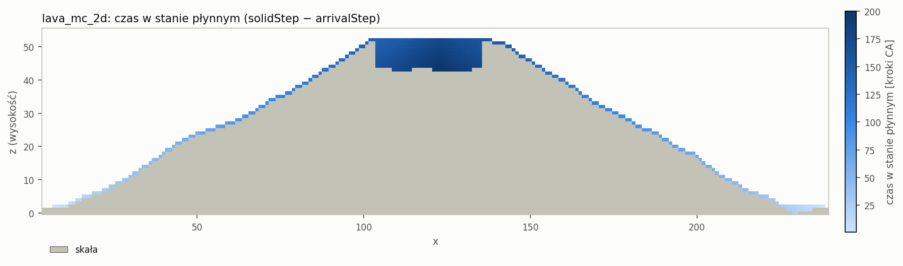

### Statystyki

Co `mc.statsEvery` MCS (oraz dla MCS 0 i ostatniego) do `mc_stats.csv` trafia wiersz
`mcs,grains,meanGrainSize,energy,acceptRate`:
- **liczba ziaren** = liczba spójnych składowych komórek domeny o tej samej orientacji (union-find,
  [Grains.cpp](../engine/src/mc/Grains.cpp)). **Spójność:** von Neumann, gdy MC używa von Neumanna,
  a Moore dla Moore'a i sąsiedztw losowych (suma ich wariantów to Moore). Dwie komórki należą więc do
  jednego ziarna wtedy, gdy granica między nimi nie kosztuje energii. Pierwotne założenie mówiło o samym von
  Neumannie, ale wtedy cienka warstwa bazaltu na „schodkowym” stoku (komórki stykają się tylko
  krawędziami) rozpadałaby się na jednokomórkowe ziarna niezależnie od przebiegu MC, a liczba ziaren
  mierzyłaby geometrię terenu, a nie krystalizację;
- **średnia wielkość ziarna** = komórki domeny / liczba ziaren;
- **energia** = ½ · Σ E_i (każda para sąsiadów liczona raz);
- **acceptRate** = zaakceptowane / próby w ostatnim interwale. Próby pominięte przez mobilność się
  nie liczą, więc to współczynnik akceptacji Metropolisa.

Czas liczenia statystyk to osobna sekcja `mcStats` i **nie** wlicza się do `mcSim`.

`stats.json` dostaje sekcję `mc`: liczbę ziaren i średnią wielkość na początku i na końcu, największe
ziarno, energię oraz `byMobility`: te same wielkości osobno dla klas mobilności ≥ 0,5 i < 0,5.
Ziarno należy do klasy, w której leży większość jego komórek. Klasy liczymy zawsze, gdy są dane
o stygnięciu, także w przebiegu bez mobilności, żeby dało się porównać oba warianty.

## 3. Zmiany w CA i formatach

- `arrivalStep` (`uint16`) w `CellState`, `Microstructure`, `VectorStorage`, `MatrixStorage` i `LavaCA`.
  Kratery mają 0, nowa lawa dostaje numer kroku (ten sam znacznik co `solidStep`). W trybie `classic`
  to krok dołączenia komórki do ziarna.
- **Zgodność vector/macierz nadal bitowa**: porównanie w benchmarku i testach obejmuje teraz także
  `solidStep` i `arrivalStep`. `--benchmark --quick` daje „zgodne: tak” we wszystkich przypadkach.
- `ca_result.bin` **wersja 2**: po `solidStep[N]` dochodzi `arrivalStep[N]` (13 B na komórkę).
  `ResultReader::readBin` czyta wersje 1 i 2 (w v1 `arrivalStep = 0`). `readFolder` informuje,
  co wczytano (`ResultSource`), co pozwala MC wyłączyć mobilność dla pliku txt. Format txt bez zmian.
- Wynik CA się nie zmienił: liczby kroków i objętości lawy wszystkich starych configów są takie same
  jak w pierwszej wersji automatu (`test_2d` 351 kroków, `test_3d` i `etna_3d` 284, `classic_ref` 71).

## 4. Konfiguracja, wywołanie, pliki wynikowe

```json
"mc": { "enabled": false, "domain": "basalt", "Q": 50, "mcs": 100, "J": 1.0, "kT": 0.0,
        "mobilityFromCooling": true, "mobilityMin": 0.05, "statsEvery": 10 }
```

- `enabled: true` + `domain: "basalt"`: CA, potem MC na wyniku w pamięci (wymaga `ca.mode = lava`;
  w trybie `classic` nie ma bazaltu, więc config zgłasza błąd).
- `enabled: true` + `domain: "full"`: samo MC na całej przestrzeni. Teren i CA są pomijane razem z ich
  walidacją (np. 2D może leżeć w płaszczyźnie x–y). W `times.json` **nie ma** sekcji `allocate`,
  `terrain`, `vents`, `caSim`, `save` ani pól `steps`/`stopReason` (zamiast zer, bo zero sugerowałoby,
  że faza trwała 0 ms), a `mode = "mc_full"`.
- Walidacja z komunikatami po polsku: `Q ≥ 2`, `mcs ≥ 0`, `J > 0`, `kT ≥ 0`, `0 ≤ mobilityMin ≤ 1`,
  `statsEvery ≥ 1`; `mobilityFromCooling` w trybie `full` daje ostrzeżenie i jest ignorowane.
  Dawne ostrzeżenie „mc.enabled ignorowane” usunięte.

**Dane wejściowe z pliku** (wynik CA zapisany wcześniej):

```
engine --mc-from results\lava_mc_2d --config configs\mc_basalt.json --out results\mc_from_lava_2d
```

Program wczytuje `ca_result.bin` (albo `ca_result.txt`, wtedy bez danych o stygnięciu: mobilność
wyłączona z ostrzeżeniem; plik bin v1: czas płynięcia liczony od kroku 0 z ostrzeżeniem) i uruchamia
samo MC. `mc.domain` musi być `basalt`. Wymiary pochodzą z pliku, a ostrzeżenie o konflikcie pojawia się
tylko wtedy, gdy config sam podaje `space`. `configs/mc_basalt.json` zawiera wyłącznie parametry MC.
Wynik `--mc-from` na `lava_mc_2d` jest **bitowo identyczny** z MC uruchomionym w tym samym przebiegu
co CA (`mc_result.bin` porównane `cmp`; jest też test jednostkowy).

**Wyjście** (folder `--out`): `mc_result.txt` (`nx ny nz`, nagłówek `x y z crystal`, 0 poza domeną),
`mc_result.bin` przy `output.format` = `bin`/`both` (`"VMC1"`, `int32 nx, ny, nz`, `int32 crystal[N]`),
`mc_stats.csv`, `times.json` (`mcInit`, `mcSim`, `mcStats`, `mcSave` [ms] + `mcs`, `domainCells`, `Q`,
`mcDomain`, `mcMobility`; przy `--mc-from` także `readInput`), `stats.json` z sekcją `mc`
(przy `--mc-from` dodatkowo `source`) i podsumowanie w konsoli.

**Narzędzia:** `tools/plot_slice.py --color crystal` (stały pseudolosowy kolor dla ID kryształu, skała
szara, powietrze białe, `--boundaries` rysuje granice ziaren, `--crop`/`--window` przycina obraz),
`--color cooling` (mapa czasu w stanie płynnym) oraz nowy `tools/plot_mc_stats.py <folder> [...]`
(liczba ziaren i średnia wielkość vs MCS, kilka folderów na jednym wykresie).

## 5. Wyniki

Nowe configi: `mc_full_2d.json` (200×200, płaszczyzna x–y jak klasyczny rozrost w benchmarku, Q = 50,
100 MCS, von Neumann, periodyczne), `mc_full_3d.json` (50³, Q = 50, 50 MCS, Moore, periodyczne),
`lava_mc_2d.json`, `lava_mc_3d.json` (CA + MC `basalt`) i `mc_basalt.json` (do `--mc-from`).

### Tryb full: klasyczny naiwny rozrost MC

Wycinek 80×80 z `mc_full_2d`: stan początkowy (losowe orientacje) i po 100 MCS.

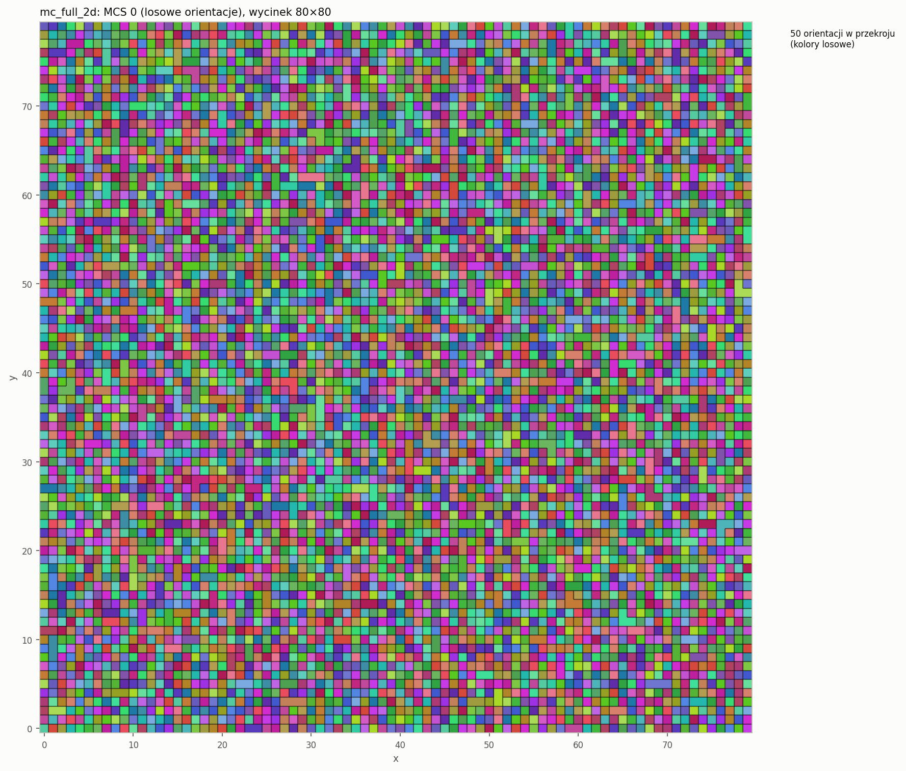
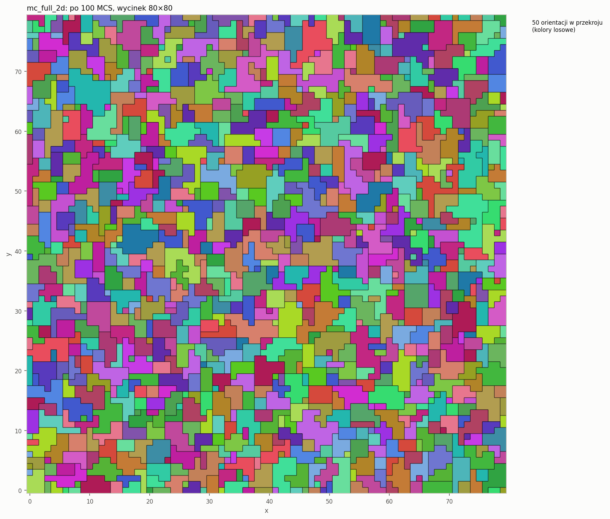

`mc_full_2d` (40 000 komórek): ziarna 38 327 → 5 596, średnia wielkość 1,04 → 7,15 komórki, energia
78 326 → 33 431; zaakceptowano 13% prób. `mc_full_3d` (125 000 komórek): ziarna 94 799 → 6 039, średnia
1,32 → 20,7 komórki. Warstwa z = 25 kostki 3D:

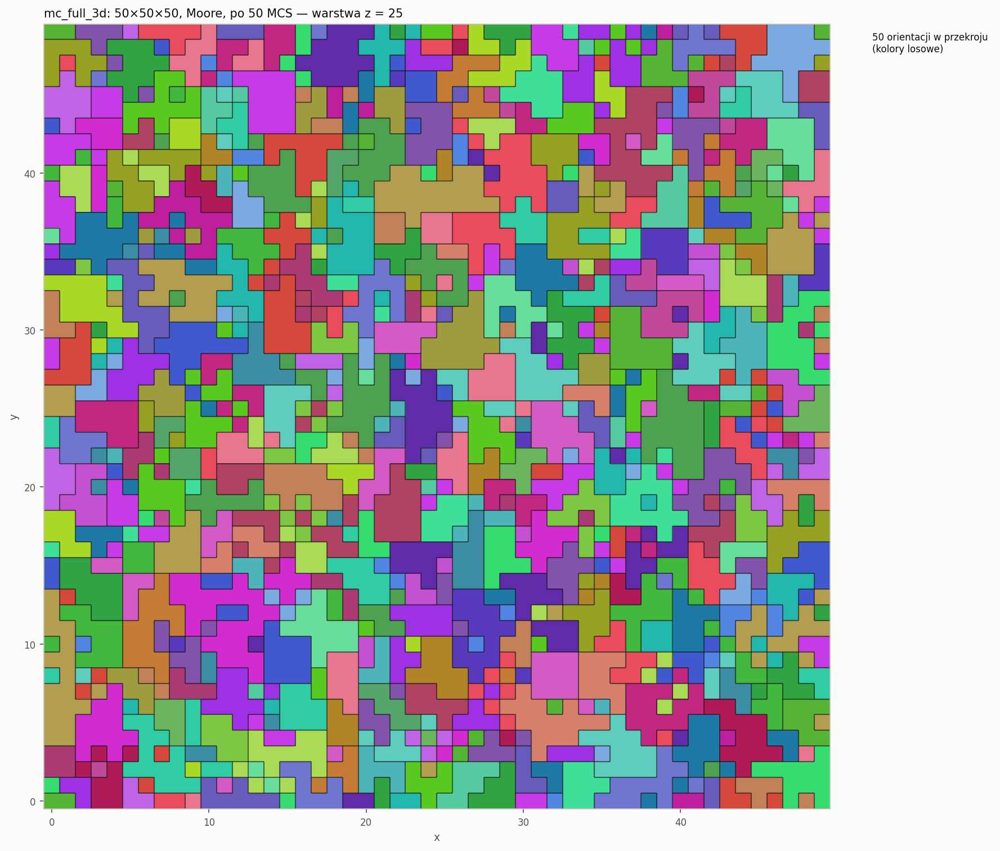

Liczba ziaren maleje, a średnia wielkość ziarna rośnie z każdym krokiem MCS:

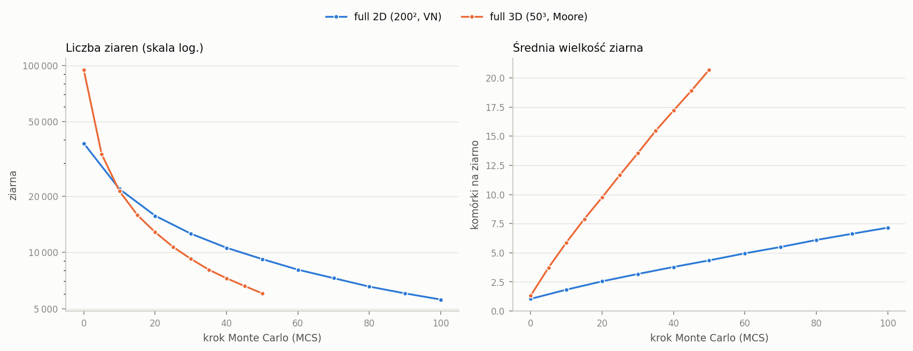

### Tryb basalt: krystalizacja zastygłej lawy

Żeby kryształy były widoczne, parametry CA dobrałem tak, by bazalt miał miejscami grubość kilku komórek.
Szeroki i głęboki krater (2D: promień 16, głębokość 9; 3D: promień 10, głębokość 6) wypełnia się
jeziorem lawy, które długo pozostaje płynne. Lawa przelewa się przez krawędź i spływa po zboczach
cienką warstwą, która szybko zastyga. W 3D jezioro ma grubość do 6 komórek (731 kolumn ma ≥ 3 komórki
bazaltu).

**2D (`lava_mc_2d`, 516 komórek bazaltu, 300 MCS)**: fragment z kraterem i lewym zboczem, z mobilnością
i bez (ta sama inicjalizacja):

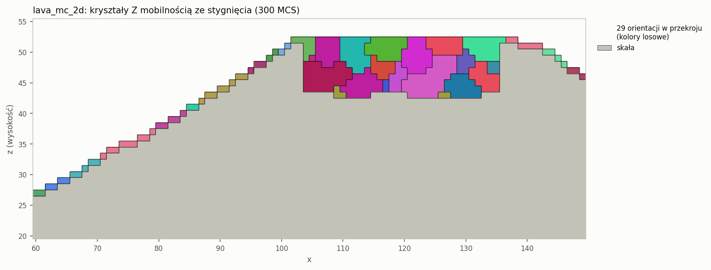
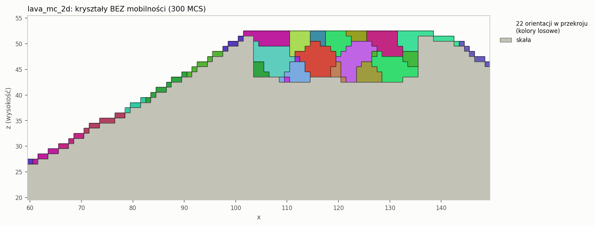

**3D (`lava_mc_3d`, 4 291 komórek bazaltu, 200 MCS)**: mapa czasu w stanie płynnym i kryształy
w widoku z góry. Z mobilnością krater i jego okolice mają duże kryształy, a obrzeże pola lawy jest
drobnokrystaliczne. Bez mobilności ziarna są duże wszędzie.

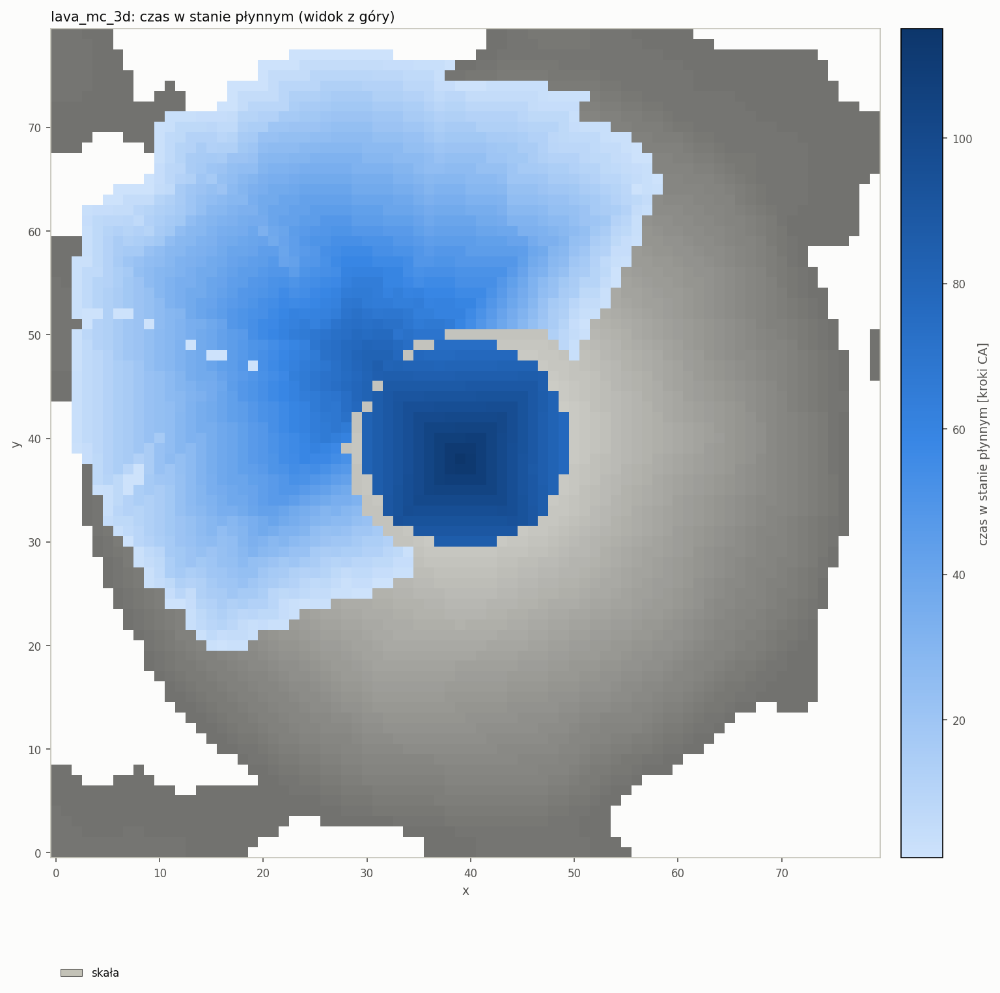
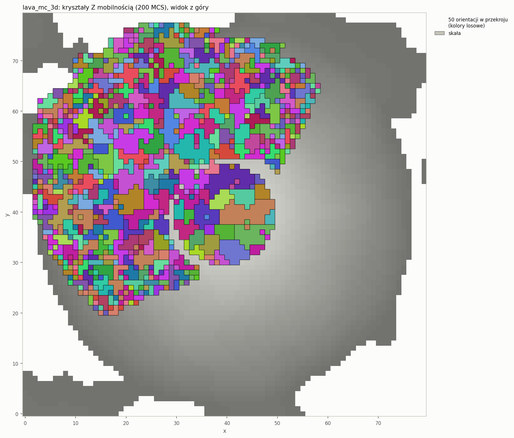
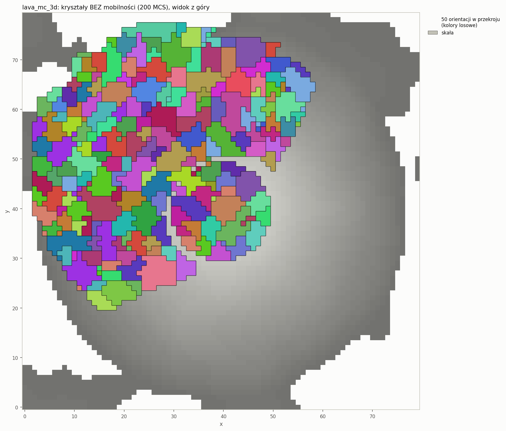

Przekrój pionowy przez krater (y = 40): jezioro lawy z dużymi kryształami i cienka warstwa na stoku.

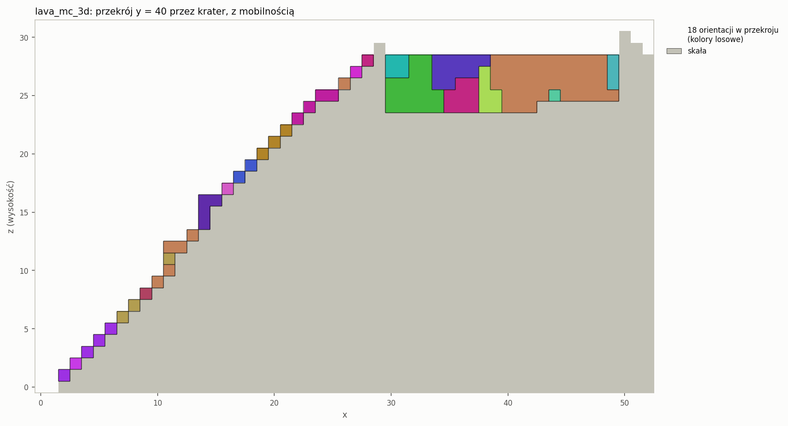

Efekt mobilności w liczbach (`stats.json`, sekcja `byMobility`; „średnia” = średnia wielkość ziarna
na końcu [komórki], w nawiasie największe ziarno):

| Przypadek | długo płynne (m ≥ 0,5): komórki / ziarna / średnia | szybko zastygłe (m < 0,5): komórki / ziarna / średnia | stosunek średnich |
|---|---|---|---|
| `lava_mc_2d` z mobilnością | 383 / 35 / **10,9** (39) | 133 / 39 / **3,4** (8) | **3,2×** |
| `lava_mc_2d` bez mobilności | 383 / 30 / 12,7 (37) | 133 / 24 / 5,6 (12) | 2,3× |
| `lava_mc_3d` z mobilnością | 1 630 / 64 / **25,8** (168) | 2 661 / 510 / **5,2** (48) | **5,0×** |
| `lava_mc_3d` bez mobilności | 1 630 / 43 / 37,0 (145) | 2 661 / 164 / 16,5 (63) | 2,2× |

Bez mobilności ziarna w cienkiej warstwie też są mniejsze: ogranicza je geometria (warstwa grubości 1
komórki ma 2–8 sąsiadów w domenie zamiast 26). Mobilność wzmacnia ten kontrast ze ~2,2× do 3,2× (2D)
i 5× (3D). W szybko zastygłej lawie 3D średnie ziarno maleje z 16,5 do 5,2 komórki.

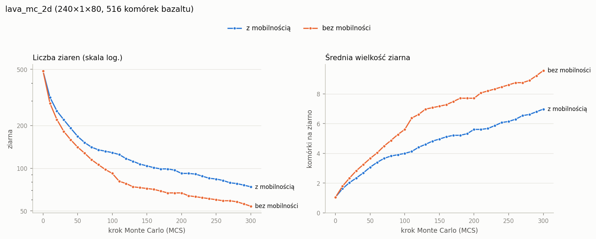
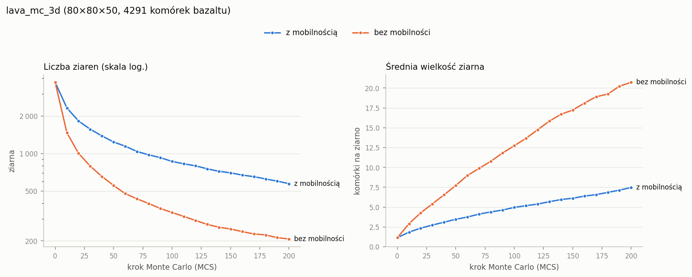

### Wpływ sąsiedztwa (tryb full, 40×40, Q = 50, 50 MCS)

| Sąsiedztwo | ziarna: start → 50 MCS |
|---|---|
| von Neumann | 1 540 → 354 |
| Moore | 1 488 → 271 |
| hexagonal (losowe) | 1 488 → 388 |
| pentagonal (losowe) | 1 488 → 1 112 (po 400 MCS: 1 085, akceptacja ~62%) |

Wyniki są identyczne dla płaszczyzny x–y i x–z. Losowe pentagonalne praktycznie nie zgrubia struktury:
decyzja widzi 5 z 8 sąsiadów. Gdy wylosowany wariant nie obejmuje partnera z ziarna, każda zmiana
orientacji ma ΔE = 0 i jest przyjmowana, więc małe ziarna stale się rozpadają. Ustala się stan
nieuporządkowany, podobny do wysokiej temperatury. To cecha naiwnego MC z wariantem sąsiedztwa
losowanym na każdy krok MCS (tak samo jak w CA), nie błąd. Hexagonal (6 z 8, brakują tylko narożniki)
rośnie normalnie.

## 6. Czasy CA i MC

MSVC Release, `times.json` [ms]; „ns/próbę” = `mcSim / (MCS · N_domena)`. Zapowiedź wykresu CA vs MC
w [kolejka-serie-dane.md](kolejka-serie-dane.md):

| Config | Komórki | Domena MC | Kroki CA | caSim | MCS | mcSim | mcStats | ns/próbę | total |
|---|---|---|---|---|---|---|---|---|---|
| `test_2d` (samo CA) | 20 000 | — | 351 | 102 | — | — | — | — | 107 |
| `lava_mc_2d` | 19 200 | 516 | 202 | 60 | 300 | 7,3 | 4,5 | 47 | 78 |
| `lava_mc_2d` bez mobilności | 19 200 | 516 | 202 | 58 | 300 | 8,4 | 4,9 | 54 | 78 |
| `--mc-from lava_mc_2d` | 19 200 | 516 | — | — | 300 | 7,1 | 3,8 | 46 | 14 |
| `lava_mc_3d` | 320 000 | 4 291 | 133 | 1 426 | 200 | 82 | 51 | 95 | 1 633 |
| `lava_mc_3d` bez mobilności | 320 000 | 4 291 | 133 | 1 337 | 200 | 174 | 54 | 203 | 1 639 |
| `mc_full_2d` (VN) | 40 000 | 40 000 | — | — | 100 | 152 | 13 | 38 | 170 |
| `mc_full_3d` (Moore) | 125 000 | 125 000 | — | — | 50 | 833 | 198 | 133 | 1 042 |
| CA classic 200², VN, 50 ziaren | 40 000 | — | 48 | 19 | — | — | — | — | 23 |
| CA classic 50³, Moore, 50 ziaren | 125 000 | — | 14 | 31 | — | — | — | — | 35 |

Wnioski:
- Na tej samej siatce naiwne MC jest **8–28× wolniejsze od CA**. Jeden krok CA to jedno przejście po
  komórkach (w classic 6–18 ns na komórkę i krok). Jeden krok MCS to N losowań, dwa przejścia po sąsiadach
  i kilka hashy na próbę (38 ns w 2D/VN, 133 ns w 3D/Moore). Do tego MC potrzebuje 50–100 MCS,
  a CA kończy po 14–48 krokach.
- W trybie `basalt` MC jest tanie w porównaniu z CA, bo domena to ~1,3% przestrzeni (4 291 z 320 000
  komórek): 82 ms MC wobec 1,4 s CA.
- Mobilność przyspiesza MC (82 ms zamiast 174 ms w 3D): pominięta próba nie liczy energii.
- Statystyki (union-find po całej siatce) kosztują 9–62% czasu `mcSim`, dlatego są poza `mcSim`.
- Pomiary są zaszumione: 3 powtórzenia `mc_full_2d` dały 177–200 ms, `mc_full_3d` 768–867 ms.
  W profilu aplikacji ([profilowanie.md](profilowanie.md)): więcej powtórzeń i przypięcie procesu do rdzenia P.

## 7. Kompilacja GCC (zaległa z pierwszej wersji automatu)

WSL (Ubuntu 22.04), **GCC 11.4.0**, CMake 3.22. Polecenie (z katalogu projektu; WSL startuje w bieżącym
katalogu, więc ścieżka nie jest potrzebna; działa w PowerShell, `cmd` i Git Bash):

```
wsl -e bash -lc "cmake --preset gcc-release && cmake --build --preset gcc-release -j 16 && ctest --preset gcc-release"
```

Pierwsza kompilacja wykryła dwa błędy z pierwszej wersji automatu, niewidoczne w MSVC:
1. **Linker:** plik `build-gcc-release/engine` kolidował z podkatalogiem `build-gcc-release/engine/`
   (z `add_subdirectory`): „cannot open output file”. Przy generatorach jednokonfiguracyjnych pliki
   wykonywalne trafiają teraz do `build-gcc-release/bin/` (MSVC bez zmian: `build\Release\engine.exe`).
2. **Segfault w teście sąsiedztw:** `for (... : Neighborhood(...).variant(0))` iterował po polu obiektu
   tymczasowego, który ginie przed pętlą (niezdefiniowane zachowanie, w MSVC przypadkiem działało).
   Test używa teraz nazwanych obiektów. Kod silnika nie miał tego wzorca.

Po poprawkach czyste buildy **GCC Release i Debug: 0 ostrzeżeń** (`-Wall -Wextra`), `ctest` 7/7 w obu.
MSVC Release i Debug: 0 ostrzeżeń (`/W4`), 7/7.

**Zgodność między kompilatorami:** `ca_result.bin` i `mc_result.bin` z GCC i MSVC są **bitowo
identyczne** dla `test_2d`, `classic_ref`, `lava_mc_2d`, `lava_mc_3d`, `mc_full_2d` i `mc_full_3d`.
Pliki tekstowe różnią się tylko końcami linii (CRLF w Windows). Działa więc zasada „losowość tylko
z hasha, bez `std::*_distribution`”.

Czasy GCC (`-O3`, WSL): MC wyraźnie szybsze niż z MSVC: `mc_full_2d` 72 ms (18 ns/próbę) zamiast
152 ms, `mc_full_3d` 334 ms zamiast 833 ms, `lava_mc_3d` CA 1 063 ms zamiast 1 426 ms. Przyczynę
(rozwinięcie pętli po sąsiadach, 64-bitowe modulo w losowaniu) sprawdzimy profilerem ([profilowanie.md](profilowanie.md)).
Czasy wczytywania w WSL (`readConfig` 18–110 ms) nie są miarodajne, bo pliki leżą na dysku Windows
montowanym przez `/mnt/d`.

## 8. Testy

`ctest`: 7 testów, czyli testy jednostkowe (67 przypadków doctest, ok. 300 tys. asercji) i 6 testów dymnych
programu, w tym `mc_full_2d`, `lava_mc_2d` i `--mc-from` na jego wyniku. Nowe testy
([test_mc.cpp](../engine/tests/test_mc.cpp) i inne):
- energia komórki i ΔE na ręcznych przykładach 2D i 3D, dla von Neumanna i Moore'a; energia całkowita;
  ramka periodyczna odświeżana po zmianie komórki przy ścianie (także narożnik 3D);
- `kT = 0`: energia nigdy nie rośnie i nie ma akceptacji z ΔE > 0; `kT > 0`: są;
- sąsiedzi spoza domeny nie wnoszą energii; komórki spoza domeny nigdy się nie zmieniają;
- tryb full: po 50 MCS jest mniej ziaren niż na starcie (VN, Moore, hexagonal, pentagonal, 2D i 3D);
- ten sam seed → identyczny wynik, inny → inny (także dla sąsiedztwa losowego i kT > 0);
- mobilność 0 → brak zmian; normalizacja min–max, `mobilityMin = 0`, równe czasy → 1; czas płynnej lawy;
- liczba spójnych składowych na ręcznym przykładzie (VN, Moore, brzegi periodyczne, 3D);
- odczyt `ca_result.bin` v1 i v2, odrzucenie nieznanej wersji; zapis/odczyt `mc_result.*` i `mc_stats.csv`;
- `--mc-from` (bin v2 = wynik w pamięci, txt bez mobilności, wymiary z pliku, ostrzeżenie o konflikcie);
- tryb full przez `Simulation` (brak sekcji CA, punkty statystyk 0, 5, 10, 12);
- zgodność vector/macierz CA z `solidStep` i `arrivalStep`; `arrivalStep` krateru = 0, ≤ `solidStep`;
- walidacja nowych pól configu, `--mc-from` w CLI.

## 9. Decyzje i odstępstwa od pierwotnego opisu

- **Spójność ziaren** wg sąsiedztwa MC (von Neumann albo Moore), a nie zawsze von Neumann; uzasadnienie
  w punkcie 2 (cienkie, schodkowe warstwy bazaltu).
- **acceptRate** liczony względem prób, które nie zostały pominięte przez mobilność.
- **Domena basalt** obejmuje też pozostałą płynną lawę. Jej czas płynięcia liczymy do ostatniego kroku CA
  (największy zapisany `solidStep`/`arrivalStep`).
- `mc.domain = basalt` z `ca.mode = classic` jest błędem configu (brak bazaltu).
- W trybie full `times.json` nie zawiera sekcji CA (zamiast zer).
- Ostrzeżenie o konflikcie wymiarów przy `--mc-from` tylko wtedy, gdy config podaje `space`.
- Configi lawy mają więcej MCS niż domyślne 100 (2D: 300, 3D: 200), żeby kryształy były wyraźne;
  czas MC jest tam pomijalny.
- Dodatki: `Neighborhood::variantFor` (wspólny wybór wariantu dla CA i MC), `configs/mc_basalt.json`,
  tryb `--color cooling` i opcje `--window`, `--crop`, `--title`, `--ca` w `plot_slice.py`.
- Słabszy warunek testu „ziarna rosną” dla pentagonalnego (tylko „mniej niż na starcie”), punkt 5.

## 10. Znane ograniczenia

- **Mobilność mierzy czas płynięcia, a nie grubość.** CA nie ma przewodzenia ciepła: czas płynięcia
  zależy od temperatury, z jaką lawa dotarła do komórki. Jezioro w kraterze jest długo płynne, bo leży
  przy kraterze, a nie dlatego, że jest grube. Grube jezioro daleko od krateru stygłoby szybko.
- **Normalizacja min–max jest wrażliwa na jedną skrajną komórkę** (krater, który eruptuje do końca, ma
  najdłuższy czas). W obu configach lawy krater zostaje otoczony zastygłą lawą i CA kończy się „brakiem
  zmian” (`lava_mc_2d`: 202 kroki, `lava_mc_3d`: 133), zanim minie `eruptionSteps`. Krater zostaje wtedy
  płynną lawą o czasie ≈ końcu CA, porównywalnym z jeziorem.
- W 2D jęzory na zboczu mają grubość 1 komórki, więc ziarna są tam ograniczone geometrią także bez mobilności.
- Losowe pentagonalne w MC nie zgrubia struktury (punkt 5).
- Naiwny algorytm marnuje większość prób: akceptacja 13% w `mc_full_2d`, 5–9% w trybie basalt.
  Optymalizacje (losowanie bez powtórzeń, orientacje tylko z sąsiadów, próby tylko na granicach,
  jedno przejście po sąsiadach, tablica exp) są oznaczone w kodzie `// OPTYMALIZACJA:`.
- MC jest z natury sekwencyjne (każda próba widzi wynik poprzednich); planowane zrównoleglenie
  wymaga podziału na niesąsiadujące podzbiory (szachownica) albo pasy z synchronizacją ramek.
- Zgodność GCC/MSVC sprawdziłem dla `kT = 0`. Dla `kT > 0` akceptacja zależy od `std::exp`, a różnica
  ostatniego bitu między bibliotekami mogłaby teoretycznie zmienić pojedynczą decyzję.
- Statystyki liczą union-find po całej siatce przy każdym pomiarze (9–62% czasu `mcSim`).

## 11. Co dalej: profil aplikacji

- Profil czasu CA i MC w funkcji rozmiaru domeny, Q, sąsiedztwa i liczby MCS (skrypt `bench/run_profile.py`).
- Profiler (VS Performance Profiler, gprof / callgrind w WSL): gorące miejsca MC, czyli `hashRand`, 64-bitowe modulo
  przy wyborze komórki i orientacji, pętla po sąsiadach; wyjaśnienie różnicy MSVC vs GCC.
- Zapotrzebowanie na pamięć MC: 5 B na komórkę z ramką (orientacja + maska), 4 B mobilności,
  16 B na komórkę domeny (listy indeksów) i 12–16 B na komórkę przy liczeniu ziaren.
- Pomiary z przypięciem do rdzenia P i większą liczbą powtórzeń; wykres CA vs MC ([kolejka-serie-dane.md](kolejka-serie-dane.md)).
