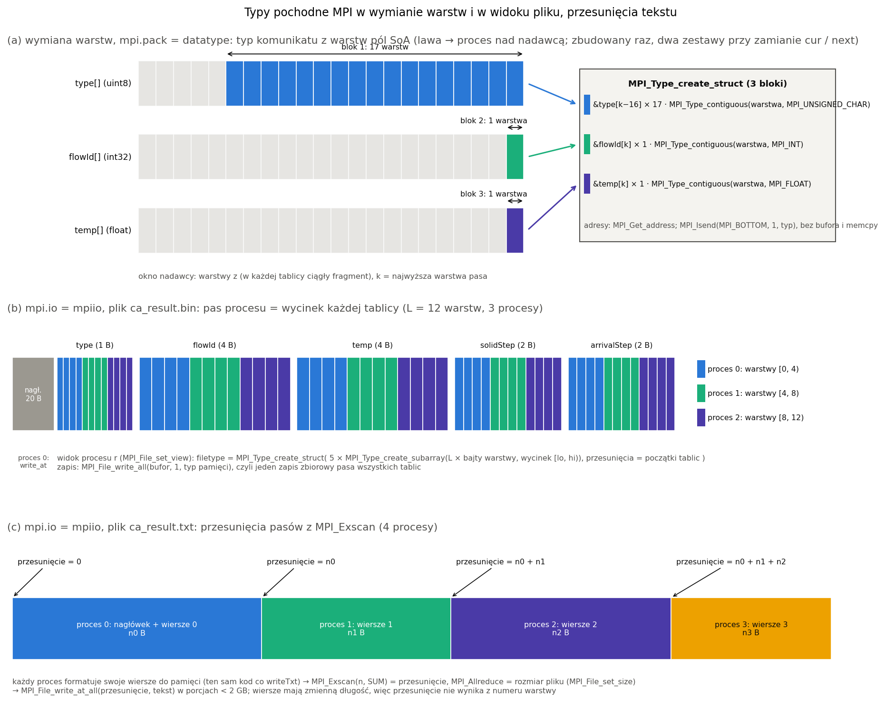
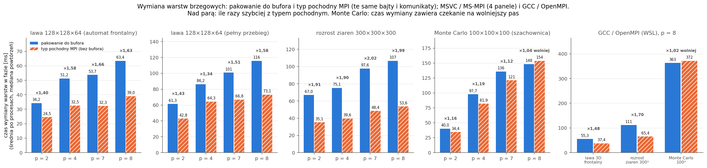
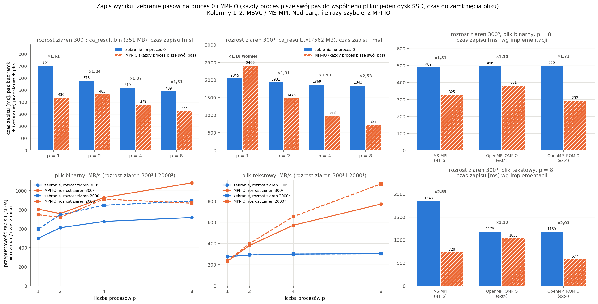
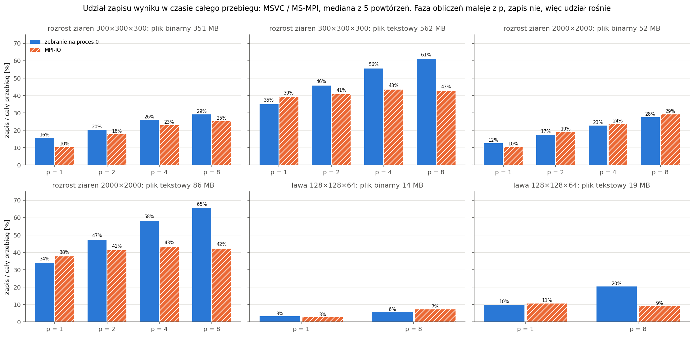
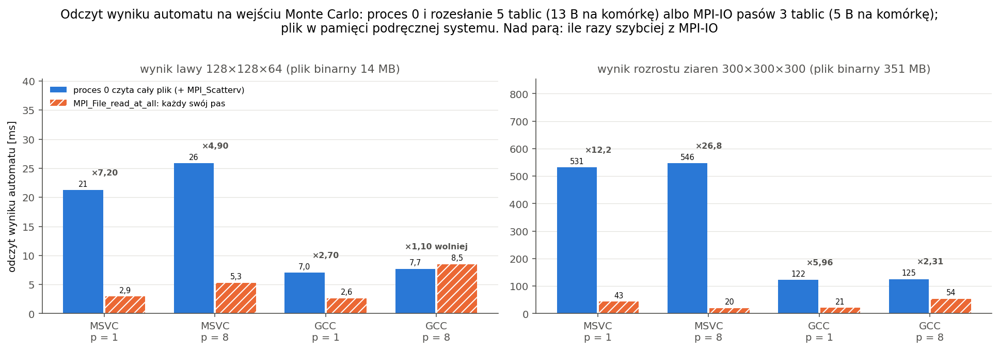

# Typy pochodne MPI i równoległy zapis

Program **`engine_mpi`** z wersji MPI (dokument „Wersja rozproszona MPI”) dostaje dwa elementy MPI, oba jako **opcje obok dotychczasowej ścieżki**:

1. **typy pochodne MPI**: wymiana warstw brzegowych bez ręcznego pakowania (typ opisuje pola warstwy wprost w siatce),
   parametry i kratery / zarodki rozsyłane jako struktury (`MPI_Type_create_struct`);
2. **równoległe wejście / wyjście (MPI-IO)**: każdy proces zapisuje swój pas do wspólnego pliku (i czyta swój pas przy
   `--mc-from`), zamiast zbierać siatkę na procesie 0.

Trzy zasady jak w wersji MPI:

- **Poprawność ponad wszystko.** Każda nowa ścieżka daje **bajtowo te same pliki wynikowe** (`ca_result.*`,
  `mc_result.*`, `mc_stats.csv`, `stats.json`, migawki) co dotychczasowa wersja MPI i co `engine`, przy 1, 2, 3, 4, 5 i 8 procesach,
  w MSVC / MS-MPI i GCC / OpenMPI, także w trybie hybrydowym (punkt 6).
- **Domyślne zachowanie bez zmian.** Bez nowych opcji `engine_mpi` działa jak dotychczas, a program `engine` (bez MPI)
  daje te same wyniki i ten sam czas co przed tymi zmianami (punkt 6.3).
- **Pomiar w tych samych warunkach** co pomiar wersji MPI (taktowanie bazowe, procesy przypięte do rdzeni P, wysoki priorytet,
  warianty naprzemiennie, zgodność każdego przebiegu); plan: [`PLAN_POMIARU.md`](../bench/results/mpi_io/PLAN_POMIARU.md),
  wyniki: punkt 8.

**W skrócie (punkt 8):** typy pochodne skracają wymianę warstw o 25–50% (bez dwóch kopii przez bufor), ale cała faza
obliczeń przyspiesza tylko o 0–9%; MPI-IO skraca zapis dużych wyników (binarny ×0,62–0,80, tekst przy 8 procesach
×0,40, dzięki równoległemu formatowaniu) i zmniejsza pamięć procesu 0 (×0,25), a odczyt `--mc-from` przyspiesza 12–27×;
małe pliki (≤ 52 MB) przez MPI-IO zapisują się tak samo albo wolniej; rozsyłanie configu strukturą oszczędza ułamek
milisekundy. Dziennik: [`bench/results/mpi_io/POSTEP.md`](../bench/results/mpi_io/POSTEP.md).



## 1. Nowe opcje

| Ustawienie | Wartości (pierwsza: domyślna) | Co zmienia |
|---|---|---|
| `mpi.pack` | `manual` / `datatype` | komunikat warstw brzegowych: pakowanie pól do bufora (`memcpy`, jak dotąd) albo typ pochodny MPI opisujący pola w siatce okna (punkt 2) |
| `mpi.bcast` | `json` / `struct` | rozsyłanie parametrów: scalony config jako tekst JSON, który każdy proces parsuje (jak dotąd), albo blok liczbowy configu jako struktura + kratery / zarodki jako tablica struktur z procesu 0 (punkt 3) |
| `mpi.io` | `gather` / `mpiio` | zapis wyników: pasy zbierane na proces 0 (`MPI_Gatherv`), który zapisuje pliki (jak dotąd), albo każdy proces zapisuje swój pas do wspólnego pliku; też odczyt `--mc-from` (punkt 4) |

- **Trzy niezależne opcje**, a nie jedna „nowa wersja”: każdą da się zmierzyć osobno (pomiar porównuje parami
  `m` vs `d`, `m` vs `s`, `m` vs `i`), a testy sprawdzają wszystkie 8 kombinacji. Wszystkie razem:
  `--set mpi.pack=datatype --set mpi.bcast=struct --set mpi.io=mpiio`.
- Walidacja w `Config::fromJson` (nieznana wartość = błąd configu z listą dozwolonych), odczyt przez
  `Config::mpiPackDatatype()`, `mpiBcastStruct()`, `mpiIoParallel()` z `effective`, bez nowych pól struktury `Config`
  (układ kodu MSVC, dokument „Prawdziwy teren i odtwarzanie erupcji”, punkt 7). Program `engine` przyjmuje i ignoruje te klucze (jak `mpi.exchange`).
- GUI: pola pojawiają się w grupie „MPI (program engine_mpi)” z opisami (`gui/static/js/form.js`).
- `times.json`, sekcja `mpi`: `pack`, `bcast.mode`, `io.mode`: każdy przebieg zapisuje, jak był liczony (punkt 5).

```powershell
mpiexec -n 4 .\build\Release\engine_mpi.exe --config configs\test_3d.json --out results\test_3d_dsi4 --set mpi.pack=datatype --set mpi.bcast=struct --set mpi.io=mpiio
```

## 2. Typy pochodne w wymianie warstw (`mpi.pack = datatype`)

### 2.1 Warstwa pola i komunikat

Pas procesu i okno są takie jak w wersji MPI (pasy warstw w osi z, w płaszczyźnie x–y oś y; okno = pas + warstwy
brzegowe). Pola siatki to **osobne tablice SoA** (typ komórki `uint8`, `flowId` `int32`, temperatura `float`,
`solidStep` i `arrivalStep` `uint16`, w MC orientacja `int32`), a warstwa okna jest w każdej z nich **ciągłym
fragmentem** (oś warstw jest zewnętrzna; warstwa z ramką w pozostałych osiach). Stąd dwa poziomy typów:

- **warstwa pola** = `MPI_Type_contiguous(komórki warstwy z ramką, typ pola)`: `MPI_UNSIGNED_CHAR`, `MPI_INT`,
  `MPI_FLOAT`, `MPI_UNSIGNED_SHORT`; po jednym typie na pole, budowane przy pierwszej wymianie;
- **komunikat do / od jednego sąsiada** = `MPI_Type_create_struct` z bloków „warstwa pola”: adres bloku z
  `MPI_Get_address` (adres bezwzględny), długość = liczba warstw, typ = typ warstwy pola. Wysyłka i odbiór od
  `MPI_BOTTOM`: struktura łączy fragmenty kilku osobnych tablic (osobnych alokacji), więc przesunięcia względem
  jednej z nich nie miałyby sensu. Kolejne warstwy tego samego pola leżą w tablicy obok siebie, więc **łączą się
  w jeden blok**.

Przykład: lawa, komunikat procesu do procesu **nad nim** (odbiorca potrzebuje 17 warstw pod swoim pasem: tuż pod
pasem pełny stan, głębiej sam typ komórki; kolejność warstw jak w oknie odbiorcy, od najgłębszej):

```
okno nadawcy (jego warstwy własne, od góry pasa w dół)       typ komunikatu (MPI_Type_create_struct, 3 bloki)
                                                              ┌───────────────────────────────────────────┐
type[]   … │ k−16 │ k−15 │ … │ k−1 │  k  │   ── 17 warstw ──→  │ blok 1: &type[k−16]   × 17 warstw typu   │
flowId[] … │      │      │   │     │  k  │   ── 1 warstwa ───→  │ blok 2: &flowId[k]    × 1 warstwa flowId │
temp[]   … │      │      │   │     │  k  │   ── 1 warstwa ───→  │ blok 3: &temp[k]      × 1 warstwa temp   │
                                    (k — najwyższa warstwa pasu)  └───────────────────────────────────────────┘
                                                              MPI_Isend(MPI_BOTTOM, 1, typ, …) — bez bufora
```

Odbiorca buduje ten sam typ na swoich warstwach brzegowych (te same pola i liczby warstw w tej samej kolejności, więc
sygnatury typów się zgadzają) i odbiera **wprost do okna**. Dotąd to samo szło przez bufor: 19 kopii
`memcpy` (po jednej na warstwę pola) u nadawcy i tyle samo u odbiorcy. Komunikat do procesu **pod** nadawcą (warstwa nad pasem odbiorcy): 3 bloki
po jednej warstwie; classic (typ, `flowId`, `arrivalStep`): 3 bloki; MC: 1 blok (orientacja).

### 2.2 Budowa raz, pamięć podręczna typów, dwa bufory

- Typy komunikatów są budowane **przy pierwszej wymianie** z danym buforem, zatwierdzane `MPI_Type_commit`
  i trzymane do końca przebiegu w mapie (klucz: bufor, kierunek, numer komunikatu, maska warstw); zwalnia je
  `MPI_Type_free` w destruktorze (`MpiType`: właściciel typu, przed `MPI_Finalize`). Plan komunikatów nie zmienia się
  w trakcie przebiegu, więc w wariancie `always` jest jeden typ na komunikat (dobór: 4–100 typów na cały przebieg
  wszystkich procesów przy 2–8 procesach, budowa łącznie 0,03–0,36 ms).
- **Pełny przebieg automatu** zamienia bufory `cur` / `next` po każdym kroku (`VectorStorage::swap` zamienia tablice),
  więc adresy pól zmieniają się co krok. Wybór: **dwa zestawy typów, po jednym na bufor** (klucz = adres tablicy typu
  komórki); przesunięcia względne nie wystarczą, bo każde pole to osobna alokacja i odległości między tablicami
  są dowolne. Przy pierwszej wymianie z drugim buforem powstaje drugi zestaw (pełny przebieg: 2× więcej typów niż
  front: 100 wobec 50 przy 8 procesach).
- Pełny przebieg potrzebuje odebranych warstw w obu buforach (po zamianie okno ma mieć ostatnio otrzymany stan):
  odbiór typem do `cur` i kopia odebranych warstw do `next` (`copyLayers`); wcześniej rozpakowanie z bufora szło
  do obu.

### 2.3 Wariant `mpi.exchange = changed`

Działa dalej (wynik ten sam): nadawca porównuje warstwy z ostatnio wysłanymi (`memcmp`, jak dotąd), **flagi
warstw idą osobnym małym komunikatem** (`MPI_UNSIGNED_CHAR`, znacznik + 100), a dane typem złożonym tylko z warstw
z flagą 1. Odbiorca czeka na flagi, potem odbiera dane typem dla tej samej maski. Typy na maskę też są w pamięci
podręcznej: `test_3d` na 3 procesach ma 460 różnych typów (różne zestawy zmienionych warstw), budowa łącznie 1,1 ms.
Komunikatów jest więcej (flagi + dane: 2 141 zamiast 1 420, bo przy pakowaniu flagi są w tym samym komunikacie).

### 2.4 Komunikaty i bajty

- Liczba komunikatów na wymianę: **ta sama** co przy pakowaniu (jeden na sąsiada i kierunek).
- Bajty: w wariancie `always` **dane bez flag**: `test_3d` na 3 procesach 82 885 968 B wobec 82 895 908 B
  (różnica = 9 940 B flag). Przy `changed` te same bajty danych i te same warstwy pominięte co przy pakowaniu.
- Z doboru (8 procesów): lawa 3D 128² × 64: 25 komunikatów i 3,85 MB na wymianę, classic 300³: 16 i 10,21 MB,
  MC 100³: 16 i 0,67 MB, w obu wariantach (kontrola w każdym przebiegu pomiaru).

Spodziewany zysk na jednym komputerze jest mały: wymiana to 0,03–1 ms na krok, a MS-MPI i OpenMPI i tak kopiują dane
przez pamięć współdzieloną; typ pochodny oszczędza tylko kopię do bufora i z bufora po stronie programu (biblioteka
może wewnętrznie pakować typ nieciągły). Wynik: punkt 8.

## 3. Parametry i kratery jako struktury (`mpi.bcast = struct`)

### 3.1 Blok liczbowy configu

Dotąd proces 0 rozsyłał scalony config jako tekst JSON (~0,9–1 KB), a każdy proces parsował go i walidował
(`Config::fromJson`). Wariant `struct` wydziela **wszystko, czego obliczenia potrzebują na każdym procesie**, do
struktury POD `ConfigBlock` i rozsyła ją **jednym `MPI_Bcast`**:

```
ConfigBlock (sizeof = 232 B, dane = 215 B)          typ MPI: MPI_Type_create_struct, 20 pól
┌──────────────────────────────┬──────────┐          offsetof(ConfigBlock, pole) → przesunięcie
│ int32   space[3]             │ nx ny nz │          MPI_INT32_T × 3
│ int32   grid, boundary, nb   │ wylicz.  │          MPI_INT32_T × 1 (×3 pola)
│ uint64  rngSeed              │          │          MPI_UINT64_T
│ int32   terrainType          │ + 4 B ░  │          (wypełnienie — nie jest przesyłane)
│ double  terrain[5]           │ stożek   │          MPI_DOUBLE × 5
│ int32   vents[3]; double eruptTemp     │          MPI_INT32_T × 3, MPI_DOUBLE
│ int32   caMode, maxSteps; double ca[4] │          stygnięcie, solidus
│ uint8   caFlags[2], mcFlags[4]  + 2 B ░│          MPI_UINT8_T × 2, × 4
│ int32   mc[4]; double mcNum[3]         │          Q, MCS, statsEvery, migawki; J, kT, mobilityMin
│ int32   output[2], parallel[4]         │          format, migawki; wątki, harmonogram, chunk, przypięcie
│ uint8   mpi[5]                  + 3 B ░│          priorytet, exchange, pack, bcast, io
│ int32   cooling                 + 4 B ░│          --mc-from: dane stygnięcia z pliku wyniku CA
└──────────────────────────────┴──────────┘          MPI_Type_create_resized(…, extent = sizeof) + commit
```

- Typ ma pola **różnych typów** (`int32`, `uint64`, `double`, `uint8`) opisane typami MPI o stałym rozmiarze
  (`MPI_INT32_T`, `MPI_UINT64_T`, …) i przesunięciami `offsetof`; `MPI_Type_create_resized` ustawia extent na
  `sizeof(ConfigBlock)`. Wypełnienie między polami nie jest przesyłane: `MPI_Type_size` = 215 B (+ 4 B
  wariantu rozsyłania = 219 B w `times.json`).
- Pozostałe procesy **przepisują pola** do `Config` (`MpiTypes::fromBlock`), bez tekstu, parsowania i walidacji
  (config sprawdził proces 0). Wartości wyliczeniowe idą jako `int32`.
- Wariant wybiera config procesu 0: pierwszy `MPI_Bcast` to liczba 0 / 1, dopiero potem tekst albo blok.
- **Granica bloku**: poza nim zostają pola tekstowe i zmiennej długości: `terrain.file` (mapę wysokości czyta tylko
  proces 0 i rozsyła tablicę wysokości, jak dotąd), `vents.positions` (zbędne, bo kratery przychodzą gotowe,
  punkt 3.2), ścieżki (`--mc-from`: ścieżkę pliku do odczytu MPI-IO rozsyła osobny `MPI_Bcast` tekstu) i `effective`
  (pełny JSON configu: `config_used.json` zapisuje proces 0). `effective` na procesach ≠ 0 ma tylko klucze czytane
  przez metody `Config` (`parallel.priority`, `mpi.*`).
- **Utrzymanie:** nowe pole liczbowe `Config` używane w obliczeniach musi trafić do bloku (`toBlock`, `fromBlock`,
  `configBlockType`). Pilnuje tego test (punkt 6.1): blok po `MPI_Bcast` = blok configu wczytanego lokalnie na każdym
  procesie (`memcmp`, 5 configów), blok → `Config` → blok bez zmian, a testy plików porównują wyniki wszystkich
  kombinacji.

### 3.2 Kratery i zarodki jako tablica struktur

Dotąd każdy proces wyznaczał globalną listę kraterów / zarodków sam (`VentPlacer`, to samo ziarno; lista
deterministyczna). W wariancie `struct` **wyznacza ją proces 0** i rozsyła jako tablicę elementów `Vent`:

```
Vent (16 B): int32 x, y, z, flowId          typ: MPI_Type_create_struct (4 × MPI_INT32_T, offsetof)
                                                  + MPI_Type_create_resized (extent = sizeof(Vent))
proces 0: buildVents(cfg, teren) ─► MPI_Bcast(liczba) ─► MPI_Bcast(vents.data(), n, typ Vent)
każdy proces: ventsInWindow(lista, plan) → placeSeeds — wstawia te z okna (pas + warstwy brzegowe), ID = numer na liście
```

- `MPI_Type_create_resized` zapewnia, że krok tablicy = `sizeof(Vent)` (extent struktury kończyłby się inaczej na
  ostatnim polu; tu akurat równe, ale typ ma być poprawny niezależnie od wypełnienia).
- Bajty: liczba (8 B) + 16 B na element: Etna 56 B (3 kratery), classic 2000² 6 408 B (400 zarodków).
- Wynik ten sam co wyznaczanie na każdym procesie (test: kratery `crater` / `random` / `positions`, zarodki classic
  3D i x–y). To pokazuje „poprawne zarodkowanie z typem pochodnym”: lista globalna, ID niezależne od liczby procesów,
  każdy proces wstawia swoje.

## 4. Równoległy zapis i odczyt (`mpi.io = mpiio`)

### 4.1 Pliki binarne: typ pochodny opisujący pas w pliku

Format plików bez zmian (`ca_result.bin` wersja 2: nagłówek 20 B + 5 tablic całej przestrzeni po kolei;
`mc_result.bin`: nagłówek 16 B + 1 tablica; migawki: te same formaty). Pas warstw [lo, hi) procesu jest w każdej
tablicy **ciągłym fragmentem**, więc:

```
plik ca_result.bin:  [nagłówek][ type: L warstw ][ flowId: L warstw ][ temp ][ solidStep ][ arrivalStep ]
proces r zapisuje:              ███ [lo,hi)        ███ [lo,hi)         ███       ███           ███
widok procesu r (MPI_File_set_view, przesunięcie = rozmiar nagłówka, etype MPI_BYTE, "native"):
   filetype = MPI_Type_create_struct( 5 × MPI_Type_create_subarray(2D: L × bajty warstwy tablicy,
                                                                    wycinek hi−lo warstw od lo),
                                      przesunięcia = początki tablic w pliku )
dane w pamięci: MPI_Type_create_struct z 5 bloków (pas każdej tablicy pola, bez ramki)
zapis: proces 0 — MPI_File_write_at(nagłówek); wszyscy — MPI_File_write_all(bufor, 1, typ pamięci)
```

- **Widok pliku** (`MPI_File_set_view`) to typ pochodny opisujący pas w pliku: dla każdej tablicy
  `MPI_Type_create_subarray` (tablica 2D: L warstw × bajty warstwy, wycinek: warstwy [lo, hi)), tablice połączone
  `MPI_Type_create_struct` z przesunięciami początków tablic. Jeden **zapis zbiorowy** `MPI_File_write_all` zapisuje
  pas wszystkich pól naraz; biblioteka zna wzorzec dostępu wszystkich procesów i może scalać zapisy.
- **Dane w pamięci**: struktura z bloków pasów pól (osobne tablice SoA wyniku bez ramki) z przesunięciami **względem
  tablicy o najniższym adresie, która jest buforem zapisu**, nie od `MPI_BOTTOM`. MS-MPI (MPI-IO z ROMIO) przy typie
  pamięci z jednym blokiem (`mc_result.bin`) uznaje go za ciągły i czyta od samego wskaźnika bufora, czyli od adresu 0
  i kończy się naruszeniem dostępu (wykryte testami MS-MPI; OpenMPI robił to poprawnie). Wymiana warstw (punkt 2) zostaje przy
  `MPI_BOTTOM`: tam MS-MPI działa, także z jednym blokiem w MC.
- Nagłówek pisze proces 0 (`MPI_File_write_at`), a `MPI_File_set_size` ustawia rozmiar pliku (bez tego stary, dłuższy
  plik o tej samej nazwie zostałby z „ogonem”).
- Typy plikowe i pamięciowe są z bajtów (`MPI_BYTE`, reprezentacja `native`): elementy pól są przepisywane bez zmian,
  jak w `ResultWriter::writeBin` (little-endian).
- Przed zapisem proces kopiuje swój pas z okna do tablic bez ramki (`ownLayers`), tak samo jak przed `MPI_Gatherv`
  w wersji MPI.

### 4.2 Pliki tekstowe: przesunięcia z `MPI_Exscan`

Wiersze `ca_result.txt` / `mc_result.txt` mają **zmienną długość** (liczby i temperatura), więc przesunięcie pasa
w pliku nie wynika z numeru warstwy:

```
proces:              0                    1                  2                 3
tekst w pamięci:  [nagłówek|wiersze 0] [wiersze 1]       [wiersze 2]      [wiersze 3]
długość:              n0                   n1                 n2                n3
MPI_Exscan(SUM):      0                    n0               n0+n1           n0+n1+n2     ← przesunięcie w pliku
MPI_Allreduce(SUM) → rozmiar pliku → MPI_File_set_size;  MPI_File_write_at_all(przesunięcie, tekst) — porcje < 2 GB
```

- Każdy proces formatuje swoje wiersze do pamięci **tym samym kodem co zapis całości** (`ResultWriter` z optymalizacji sekwencyjnej:
  `formatTemp`, liczby przez `to_chars`, bufor dopisywany wskaźnikiem): `appendTxtRows` / `appendCrystalTxtRows`
  z indeksem pierwszej warstwy pasa (współrzędne globalne). Nagłówek (`txtHeader`) dokleja proces 0 przed swoje
  wiersze.
- `MPI_Exscan` (suma długości procesów o mniejszym numerze; na procesie 0 wynik jest nieokreślony, przyjmujemy 0)
  daje przesunięcie, `MPI_Allreduce` rozmiar pliku. Zapis zbiorowy `MPI_File_write_at_all` w porcjach < 2 GB
  (liczba elementów w MPI to `int`); liczba porcji = maksimum po procesach, bo każde wywołanie jest zbiorowe.
- Formatowanie jest w osobnym pliku `engine/src/io/ResultWriterSlabs.cpp`: w pierwszej wersji nowe pętle leżały
  w `ResultWriter.cpp` i **zmieniły decyzje MSVC o wstawianiu funkcji pomocniczych w `writeTxt`** (bez zmiany jego
  kodu): zapis `ca_result.txt` przez `engine` był o 9% wolniejszy (test A/B `ab_e11a_msvc.md`). Po przeniesieniu
  bez narzutu (punkt 6.3); `engine` tego pliku nie dołącza.

### 4.3 Migawki, `stats.json`, pozostałe pliki

- Migawki `snapshots/step_*.bin` i `mc_snapshots/mcs_*.bin`: ta sama droga co plik binarny wyniku (folder tworzy
  proces 0, potem `MPI_Barrier`, zanim procesy otworzą w nim plik).
- **`stats.json` bez zebrania siatki:** statystyki lawy (objętość na krater, zasięg) to sumy i maksima po komórkach,
  więc `Simulation::buildStats` jest rozdzielone na `flowSums` (sumy po ziarnach w pasie, indeks warstwy globalny)
  i `statsFromSums`; przy MPI-IO pasy liczą sumy, a `MPI_Reduce` (sumy całkowite, maksimum zasięgu) zbiera je na
  procesie 0, więc `stats.json` jest bajtowo ten sam.
- `mc_stats.csv`, `stats.json`, `times.json`, `config_used.json`: dalej proces 0 (małe pliki).
- **MC:** zapis `mc_result.*` przez MPI-IO, ale statystyki ziaren (union-find co `mc.statsEvery`) dalej potrzebują
  mapy kryształów na procesie 0 (`MPI_Gatherv`, dokument „Wersja rozproszona MPI”, punkt 6); w MC MPI-IO usuwa tylko końcowy zapis.

### 4.4 Odczyt `--mc-from`

Proces 0 czyta tylko **nagłówek** `ca_result.bin` (`ResultReader::readBinHeader`: wymiary, wersja, przesunięcie
danych) i rozsyła go ze ścieżką pliku; każdy proces czyta **swój pas** tablic potrzebnych MC (typ komórki,
`solidStep`, `arrivalStep` od wersji 2) przez `MPI_File_read_at_all`. Dotąd proces 0 czytał cały plik (5 tablic,
13 B na komórkę) i rozdzielał pasy `MPI_Scatterv`; teraz czytane jest 5 B na komórkę i nic nie przechodzi przez
proces 0. Wejście tekstowe (`ca_result.txt`): jak dotąd (proces 0 czyta cały plik: wiersze zmiennej długości).

### 4.5 MS-MPI, OpenMPI i system plików

- **MS-MPI 10.1**: MPI-IO jest (nagłówek ma `MPI_File_*`, `MPI_Type_create_subarray`, `MPI_Exscan`, typy o stałym
  rozmiarze, choć zgłasza `MPI_VERSION 2.0`); zapis na NTFS działa.
- **OpenMPI 4.1.2 (WSL)**: dwie implementacje: **OMPIO** (domyślna) i **ROMIO 3.2.1** (`mpiexec --mca io romio321`).
  Obie działają na ext4 i na dysku Windows przez 9p (`/mnt/<dysk>`), ale tam **8–16× wolniej** (próba: 4 procesy po
  4 MB: ext4 OMPIO 60 ms, ROMIO 15 ms; 9p 465 / 239 ms). Dlatego **w WSL MPI-IO tylko na ext4** (`/tmp` albo katalog
  w systemie plików WSL): testy (`engine_mpi_tests` pisze do folderu tymczasowego), `compare_results.py` (programy WSL
  piszą wyniki do `/tmp/volcano_cmp`, do porównania trafia kopia) i pomiar (`mpi_io.py --wsl`, `/tmp/volcano_mpi_io`).
- W doborze ROMIO zapisywało tekst 2–3× szybciej niż OMPIO (punkt 7), więc pomiar obejmuje oba.
- Jeden komputer: folder tymczasowy Windows (NTFS) i dysk WSL (ext4 w pliku dysku wirtualnego) leżą **na tym samym
  dysku SSD NVMe**: MPI-IO nie ma tu wielu dysków ani serwerów plików do zrównoleglenia; zyskać może na braku zebrania
  i kopii na procesie 0, równoległym formatowaniu tekstu i pamięci procesu 0.

## 5. Czasy w `times.json`

| Klucz | Co |
|---|---|
| `save`, `mcSave` | zapis wyników (proces 0): **od końca fazy CA**: kopia pasa bez ramki, (gather) `MPI_Gatherv` i zapis plików na procesie 0 albo (mpiio) zapis MPI-IO; tak samo liczony w obu trybach (punkt 6.4) |
| `files.<plik>` | rozmiar i czas zapisu pliku na procesie 0 (mpiio: formatowanie + MPI-IO tego pliku) |
| `readInput` | `--mc-from`: odczyt wejścia na procesie 0 (gather: cały plik; mpiio: nagłówek + odczyt pasa) |
| `mpi.pack`, `mpi.bcast.mode`, `mpi.io.mode` | warianty przebiegu |
| `mpi.ca` / `mpi.mc`: `typesBuilt`, `typeBuildMs` | liczba zbudowanych typów komunikatów (suma po procesach) i czas budowy (min / średnia / maks; część `haloMs`) |
| `mpi.ca.gatherMs` | kopia pasa bez ramki (+ `MPI_Gatherv` przy gather), min / średnia / maks |
| `mpi.bcast` | `configBytes`, `configMs` (same `MPI_Bcast`), `configPrepMs` (przygotowanie na procesie 0: `dump()` albo blok), `configBuildMs` (budowa `Config` na procesach ≠ 0: parsowanie i walidacja albo przepisanie pól), `ventsBytes`, `ventsMs` (tablica struktur), teren jak dotąd |
| `mpi.io.files[]` | plik, bajty, `formatMs` i `ioMs` (min / średnia / maks po procesach: formatowanie tekstu i samo MPI-IO: otwarcie, rozmiar, widok, zapis zbiorowy, zamknięcie), `ms` i `MBps` (cały zapis na procesie 0) |
| `mpi.io.read` | odczyt `--mc-from` przez MPI-IO: bajty wszystkich procesów, `ioMs`, `MBps` |
| `mpi.scatter` | `--mc-from` przy gather: rozdział pasów `MPI_Scatterv` |
| `mpi.peakRssBytes` | szczyt pamięci procesów (min / średnia / maks); `memory.peakRssBytes`: proces 0 |

## 6. Zgodność bajtowa i testy

### 6.1 Testy

- **`engine/tests/mpi/test_mpi.cpp`** (pod `mpiexec`, `ctest`: `mpi_np1`, `np2`, `np3`, `np4`, `np5`, `np8`), trzy nowe
  przypadki:
  1. **wymiana typami = pakowanie**: lawa 2D / 3D `front` i `full`, classic 3D Moore z pierścieniem i x–y von Neumann
     (pełny przebieg, brzeg absorbujący), MC 2D / 3D, `always` i `changed`, hybryda (procesy × 4 wątki): wynik, liczba
     kroków i historia liczników = odniesienie (`LavaCA` / `McStage` na całej przestrzeni), a liczniki komunikacji:
     `always`: te same komunikaty, bajty = pakowanie − flagi; `changed`: te same bajty danych i warstwy pominięte;
  2. **blok configu i kratery**: blok po `MPI_Bcast` = blok configu wczytanego lokalnie (5 configów, `memcmp`),
     blok → `Config` → blok bez zmian, extent typów = `sizeof`; kratery / zarodki z procesu 0 = wyznaczone lokalnie
     (lawa `crater` / `random` / `positions`, classic 3D i x–y);
  3. **pliki bajt po bajcie**: cały program (`MpiSimulation::runFromCli` w procesie testów) wobec `engine`
     (`Simulation::run`, `runMcFrom`): 9 przypadków (lawa 2D, lawa 3D front z migawkami, 3D full, classic VN pierścień
     z 17 warstwami: liczba warstw niepodzielna przez liczbę procesów, classic x–y Moore z brzegiem absorbującym, MC 2D
     z migawkami, MC 3D, lawa + MC na bazalcie, `--mc-from`) × 10 kombinacji (8 × `pack` × `bcast` × `io` + `md` i `mdsi`
     z `changed`) + tryb hybrydowy 2 × 4 (`m` i `mdsi`). Wszystkie pliki, także migawki; bez `times.json`,
     `config_used.json`, sekcji `parallel` w `stats.json`.
- `engine/tests/test_io.cpp`: tekst z pasów (`txtHeader` + `appendTxtRows` każdego pasa) = `writeTxt` całości
  (CA i MC, 2D i 3D, różne podziały), nagłówki `binHeader` / `crystalBinHeader` = początek plików `writeBin`,
  `readBinHeader`; `test_config.cpp`: nowe opcje (domyślne, dozwolone, błędne wartości, `--set`).
- **Czułość (mutacje, każda osobno, cofnięte; 3 procesy):** M1 zapis bin od warstwy 0 zamiast `lo`, M2 tekst bez
  przesunięcia `MPI_Exscan`, M3 odczyt `arrivalStep` spod adresu `solidStep`, M4 `datatype + changed` bez kopii
  odebranych warstw do drugiego bufora, M5 typ bloku configu bez jednego pola (`mobilityMin`), M6 typ nadawcy opisuje
  złą warstwę: **każda wykryta** (M1–M3 testem plików, M4 i M6 testem plików i testem wymiany, M5 testem bloku i testem
  plików).
- **Buildy** (bez ostrzeżeń): MSVC Release i Debug z MS-MPI, GCC Release z OpenMPI: `ctest` **21/21** (Debug:
  `mpi_np*` po 78–104 s z asercjami w kodzie MPI); GCC z `VOLCANO_MPI=OFF`: `ctest` 12/12, `engine` bajtowo ten sam
  co z MPI; `pytest gui\tests` 102/102.

### 6.2 Tabele zgodności (wszystkie configi)

`bench/compare_results.py --launch`: 15 configów z `configs/` (w tym `mc_basalt` przez `--mc-from`), MC szachownicą,
bajt po bajcie wszystkie pliki wyników poza `times.json` i `config_used.json`; odniesienie: `engine_mpi` sprzed zmian na
3 procesach. Skróty: `d` / `s` / `i`: `pack = datatype` / `bcast = struct` / `io = mpiio`, `c`: `exchange = changed`.

| Tabela | Warianty (liczba procesów) | MSVC / MS-MPI | GCC / OpenMPI |
|---|---|---|---|
| [`zgodnosc_mpi_io_msvc.md`](../bench/results/mpi_io/zgodnosc_mpi_io_msvc.md) | m3 (domyślne = wersja MPI sprzed zmian), d3, s3, i3, dsi1, dsi3, dsi8, dsi 2 × 4, dsi8c; krzyżowo GCC dsi3 | **15/15** | **15/15** (dsi3) |
| [`zgodnosc_mpi_io_gcc.md`](../bench/results/mpi_io/zgodnosc_mpi_io_gcc.md) | m3, d3, s3, i3, dsi1, dsi3, dsi8, dsi 2 × 4, dsi8c (wyniki na ext4) | — | **15/15** |
| [`zgodnosc_mpi_io_full.md`](../bench/results/mpi_io/zgodnosc_mpi_io_full.md) | `ca.sweep = full` (dwa zestawy typów): dsi3, dsi8, dsi 2 × 4, dsi8c; GCC dsi8, dsi8c | **15/15** | **15/15** |

Zgodność w skrócie (opcje × liczba procesów):

| | 1 proces | 2 | 3 | 4 | 5 | 8 | 2 × 4 wątki |
|---|---|---|---|---|---|---|---|
| testy `ctest`: 8 kombinacji + `changed`, 9 przypadków (MSVC Release / Debug, GCC) | tak | tak | tak | tak | tak | tak | tak (`m`, `mdsi`) |
| 15 configów, MSVC: domyślne / d / s / i | — | — | tak | — | — | — | — |
| 15 configów, MSVC i GCC: dsi (+ `changed`, `full`) | tak | — | tak | — | — | tak | tak |
| dobór pomiaru (`mpi_io.py`, każdy przebieg z pierwszym wariantem) | tak | tak | tak | tak | — | tak (i 7) | — |

Wszystkie tabele na binarkach końcowych (`bench/baseline/engine_mpi_e11_{msvc.exe,gcc}`; katalog lokalny).

### 6.3 Program `engine` bez zmian

Te zmiany dotknęły kodu wspólnego z `engine` (`Config`, `ResultWriter`, `ResultReader`, `Simulation::buildStats`), więc:

- **zgodność** `engine` e10 / e11 (sprzed i po zmianach): [`zgodnosc_e11_engine.md`](../bench/results/mpi_io/zgodnosc_e11_engine.md) (1 wątek,
  MSVC i GCC) i [`zgodnosc_e11_engine_t8.md`](../bench/results/mpi_io/zgodnosc_e11_engine_t8.md) (8 wątków, MC szachownicą)
  **15/15**;
- **test A/B** (`bench/ab.py`: 1 wątek, procesor 2, naprzemiennie, 9 powtórzeń): MSVC
  ([`ab_e11_msvc.md`](../bench/results/mpi_io/ab_e11_msvc.md)): fazy obliczeń ×0,991–1,013, zapis `save` classic 1000²
  ×1,000, cały przebieg ×0,968–1,010; GCC ([`ab_e11_gcc.md`](../bench/results/mpi_io/ab_e11_gcc.md)): ×0,98–1,03,
  przedziały min–max się nakładają, a 144 ze 156 funkcji automatu i MC ma w obu binarkach ten sam rozmiar i adres
  mod 64 (`nm -S`; różnią się fragmenty `.cold` i przesunięcie w `McStage::run` poza pętlą MCS); szum procesorów
  wirtualnych WSL. **Narzutu nie ma.** Pierwsza wersja (`ab_e11a_msvc.md`) miała zapis tekstu +9% (punkt 4.2).

### 6.4 Poprawka pomiaru zapisu

W pierwszej wersji `save` przy gather zawierało kopię pasa bez ramki i `MPI_Gatherv` (`ca.gatherMs`), a przy mpiio
tylko zapis plików: kopia pasa (classic 2000², 2 procesy: ~21 ms) nie trafiała do żadnej sekcji i porównanie
zawyżałoby zysk MPI-IO. Teraz `save` w obu trybach liczy się od końca fazy CA (wyniki bez zmian; testy i tabele
zgodności powtórzone na końcowych binarkach). Zapis MC był spójny (kopia mapy kryształów w obu trybach w `mcStats`).

## 7. Wstępne obserwacje (dobór przypadków: pojedyncze przebiegi, bez wniosków)

Z doboru ([`dobor_msvc.md`](../bench/results/mpi_io/dobor_msvc.md), [`dobor_gcc.md`](../bench/results/mpi_io/dobor_gcc.md);
1 powtórzenie, zwykłe użycie komputera, tło 18–26%), tylko do zaplanowania pomiaru:

- **wymiana:** czas wymiany `d` / `m` ×0,45–0,67 w lawie i classic 300³ (te same bajty, bez kopii do bufora i
  z bufora), w MC od ×0,19 do ×1,46 (w MC czas wymiany zawiera czekanie na wolniejszy pas po kolorze); cała faza
  ×0,70–1,22: szum pojedynczych przebiegów większy niż różnica. Budowa typów 0,03–0,36 ms na cały przebieg;
- **rozsyłanie:** budowa `Config` na procesach ≠ 0: JSON 0,27–2,9 ms, struktura 0,04–0,08 ms; `MPI_Bcast` ~0,6–0,7 ms
  w obu (MS-MPI; pierwsza operacja zbiorowa), w WSL 0,03–0,1 ms. Razem < 1% czasu przebiegu;
- **zapis:** classic 300³ bin (351 MB): `save` przy 8 procesach 540 → 394 ms (znika zebranie ~196 ms, a sam plik przez
  MPI-IO 353 ms wobec 306 ms jednym strumieniem), szczyt pamięci procesu 0 469 → 118 MB; tekst (562 MB) przy 4 / 8
  procesach ×0,54 / ×0,48 (formatowanie równoległe), przy 1 procesie wolniej (formatowanie do pamięci + MPI-IO zamiast
  zapisu strumieniem); mniejsze pliki binarne (14–52 MB) przez MPI-IO wolniej niż jednym strumieniem. GCC / OMPIO:
  tekst przez MPI-IO wolniejszy niż jeden proces (classic 300³, 8 procesów: 1 889 wobec 1 319 ms), ROMIO 2–3× szybsze
  niż OMPIO;
- **odczyt `--mc-from`:** classic 300³: proces 0 (cały plik) 515–566 ms, pasy przez MPI-IO (135 MB) 23–43 ms.

## 8. Wyniki pomiaru

### 8.1 Warunki

Cichy pomiar 21.10.2026 wg [`PLAN_POMIARU.md`](../bench/results/mpi_io/PLAN_POMIARU.md): 9 części po 0,2–5,5 min
(MSVC / MS-MPI 4, GCC / OpenMPI 5, w tym jedna z ROMIO), razem ~23 min; taktowanie bazowe, proces r na rdzeniu
P (`pcores`; p = 7 bez procesora 0), wysoki priorytet, warianty naprzemiennie, mediana [min–max] z 5–7 powtórzeń.
Tło 10–24% (stałe, inny program w tle), **żadna część nie wymagała powtórki, wszystkie przebiegi bitowo zgodne**,
bajty i komunikaty wymiany, rozmiary plików i liczby typów stałe między powtórzeniami. Każdy przebieg pisze nowy plik
(folder usuwany przed i po przebiegu), czas zapisu kończy się na zamknięciu pliku; wszystkie warianty piszą w tych
samych warunkach, do pamięci podręcznej systemu („ciepło”, pierwszy przebieg części to rozgrzewka poza wynikami);
odczyt `--mc-from` jest zawsze z pliku w pamięci podręcznej. Tabele: [`pomiar_msvc.md`](../bench/results/mpi_io/pomiar_msvc.md),
[`pomiar_gcc.md`](../bench/results/mpi_io/pomiar_gcc.md), [`pomiar_gcc_romio.md`](../bench/results/mpi_io/pomiar_gcc_romio.md)
(+ `_raw.csv` części); wykresy `python bench\plot_mpi_io.py`.

### 8.2 Wymiana warstw: pakowanie vs typy pochodne



Czas wymiany = `haloAvg` (średnia po procesach z całej fazy), faza = `caSim` / `mcSim`; d / m: `datatype` / `manual`:

| Przypadek | B / wymianę (p = 8) | wymiana d / m: p = 2 / 4 / 7 / 8 (MSVC) | faza d / m (MSVC) | GCC p = 8: wymiana / faza |
|---|---|---|---|---|
| lawa 3D 128² × 64, `front` | 3,85 MB | ×0,72 / ×0,63 / ×0,60 / ×0,62 (63,4 → 39,0 ms) | ×0,92–1,00 | ×0,68 / ×0,89 |
| lawa 3D, `full` (dwa zestawy typów) | 3,85 MB | ×0,70 / ×0,75 / ×0,66 / ×0,63 (116 → 73 ms) | ×0,94–1,00 | — |
| classic 300³ VN | 10,21 MB | ×0,52 / ×0,53 / ×0,50 / ×0,50 (107 → 54 ms) | ×0,91–0,97 | ×0,59 / ×0,97 |
| MC 100³ szachownica | 0,67 MB | ×0,86 / ×0,84 / ×0,89 / ×1,04 | ×0,98–1,00 | ×1,02 / ×1,00 |

- **Typy pochodne przyspieszają samą wymianę o 25–50%** w obu bibliotekach: te same bajty i komunikaty, ale bez
  kopii do bufora u nadawcy i z bufora u odbiorcy. Na jednym komputerze MS-MPI i OpenMPI i tak kopiują dane przez
  pamięć współdzieloną (nadawca → bufor biblioteki → odbiorca), więc pakowanie dokładało dwie kopie do dwóch
  koniecznych; bloki typu są ciągłymi warstwami, więc biblioteka kopiuje je wprost. Największy zysk w classic 300³
  (duże warstwy: 0,94 → 0,47 ms na wymianę 10 MB), mniejszy w lawie (19 małych bloków, część czasu to obsługa
  komunikatów).
- **Cała faza zyskuje mało (0–9%)**, bo wymiana to 4–24% czasu fazy. Najwięcej przy 8 procesach (classic ×0,91,
  lawa ×0,92–0,94); tam wymiana ma największy udział (lawa `front`: 24%).
- **MC: bez zysku**: wymiana to 0,17–0,67 MB na MCS, a jej czas zawiera czekanie na wolniejszy pas po każdym kolorze
  (synchronizacja), którego typ pochodny nie zmienia; przy 8 procesach różnica w granicach szumu.
- Budowa typów: 4–100 typów na cały przebieg, łącznie 0,01–0,17 ms, pomijalna.

### 8.3 Rozsyłanie: JSON vs struktury

| | config [B] | `MPI_Bcast` configu [ms] | budowa `Config` na procesach ≠ 0 [ms] | kratery / zarodki | razem [ms] |
|---|---|---|---|---|---|
| MSVC, JSON (m3 / m8) | 881–980 | 0,46–0,68 | 0,26–0,41 | liczone na każdym procesie | 0,81–1,10 |
| MSVC, struktury (m3s / m8s) | 219 | 0,50–0,63 | 0,04–0,07 | 56 B (Etna) / 6 408 B (2000²), 0,02–0,10 ms | 0,59–0,80 |
| GCC, JSON (m8) | 881–938 | 0,06 | 0,14 | liczone na każdym procesie | 0,21–0,30 |
| GCC, struktury (m8s) | 219 | 0,03 | 0,02 | 0,01–1,15 ms (rozrzut 0,10–1,77) | 0,07–1,20 |

Struktura jest 4× mniejsza, a jej przepisanie 5–7× szybsze niż parsowanie i walidacja JSON, ale **całe rozsyłanie
trwa < 1,2 ms przy przebiegach rzędu sekund**, więc zysk czasu nie ma znaczenia. Wartość wariantu `struct` jest inna:
pokazuje typ pochodny z polami różnych typów i jedną listę kraterów / zarodków z procesu 0. `MPI_Bcast` w MS-MPI
(0,5–0,7 ms) to głównie pierwsza operacja zbiorowa po starcie, niezależnie od rozmiaru.

### 8.4 Zapis wyników: zebranie na proces 0 vs MPI-IO



`save` = od końca fazy CA: kopia pasa bez ramki, (gather) `MPI_Gatherv` na proces 0, zapis pliku; i / m: `mpiio` /
`gather`; MSVC / MS-MPI na NTFS:

| Plik | p = 1 | p = 2 | p = 4 | p = 8 | p = 8: zebranie (gather) | p = 8: formatowanie / MPI-IO (mpiio) | pamięć procesu 0, p = 8 |
|---|---|---|---|---|---|---|---|
| classic 300³ `.bin` 351 MB | 704 → 436 (×0,62) | ×0,80 | ×0,73 | 489 → 325 (×0,66) | 175 ms | brak / 287 ms | 469 → 118 MB |
| classic 300³ `.txt` 562 MB | 2 045 → 2 409 (×1,18) | ×0,77 | ×0,53 | 1 843 → 728 (×0,40) | 175 ms | 208 / 490 ms | 469 → 125 MB |
| classic 2000² `.bin` 52 MB | ×0,80 | ×1,04 | ×0,93 | 58 → 60 (×1,03) | 28 ms | brak / 50 ms | 77 → 37 MB |
| classic 2000² `.txt` 86 MB | ×1,17 | ×0,74 | ×0,46 | 285 → 90 (×0,32) | 27 ms | 33 / 51 ms | 77 → 28 MB |
| lawa 3D `.bin` 14 MB | ×0,85 | — | — | 18 → 23 (×1,29) | 8 ms | brak / 20 ms | 30 → 28 MB |
| lawa 3D `.txt` 19 MB | ×1,08 | — | — | 76 → 29 (×0,38) | 8 ms | 9 / 18 ms | 30 → 16 MB |

Przy 8 procesach trzy implementacje MPI-IO (classic, `save` gather → mpiio):

| Plik | MS-MPI (NTFS) | OpenMPI OMPIO (ext4, domyślne) | OpenMPI ROMIO (ext4) |
|---|---|---|---|
| 300³ `.bin` | 489 → 325 (×0,66) | 496 → 381 (×0,77) | 500 → 292 (×0,58) |
| 300³ `.txt` | 1 843 → 728 (×0,40) | 1 175 → 1 035 (×0,88) | 1 169 → 577 (×0,49) |
| 2000² `.bin` | 58 → 60 (×1,03) | 53 → 85 (×1,62) | 55 → 43 (×0,78) |
| 2000² `.txt` | 285 → 90 (×0,32) | 166 → 158 (×0,95) | 154 → 77 (×0,50) |

(Pliki tekstowe w WSL są o 1 B na wiersz mniejsze: koniec wiersza `\n` zamiast `\r\n` w Windows: 535 / 82 MB.)

Gdzie MPI-IO zyskuje, a gdzie nie:

- **Sam zapis jednego pliku na jednym dysku się nie zrównolegla.** Plik binarny 351 MB przez MPI-IO przy 2–8 procesach
  to 286–328 ms wobec 278–288 ms jednym strumieniem z procesu 0 (MB/s pliku 1 070–1 230 wobec ~1 250). Zapis zbiorowy
  (dwufazowy: procesy-agregatory zbierają dane i piszą duże fragmenty) dokłada wymianę między procesami, a dysk i pamięć
  podręczna systemu są jedne.
- **Zysk w pliku binarnym = brak zebrania na proces 0** (`MPI_Gatherv` 164–175 ms przy p ≥ 2) i 4× mniej pamięci
  procesu 0 (nie trzyma całej siatki). Przy p = 1 gather składa wynik w osobnej siatce całej przestrzeni (alokacja
  i kopia 351 MB), a MPI-IO pisze wprost z pasa jednym dużym zapisem, stąd ×0,62.
- **Tekst zyskuje najwięcej dzięki równoległemu formatowaniu, nie IO.** Formatowanie (liczby i temperatura na tekst)
  kosztuje więcej niż zapis: w trybie mpiio skaluje się prawie idealnie (1 614 → 208 ms przy 1 → 8 procesach), a samo
  MPI-IO zostaje stałe (~490–520 ms za 562 MB). Proces 0 w trybie gather formatuje cały plik sam (1 629 ms niezależnie
  od p). Przy p = 1 mpiio jest wolniejsze (×1,17–1,18): cały tekst jest najpierw formatowany do pamięci, a potem
  zapisywany, zamiast przeplatać formatowanie z zapisem strumienia.
- **Małe pliki (14–52 MB): bez zysku albo strata.** stały koszt MPI-IO (otwarcie, ustawienie rozmiaru, widok,
  synchronizacja zapisu zbiorowego: ~20–25 ms) jest porównywalny z całym zapisem jednym strumieniem (6–22 ms).
- **Implementacja MPI-IO ma znaczenie:** w OpenMPI domyślne OMPIO zapisywało tekst 300³ w 899 ms, ROMIO w 418 ms
  (MPI-IO samo), a mały plik binarny przez OMPIO był wolniejszy niż gather (×1,62). ROMIO (z niego wywodzi się też
  MPI-IO w MS-MPI) daje zysk we wszystkich czterech przypadkach. W WSL lepszy jest też zwykły zapis tekstu (gather
  1 169 ms wobec 1 843 ms w MSVC; formatowanie i strumień w GCC / glibc są szybsze).



**Udział zapisu w `total`:** faza obliczeń maleje z liczbą procesów, a zapis w trybie gather nie, więc jego udział
rośnie: tekst classic 2000² 34% (p = 1) → 65% (p = 8), 300³ 35% → 61%. MPI-IO zatrzymuje ten wzrost na ~42–43%
(tekst) i obniża go w binarnym 300³ (29% → 25% przy p = 8); w małych plikach udział jest mały w obu trybach (3–7%).
Dla prawa Amdahla: zapis gather to część szeregowa, która przy dużym wyniku tekstowym ogranicza przyspieszenie
całego przebiegu bardziej niż komunikacja.

### 8.5 Odczyt `--mc-from`



| Wejście | MSVC p = 1 | MSVC p = 8 | GCC p = 1 | GCC p = 8 | `total` MSVC p = 8 |
|---|---|---|---|---|---|
| classic 300³ (351 MB, czytane pasy 135 MB) | 531 → 44 ms (×0,08) | 546 → 20 ms (×0,04) | 122 → 21 ms (×0,17) | 125 → 54 ms (×0,43) | 2 971 → 2 342 ms (−21%) |
| lawa 3D (14 MB, pasy 5 MB) | 21 → 3 ms (×0,14) | 26 → 5 ms (×0,20) | 7,0 → 2,6 ms (×0,37) | 7,7 → 8,5 ms (×1,10) | 90 → 64 ms (−28%) |

(gather: odczyt całego pliku na procesie 0 + `MPI_Scatterv`; mpiio: nagłówek + odczyt pasa.) MPI-IO czyta **2,6×
mniej danych** (3 tablice potrzebne MC zamiast 5) i nic nie przechodzi przez proces 0. W MSVC odczyt całego pliku
strumieniem jest wolny (~680 MB/s z pamięci podręcznej), więc zysk jest duży (12–27×); w WSL strumień jest ~5×
szybszy i zysk mniejszy, a przy 8 procesach i małym pliku znika (stały koszt operacji zbiorowej).

### 8.6 Wnioski

- **Typy pochodne w wymianie:** tak, przyspieszają: sama wymiana o 25–50% (MS-MPI i OpenMPI), kod jest prostszy
  (bez buforów i pętli kopiujących), ale na jednym komputerze to 0–9% fazy, a w MC nic. Spodziewany „mały zysk”
  potwierdzony; zaskoczeniem jest tylko, że pakowanie kosztowało aż połowę czasu wymiany.
- **Struktury w rozsyłaniu:** poprawne i mniejsze, czasowo bez znaczenia.
- **MPI-IO na jednym dysku SSD:** sam zapis się nie przyspiesza (jeden dysk, jedna pamięć podręczna), ale znika
  zebranie na procesie 0 i jego pamięć, a tekst formatuje się równolegle; duże wyniki zapisują się 1,3–3× szybciej,
  odczyt `--mc-from` 12–27× szybciej (MSVC). Małe pliki: lepiej zostać przy gather. Wybór implementacji (ROMIO
  zamiast OMPIO) zmienia wynik bardziej niż liczba procesów.

## 9. Ograniczenia

- **Jeden komputer, jeden dysk SSD:** zapis NTFS (MSVC) i ext4 (WSL, plik dysku wirtualnego) trafia na ten sam dysk
  NVMe; MPI-IO nie ma tu równoległego systemu plików, więc sam zapis nie może się zrównoleglić (punkt 8.4).
- **Pamięć podręczna systemu plików:** czas zapisu kończy się na zamknięciu pliku; dane są w pamięci podręcznej
  systemu, na dysk trafiają później (bez `fsync`); pliki 14–562 MB mieszczą się w niej w całości. Mierzymy więc koszt
  zapisu widziany przez program (formatowanie, kopie, zebranie, wywołania systemu), nie przepustowość dysku; w obu
  trybach tak samo. Odczyt `--mc-from` też jest „ciepły”. Plik większy niż wolna pamięć RAM pisałby się z prędkością
  dysku i różnice między trybami byłyby mniejsze.
- **WSL ext4 vs NTFS:** porównanie MSVC z GCC miesza kompilator, bibliotekę MPI i system plików (NTFS przez Windows,
  ext4 w pliku dysku wirtualnego WSL); MPI-IO w WSL tylko na ext4 (`/mnt/<dysk>` przez 9p 8–16× wolniej); procesory
  wirtualne, więc wyniki GCC są porównawcze (rozrzut powtórzeń 10–20%).
- **MS-MPI:** w MPI-IO bez typu pamięci od `MPI_BOTTOM` (punkt 4.1).
- **Limity `int` w MPI:** blok typu (pas jednej tablicy) < 2 GB na proces (classic 300³ przy 1 procesie: 108 MB
  największej tablicy); tekst pisany porcjami < 2 GB; `datatype + changed`: maska warstw komunikatu ma 64 bity
  (lawa: najwyżej 17 warstw w komunikacie), typów może być wiele (jeden na zestaw zmienionych warstw).
- **MC:** statystyki ziaren dalej zbierają mapę na procesie 0 (punkt 4.3), więc pamięć procesu 0 w MC się nie zmniejsza.
- **Tekst:** każdy proces trzyma swój pas sformatowany w pamięci (~21 B na komórkę) przed zapisem; wejście
  `--mc-from` z pliku tekstowego: proces 0 czyta cały plik.
- **`ConfigBlock`** trzeba uzupełniać przy nowych polach liczbowych configu (punkt 3.1).

## 10. Czego się spodziewać na klastrze (przewidywanie)

Bez pomiaru, tylko kierunek, wynikający z tego, co zmierzone na jednym komputerze:

- **Wymiana warstw:** komunikat idzie przez sieć (np. InfiniBand), więc czas przesłania 1–10 MB rośnie, a dwie kopie
  pakowania w pamięci stają się mniejszą częścią całości, więc względny zysk typów pochodnych **zmaleje**. Z drugiej
  strony ciągłe bloki typu pozwalają bibliotece wysyłać wprost z pamięci programu (bez kopii pośrednich, przy RDMA),
  co oszczędza też pamięć i przepustowość procesora; zysk zależy od biblioteki MPI i sieci.
- **Zapis MPI-IO:** równoległy system plików (np. Lustre, GPFS) ma wiele serwerów i dysków, więc **sam zapis może się
  zrównoleglić**; tu nie mógł. Zebranie na procesie 0 jest na klastrze dodatkowo ograniczone łączem sieciowym
  i pamięcią jednego węzła (siatka 1000³ to ~13 GB pliku binarnego), więc przewaga MPI-IO dla dużych wyników powinna
  **wzrosnąć**; potrzebne byłyby wskazówki rozkładu pliku (`MPI_Info`: liczba serwerów, rozmiar paska, liczba
  agregatorów). Małe pliki: stały koszt otwarcia i metadanych na równoległym systemie plików jest zwykle większy,
  gather albo zapis rzadszy.
- **Odczyt `--mc-from`:** jak zapis: pasy czytane przez wszystkie węzły zamiast przez jeden i rozdzielane siecią.
- **Rozsyłanie configu:** dalej pomijalne (raz na przebieg, < 1 KB).

## 11. Wnioski dla testów wydajności

- **Przyspieszenie i efektywność:** mierzyć fazę obliczeń i cały przebieg osobno, bo zapis wyniku jest częścią
  szeregową (gather) albo stałą (MPI-IO: ~0,5 s za 562 MB tekstu niezależnie od p), więc przy dużych wynikach to on
  ogranicza S(p) całego przebiegu (udział do 61–65%, punkt 8.4). Do testów skalowania: `output.format = bin` albo
  `none` i osobne zestawienie zapisu; dla dużych wyników tekstowych `mpi.io = mpiio`, w WSL z ROMIO.
- **Wymiana:** `mpi.pack = datatype` jako ustawienie do pomiarów MPI (wymiana −25–50%, faza do −9% przy 8 procesach);
  m7 i hybryda 2 × 4 z pomiarów wersji MPI dalej jako punkty odniesienia.
- **Pamięć główna:** szczyt pamięci procesu 0 w gather rośnie z rozmiarem siatki (cała siatka + pasy), w MPI-IO
  maleje z p (469 → 118 MB przy 8 procesach); test pamięci: `mpi.peakRssBytes` (min / maks po procesach) w funkcji
  rozmiaru i p; MC dalej zbiera mapę na procesie 0 (punkt 4.3).
- **Pamięć podręczna:** zysk typów pochodnych to oszczędzone kopie przez pamięć; warto zestawić rozmiar pasa
  i warstw brzegowych (classic 300³: 10 MB na wymianę przy 8 procesach) z rozmiarem pamięci podręcznej L2 / L3
  i sprawdzić przyspieszenie ponadliniowe przy pasach mieszczących się w L3; pomiary zapisu odróżniać od pamięci
  podręcznej systemu plików (punkt 9).

## 12. Pliki

| Plik | Co |
|---|---|
| `engine/src/mpi/MpiTypes.*` | `MpiType` (zwalnianie typu), `ConfigBlock` + typ `MPI_Type_create_struct` (20 pól, `offsetof`, `MPI_Type_create_resized`), typ `Vent`, `toBlock` / `fromBlock` |
| `engine/src/mpi/MpiHalo.*` | `runTyped` (typ warstwy pola, typ komunikatu z adresów (`messageType`), pamięć podręczna typów, dwa bufory, `changed`: flagi + typ na maskę, `copyLayers`); liczniki `typesBuilt`, `typeBuildMs` |
| `engine/src/mpi/MpiIo.*` | zapis bin (widok: struct z `MPI_Type_create_subarray`, `MPI_File_write_all`), tekst (`MPI_Exscan`, `MPI_File_write_at_all` w porcjach), odczyt pasa `--mc-from` (`MPI_File_read_at_all`) |
| `engine/src/mpi/MpiSimulation.*` | `bcastConfig` (JSON / struktura), `bcastVents`, zapis i odczyt przez MPI-IO, migawki, `stats.json` z sum (`MPI_Reduce`), `times.json` (`mpi.bcast`, `mpi.io`, typy), `save` od końca fazy CA |
| `engine/src/io/Config.*` | `mpi.pack`, `mpi.bcast`, `mpi.io` (walidacja, `mpiPackDatatype()`, `mpiBcastStruct()`, `mpiIoParallel()`) |
| `engine/src/io/ResultWriter.*`, `ResultWriterSlabs.cpp` | `binHeader`, `crystalBinHeader`; `txtHeader`, `appendTxtRows`, `appendCrystalTxtRows` (osobny plik, punkt 4.2) |
| `engine/src/io/ResultReader.*` | `readBinHeader` (nagłówek `ca_result.bin`, wspólny z `readBin`) |
| `engine/src/app/Simulation.*` | `flowSums` + `statsFromSums` (statystyki CA z sum po pasach; `buildStats` = oba) |
| `engine/tests/mpi/test_mpi.cpp`, `test_io.cpp`, `test_config.cpp` | testy punktu 6.1; `test_strip.cpp`: nazwy zmiennych `rank0` / `rank1` |
| `gui/static/js/form.js` | opisy pól `mpi.pack`, `mpi.bcast`, `mpi.io` |
| `bench/mpi_io.py` | pomiar typów MPI i MPI-IO: grupy `pack` / `bcast` / `io` / `read`, `--wsl` (ext4), `--mpiexec` z opcjami (ROMIO), `--from-raw` |
| `bench/plot_mpi_io.py` | wykresy `docs/img/mpi_io_*.png` (schemat, wymiana, zapis, udział zapisu, odczyt) z `pomiar_*_raw.csv` |
| `bench/scaling_mpi.py` | przyrostki wariantów `d` / `s` / `i`, `--mc-from`, miary plików, MPI-IO, rozsyłania, pamięci |
| `bench/compare_results.py` | programy WSL piszą na ext4 (`/tmp/volcano_cmp`), wejście `--mc-from` kopiowane na ext4 |
| `bench/results/mpi_io/` | dziennik `POSTEP.md`, `PLAN_POMIARU.md`, pomiar `pomiar_msvc.md`, `pomiar_gcc.md`, `pomiar_gcc_romio.md` (+ części `_cz*` i `_raw.csv`), dobór `dobor_{msvc,gcc}*`, zgodność `zgodnosc_*.md`, narzut `ab_e11_*.md` (`ab_e11a_msvc.md`: pierwsza wersja) |
