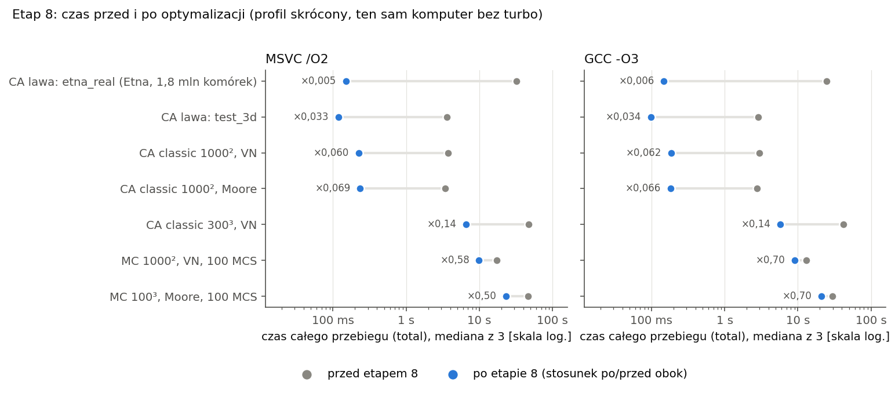
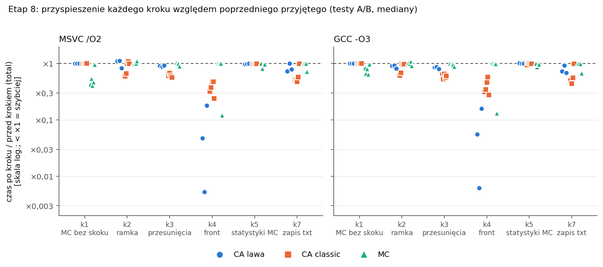
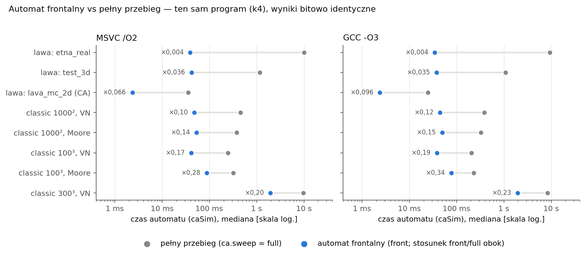

# Optymalizacja wersji sekwencyjnej

Przyspieszenie silnika (CA i MC) na jednym rdzeniu, ostatni krok przed zrównolegleniem (OpenMP, potem MPI).
Punktem wyjścia była lista priorytetowa z profilu ([Profil aplikacji](profilowanie.md), punkt 2.3). Dwie zasady:

- **Poprawność ponad wszystko.** Każda zmiana daje wyniki **bitowo identyczne** z programem sprzed optymalizacji: pliki
  `ca_result.*`, `mc_result.*`, `mc_stats.csv` i `stats.json` z historią liczników, dla wszystkich configów z `configs/`,
  w MSVC i GCC (te same pliki w obu kompilatorach, jak dotąd).
- **Każda zmiana zmierzona testem A/B**, nie „na oko”: stary i nowy program naprzemiennie, przypięte do jednego rdzenia,
  mediana i rozrzut z kilku powtórzeń. Zmiana bez zysku ponad szum (±3%) nie wchodzi.

**Wynik w skrócie** (profil przed i po optymalizacji, te same warunki pomiaru, punkt 4; czas całego przebiegu):

| Przypadek | MSVC przed → po | | GCC przed → po | |
|---|---|---|---|---|
| CA lawa `etna_real` (Etna, 1,8 mln komórek) | 32,3 s → 0,150 s | ×0,005 | 24,7 s → 0,148 s | ×0,006 |
| CA lawa `test_3d` | 3,59 s → 0,119 s | ×0,033 | 2,87 s → 0,098 s | ×0,034 |
| CA classic 1000², 100 zarodków, VN | 3,72 s → 0,223 s | ×0,060 | 3,00 s → 0,186 s | ×0,062 |
| CA classic 300³, 100 zarodków, VN | 47,5 s → 6,56 s | ×0,14 | 42,0 s → 5,78 s | ×0,14 |
| MC 1000², VN, 100 MCS | 17,2 s → 9,92 s | ×0,58 | 13,0 s → 9,03 s | ×0,70 |
| MC 100³, Moore, 100 MCS | 46,4 s → 23,1 s | ×0,50 | 29,9 s → 20,9 s | ×0,70 |

Czasy przy **taktowaniu bazowym** procesora (punkt 1.3); przy taktowaniu dynamicznym te same przypadki są ok. 2,3× krótsze, a stosunki są te same
(np. `etna_real` w teście A/B przy taktowaniu dynamicznym: automat 13,1 s → 39 ms). **Ogromny zysk automatu frontalnego w lawie wynika
z tego, że lawa zajmuje ułamek siatki**: pełny przebieg sprawdzał w każdym kroku wszystkie 1,8 mln komórek, z których
w kroku zmienić może się kilkaset. Dowodem poprawności jest bitowa zgodność w obu trybach (`ca.sweep = front`
i `full`), a pełny przebieg zostaje w kodzie jako wersja referencyjna.

## 1. Metodyka

### 1.1 Program „przed” i zgodność bitowa

Przed pierwszą zmianą zbudowano czyste MSVC Release i GCC Release i zachowano je jako `bench/baseline/engine_przed_msvc.exe`
i `engine_przed_gcc`; po każdym przyjętym kroku `engine_kN_*` (katalog `bench/baseline/` jest lokalny, w `.gitignore`;
programy da się odtworzyć z historii repozytorium). Zgodność sprawdza `bench/compare_results.py`: każdy config
z `configs/*.json` (w wariancie domyślnym; `mc_basalt` w trybie `--mc-from` na wyniku `lava_mc_2d` tego samego programu)
liczony każdym programem, folder wyników porównany bajt po bajcie z wynikiem pierwszego programu (bez `times.json`
i `config_used.json`; `stats.json` przy różnicy bajtowej jeszcze raz jako JSON bez pól z czasem; MSVC ↔ GCC: pliki
tekstowe bez różnicy końców wierszy). Program GCC jest uruchamiany w WSL, więc jedna tabela sprawdza też MSVC ↔ GCC.
Wynik każdego kroku: `bench/results/ab/zgodnosc_kN.md`: **15/15 configów zgodnych w każdym kroku, w obu kompilatorach**
(dla k4 dodatkowo w trybach `front` i `full`).

### 1.2 Test A/B: `bench/ab.py`

- Programy uruchamiane **naprzemiennie** (A B, potem B A: kolejność odwracana co powtórzenie, żeby dryf temperatury
  procesora rozkładał się równo), proces przypięty do procesora logicznego 2 (rdzeń P), na Windows priorytet
  `HIGH_PRIORITY_CLASS`; GCC w WSL (`sched_setaffinity`, procesor wirtualny), programy i dane na ext4 maszyny WSL.
- **Stały zestaw 13 przypadków** przez całą optymalizację: CA lawa (`test_3d`, `etna_real`, część CA `lava_mc_2d`),
  CA classic (1000² VN i Moore, 100³ VN i Moore, 300³ VN), MC (`mc_full_2d` 200² i 1000², `mc_full_3d` 50³ i 100³,
  `lava_mc_3d` z mobilnością). 5–11 powtórzeń (szybkie przypadki więcej), mediana i [min–max].
- Miary z `times.json` (`caSim`, `mcSim`, `mcStats`, `save`, `mcSave`, `total`) i czas procesu (`procWall`).
- **Po każdym powtórzeniu wyniki są porównywane bitowo** z pierwszym programem, więc test A/B jest jednocześnie testem
  zgodności na zestawie przypadków.
- Wynik: `<nazwa>.md` (tabela), `<nazwa>.csv` (mediany), `<nazwa>_raw.csv` (każdy przebieg). Pomiar podzielony na części
  (np. osobno grupy CA i MC) scala `ab.py --from-raw a_raw.csv,b_raw.csv --labels …` w jedną tabelę.

### 1.3 Warunki pomiarów

- **Tło** (obciążenie całego procesora przez inne programy, `psutil`, na początku i końcu każdego pomiaru) jest zapisane
  w nagłówku każdej tabeli i w dzienniku [`bench/results/ab/POSTEP.md`](../bench/results/ab/POSTEP.md). Stały składnik
  ok. 2 procesorów logicznych to zapytania WMI programów działających w tle (np. narzędzi producenta laptopa).
  W pomiarach optymalizacji: 9–30% CPU, stabilne między początkiem a końcem pomiaru. Test A/B jest na tło odporny (oba programy
  w tych samych warunkach, naprzemiennie), bezwzględne czasy mniej.
- **Pierwszy profil odniesienia** (`profile_2026-10-17_przed`) miał tło 17–20% (aktualizacje systemu, skan antywirusowy),
  więc profil „przed” do porównania z „po” powtórzono (`_przed2`) w tych samych warunkach co `_po`.
- **Ograniczona moc komputera (od kroku 5).** Komputer pomiarowy (laptop, i9-13900HX) pod pełnym obciążeniem wszystkich rdzeni
  się restartował, a kompilatory kilka razy przerwały pracę losowym błędem wewnętrznym (MSVC C1001 / 0xC0000409, GCC
  „internal compiler error: Segmentation fault” w różnych plikach; ponowienie bez zmian w kodzie przechodziło). Zamiast
  szukać usterki sprzętu, dalsza część optymalizacji (i wszystkie późniejsze pomiary) używa komputera z ograniczoną mocą: **taktowanie
  bazowe procesora** (podwyższanie częstotliwości, Intel Turbo Boost, wyłączone: maksymalny stan procesora 99% dla obu klas rdzeni; pod obciążeniem rdzeń P pracuje z 97% taktowania
  bazowego, ok. 2,1 GHz, zamiast ~4,3 GHz przy taktowaniu dynamicznym), **WSL ograniczony do 8 procesorów i 8 GB**, buildy z 4 zadaniami
  równoległymi, jedna ciężka operacja naraz (build albo pomiar), próg tła 30%.
- **Kroki k1–k4 mierzono przy taktowaniu dynamicznym, k5 i k7 przy bazowym.** Test A/B porównuje programy w tych samych warunkach, więc stosunki
  B/A z obu okresów są porównywalne; bezwzględne czasy przed/po dają profile `_przed2` i `_po`, mierzone w tej samej sesji
  i w tych samych warunkach (taktowanie bazowe). `_przed2` jest 2,2–2,8× dłuższy od pierwszego `_przed`: to samo taktowanie bazowe.
- k1 mierzono w dwóch sesjach: część MC (tło 13–14%) przed k2, część CA razem z pomiarem k2 (tło 9–16%).
- **Pomiary w częściach:** jedno polecenie pomiarowe trwa najwyżej ~10 min, a pomiarów nie puszczamy w tle, więc
  dłuższe A/B (zwłaszcza przy taktowaniu bazowym) są dzielone na części po grupach albo przypadkach i scalane `--from-raw`; profil
  `_przed2`: trzy wywołania `run_profile.py` z tą samą nazwą (skrypt dopisuje brakujące przebiegi, tło każdej części
  w `meta.passes`).
- Błędy wewnętrzne kompilatorów nie dotyczyły kodu (te same pliki kompilowane ponownie bez błędu) i nie wpływają na
  pomiary: każdy program „po” został zbudowany bez błędów i ostrzeżeń i przeszedł testy.

## 2. Każda optymalizacja osobno

Stosunek median czasu **po kroku / przed krokiem** (poprzedni przyjęty krok; < 1 oznacza szybciej), zakres po przypadkach
grupy; miara główna: `caSim` (CA) i `mcSim` (MC), dla k5 i k7 miara, której dotyczy zmiana.

| Krok | Zmiana | MSVC | GCC | Zgodne bitowo | Tabele |
|---|---|---|---|---|---|
| k1 | MC: liczenie sąsiadów bez skoku warunkowego, energia przed i po w jednym przejściu, stała część hasha przed pętlą | MC ×0,25–0,52; mcStats ×0,64–0,81; CA ×0,98–1,00 | MC ×0,43–0,82; mcStats ×0,90–0,95; CA ×0,98–1,00 | 15/15 | `ab_k1_mc_*`, `ab_k1_ca_*` |
| k2 | Ramka tylko w osiach używanych przez sąsiedztwo | classic 2D ×0,56–0,62, lawa 2D ×0,82; **CA 3D ×1,10–1,12**; MC ×0,98–1,02 | classic 2D ×0,58–0,63, classic 3D ×0,91–0,97, lawa ×0,81–0,92; MC ×0,99–1,08 | 15/15 | `ab_k2_*` |
| k3 | Przesunięcia liniowe sąsiadów w CA | lawa ×0,88–0,91, classic ×0,52–0,57; MC ×1,00–1,04 | lawa ×0,79–0,86, classic ×0,45–0,57; MC ×0,95–1,02 | 15/15 | `ab_k3_*` |
| k4 | Automat frontalny (`ca.sweep = front`) | lawa ×0,003–0,062, classic ×0,10–0,26; MC ×0,99–1,01 | lawa ×0,004–0,086, classic ×0,12–0,35; MC ×0,98–1,04 | 15/15, `front` i `full` | `ab_k4_*`, `ab_k4_*_front_full` |
| k5 | Tańsze statystyki MC (etykiety ziaren, energia całkowita) | mcStats ×0,45–0,74; MC total ×0,82–1,00; CA i mcSim ×0,98–1,02 | mcStats ×0,53–0,87; MC total ×0,87–1,01; CA i mcSim ×0,98–1,02 | 15/15 | `ab_k5_*` |
| k7 | Zapis `ca_result.txt` / `mc_result.txt` (+ w GCC wyrównanie funkcji) | save ×0,27, mcSave ×0,33; total z plikiem txt ×0,48–0,80; caSim, mcSim bez zmian | save ×0,18–0,23, mcSave ×0,31–0,33; total z txt ×0,44–0,77; caSim, mcSim ×0,99–1,03 (classic 1000² VN ×1,07 przy rozrzucie 107–261 ms) | 15/15 | `ab_k7_*`, `ab_k7a_gcc*` |
| k8 | Presety kompilatora: `msvc-release-avx2` (`/arch:AVX2`), `gcc-release-native` (`-march=native`) | ×0,98–1,05 względem k7, **bez zysku** | ×0,99–1,07 względem k7, **bez zysku** | 15/15 (także MSVC ↔ GCC) | `ab_k8_*` (7 przypadków) |

Wszystkie przebiegi A/B były bitowo zgodne z programem odniesienia. Pliki: `bench/results/ab/` (tabele `.md`, mediany
`.csv`, surowe przebiegi `_raw.csv`), dziennik z tłem każdego pomiaru: `POSTEP.md`.

Na wykresie miarą jest `total` (cały przebieg), więc widać też, ile z zysku kroku zostaje w czasie całego programu
(np. k5 skraca statystyki o połowę, ale w dużych MC dominuje `mcSim`).

## 3. Co zmieniono

### 3.1 k1: MC bez skoku warunkowego

W pętli po sąsiadach (`PottsMC::unlikeBeforeAfter`, `engine/src/mc/PottsMC.hpp`) liczniki są sumami wyników porównań
(`inDomain += sj != 0`, `sameA += sj == a`, `sameB += sj == b`) zamiast `if`; energia przed i po zmianie orientacji
wychodzi z **jednego** przejścia (różnych = w domenie − tych samych), bo nowa orientacja jest losowana przed liczeniem
energii (nie zależy od niej). Stała część kaskady `hashRand(seed, krok, …)` jest liczona raz na MCS (`hashPrefix`),
w próbie zostaje jedno ogniwo numeru próby. Decyzje stałe w czasie kroku (mobilność, sąsiedztwo losowe) wybiera szablon
`sweepTrials<kMobility, kRandomNb>` raz przed pętlą.

**Asembler** (`bench/profiles/asm/PottsMC_unlike_msvc_O2_etap8.asm`): w MSVC pętla po sąsiadach liczy przez
`setne`/`sete`, a jedynym skokiem jest powrót pętli; przed zmianą był tam skok `je` po porównaniu orientacji, trudny do
przewidzenia (dokument „Profil aplikacji”, punkt 2.4). GCC: `cmp`/`sbb` + dwa `sete`, skok tylko na końcu pętli. Stąd zysk MSVC ×2–4, a GCC
(który już wcześniej nie miał skoku) ×1,2–2,3, z jednego przejścia zamiast dwóch.

### 3.2 k2: ramka tylko w używanych osiach

W 2D trzecia oś nie ma ramki (`Dims::frameX/Y/Z`, `Storage.hpp`, `Boundary.hpp`, `PottsMC`), więc siatka 1000² ma
1002² komórek zamiast 1002²·3. Pamięć CA classic 2D w modelu: 91 → ~39 B na komórkę (razem z k4: 28–36 B), szybsze
wypełnianie ramki. **MSVC: CA 3D wolniejsze o 10–12%** przy tym samym automacie; zmienił się tylko wzór indeksu
`base + x + sx·(y + sy·z)`; k3 usuwa indeks z gorących pętli i stratę odrabia (k3/przed w lawie 3D ×0,97–1,00). Krok
przyjęty ze względu na zysk 2D i pamięć.

### 3.3 k3: przesunięcia liniowe sąsiadów w CA

Dostęp do sąsiada przez pozycję w tablicy: `Storage::Pos` (VectorStorage: indeks z ramką, MatrixStorage: współrzędne),
`linear(o) = dx + sx·(dy + sy·dz)` liczone raz w konstruktorze automatu dla każdego przesunięcia każdego wariantu
sąsiedztwa (`LavaCA::nbSteps_`), sąsiad = pozycja + przesunięcie, następna komórka w osi x = pozycja + 1. Współrzędne
sąsiada liczone dopiero wtedy, gdy jest lawą (rzadko). Wariant sąsiedztwa losowego wynika ze stałej części hasha liczonej
raz na krok (jak w MC od k1). MC używał przesunięć liniowych od początku (dokument „Monte Carlo: krystalizacja (model Pottsa)”), więc się nie zmienił.

### 3.4 k4: automat frontalny

**Pomysł:** w kroku zmienić się może tylko komórka lawy (stygnięcie, zastyganie) i komórka powietrza, do której
jakiś sąsiad-lawa (classic: sąsiad-ziarno) może wpłynąć; pozostałe komórki w pełnym przebiegu i tak zostają bez zmian.
Profil aplikacji pokazał, że 99,99% przeszukań sąsiadów powietrza w lawie nic nie znajduje.

**Struktura** (`engine/src/ca/LavaCA.hpp`, sekcja „automat frontalny”): **listy per warstwa**: dla każdej wartości osi
pionowej z (w przekroju 2D osi y) `FrontLayer` z listami `src` (lawa: wszystkie komórki lawy; classic: ziarna dodane
w poprzednim kroku), `cand` (komórki powietrza do sprawdzenia, bez powtórzeń dzięki znacznikom `mark_`, 1 B/komórkę),
`nextSrc` i `changes` (nowy stan zmienionych komórek). Krok:

1. `frontDescent`: D(n) tylko dla komórek lawy,
2. `frontCandidates`: kandydaci = komórki powietrza c, dla których jakaś komórka `src` leży w c + o, gdzie o przebiega
   **sumę wszystkich wariantów** sąsiedztwa (także losowych pentagonalnych/heksagonalnych) i przesunięcia wypełniania
   zagłębień,
3. `frontRules`: **te same funkcje reguł** co pełny przebieg (`gatherLavaCandidates`, głosowanie, stygnięcie) czytają
   tylko `cur_` i piszą listy swojej warstwy,
4. `frontApply`: zmiany do `cur_` po regułach wszystkich warstw, kopie w ramce periodycznej (`Boundary::syncCell`).

Jeden bufor siatki zamiast dwóch (bez `next_`), więc pamięć siatki CA jest o połowę mniejsza.

**Dlaczego wynik jest bitowo ten sam:** każda komórka, która może się zmienić, jest przetwarzana tą samą funkcją reguł na
tym samym stanie `cur_` z początku kroku, a losowość `hashRand(seed, krok, globalIndex)` nie zależy od kolejności
przetwarzania. Liczniki w `stats.json` liczone są z tych samych warunków co w `updateLava`/`updateClassic` (lawa, która
została lawą, + nowa; powietrze przed krokiem − nowe; zmienione), więc historia `activeCells`/`changedCells` i reguła
„krok bez zmian kończy symulację” działają bez zmian. Classic z sąsiedztwem losowym: kandydaci, którzy się nie zmienili,
zostają na liście (wariant w następnym kroku może sięgnąć do ziarna). Ramka jest wypełniana raz, potem kopiowane są tylko
zmienione komórki przy ścianach periodycznych, czyli to samo, co dałoby ponowne `apply()`.

**Testy** (`engine/tests/test_front.cpp`, 11 przypadków): lawa 2D/3D, classic 2D w trzech płaszczyznach i 3D, wszystkie
sąsiedztwa, brzeg periodyczny i absorbujący (także lawa przez brzeg), ponding wł./wył., kratery losowe, limit kroków,
reguła „krok bez zmian” (i jej brak przy sąsiedztwie losowym), obie reprezentacje siatki, ścieżka `--timing-detail`;
porównanie wyniku bitowo + liczba kroków + powód końca + historia liczników. Pełny przebieg zostaje jako wersja
referencyjna: `ca.sweep = "full"` (config, `--set`, formularz GUI).

**Front vs pełny przebieg w tym samym programie** (k4, `caSim` [ms], mediana; `ab_k4_*_front_full.md`, taktowanie dynamiczne):

| Przypadek | MSVC full | MSVC front | front/full | GCC full | GCC front | front/full |
|---|---|---|---|---|---|---|
| lawa `etna_real` | 10 074 | 39,1 | ×0,004 | 9 328 | 34,7 | ×0,004 |
| lawa `test_3d` | 1 164 | 41,7 | ×0,036 | 1 087 | 37,5 | ×0,035 |
| lawa `lava_mc_2d` (CA) | 35,4 | 2,4 | ×0,066 | 24,8 | 2,4 | ×0,096 |
| classic 1000², VN | 457 | 47,5 | ×0,10 | 382 | 44,6 | ×0,12 |
| classic 1000², Moore | 376 | 53,1 | ×0,14 | 324 | 49,6 | ×0,15 |
| classic 100³, VN | 246 | 41,1 | ×0,17 | 205 | 38,4 | ×0,19 |
| classic 100³, Moore | 318 | 88,5 | ×0,28 | 229 | 77,2 | ×0,34 |
| classic 300³, VN | 9 690 | 1 946 | ×0,20 | 8 371 | 1 946 | ×0,23 |

Zysk zależy od tego, jaka część siatki jest „aktywna”: w lawie to ułamek procenta (stąd ×0,004), w classic front obejmuje
wszystkie granice rosnących ziaren, które pod koniec wypełniają całą przestrzeń (×0,10–0,34; więcej dla Moore, bo suma
przesunięć jest większa).

**Uczciwa obserwacja:** w MSVC sam pełny przebieg (`k4_full`) jest w lawie 3D o ~22% szybszy niż k3 (`etna_real`
13,1 → 10,1 s, `test_3d` 1,49 → 1,16 s), choć pętla pełnego przebiegu się nie zmieniła; w GCC bez różnicy. Nie
wyjaśniliśmy tego do końca; najpewniej to ten sam mechanizm co w dokumencie „Prawdziwy teren i odtwarzanie erupcji” (punkt 7): inny układ kodu w pliku
wykonywalnym MSVC zmienia wyrównanie gorącej pętli. Domyślny tryb to i tak `front`.

### 3.5 k5: tańsze statystyki MC

Statystyki (liczba ziaren, energia) liczone co `mc.statsEvery` MCS zajmowały po k4 6–33% czasu przebiegu MC
(najwięcej w 3D Moore: `mc_full_3d` 50³: 236 z 717 ms). `Grains::label`
(`engine/src/mc/Grains.cpp`): dla komórek wnętrza sąsiedzi „do przodu” przez stałe przesunięcie liniowe w tablicy bez
ramki (bez zawijania współrzędnych i liczenia `globalIndex`), reprezentant komórki raz na komórkę, a gdy sąsiad x+1 ma tę
samą orientację, pominięte są przesunięcia wspólne z x+1 (połączy je komórka x+1; Moore 3D: 8 z 13 sprawdzeń). Składowe
spójności nie zależą od kolejności łączenia, a reprezentantem ziarna jest zawsze jego najmniejszy indeks, więc etykiety są
identyczne. `PottsMC::totalEnergy`: przy sąsiedztwie symetrycznym tylko pary „do przodu” (pełna suma = 2 × suma „do
przodu”; mnożenie przez 0,5 i 2 jest dokładne), bez skoków warunkowych. Testy: etykiety vs przeszukiwanie wszerz (BFS),
energia vs suma energii komórek. Największy zysk w 3D Moore (MC 100³: `mcStats` 2,3 → 1,05 s w MSVC).

Nieudana pierwsza wersja: energia z warunkiem `&&` (skok) była wolniejsza od starej, a etykiety tylko −25%; poprawione
przed pomiarem A/B (energia bez skoków, pomijanie sąsiadów wspólnych z x+1).

### 3.6 k7: zapis plików tekstowych

Zapis `ca_result.txt` (1 mln komórek, 19,7 MB) trwał 303 ms, a `ca_result.bin` 8 ms; po k4 zapis był w classic 1000²
największą częścią czasu (`save` 130 ms przy `caSim` 48 ms, taktowanie dynamiczne). `engine/src/io/ResultWriter.cpp`: znaki dopisywane
wskaźnikiem do bufora ~1 MB (bez sprawdzania rozmiaru przy każdym znaku), liczby całkowite przez `std::to_chars`,
fragment wiersza „ y z ” liczony raz na wiersz siatki, a temperatura bez `printf` (`ResultWriter::formatTemp`): iloczyn
v·10 jest w `double` dokładny (mantysa `float` 24 bity × 10 → najwyżej 27 bitów), więc zaokrąglenie do całkowitej
(do najbliższej, remis do parzystej: `std::nearbyint`) daje te same cyfry co `printf("%.1f")`. Plik jest otwierany
binarnie, a koniec wiersza dopisywany jawnie (Windows `\r\n`: te same bajty, które dawał tryb tekstowy, bez kopiowania
całego bufora przez zamianę `\n` → `\r\n`). **Format i zawartość bez zmian**: test w `test_io.cpp` porównuje plik bajt w bajt
z zapisem sprzed zmiany, a `formatTemp` z `printf` na ~520 tys. wartości (w tym remisy .25/.75, wartości ujemne, −0,0).
Wynik: `ca_result.txt` 303 → 60 ms, `mc_result.txt` 138 → 36 ms (MSVC, pojedynczy przebieg, taktowanie bazowe); w teście A/B
`save` ×0,18–0,27, `mcSave` ×0,31–0,33.

**Układ kodu w GCC.** Pierwszy pomiar k7 w GCC pokazał `caSim` wolniejsze o 3–27%, choć kod automatu się nie zmienił.
Sprawdzenie (`nm`, `objdump`): kod maszynowy `frontRules`, `frontDescent`, `stepTimed`, `gatherLavaCandidates`
i `PottsMC::sweep` w k5 i k7 jest identyczny, a wszystkie funkcje `LavaCA` przesunęły się o 16 B (np. `frontRules`
z 48 na 0 B w linii 64 B), bo o tyle urósł kod `ResultWriter.cpp` położony przed nimi. Rozwiązanie: **GCC Release
kompiluje z `-falign-functions=64`** (`engine/CMakeLists.txt`): każda funkcja zaczyna się na początku linii 64 B, więc
położenie pętli automatu i MC względem linii nie zależy od kodu w innych plikach. A/B k5 / k7 / k7 z wyrównaniem
(`ab_k7a_gcc.md`): z wyrównaniem `caSim` ×0,99–1,03 względem k5 (classic 1000² VN ×1,07 przy rozrzucie 107–261 ms;
bez wyrównania ×1,03–1,25), MC bez zmian; wyniki bitowo te
same (`zgodnosc_k7a_gcc.md`). MSVC nie ma odpowiednika dla pojedynczych funkcji; w MSVC k7 nie zmieniło `caSim`.

## 4. Łącznie: przed → po

Profil skrócony (`bench/run_profile.py --cases …`, te same miary co pełny profil, 3 powtórzenia, MSVC i GCC, taktowanie bazowe):
`bench/results/profile_2026-10-17_przed2*` (programy `engine_przed_*`, tło 22–25% na starcie części) i
`profile_2026-10-17_po*` (programy k7 MSVC i k7 z wyrównaniem GCC, czyli obecny kod; tło 17–18%). Mediany:

| Przypadek | Miara | MSVC przed2 | MSVC po | po/przed | GCC przed2 | GCC po | po/przed |
|---|---|---|---|---|---|---|---|
| `etna_real` | caSim | 32 203 ms | 85,8 ms | ×0,003 | 24 621 ms | 77,3 ms | ×0,003 |
| | total | 32 281 ms | 150 ms | ×0,005 | 24 729 ms | 148 ms | ×0,006 |
| `test_3d` | caSim | 3 517 ms | 93,3 ms | ×0,027 | 2 819 ms | 85,7 ms | ×0,030 |
| classic 1000², VN | caSim | 3 361 ms | 122 ms | ×0,036 | 2 683 ms | 107 ms | ×0,040 |
| | save | 309 ms | 80,3 ms | ×0,26 | 255 ms | 60,6 ms | ×0,24 |
| | total | 3 724 ms | 223 ms | ×0,060 | 2 999 ms | 186 ms | ×0,062 |
| classic 1000², Moore | total | 3 399 ms | 236 ms | ×0,069 | 2 761 ms | 182 ms | ×0,066 |
| classic 300³, VN | caSim | 38 122 ms | 3 663 ms | ×0,096 | 34 540 ms | 3 423 ms | ×0,099 |
| | total | 47 515 ms | 6 557 ms | ×0,14 | 42 049 ms | 5 783 ms | ×0,14 |
| MC 1000², VN | mcSim | 16 321 ms | 9 401 ms | ×0,58 | 12 331 ms | 8 589 ms | ×0,70 |
| | mcStats | 739 ms | 424 ms | ×0,57 | 539 ms | 392 ms | ×0,73 |
| MC 100³, Moore | mcSim | 42 850 ms | 21 943 ms | ×0,51 | 27 793 ms | 19 920 ms | ×0,72 |
| | mcStats | 3 377 ms | 1 126 ms | ×0,33 | 1 933 ms | 931 ms | ×0,48 |
| | total | 46 390 ms | 23 138 ms | ×0,50 | 29 853 ms | 20 905 ms | ×0,70 |

Te same kroki z testów A/B (miara `total`; przed → k4 przy taktowaniu dynamicznym, k5 i k7 względem poprzedniego kroku przy bazowym):

| Przypadek | MSVC przed → k4 | k5/k4 | k7/k5 | GCC przed → k4 | k5/k4 | k7/k5 |
|---|---|---|---|---|---|---|
| `etna_real` | 13 118 → 68,8 ms (×0,005) | ×0,99 | ×1,00 (tylko bin) | 11 990 → 59,0 ms (×0,005) | ×1,01 | ×0,93 |
| `test_3d` | 1 557 → 71,9 ms (×0,046) | ×0,98 | ×0,73 | 1 354 → 61,3 ms (×0,045) | ×1,02 | ×0,73 |
| classic 1000², VN | 1 586 → 191 ms (×0,12) | ×0,98 | ×0,51 | 1 391 → 156 ms (×0,11) | ×0,95 | ×0,51 |
| classic 300³, VN (bin) | 18 150 → 2 452 ms (×0,14) | ×0,99 | ×0,99 | 16 164 → 2 426 ms (×0,15) | ×0,98 | ×0,99 |
| MC 1000² | 7 104 → 4 110 ms (×0,58) | ×1,00 | ×1,01 | 5 322 → 3 353 ms (×0,63) | ×1,01 | ×1,00 |
| MC 100³ | 19 092 → 9 184 ms (×0,48) | ×0,96 | ×1,00 | 12 906 → 8 215 ms (×0,64) | ×0,95 | ×0,95¹ |
| `lava_mc_3d` (CA + MC) | 1 359 → 156 ms (×0,11) | ×0,98 | ×0,72 | 1 073 → 113 ms (×0,11) | ×0,96 | ×0,68 |

¹ k7 bez wyrównania funkcji (przypadek nie był w pomiarze `ab_k7a_gcc`; MC nie zależy od wyrównania, punkt 3.6).

**Pamięć** (model z kodu, `MemoryModel`, B na komórkę; MSVC; `_przed2` → `_po`): classic 1000² VN 91,3 → 28,3, Moore
91,3 → 35,6 (ramka tylko w osiach 2D + jeden bufor siatki); classic 300³ 39,5 → 29,0; lawa `test_3d` 43,0 → 30,8,
`etna_real` 41,5 → 29,0 (jeden bufor, + 1 B znaczników frontu); MC 1000² 51,9 → 41,8 (ramka 2D), MC 100³ bez zmian.
Szczyt pamięci procesu: classic 1000² 93 → 34 MB, 300³ 1024 → 755 MB, `etna_real` 76 → 55 MB.

## 5. Profil po zmianach: co dominuje teraz

gprof, build `gcc-profile-noinline` (kluczowe funkcje bez wstawiania: podział czasu między funkcje, nie czasy),
`ETAP8=1 bash bench/profile_gcc.sh` → `bench/profiles/etap8_gprof_*_flat.txt`; krótkie przypadki 20 przebiegów:

| Przypadek | Najdroższe funkcje (udział czasu własnego) |
|---|---|
| CA lawa `etna_real` | `frontCandidates` 40%, `gatherLavaCandidates` 13%, `frontRules` 6%; **przygotowanie ~25%** (odczyt mapy wysokości, wypełnianie tablic, `initFront`, `toMicrostructure`) |
| CA lawa `test_3d` | `frontCandidates` 56%, `gatherLavaCandidates` 27%, `frontRules` 5% |
| CA classic (`classic_ref`, 100³) | `frontCandidates` 42%, `frontRules` (głosowanie) 19%, `frontApply` 9%, `syncCell` 7% |
| MC `mc_full_3d` (300 MCS) | `sweepTrials` 83%, `Grains::label` 14%, `totalEnergy` 3% |

Fazy (`--timing-detail`, profil `_po`, MSVC): `test_3d`: reguły (kandydaci + reguły) 86 ms, D(n) 9 ms, ramka i koniec
kroku 2 ms (przed: reguły 3 799 ms, D(n) 160 ms, ramka 51 ms); MC 100³ Moore: jeden MCS 195–260 ms (przed 332–406 ms),
etykiety ziaren 188 ms i energia 52 ms na 20 MCS (przed 338 i 294 ms).

**Wnioski:** w CA najdroższe jest teraz **budowanie listy kandydatów** (dla każdej komórki frontu suma przesunięć
wszystkich wariantów, w lawie z wypełnianiem zagłębień), a w dużych przypadkach lawy rośnie udział przygotowania, które
nie zależy od liczby kroków. W MC dominuje pętla prób (losowy dostęp do pamięci), statystyki to już ~15%.

## 6. Pominięte i dalsze możliwości

Z powodu ograniczonego czasu pomiarów (taktowanie bazowe wydłużyło każdy pomiar ok. 2,3×) pominięto:

- **k6: mniejsze typy i mniej kopiowania.** Pomysł: orientacja MC `int32` → `uint16` z maską w orientacji (0 = poza
  domeną), `flowId` jako `uint16` (z walidacją liczby kraterów/ziaren w configu), CA classic bez pól `temp`, `solidStep`,
  `arrivalStep` (13 → 5 B na komórkę). Spodziewany efekt: pamięć ×2–3 mniej, MC na dużych siatkach ×1,3–2 (mniej
  chybień pamięci podręcznej), CA mniej (automat frontalny dotyka mało komórek). Część „mniej kopiowania” zrobił już k4
  (jeden bufor siatki).
- **Warianty algorytmiczne MC** (zmieniają proces losowy, więc byłyby osobnymi opcjami configu z walidacją
  statystyczną: średnia liczba i wielkość ziaren dla ≥ 10 ziaren generatora, krzywe liczby ziaren vs MCS):
  - *losowanie bez powtórzeń*: każda komórka domeny raz na MCS w losowej permutacji (Fisher–Yates z `hashRand`);
    ten sam koszt próby, ale bez komórek pominiętych w danym MCS; spodziewana kinetyka zgrubiania nieco szybsza na MCS,
    zysk czasu mały (permutacja kosztuje tyle co losowanie);
  - *próby tylko na granicach ziaren*: komórka bez sąsiada o innej orientacji nie może obniżyć energii, więc przy kT = 0
    jej pominięcie nie zmienia rozkładu wyników; po początkowej fazie zgrubiania granice to kilka–kilkanaście procent
    komórek, więc spodziewany zysk ×3–10 na MCS (koszt: utrzymanie listy granic); przy kT > 0 wnętrze ziarna też może
    się zmienić (z prawdopodobieństwem exp(−ΔE/kT)), więc wariant przybliża proces;
  - *propozycja orientacji spośród sąsiadów* zamiast z całego 1..Q: akceptacja rośnie z ~13% do kilkudziesięciu
    procent, zgrubianie na MCS jest szybsze, więc porównanie z wariantem naiwnym musi być przy tym samym czasie, nie
    tylko tej samej liczbie MCS.
- **CA:** tańsze `frontCandidates` (osobne listy przesunięć dla lawy na gruncie i w powietrzu zamiast sumy wszystkich
  wariantów; dla classic tylko sąsiedzi nowych ziaren, którzy są powietrzem) i równoległe lub szybsze przygotowanie
  (odczyt mapy wysokości, `toMicrostructure` bez kopii).

### 6.1 k8: kompilator i flagi (nieudana próba)

Nowe presety, domyślne bez zmian: `msvc-release-avx2` (`/O2 /Ob2 /DNDEBUG /arch:AVX2`, katalog `build-msvc-avx2/`)
i `gcc-release-native` (`-O3 -DNDEBUG -march=native`, `build-gcc-native/`; jak domyślny GCC, z `-falign-functions=64`).
Oba budują się bez ostrzeżeń, `ctest` 12/12, wyniki **bitowo zgodne** ze wszystkimi programami (15/15 configów,
`zgodnosc_k8.md`); `-march=native` mogło włączyć FMA i zmienić zaokrąglenia, ale na żadnym configu wynik się nie
zmienił. **Zysku brak** (A/B na 7 przypadkach, taktowanie bazowe):
AVX2 / k7 ×0,98–1,05, native / k7 z wyrównaniem ×0,99–1,07. Gorące pętle są ograniczone dostępem do pamięci i skokami,
nie arytmetyką, a pętla po sąsiadach MC nie wektoryzuje się (dokument „Profil aplikacji”, punkt 2.4), więc szersze wektory nic nie dają, a program
`-march=native` jest nieprzenośny. Presety zostają do porównań. PGO (MSVC) nie sprawdzano; zysk mógłby przyjść głównie
z lepszego układu gorącego kodu, który okazał się wrażliwy (punkty 3.4 i 3.6).

## 7. Wnioski dla wersji OpenMP

- **Pomiary równoległe tylko na rdzeniach P, najwyżej 8 wątków lub procesów** (OpenMP 1, 2, 4, 6, 8; MPI 1–8, w tym
  ≥ 3): jeden wątek na rdzeń fizyczny P (procesory logiczne 0, 2, …, 14), rdzenie E wolne dla systemu. To świadoma
  decyzja: rdzenie P i E mają różną wydajność, więc mieszanie ich zaburza przyspieszenie i efektywność; 8 rdzeni P
  wystarcza do pokazania skalowania, a komputer nie pracuje z pełną mocą (punkt 1.3).
- **CA, automat frontalny: gotowy do podziału.** Pętle po warstwach w `frontDescent`, `frontCandidates`, `frontRules`
  i `frontApply` są niezależne: kandydaci warstwy k powstają tylko z `src` warstw k−1..k+1 (grupy przesunięć `rev_[d]`)
  i trafiają do list i znaczników warstwy k; reguły czytają tylko `cur_` (stan z początku kroku) i piszą listy swojej
  warstwy; liczniki (`stay`, `changed`, `born`) są lokalne (redukcja); zmiany warstwy dotyczą komórek tej warstwy
  (kopie w ramce periodycznej to różne komórki ramki). OpenMP: `parallel for schedule(dynamic)` po warstwach (front jest
  nierównomierny, bo lawa skupia się w kilku warstwach), bariera między fazami. Zależność: faza `frontApply` musi zacząć
  się po zakończeniu reguł **wszystkich** warstw (reguły czytają `cur_`), a `frontCandidates` warstwy k po
  `nextSrc` warstw sąsiednich z poprzedniego kroku.
- **CA, pełny przebieg** (`ca.sweep = full`): klasyczny synchroniczny automat z dwoma buforami: pętla po z dzieli się
  na pasy bez zależności, liczniki przez redukcję; dobry punkt odniesienia skalowania (dużo pracy na komórkę).
- **Wynik nie zależy od liczby wątków**, bo losowość pochodzi z `hashRand(seed, krok, globalIndex)`, a nie z generatora
  ze stanem: to warunek bitowej zgodności wersji równoległej z sekwencyjną.
- **MC: wymaga zmiany schematu.** Obecny MC to losowe próby po kolei (`hashRand(seed, MCS, numer próby)`), a każda
  zaakceptowana zmiana wpływa na następne próby: kolejność prób definiuje trajektorię, więc pętli nie da się podzielić
  bez zmiany wyniku. Standardowe rozwiązanie: **szachownica** (podsieci, w których żadne dwie komórki nie są
  sąsiadami: 2 kolory dla von Neumanna, 4 w 2D i 8 w 3D dla Moore'a); komórki jednego koloru aktualizowane równolegle,
  losowość z `hashRand(seed, MCS, kolor, komórka)`. To nowy wariant (opcja configu), statystycznie równoważny wariantowi
  naiwnemu, deterministyczny dla każdej liczby wątków. Zależności: kopie w ramce periodycznej (`syncFrame`) dotyczą
  komórek przy ścianach, różnych dla różnych komórek, bez konfliktu.
- **Statystyki MC:** energia to redukcja (prosta), etykiety ziaren (union-find) są sekwencyjne z natury; równolegle:
  etykiety w pasach + łączenie na granicach pasów, albo zostawić sekwencyjne (po k5 ~14% czasu MC przy `statsEvery` 10).
- **Zapis wyników:** formatowanie pliku tekstowego w pasach do osobnych buforów i zapis po kolei (wynik ten sam);
  plik binarny jest ograniczony przepustowością dysku.
- **Prawo Amdahla:** w lawie po optymalizacji przygotowanie (teren, mapa wysokości, alokacja) to już ~25% czasu `etna_real`,
  więc bez jego zrównoleglenia przyspieszenie całego przebiegu lawy będzie ograniczone.

## 8. Testy i weryfikacja

- **doctest:** fronty vs pełny przebieg (`test_front.cpp`), etykiety ziaren vs BFS i energia vs suma energii komórek
  (`test_mc.cpp`), `formatTemp` = `printf` i zapis txt bajt w bajt (`test_io.cpp`), model pamięci z ramką 2D
  (`test_profile.cpp`): MSVC 111/111 przypadków, GCC 110/110.
- **Buildy:** MSVC Release i GCC Release bez ostrzeżeń (`/W4`, `-Wall -Wextra`), `ctest` 12/12; MSVC Debug bez ostrzeżeń,
  `ctest` 12/12; presety k8 (`msvc-release-avx2`, `gcc-release-native`) bez ostrzeżeń, `ctest` 12/12. **GCC Debug pominięty**: przy ograniczonej mocy komputera jeden build Debug na koniec optymalizacji, ten sam kod co GCC
  Release (ostrzeżenia sprawdza Release), asercje i kod bez optymalizacji sprawdza Debug MSVC, a każdy dodatkowy pełny
  build był ryzykiem błędu wewnętrznego kompilatora.
- `python -m pytest gui\tests`: 100/100 (formularz GUI pokazuje opcję `ca.sweep` z polskim opisem; nowe pole configu
  trafia do formularza samo z `--print-defaults`).
- **Zgodność bitowa** wszystkich configów z programem „przed” po każdym kroku: `zgodnosc_k1.md` … `zgodnosc_k7.md`,
  `zgodnosc_k7a_gcc.md`: 15/15, MSVC i GCC.

## 9. Pliki

| Plik | Co |
|---|---|
| `bench/ab.py` | test A/B: naprzemiennie, przypięcie, mediana i rozrzut, zgodność bitowa po każdym powtórzeniu, `--from-raw` |
| `bench/compare_results.py` | zgodność bitowa wszystkich configów kilku programów (MSVC i GCC przez WSL) |
| `bench/plot_etap8.py` | wykresy `docs/img/etap8_*.png` |
| `bench/run_profile.py` | nowa opcja `--cases` (profil skrócony), `etna_real` w grupie `lava` |
| `bench/profile_gcc.sh` | tryb `ETAP8=1` (krótki profil gorących miejsc po zmianach) |
| `bench/results/ab/` | tabele i surowe przebiegi A/B (`ab_k*`), zgodność (`zgodnosc_k*`), dziennik `POSTEP.md` |
| `bench/results/profile_2026-10-17_przed*`, `_przed2*`, `_po*` | profile przed (taktowanie dynamiczne, tło 17–20%), przed2 i po (te same warunki) |
| `bench/profiles/etap8_gprof_*`, `asm/PottsMC_unlike_msvc_O2_etap8.asm` | profil po zmianach, asembler pętli MC po k1 |
| `engine/src/mc/PottsMC.*`, `Grains.*`, `core/Rng.hpp` | k1 (pętla prób), k5 (statystyki) |
| `engine/src/core/Types.hpp`, `Storage.hpp`, `Boundary.hpp`, `MemoryModel.hpp`, `Neighborhood.hpp` | k2 (ramka w używanych osiach), k3 (`Pos`, `linear`, wariant sąsiedztwa ze stałej części hasha), `syncCell` |
| `engine/src/ca/LavaCA.hpp`, `CaRules.hpp` | k3, k4 (automat frontalny), opis warunków zmiany komórki |
| `engine/src/io/Config.*`, `gui/static/js/form.js` | `ca.sweep` (`front` / `full`) i jego opis w formularzu |
| `engine/src/io/ResultWriter.*` | k7 (zapis txt, `formatTemp`) |
| `engine/CMakeLists.txt` | GCC Release: `-falign-functions=64` |
| `CMakePresets.json` | presety `msvc-release-avx2`, `gcc-release-native` (k8, porównanie flag) |
| `engine/tests/test_front.cpp`, `test_mc.cpp`, `test_io.cpp`, `test_profile.cpp`, `test_boundary.cpp`, `test_rng.cpp` | testy |
