# Prawdziwy teren i odtwarzanie erupcji

Prawdziwe wulkany (Etna, Wezuwiusz) i odtwarzanie erupcji krok po kroku. Dwie rzeczy:

- **A. Presety z prawdziwym terenem**: mapy wysokości Etny i Wezuwiusza pobrane z publicznego zbioru danych
  wysokościowych, kratery w zadanych miejscach (`vents.placement = "positions"`), wybór kraterów kliknięciem na mapie w GUI.
- **B. Odtwarzanie erupcji**: suwak czasu „krok 0 … ostatni krok”, Odtwórz/Pauza i prędkość w podglądzie 2D i 3D,
  eksport klatek PNG (ZIP) i filmu WebM; odtwarzanie krystalizacji MC z migawek.

> **Zastrzeżenie.** Model **nie jest skalibrowany fizycznie**. To automat komórkowy „rozrostu ziaren” z regułami
> grawitacji i stygnięcia (`engine/src/ca/CaRules.hpp`) uruchomiony na prawdziwym terenie: **symulacja, nie prognoza**.
> Parametry lawy dobrano tak, żeby obraz był czytelny i czas obliczeń krótki, a nie z własności lawy Etny czy
> Wezuwiusza; zasięgi i czasy kroków nie odpowiadają prawdziwym kilometrom ani godzinom. Erupcja boczna Etny jest
> **inspirowana** erupcją z 2001 r. (położenie szczeliny), a nie jej odtworzeniem.

Reguły CA i MC nie zmieniły się: wyniki wszystkich wcześniejszych configów (`test_2d`, `lava_mc_2d`, `mc_full_2d`,
`classic_ref`, `test_3d`, `heightmap_*`, `lava_mc_3d`, `mc_full_3d`) są bitowo identyczne z wynikami silnika sprzed
tych zmian (`cmp` plików `ca_result.*`, `mc_result.*`, `stats.json`, `mc_stats.csv`), GCC i MSVC dają te same pliki,
a czasy CA/MC w teście A/B (punkt 7) są takie jak przed zmianami.

## 1. Skąd dane

| | |
|---|---|
| **Źródło** | **AWS Terrain Tiles** (Tilezen / Mapzen „Terrain Tiles”): publiczny zasób S3, bez klucza i logowania |
| **Format** | kafelki **Terrarium PNG** 256×256, Web Mercator (schemat „slippy map” z/x/y): `https://s3.amazonaws.com/elevation-tiles-prod/terrarium/{z}/{x}/{y}.png` |
| **Dekodowanie** | wysokość [m] = R·256 + G + B/256 − 32768 (dokładność 1/256 m; morze: 0 albo ujemne z ETOPO1) |
| **Dane pod spodem** | na lądzie przy zoomie 10–15 głównie **SRTM** (30 m), w Europie także **EU-DEM**; oceany: ETOPO1 (dokumentacja `tilezen/joerd`, `docs/data-sources.md`) |
| **Licencja / przypisanie** | dane są otwarte, ale wymagane jest przypisanie wg `tilezen/joerd`, `docs/attribution.md`; pełny tekst w [configs/heightmaps/README.md](../configs/heightmaps/README.md) (wzmianka i odnośnik w [README.md](../README.md)); w metadanych każdej mapy (`<nazwa>.json`, pole `source.attribution`) |
| **Data pobrania** | 2026-10-13 (`fetched` w metadanych) |

Wymagane przypisanie (skrót; dla naszych obszarów istotne: *Europe … EU-DEM* oraz *SRTM … U.S. Geological Survey*):

```
* ArcticDEM terrain data DEM(s) were created from DigitalGlobe, Inc., imagery and funded under National Science
  Foundation awards 1043681, 1559691, and 1542736;
* Australia terrain data © Commonwealth of Australia (Geoscience Australia) 2017;
* Austria terrain data © offene Daten Österreichs – Digitales Geländemodell (DGM) Österreich;
* Canada terrain data contains information licensed under the Open Government Licence – Canada;
* Europe terrain data produced using Copernicus data and information funded by the European Union - EU-DEM layers;
* Global ETOPO1 terrain data U.S. National Oceanic and Atmospheric Administration
* Mexico terrain data source: INEGI, Continental relief, 2016;
* New Zealand terrain data Copyright 2011 Crown copyright (c) Land Information New Zealand and the New Zealand
  Government (All rights reserved);
* Norway terrain data © Kartverket;
* United Kingdom terrain data © Environment Agency copyright and/or database right 2015. All rights reserved;
* United States 3DEP (formerly NED) and global GMTED2010 and SRTM terrain data courtesy of the U.S. Geological Survey.
```

## 2. Jak pobrano: `tools/fetch_dem.py`

```powershell
python tools\fetch_dem.py --name etna --bbox 37.58 14.80 37.92 15.22 --zoom 11 --nx 160 --ny 160 --nz 70 --description "Etna (Sycylia)"
python tools\fetch_dem.py --name wezuwiusz --bbox 40.77 14.36 40.87 14.49 --zoom 12 --nx 140 --ny 140 --nz 50 --description "Wezuwiusz z Monte Somma (Kampania)"
python tools\fetch_dem.py ... --from-cache      # bez internetu, z kafelków w tools\.dem_cache\ (poza repozytorium)
```

Kroki skryptu:

1. **bbox → kafelki.** Narożniki (szer., dł.) → globalne współrzędne piksela Web Mercator przy danym zoomie
   (`latlon_to_pixel`), zakres kafelków z marginesem 2 pikseli (`tile_range`); pobranie (`urllib`, 3 próby, cache
   `tools/.dem_cache/terrarium/z/x/y.png`), dekodowanie Terrarium (`decode_terrarium`), mozaika.
2. **Przepróbkowanie do siatki nx × ny.** Środek komórki (x, y) → (szer., dł.) **liniowo w bbox**: x = 0 to zachód,
   **y = 0 to południe, y = ny − 1 to północ** (ta sama konwencja co import obrazów w `gui/heightmap.py` i rzut z góry
   w podglądzie 2D); → piksel mozaiki → **interpolacja dwuliniowa** (`bilinear`). Gdy na komórkę przypada > 1,5
   piksela kafelka, mozaika jest najpierw wygładzana (3 przebiegi filtra pudełkowego ≈ filtr Gaussa o szerokości
   ~komórki): komórka niesie średnią swojego terenu zamiast przypadkowego piksela (bez aliasingu).
3. **Skala pionowa.** Poziom odniesienia = max(0, minimum obszaru); gdy w kadrze jest morze, poziom morza (dno
   morza → 0); najwyższy punkt → **0,85·nz** komórek (`--peak`). Komórki = (wysokość − poziom) / (m na komórkę),
   zaokrąglone do 0,01 (silnik bierze `ceil`).
4. **Zapis** do `configs/heightmaps/` (małe pliki, do repozytorium): `<nazwa>.csv` (format silnika: ny wierszy ×
   nx wartości), `<nazwa>.png` (podgląd w odcieniach szarości, północ u góry), `<nazwa>.json` (bbox, zoom, kafelki,
   źródło i przypisanie, data pobrania, m/komórkę w poziomie X/Y i w pionie, przewyższenie, min/max/średnia
   wysokość, położenie szczytu, wzór komórka ↔ szer./dł.).

Pomocniczo **`tools/latlon_to_grid.py`**: (szer., dł.) → kolumna (x, y) + wysokość + okno wysokości wokół + lokalne
zagłębienia (do weryfikacji kraterów); `--cell X Y` odwrotnie. Wzór: `x = floor((dł − W)/(E − W)·nx)`,
`y = floor((szer − S)/(N − S)·ny)`; punkt na granicy komórek należy do komórki na E/N.

### Wynik pobrania

| | Etna | Wezuwiusz |
|---|---|---|
| bbox (S, W, N, E) | 37,58; 14,80; 37,92; 15,22 (bez zmian) | 40,77; 14,36; 40,87; 14,49 (bez zmian) |
| zoom, kafelki | 11: 12 kafelków (x 1108–1110, y 790–793) | 12: 6 kafelków (x 2211–2212, y 1537–1539) |
| piksel kafelka | 60 m (3,8 piksela na komórkę) | 29 m (2,7 piksela na komórkę) |
| siatka | 160 × 160 × 70 | 140 × 140 × 50 |
| obszar | 37,0 × 37,7 km | 11,0 × 11,1 km |
| m/komórkę poziomo (X × Y) | 231,3 × 235,9 (średnio 233,6) | 78,3 × 79,3 (średnio 78,8) |
| m/komórkę pionowo | 55,1 | 29,1 |
| przewyższenie | ×4,24 | ×2,71 |
| wysokość min–max | 0 (morze) – 3276 m | 0 (morze) – 1235 m |
| najwyższa komórka | x = 74, y = 82 (37,7553 N, 14,9956 E), Krater Płn.-Wsch. | x = 75, y = 73 (40,8225 N, 14,4301 E), krawędź krateru |

Szczyty wyszły niżej niż w rzeczywistości (Etna ~3350 m, Wezuwiusz 1281 m), bo komórka to średnia z ~230 m (Etna)
i ~80 m (Wezuwiusz): wygładzenie ścina wierzchołki. **Kadr sprawdzony** na cieniowanej mapie z poziomicami
(panel „Kratery na mapie” niżej: Etna i Wezuwiusz): oba wulkany są w środku i w całości, zadany bbox
nie wymagał poprawek. Na Etnie widać na wschód od szczytu **Valle del Bove** (kotlina ze stromą ścianą zachodnią,
dno ~1500–1850 m, x ≈ 86–100, y ≈ 62–90), morze w pasie wschodnim; na Wezuwiuszu Gran Cono z kraterem (zagłębienie
~200 m), łuk **Monte Somma** na północy (grzbiet 900–1060 m, y ≈ 87–95) i dolina między nimi (Atrio del Cavallo /
Valle del Gigante, ~700–870 m), morze w narożniku SW.

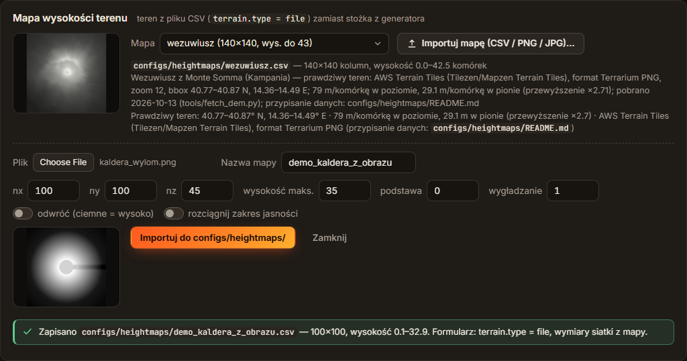

## 3. Kratery w zadanych miejscach: `vents.placement = "positions"`

Nowe w configu: `"vents": { "placement": "positions", "positions": [[x, y], ...], "count": N }`. Krater = pierwsza komórka
powietrza nad terenem w kolumnie (x, y), `flowId` = numer na liście (1, 2, …). Domyślnie lista jest pusta
i `placement = "crater"`; stare configi działają bitowo tak samo (sprawdzają to testy i `cmp`).

Walidacja (`Config::fromJson`, komunikaty po polsku z nazwą parametru; GUI podświetla pole):
- lista par liczb całkowitych `[x, y]`, `0 ≤ x < nx`, `0 ≤ y < ny`, bez powtórzeń kolumny;
- przy `placement = "positions"` lista niepusta i **`vents.count` musi być równe długości listy** (wybór: jawna zgodność
  obu pól zamiast liczenia `count` z listy, bo pomyłka w jednym z pól nie przejdzie po cichu; GUI ustawia `count`
  samo przy każdym kliknięciu na mapie);
- kolumna w całości ze skały (wysokość terenu ≥ nz) → błąd przy rozmieszczaniu (`VentPlacer::placeAt`);
- lista przy `crater`/`random` → ostrzeżenie (ignorowana); `positions` w trybie `classic` → ostrzeżenie (zarodki losowe).

Lista **nie jest polem struktury `Config`**; zwraca ją `Config::ventColumns()` (czyta zwalidowany `effective`), a kratery
rozmieszcza `VentPlacer::placeAt` wołane z `Simulation::buildVents`. Powód jest wydajnościowy, nie funkcjonalny:
punkt 7.

**GUI: „Kratery na mapie”** (zakładka *Nowa symulacja*, panel pojawia się przy `placement = positions`): mapa wysokości
(kolory hipsometryczne + cieniowanie ze światłem z NW + poziomice co „ładny” krok: 250 m na Etnie, 100 m na Wezuwiuszu;
morze na niebiesko), **kliknięcie dodaje krater, kliknięcie na znaczniku usuwa**, *Cofnij ostatni*, *Wyczyść*; lista
kraterów z wysokością w metrach i szer./dł.; pod kursorem: kolumna, wysokość terenu (komórki i m n.p.m.) i **szerokość /
długość geograficzna** (dla map z metadanymi `<nazwa>.json`). Teren ze stożka pokazany w przybliżeniu (wzór generatora
bez szumu), przekrój 2D (ny = 1) jako profil. Pole `vents.positions` w formularzu to tekst JSON (można też wpisać ręcznie).

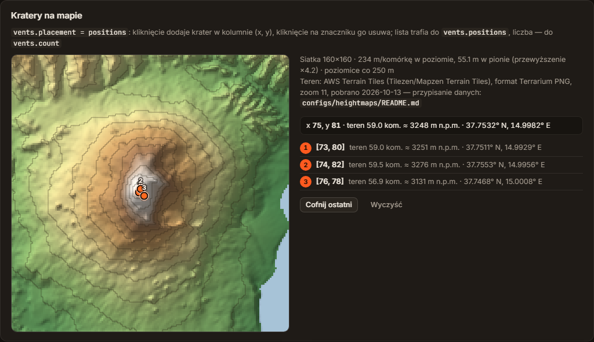
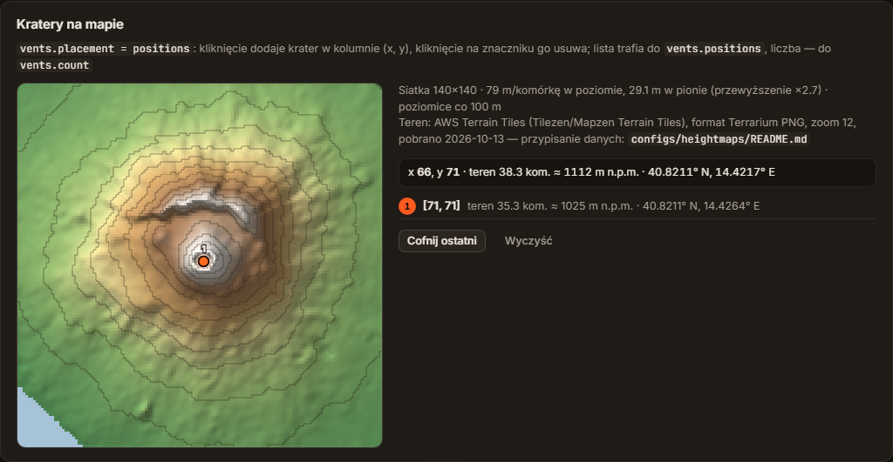

## 4. Presety i położenia kraterów

| Preset | Kratery [x, y] | Skąd i jak sprawdzone |
|---|---|---|
| `etna_real` | Voragine **[73, 80]** (37,7511 N 14,9929 E, 3251 m), Krater Płn.-Wsch. **[74, 82]** (37,7553 N 14,9956 E, 3276 m), Krater Płd.-Wsch. **[76, 78]** (37,7468 N 15,0008 E, 3131 m) | przybliżone współrzędne kraterów (Voragine ~37,751 N 14,993 E; NE ~37,754 N 14,994 E; SE ~37,747 N 15,000 E) → `latlon_to_grid.py`. Przy 234 m/komórkę **zagłębień kraterów nie widać**: szczyt to płaskowyż 3200–3276 m, kratery zlewają się w 2–3 sąsiednie komórki. NE: zadany punkt wypada w rogu komórki [73, 81], obok **najwyższej komórki mapy [74, 82]**, więc wzięta ona (NE to najwyższy krater Etny). SE: zadana komórka leży na wschodnim zboczu stożka SE (3131 m; jego wierzchołek [75, 79] ma 3222 m) |
| `etna_real_boczna` | szczelina N–S: **[74, 60]** 2174 m, **[75, 62]** 2290 m, **[76, 64]** 2481 m (37,709–37,717 N, 14,996–15,001 E) | rejon szczeliny 37,71–37,72 N, 14,99–15,01 E, 2100–2700 m; trzy kratery wzdłuż spadku stoku, **inspirowane** erupcją z 2001 r. |
| `wezuwiusz_real` | **[71, 71]** (40,8211 N 14,4264 E, 1025 m) | krater ~40,821 N 14,426 E → `latlon_to_grid.py --window 5`: kolumna leży **na dnie zagłębienia** (lokalne minima [72, 70] 1018 m i [70, 71] 1023 m, krawędź 1180–1235 m, najniższy odcinek krawędzi na SW/W ~1075–1100 m) |

```powershell
python tools\latlon_to_grid.py etna 37.751 14.993 37.754 14.994 37.747 15.000 --window 3
python tools\latlon_to_grid.py wezuwiusz 40.821 14.426 --window 5
```

Parametry lawy (oba presety Etny: te same; `neighborhood = moore`, `ponding = true`, `eruptTemp = 1200`, `solidusTemp = 800`,
`eruptionSteps = 150`, `coolingAmbient = 3`):

| Preset | `coolingFall` | `coolingLateral` | kroki (koniec) | lawa [komórki] | zasięg maks. | czas CA* |
|---|---|---|---|---|---|---|
| `etna_real` | 4 | 80 | 284 (brak płynnej lawy) | 4402 | 46 komórek ≈ **10,8 km** | **~20 s** |
| `etna_real_boczna` | 4 | 80 | 284 (brak płynnej lawy) | 2347 | 39 komórek ≈ **9,0 km** | **~20 s** |
| `wezuwiusz_real` | 1,3 | 27 | 128 (brak zmian w kroku) | 2470 | 44 komórki ≈ **3,5 km** | **~5 s** |

\* MSVC Release, i9-13900HX, bez przypięcia, przy obciążonym tle (`WmiPrvSE` ~3 rdzenie); założony limit ≤ ~30 s spełniony.

Dla Wezuwiusza koszty stygnięcia „na komórkę” są ~1/3 wartości Etny, bo komórka jest ~3 razy mniejsza (79 m zamiast
234 m). Wezuwiusz kończy po 128 krokach regułą „brak zmian”: wypełniony bazaltem krater zasypuje własny komin
(płynny zostaje tylko krater o stałej `eruptTemp`), a lawa żyje (1200 − 800)/3 ≈ 133 kroki od przybycia.

### Jak dobrano parametry (Etna, erupcja szczytowa, 160×160×70)

| Wariant | sąsiedztwo | fall | lateral | inne | kroki | zasięg | czas | obraz |
|---|---|---|---|---|---|---|---|---|
| a | Moore | 12 | 16 | | 284 | 7,9 km | 18 s | zwarte płaty wokół szczytu |
| b | Moore | 4 | 30 | | 284 | 14,8 km | 20 s | szerokie wachlarze w dół stoku |
| d | Moore | 3 | 50 | | 284 | 13,1 km | 20 s | wachlarze, palce na brzegach |
| **f (wybrany)** | **Moore** | **4** | **80** | | 284 | **10,8 km** | **19 s** | **najwęższe, palczaste płaty; lob w Valle del Bove** |
| vn2 | von Neumann | 4 | 25 | | 130 | 3,3 km | 3 s | „romb”, kula w metryce taksówkowej |
| vn5 | von Neumann | 0,5 | 6 | | 141 | 14,7 km | 3 s | duży romb, ignoruje rzeźbę |
| pent | pentagonal | 3 | 50 | | 284 | 11,4 km | 23 s | jak Moore, mniej regularnie |
| z100 | Moore | 3 | 30 | nz = 100 | 284 | 15,0 km | 26 s | szerokie płaty |
| z140 | Moore | 2 | 30 | nz = 140 | 284 | 5,6 km | 36 s (> 30 s) | krótkie płaty |

Wniosek: **przy tej rozdzielczości lawa tworzy płaty w kierunku spadku, a nie wąskie jęzory**; to cecha reguł,
których nie zmieniamy:
1. *Model wzrostu bez zachowania masy*: każda komórka lawy jest nowym „źródłem”, więc front obejmuje wszystko, co
   osiągalne w budżecie temperatury (1200 − 800 °C) od kraterów (`docs/architektura.md`, pytanie o dobór parametrów).
2. *Spływ po skosie przy spadku D = 1* (sąsiedztwo Moore'a) idzie do **wszystkich** niższych sąsiadów z podparciem,
   z każdym stopniem w dół płat poszerza się o ±1 komórkę (wachlarz ~90°). Wybór tylko kierunku największego spadku
   działa dopiero przy D ≥ 2 (lawa „przelewa się nad krawędź”), a na płaskich stopniach (D = 0) lawa rozlewa się wszędzie.
3. *Teren skwantowany do komórek*: 55 m w pionie przy 234 m w poziomie; stoki Etny 10–15° to schody o stopniach
   ~0,75–1 komórki, więc lawa jest prawie zawsze w reżimie D = 0 / D = 1. Doliny (barrancos) Etny są płytsze niż
   jedna komórka pionowa; jedyne doliny „widoczne” dla modelu to duże formy: Valle del Bove i dolina między Wezuwiuszem
   a Sommą.

Dlatego wybrano **drogie rozlewanie po płaskim (80 °C) i tani spływ w dół (4 °C)**: lawa biegnie po stromych stokach,
a zatrzymuje się, gdzie teren łagodnieje (≤ 5 ruchów „w bok” na ścieżkę). Von Neumann (bez spływu po skosie) daje
sztuczne romby, a wyższa rozdzielczość pionowa (nz = 100–140) nie poprawia kształtu, za to wydłuża obliczenia ponad limit.

## 5. Wyniki i obserwacje

### Etna: erupcja szczytowa (`etna_real`)

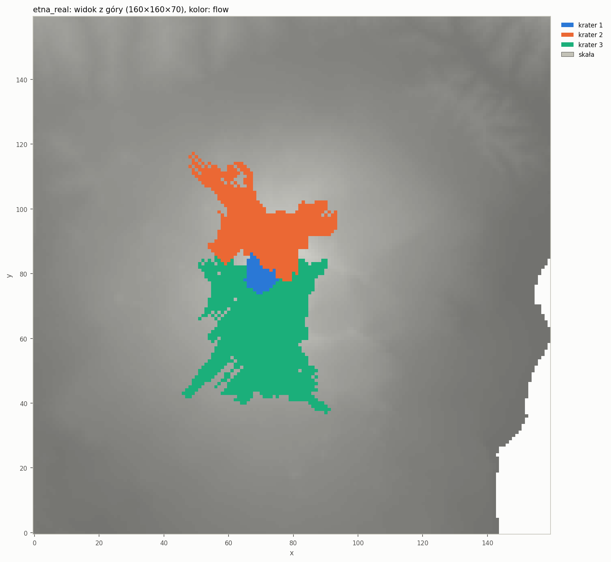
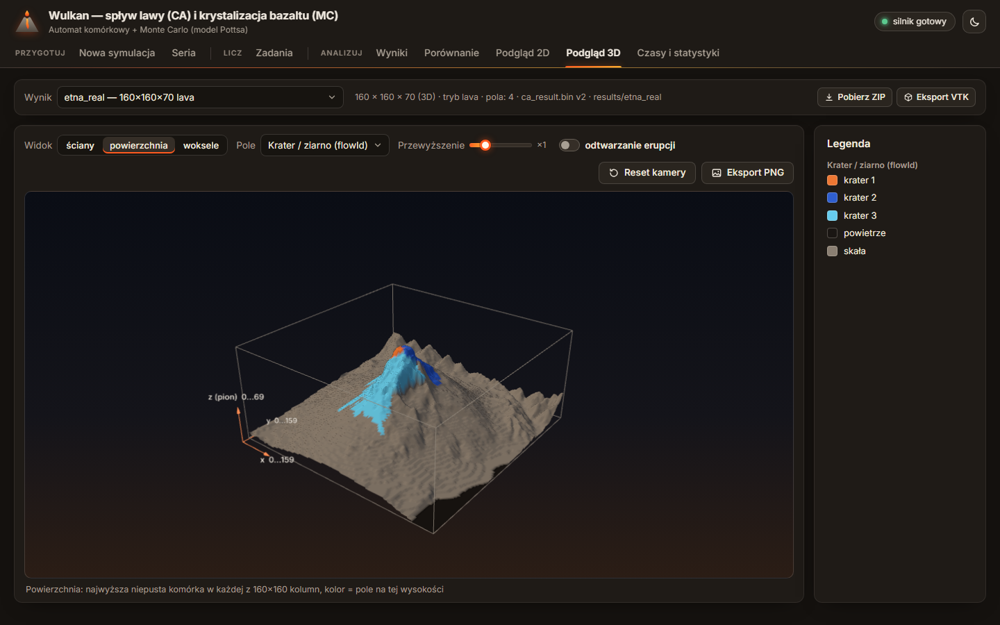

- Kolory kraterów: na widoku z góry (`tools/plot_slice.py`, stara paleta) Voragine: niebieski, NE: pomarańczowy,
  SE: zielony; na zrzucie 3D z GUI (nowa paleta, [wyglad-interfejsu.md](wyglad-interfejsu.md)) Voragine: pomarańczowy, NE:
  niebieski, SE: jasnoniebieski.
- **Krater SE**: 1255 kolumn, głównie na **S i SW** (do y = 37, ~10 km, do ~1000 m n.p.m.) oraz wąski lob
  na **E**, po zachodniej ścianie Valle del Bove; **Krater NE**: 712 kolumn na **N i NW** (do y = 117,
  ~8 km, ~1150 m) i lob na NE nad Valle del Bove; **Voragine**: mały płat między nimi (otoczony lawą sąsiadów).
- **Valle del Bove:** lawa obu kraterów wchodzi na **górną, zachodnią ścianę kotliny** (26 kolumn w rejonie x ≥ 86,
  58 ≤ y < 90, teren 2050–2460 m, do ~3 km na E od krateru SE), ale **nie dochodzi do dna** (~1500–1850 m); kończy
  się budżet temperatury na stromej ścianie (każdy poziom spadku i każdy ruch w bok kosztuje). Kierunek jest sensowny
  (z SE krateru lawa w rzeczywistości często wpływa do Valle del Bove), ale model zatrzymuje ją wcześniej.
- Ogólnie kierunki zgadzają się z rzeźbą: lawa schodzi radialnie po stożku tam, gdzie stok jest najdłuższy (S, N),
  omija zachodnie zbocza o łagodniejszym spadku i zatrzymuje się u podnóża stożka szczytowego / na pierwszych
  wypłaszczeniach (1000–1200 m).

### Etna: erupcja boczna (`etna_real_boczna`, inspirowana 2001 r.)

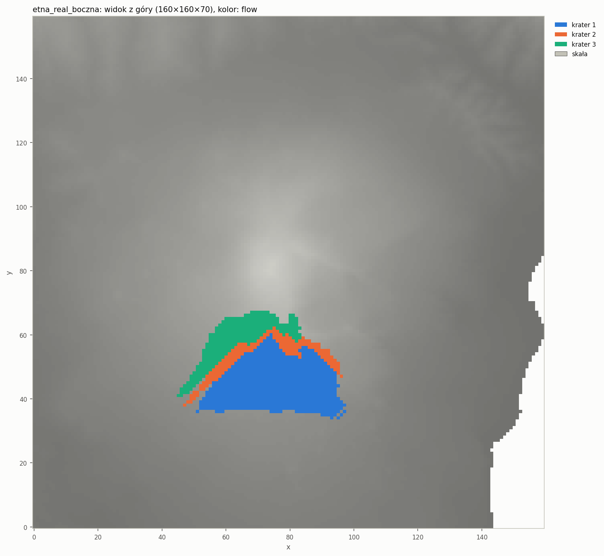
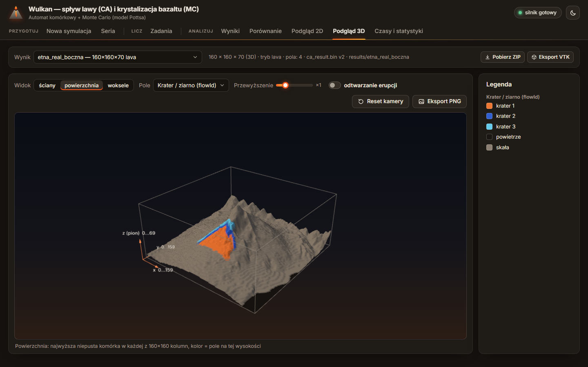

Lawa ze szczeliny spływa **na S i SE** po południowym stoku (1181 kolumn, y 34–67, nic na północ od szczeliny poza
kilkoma komórkami przy górnym kraterze), najdalej z najniższego krateru (2174 m): ~6 km na S, do ~870 m n.p.m.
W 2001 r. najdłuższy potok z krateru na ~2100 m doszedł na S do wysokości ok. 1000 m (kilka km nad Nicolosi);
kierunek i rząd wielkości podobne, ale to zbieżność kierunku spadku stoku, nie kalibracja.

### Wezuwiusz (`wezuwiusz_real`)

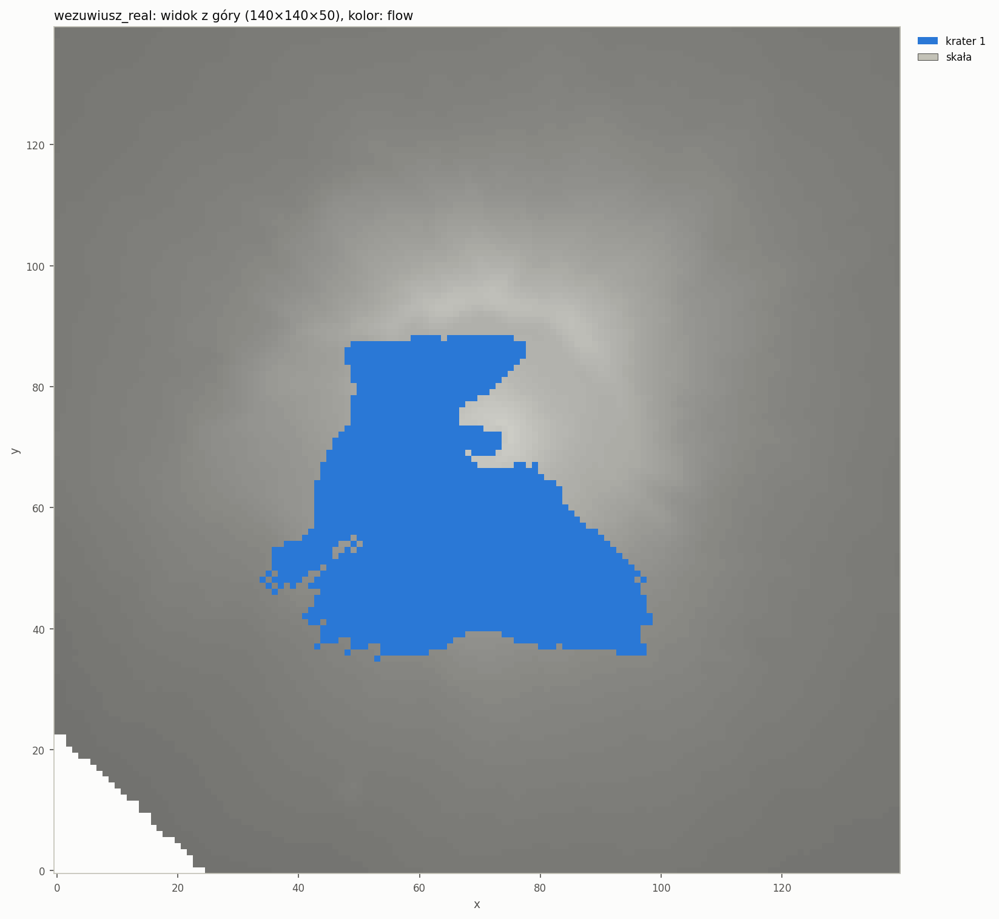
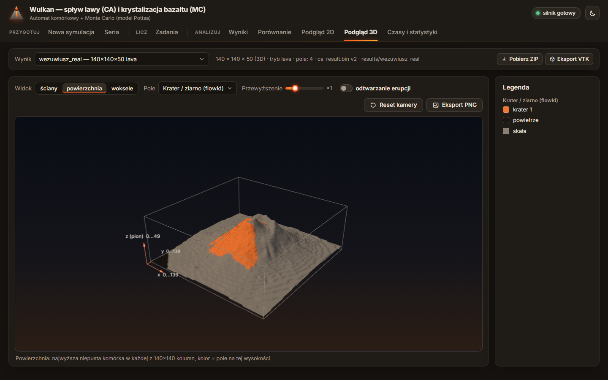

- Lawa najpierw **wypełnia krater** (reguła wypełniania zagłębień; krater ~7 komórek głębokości), potem **przelewa się
  przez najniższy odcinek krawędzi na SW/W** i spływa po stokach **S, W i SE** Gran Cono (2023 kolumn, do ~3,5 km od
  krateru, do ~230 m n.p.m.).
- Na **północy** lawa schodzi do doliny między stożkiem a Sommą (Atrio del Cavallo / Valle del Gigante, 800–870 m;
  najdalej y = 88) i **tam się zatrzymuje: przez grzbiet Monte Somma (900–1060 m, y ≈ 87–95) nie przelewa się
  w żadnej kolumnie**: lawa się nie wspina, a dolina nie jest zamkniętą niecką, którą mogłaby wypełnić. To zgodne
  z rolą Sommy jako bariery (np. lawa z 1944 r. popłynęła doliną Atrio del Cavallo i dalej na zachód, a nie przez grzbiet).

## 6. Odtwarzanie erupcji krok po kroku

Stan każdej komórki w kroku k (k = 0 … steps, stan k = po k krokach CA) da się odtworzyć z wyniku końcowego,
bez nowego wyjścia silnika, bo `ca_result.bin` v2 zapisuje dla każdej komórki `arrivalStep` i `solidStep`
(semantyka sprawdzona w kodzie `LavaCA::updateLava`: krok t czyta stan t i zapisuje stan t + 1, znacznik = numer kroku t):

| typ końcowy | stan w kroku k |
|---|---|
| skała | skała |
| powietrze (komórka nigdy nie była lawą; jej `arrivalStep` = 0) | powietrze |
| lawa / bazalt | **powietrze** dla k < pojawienie, gdzie pojawienie = **0 dla krateru**, `arrivalStep + 1` dla reszty |
| bazalt | **bazalt** dla k ≥ `solidStep + 1` |
| (pozostałe) | **płynna lawa**, także lawa płynna do końca (jej `solidStep` = 0, rozpoznawana po typie końcowym) |

Kratery mają `arrivalStep = 0` tak jak komórki zalane w kroku 0; rozpoznajemy je po położeniu (`stats.json` →
`flows[].vent`). Bez listy kraterów (np. obcięta lista przy > 10 000 zarodków) wszystkie komórki z `arrivalStep = 0`
pojawiają się w kroku 0; różnica najwyżej 1 kroku dla kilku komórek (GUI to zaznacza).

**Temperatura** w kroku k nie jest zapisana, ale da się ją **policzyć dokładnie**: po przybyciu płynna lawa traci
dokładnie `coolingAmbient` na krok, a krater w trakcie erupcji ma stałe `eruptTemp` (reguła 2 w `CaRules.hpp`), więc
T_k = min(eruptTemp, T_końc + coolingAmbient · (koniec − k)), koniec = `solidStep + 1` (bazalt) albo steps (lawa).
Wybrano to zamiast „wieku lawy” (k − pojawienie): wiek nie odróżnia świeżej lawy daleko od krateru (już chłodnej)
od lawy przy kraterze. Paleta **„żar”**: świeża lawa jasnożółta → pomarańcz → ciemniejąca czerwień przy temperaturze
zastygania; bazalt: grafit, skała: ciepła szarość-brąz (od nowego wyglądu interfejsu te same kolory co w widoku „typ komórki”,
[wyglad-interfejsu.md](wyglad-interfejsu.md)); płynna lawa w 3D lekko świeci. Tryb **„krater”**: kolor `flowId` (dla `classic`:
rozrost ziaren).

**Sprawdzenie:** silnik ma migawki `output.snapshotsEvery` (`snapshots/step_<k>.bin`, ten sam format co `ca_result.bin`;
odtwarzanie dodało migawkę stanu **0**). Testy porównują odtworzenie z prawdziwym stanem:
`engine/tests/test_replay.cpp`: każdy krok automatu (lawa 2D i 3D, kratery w kraterze / na zboczu / z listy, Moore /
von Neumann, Vector / Matrix, classic): typ i `flowId` identyczne, temperatura z błędem < 0,05 °C (zaokrąglenia float);
migawki zapisane przez silnik = odtworzenie; `gui/tests/test_replay.py`: to samo dla `gui/replay.py` na migawkach
z silnika, liczba komórek płynnych w każdym kroku = `activeCells` ze `stats.json`, oraz **ta sama reguła
w przeglądarce** (`gui/static/js/replay.js` uruchomiony przez `node`) daje te same stany i temperatury.

**GUI.** Przełącznik **„odtwarzanie erupcji”** w podglądzie 2D i 3D pokazuje pasek: **Odtwórz / Pauza**, suwak
„krok 0 … steps”, prędkość (kroków/s; domyślnie całość ~10 s), numer kroku, **liczba komórek płynnych i zastygłych**
w tym kroku (cała objętość; w 2D także w przekroju), kolor „żar” / „krater”. Dane pobierane **raz**:
- 2D: pięć przekrojów bieżącej płaszczyzny (typ, pojawienie, zastygnięcie, temperatura końcowa, `flowId`;
  pola pochodne `appear`, `solidFrom` w `/api/result/slice`), stan klatki liczy przeglądarka;
- 3D: wszystkie komórki lawy (`/api/result/replay/cells`: 22 B/komórkę) + wysokość terenu (`surface?field=terrain`);
  **powierzchnia** w kroku k = najwyższa niepusta komórka kolumny (teren albo lawa pojawiona do k), **ściany**:
  tekstury przeliczane co klatkę, **woksele**: komórki posortowane wg pojawienia (`count` = widoczne).
  Ograniczenie: powyżej 2 mln komórek lawy pakiet próbkuje **całe kolumny** co `step` (powierzchnia w próbkach
  pozostaje poprawna), woksele: co n-tą komórkę do 150 tys.

**Eksport animacji:** *Klatki PNG (ZIP)*: do 200 klatek równomiernie (pierwsza i ostatnia zawsze), kadr jak
*Eksport PNG* (tytuł z numerem kroku + legenda), ZIP bez kompresji tworzony w przeglądarce; *Nagraj WebM*: film
25 kl./s (MediaRecorder na canvasie, do 300 klatek). Sprawdzone w Chromium (Playwright): ZIP 129 klatek Wezuwiusza
otwiera się bez błędów, WebM się zapisuje.

**Krystalizacja MC:** opcja `mc.snapshotsEvery` (domyślnie 0, wyłączone) zapisuje `mc_snapshots/mcs_<k>.bin`
(format `mc_result.bin`) dla MCS 0, co N i na końcu; czas w osobnej sekcji `mcSnapshots` **nie wlicza się do
`mcSim`**, wynik MC bez zmian (test). W GUI źródło odtwarzania „krystalizacja (MC)”: suwak po migawkach, kryształy
w przekroju 2D i na ścianach / powierzchni 3D (`mcs=<k>` w zapytaniach; woksele: stan końcowy).

Klatki Etny (3D, powierzchnia; kroki 8, 60, 150: koniec erupcji, 230: zastyganie):


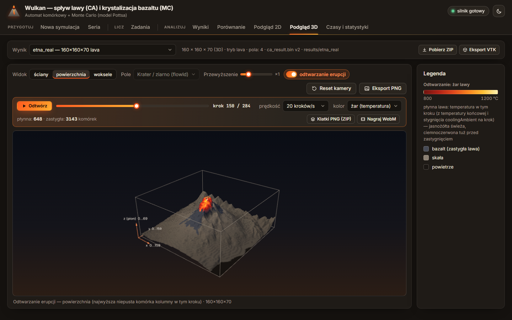

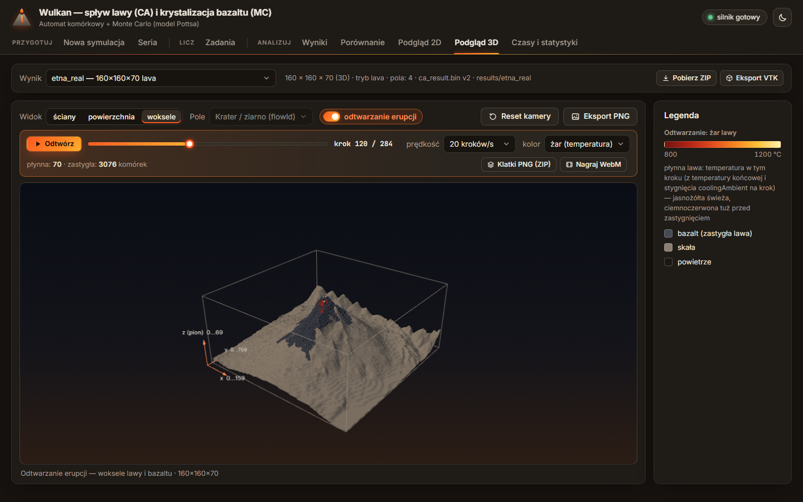

Przekrój 2D przez krater Wezuwiusza (y = 71; kroki 6, 40, 128) i krystalizacja MC z migawek (`lava_mc_3d`, MCS 0, 20, 200):

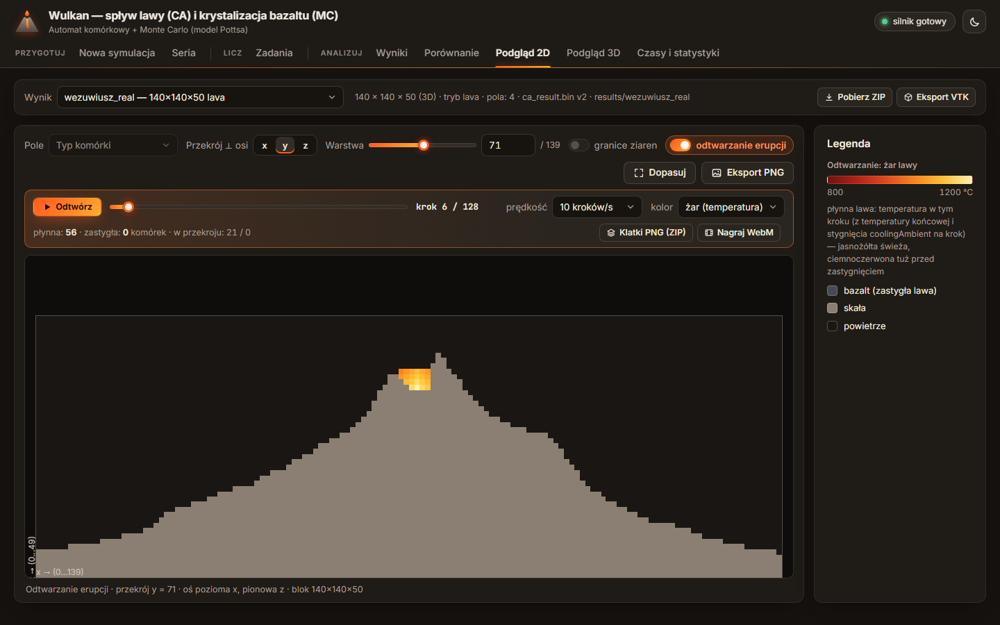
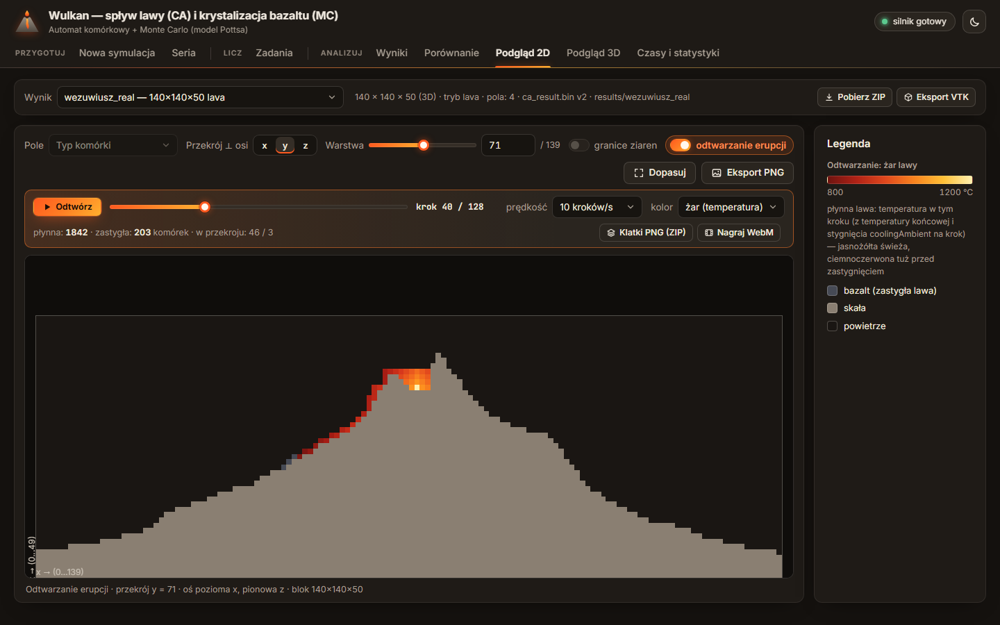
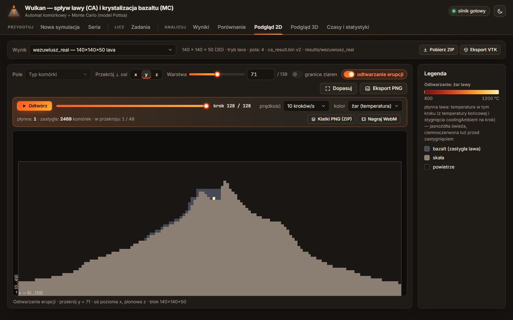
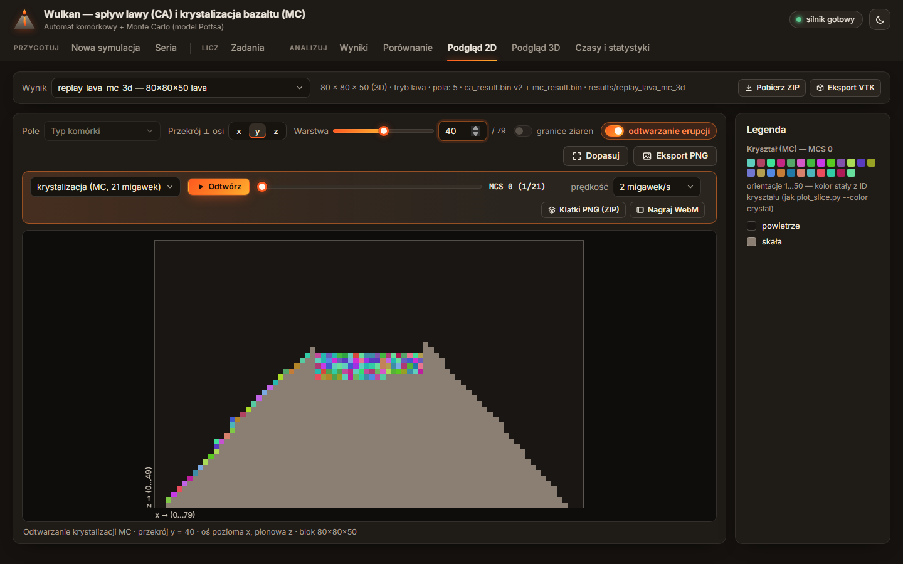
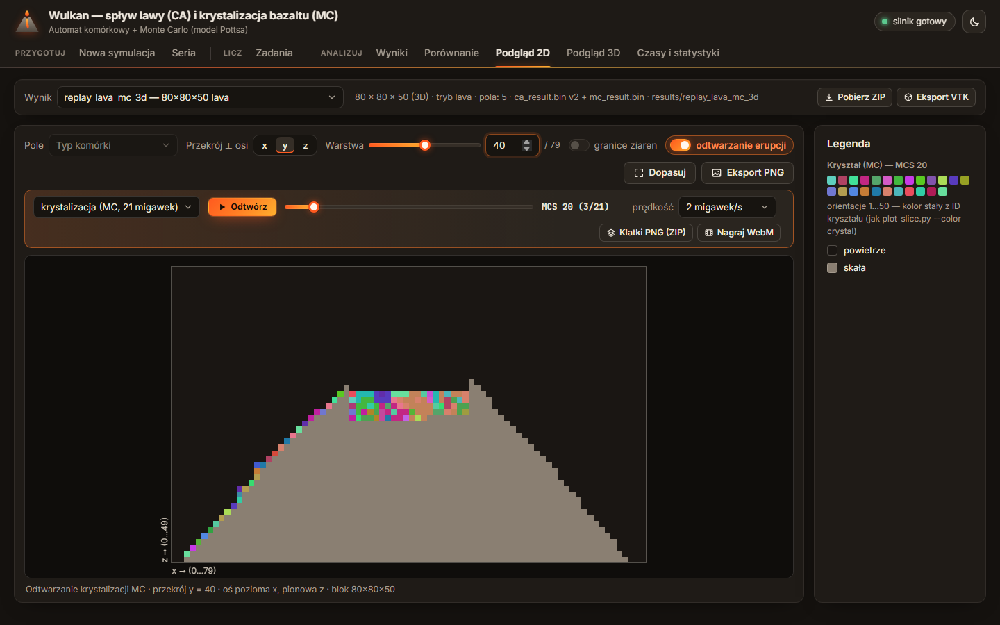
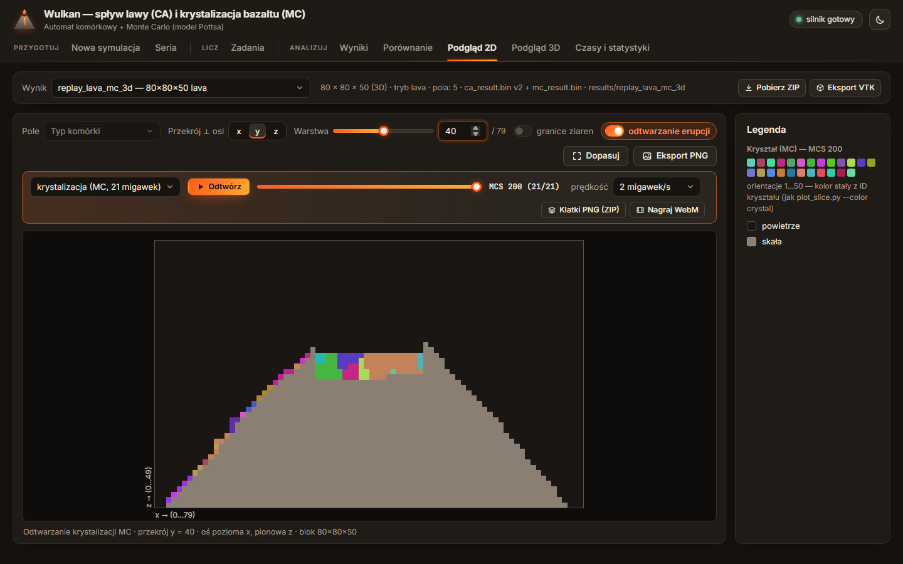

## 7. Uwaga techniczna: zgodność czasów (test A/B) i układ kodu w MSVC

Pierwsza wersja trzymała listę kraterów jako `std::vector` w `VentsConfig`. Wyniki były bitowo identyczne, ale test A/B
(stary i nowy `engine.exe` naprzemiennie, przypięte do procesora 2, 5–8 powtórzeń) pokazał **CA wolniejsze o 6–9%**
(`test_3d` 1745 → 1871 ms, `heightmap_kanion` 3465 → 3772 ms) przy **niezmienionym kodzie automatu**; GCC i MC bez zmian.
Bisekcja na kopiach źródeł + mapy linkera (`/MAP`):
- ten sam kompilator (MSVC 19.38.33133), położenie exe bez znaczenia, gałąź migawek bez znaczenia;
- winna grupa zmian configu: pole-wektor dokładało instancje `vector<GridColumn>` (realokacja, destruktor), nowy
  destruktor `VentsConfig` i powiększało konstruktor kopiujący / destruktor `Config`. Linker MSVC układa te funkcje
  (COMDAT) **przed** kodem `LavaCA`, więc cały automat przesunął się o 400 B: `updateLava` z 32 na 48 B w linii 64 B
  (to samo dla `computeDescent`, `dropDepth`, `hasSupport`). To **efekt wyrównania gorącej pętli**, nie zmiany algorytmu;
- umieszczenie `LavaCA` w osobnej podsekcji `.text$alava` (`__declspec(code_seg)`) dało układ stabilny, ale też ~5% wolniejszy
  (inne wyrównanie), odrzucone.

Rozwiązanie: lista kraterów **nie jest polem `Config`** (czyta ją `Config::ventColumns()` z `effective`, typ
`vector<pair<int,int>>` jest już instancjonowany w `VentPlacer`), `mc.snapshotsEvery` mieści się w istniejącym
wypełnieniu `McConfig` (rozmiar struktury bez zmian). Mapa linkera: adresy wszystkich funkcji `LavaCA` **identyczne**
jak przed zmianami. Test A/B końcowy (mediana z 5, przypięte, tło ~3 rdzenie): `test_3d` CA ×1,002, `heightmap_kanion`
×0,990, `mc_full_2d` MC ×0,997, `lava_mc_2d` CA ×1,03 / MC ×1,04 (czasy 7–60 ms, przedziały się nakładają, czyli szum);
GCC: `test_3d` 1531 ms vs 1573 ms przed zmianami.

**Wniosek dla dalszej optymalizacji:** w MSVC zmiana kodu, który *nie* jest automatem (np. nowe pole w `Config`), potrafi zmienić
czas CA o ±7% przez położenie pętli w pliku wykonywalnym. Przy pomiarach przed/po porównywać build z tymi samymi
zmianami „obok” albo sprawdzać mapą linkera (`/MAP`), czy adresy funkcji `LavaCA` się nie przesunęły.

## 8. Pliki

| Plik | Co |
|---|---|
| `tools/fetch_dem.py` | pobranie kafelków Terrarium, mozaika, przepróbkowanie, skala pionowa, zapis CSV/PNG/JSON |
| `tools/latlon_to_grid.py` | (szer., dł.) ↔ (x, y), okno wysokości i zagłębienia (weryfikacja kraterów) |
| `configs/heightmaps/etna.*`, `wezuwiusz.*`, `README.md` | mapy (CSV, podgląd PNG, metadane JSON) i przypisanie danych |
| `configs/etna_real.json`, `etna_real_boczna.json`, `wezuwiusz_real.json` | presety (widoczne w GUI: *Nowa symulacja → Preset*) |
| `engine/src/io/Config.*`, `terrain/VentPlacer.*`, `app/Simulation.cpp` | `vents.placement = positions`, `Config::ventColumns()`, `VentPlacer::placeAt`, migawka stanu 0 |
| `engine/src/app/McStage.*` | migawki kryształów `mc.snapshotsEvery` |
| `engine/tests/test_replay.cpp` (+ `test_config.cpp`, `test_terrain.cpp`) | kratery z listy, zgodność bitowa, odtwarzanie = stan automatu, migawki CA i MC |
| `gui/replay.py`, `gui/results.py`, `gui/app.py`, `gui/heightmap.py` | reguła odtwarzania, pola `appear`/`solidFrom`/`terrain`, `/api/result/replay*`, `mcs=<k>`, metadane geo map |
| `gui/static/js/replay.js`, `ventpicker.js`, `viewer2d.js`, `viewer3d.js`, `form.js` | pasek odtwarzania, paleta „żar”, eksport ZIP/WebM, panel kraterów na mapie, pole JSON |
| `gui/tests/test_fetch_dem.py`, `test_replay.py`, `screenshots.py --only-real` | testy (bez internetu) i zrzuty `docs/img/real_*.png`, `replay_*.png` |
