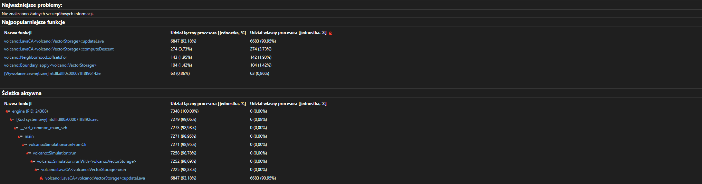
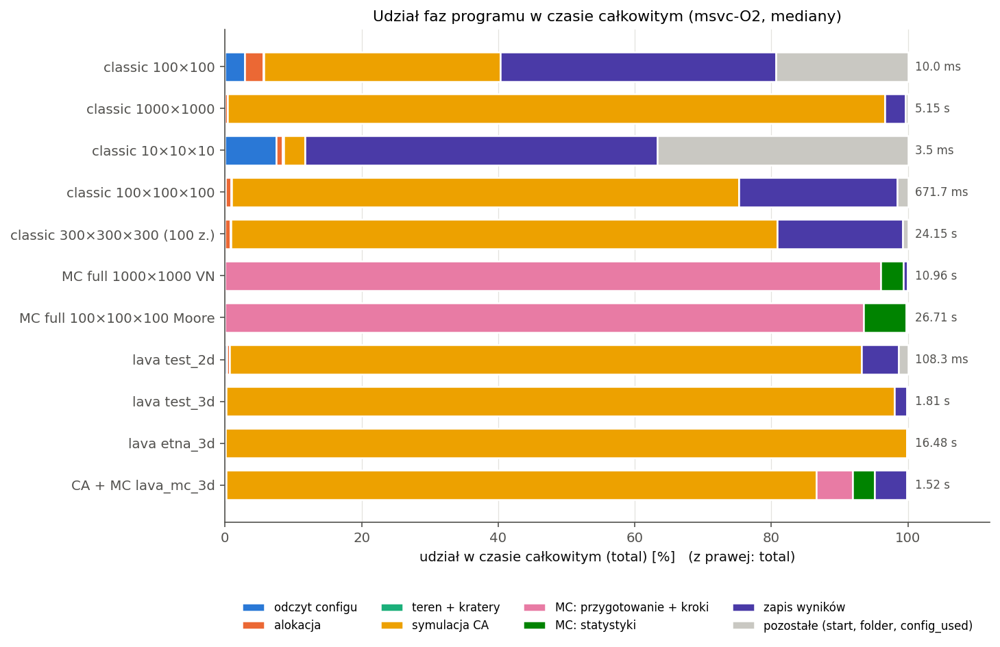
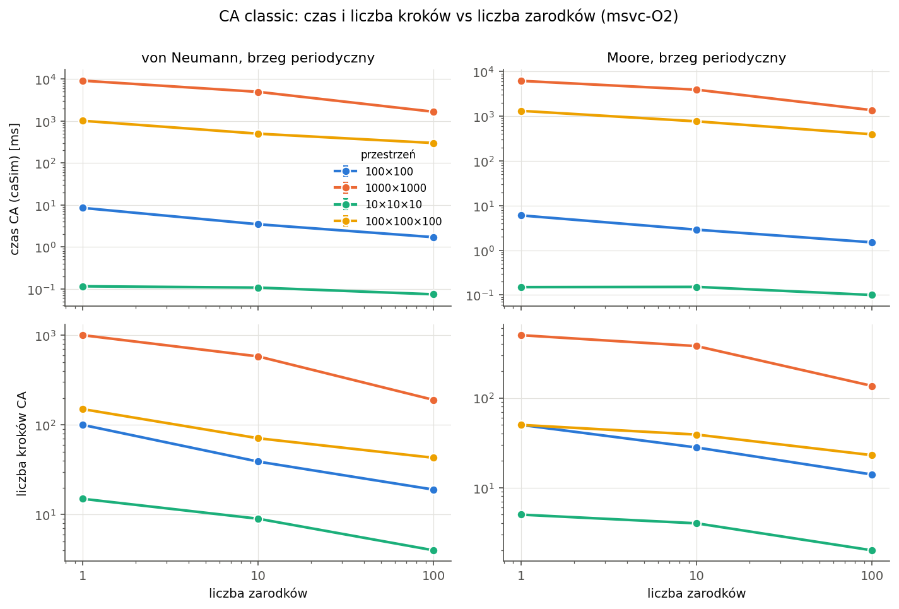
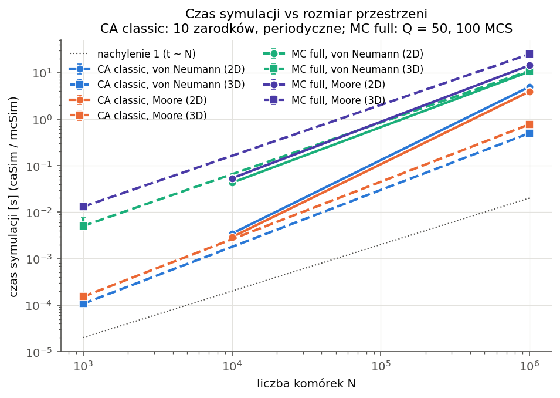
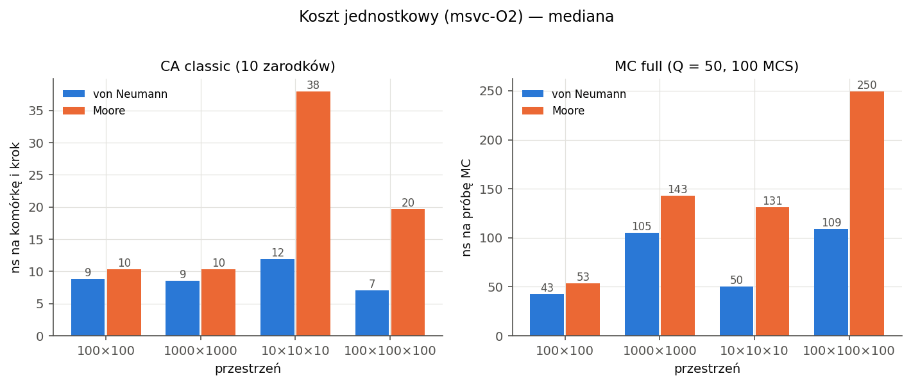
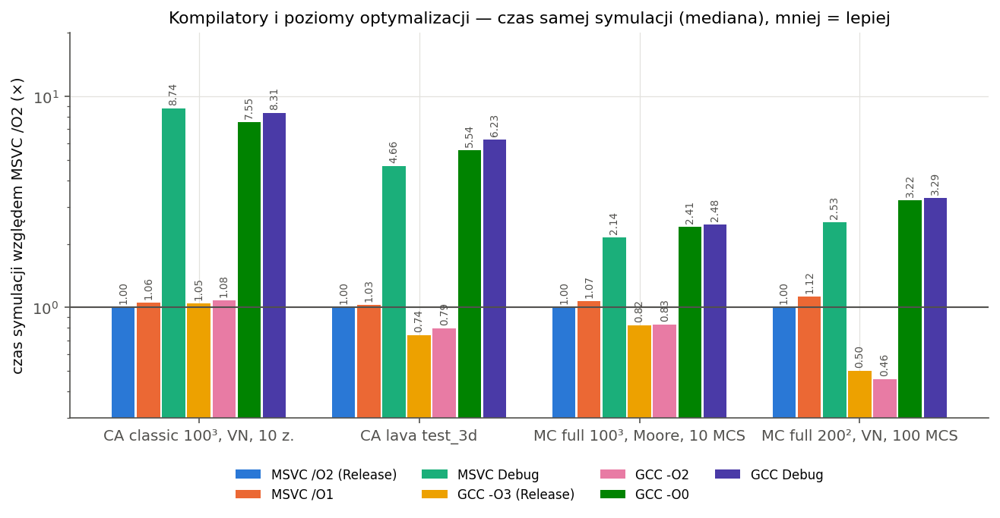
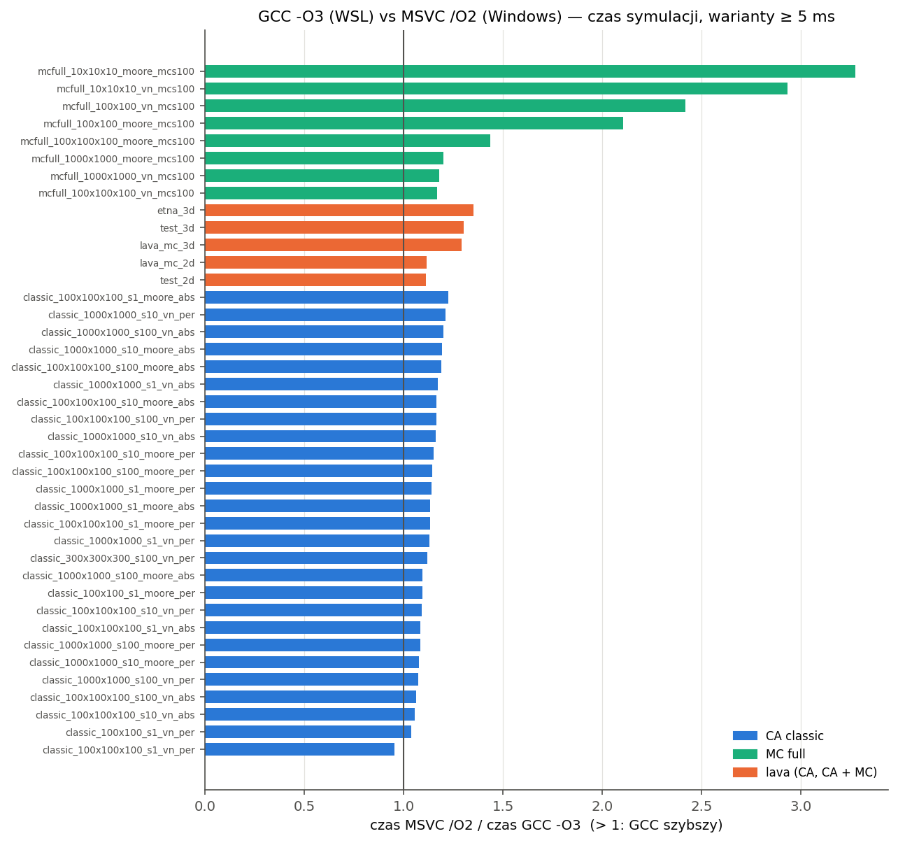
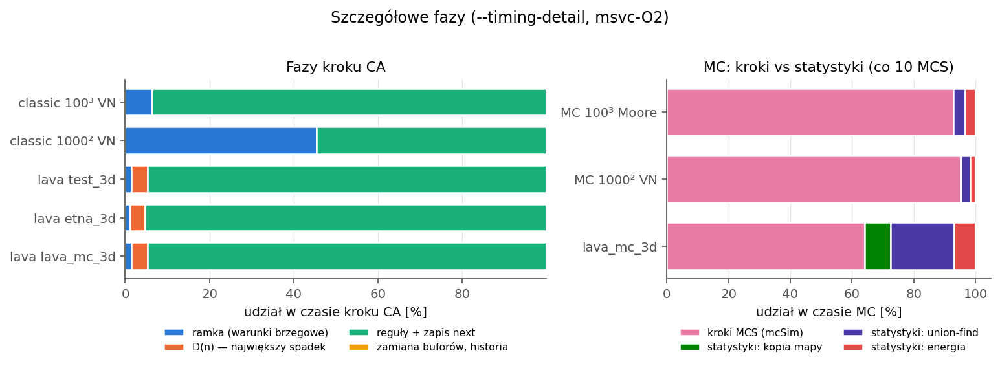
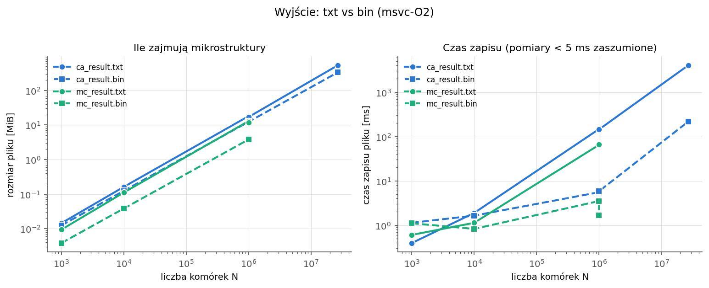
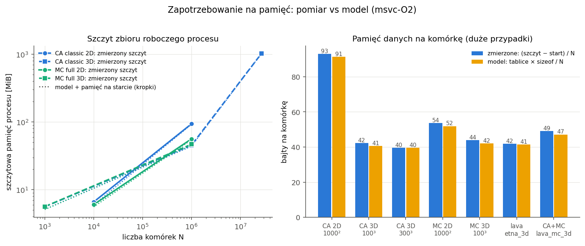

# Profil aplikacji

Profil aplikacji, wymagania sprzętowe, testy wydajności i zapotrzebowanie na zasoby.

**Stan na 09.10.2026.** Ta część to analiza, nie optymalizacja.
Kod symulacji (reguły CA i MC) się nie zmienił: wyniki `ca_result.bin` i `mc_result.bin` są bitowo
identyczne z wynikami sprzed profilowania, a czasy w granicach ±1% (test A/B, punkt 1.4). Doszły tylko
pomiary (pamięć procesu, model pamięci, rozmiary plików, czasy faz), skrypty i presety profilowania.
**Pomiary profilu (`bench/results/profile_2026-10-09*`, `bench/profiles/`) są punktem
odniesienia dla dalszej optymalizacji.**

Najważniejsze wyniki w skrócie:
- **CA lawy:** 68–83% czasu zajmuje `gatherLavaCandidates`, czyli przeszukanie 26 sąsiadów każdej komórki
  powietrza w każdym kroku. W `etna_3d` funkcja jest wywoływana 425 mln razy, a lawę znajduje w 0,013%
  wywołań (55 tys.). Prawie cała praca CA jest zbędna; największy zysk w dalszej optymalizacji da automat
  frontalny (przetwarzanie tylko komórek przy lawie).
- **CA classic 2D:** 45% czasu kroku to wypełnianie ramki w nieużywanej osi z (dwie pełne warstwy
  kopiowane co krok). Ta sama ramka zajmuje 2/3 pamięci siatki 2D (91 B na komórkę zamiast 40).
- **MC:** 60–67% czasu/instrukcji to liczenie sąsiadów o innej orientacji (energia przed i po zmianie),
  7–13% hash, 9–20% statystyki (union-find).
- **GCC vs MSVC w MC (2–3× na małych siatkach):** MSVC kompiluje porównanie orientacji sąsiada do
  skoku warunkowego, który procesor często źle przewiduje; GCC liczy je bez skoku. Po przepisaniu
  jednej linii (i wyciągnięciu stałej części hasha przed pętlę) MSVC dorównuje GCC, sprawdzone
  asemblerem, mikrobenchmarkiem i eksperymentem (punkt 2.4).
- **Pamięć:** model teoretyczny (tablice × `sizeof`) zgadza się z pomiarem z dokładnością 0–4% (MSVC)
  dla siatek ≥ 1 mln komórek: CA 3D ≈ 40 B/komórkę, CA 2D ≈ 91 B, MC 3D ≈ 42 B, lawa + MC ≈ 47–49 B.
  Siatka 1000³ wymaga ~40–50 GB RAM; to argument za MPI (planowany dalszy rozwój).
- **Wyjście:** txt ≈ 17–21 B/komórkę, bin = 13 B/komórkę; zapis txt jest 19–27× wolniejszy niż bin
  (300³: 4,05 s vs 0,22 s, 536 MiB vs 335 MiB).

Pytania, na które odpowiada ten dokument:

| Pytanie | Sekcja |
|---|---|
| Profil 1) Które funkcje najbardziej obciążają procesor? | 2.1 |
| Profil 2) Czy możemy coś poprawić? | 2.2 |
| Profil 3) Jakie mamy możliwości optymalizacji? | 2.3 (+ 2.4: GCC vs MSVC) |
| Czas 1) IO, przygotowanie przestrzeni, alokacja pamięci | 3.1 |
| Czas 2) Sama symulacja: zarodki 1/100…, von Neumann/Moore, 100², 1000², 10³, 100³ | 3.2, 3.3 |
| Czas 3) Output: ile zajmują mikrostruktury | 4 |
| Czas 4) Automatyzacja | 1.3 (`bench/run_profile.py`) |
| Tytuł: wymagania sprzętowe, zapotrzebowanie na zasoby | 5 |

---

## 1. Środowisko pomiarowe

### 1.1 Sprzęt i system

| | |
|---|---|
| Komputer | Dell G16 7630 (laptop), zasilanie sieciowe, plan zasilania „Zrównoważony” |
| Procesor | Intel Core i9-13900HX: 8 rdzeni P (procesory logiczne 0–15, z HT) + 16 rdzeni E (16–31), 24 rdzenie / 32 wątki |
| Pamięć | 32 GB DDR5-4800 (2 × 16 GB) |
| System | Windows 11 Home 10.0.26200; WSL2: Ubuntu 22.04.5, jądro 5.15.167.4, 16 GB, 32 wirtualne procesory |
| Dysk | SSD NVMe: C: SK hynix BC901 1 TB (tu `%TEMP%` z wynikami przebiegów MSVC), D: Samsung 990 EVO 2 TB (projekt); wyniki GCC na ext4 maszyny WSL |

Program jest sekwencyjny: używa jednego rdzenia. Na tym procesorze ten sam program na rdzeniu E jest
**2,3–2,9× wolniejszy** niż na rdzeniu P (`bench/profiles/pcore_vs_ecore.txt`), dlatego wszystkie
pomiary są przypięte do procesora logicznego 2 (rdzeń P; procesor 0 obsługuje najwięcej przerwań).

### 1.2 Kompilatory i buildy

| Etykieta | Kompilator | Flagi (preset CMake) | Gdzie uruchamiany |
|---|---|---|---|
| `msvc-O2` | MSVC 19.38 (VS 2022) | `/O2 /Ob2 /DNDEBUG /W4 /permissive- /utf-8` (`msvc-release`), **główny build** | Windows |
| `msvc-O1` | MSVC 19.38 | `/O1 /DNDEBUG` (`msvc-o1`) | Windows |
| `msvc-Debug` | MSVC 19.38 | `/Od /Ob0 /RTC1 /Zi /MDd`, asercje (`msvc-debug`) | Windows |
| `gcc-O3` | GCC 11.4.0 | `-O3 -DNDEBUG -Wall -Wextra` (`gcc-release`) | WSL2 |
| `gcc-O2` | GCC 11.4.0 | `-O2 -g -DNDEBUG` (`gcc-o2`; `-g` nie zmienia kodu GCC) | WSL2 |
| `gcc-O0` | GCC 11.4.0 | `-O0 -DNDEBUG` (`gcc-o0`) | WSL2 |
| `gcc-Debug` | GCC 11.4.0 | `-g` bez optymalizacji, asercje (`gcc-debug`) | WSL2 |

Profilowanie: `msvc-profile` (kod jak Release + PDB), `gcc-profile` (`-O2 -pg -g`), `gcc-o2` (callgrind)
oraz warianty `*-noinline` (makro `VOLCANO_NOINLINE` zabrania wstawiania kluczowych funkcji; tylko do
podziału czasu między funkcje; czasów tych buildów nie porównujemy).

### 1.3 Metoda i automatyzacja (`bench/run_profile.py`)

Skrypt (Python, tylko `pandas` + opcjonalnie `psutil`) generuje configi do folderu tymczasowego, uruchamia
`engine` dla każdego wariantu, zbiera `times.json` i zapisuje:
`bench/results/profile_2026-10-09.csv` (142 wiersze: wariant × build, dla każdej miary mediana, min, max,
odchylenie standardowe), `_raw.csv` (426 przebiegów), `_meta.json` (sprzęt, system, flagi, obciążenie tła)
i `_benchmark.csv` (vector vs macierz).

- **3 powtórzenia** każdego wariantu, buildy przeplatane (MSVC, GCC, MSVC, …), więc dryf temperatury
  rozkłada się równo. W tabelach: mediana, a w nawiasie [min–max].
- **Przypięcie:** skrypt ustawia sobie powinowactwo `psutil.cpu_affinity([2])` (bez `psutil`:
  `SetProcessAffinityMask` przez `ctypes`), a procesy potomne je dziedziczą (skrypt to sprawdza). Działa jak
  `start /affinity` z benchmarku pierwszej wersji silnika, ale bez pośrednictwa `cmd` (cytowanie ścieżek ze spacjami, kod
  wyjścia, stderr). Silnik dostaje `HIGH_PRIORITY_CLASS`. W WSL: `taskset -c 2`, czyli wirtualny procesor
  maszyny WSL2, host może go planować na dowolnym rdzeniu fizycznym.
- **WSL:** program, config i wyniki na ext4 maszyny wirtualnej (`/tmp`), nie na `/mnt/d` (9P jest wolne).
  W pierwszym przebiegu WSL wyłączył bezczynną maszynę i wyczyścił `/tmp` (zniknął program GCC); 247
  zapisanych przebiegów zostało, reszta dokończona wznowieniem (skrypt pomija zapisane przebiegi). Poprawka:
  proces podtrzymujący maszynę WSL przez cały pomiar i kopia programu przy jego braku.
- **Tło:** w czasie pomiaru inne programy zajmowały 15–26% całego CPU (stały `WmiPrvSE.exe` ~2 procesory
  logiczne od 7.10: zapytania WMI programów działających w tle (np. narzędzi producenta laptopa) oraz
  przeglądarka; `_meta.json`). Rdzeń 2 nie był przez nie przypisany, ale wspólne
  są L3 i limit mocy (niższe taktowanie dynamiczne).
- **Rzetelność:** pomiary < 5 ms traktuję jako zaszumione (rozrzut 10–50%, np. MC 10³ VN: 4,9–7,5 ms);
  nie wyciągam wniosków z różnic mniejszych niż rozrzut. Ten sam wariant w innej sesji (godzinę później)
  był 5–10% wolniejszy; porównania przed/po optymalizacji robić w jednej sesji, naprzemiennie.
- **Czas pomiaru:** cała macierz MSVC + GCC: 25 min (426 przebiegów + benchmark).

Ponowne uruchomienie (z katalogu projektu, po zbudowaniu presetów):

```
python bench/run_profile.py --full --gcc      # pełna macierz -> bench/results/profile_<data>.csv
python bench/run_profile.py --quick           # szybkie sprawdzenie (~30 s)
python bench/plot_profile.py                  # wykresy docs/img/profile_*.png
wsl -e bash -lc "bash bench/profile_gcc.sh"    # profil GCC (gprof, callgrind) -> bench/profiles/
python bench/profile_msvc.py                  # profil MSVC: VSDiagnostics + xperf -> bench/profiles/
```

Macierz pomiarów (`--full`):

| Grupa | Warianty | Przebiegi |
|---|---|---|
| CA classic | {100², 1000², 10³, 100³} × zarodki {1, 10, 100} × {VN, Moore} × periodyczne; dla 1000² i 100³ także absorbujące | 36 wariantów × 2 buildy × 3 |
| MC full | {100², 1000², 10³, 100³} × {VN, Moore}, Q = 50, **100 MCS dla wszystkich rozmiarów** (bez przeliczania na 1 MCS) | 8 × 2 × 3 |
| Lawa (CA, CA + MC) | `test_2d`, `test_3d`, `etna_3d`, `lava_mc_2d`, `lava_mc_3d` | 5 × 2 × 3 |
| Wyjście | każdy wariant zapisuje `both` (txt + bin): czas i rozmiar każdego pliku w `times.json` | — |
| Kompilatory | classic 100³ VN 10 zarodków, lawa `test_3d`, MC 100³ Moore 10 MCS, MC 200² VN 100 MCS × 7 buildów | 4 × 7 × 3 |
| Duży przypadek | classic 300³, 100 zarodków, VN, periodyczne | 1 × 2 × 3 |
| Szczegółowe fazy | `--timing-detail`: classic 100³ i 1000², MC 100³ i 1000² (20 MCS), `test_3d`, `etna_3d`, `lava_mc_3d` | 7 × 2 × 3 |

2D w trybie classic i MC full leży w płaszczyźnie x–y (`nz = 1`). 100 zarodków w 10³ = 10% komórek;
ma sens (gęste zarodkowanie), więc nic nie pominięto.

### 1.4 Co doszło w kodzie (tylko pomiary)

| Element | Opis |
|---|---|
| `core/ProcessInfo.*` | szczytowa pamięć procesu; kod systemowy w `#ifdef`: Windows `GetProcessMemoryInfo` (`PeakWorkingSetSize`, `PeakPagefileUsage`), Linux `getrusage(RUSAGE_SELF).ru_maxrss` + `/proc/self/statm` |
| `core/MemoryModel.hpp` | model teoretyczny: każda duża tablica jest rejestrowana przy alokacji (rozmiar z `sizeof` × liczba elementów) i zwolnieniu; szczyt = największa suma żyjących tablic + jego skład |
| `times.json` | wybrałem **rozszerzenie `times.json`** zamiast osobnego `resources.json`: jeden plik na przebieg (skrypt czyta jeden plik), istniejące sekcje bez zmian. Nowe: `memory` (start, koniec, szczyt RSS, szczyt pamięci prywatnej, `model` z bajtami na komórkę), `files` (rozmiar i czas zapisu każdego pliku), `detail` (tylko z `--timing-detail`) |
| `--timing-detail` | CA: czasy faz kroku (ramka, D(n), reguły, zamiana buforów); MC: czas pierwszego/ostatniego/min/max MCS, składniki statystyk (kopia mapy, union-find, energia). Zegar czytany raz na fazę kroku, nie na komórkę |
| `LavaCA` | `stepTimed()` (krok z pomiarem faz), pętle reguł wydzielone do `updateLava()`/`updateClassic()`, `gridBytes()`/`auxBytes()` |
| `PottsMC` | `bytes()`, `measure(…, McMeasureTimes*)` |
| CMake | `VOLCANO_OPT_FLAG` (poziom optymalizacji presetów), `VOLCANO_PROFILE_NOINLINE`, `psapi`, cel `mc_kernels` (mikrobenchmark); presety `msvc-o1`, `msvc-profile(-noinline)`, `gcc-o0`, `gcc-o2(-noinline)`, `gcc-profile(-noinline)` |
| Testy | `engine/tests/test_profile.cpp`: 7 przypadków (pamięć procesu, model, sekcje `times.json`, `--timing-detail`, identyczny wynik CA ze stoperem faz i bez) |

**Efekt obserwatora (znaleziony i usunięty).** Pierwsza wersja mierzyła fazy stoperem (`LapTimer`) wewnątrz
`stepLava`. Stoper był wyłączony (bez odczytu zegara), a mimo to test A/B pokazał, że krok lawy w MSVC
zwolnił o **9–10%** (`test_3d`: 2075 vs 1911 ms, `lava_mc_3d`: 1516 vs 1377 ms, rozrzuty rozłączne); sama
obecność obiektu stopera zmieniła kod pętli. Wersja bez stopera wróciła do 1865 / 1354 ms. Dlatego krok
z pomiarem faz ma osobną ścieżkę `stepTimed()`, a zwykły krok nie zawiera żadnego kodu pomiarowego.
Test A/B końcowej wersji (stary vs nowy exe, przemiennie, 5–7 powtórzeń, przypięte): `test_3d` ×0,990,
`lava_mc_3d` ×0,994, `classic_ref` ×0,994, `mc_full_3d` ×1,006, `mc_full_2d` ×1,005, bez zmian.

**Poprawność:** `ca_result.bin`, `mc_result.bin` (i txt, `stats.json`, `mc_stats.csv`) dla `test_2d`,
`test_3d`, `classic_ref`, `lava_mc_2d`, `lava_mc_3d`, `mc_full_2d`, `mc_full_3d` są bitowo identyczne
z wynikami sprzed profilowania, także z `--timing-detail` (29 plików, `cmp`). GCC daje te same pliki co MSVC.
Poprawek błędów w symulacji nie było.

---

## 2. Profil aplikacji

Cztery niezależne profile tych samych wariantów (`bench/profiles/`):

| Narzędzie | Co mierzy | Build | Pliki |
|---|---|---|---|
| **gprof** | próbki czasu co 10 ms + liczba wywołań (`-pg`) | `gcc-profile`, `gcc-profile-noinline` | `gprof_*_flat.txt` (pełne grafy wywołań `*_graph.txt` odtwarza `bench/profile_gcc.sh`) |
| **valgrind callgrind** | liczba wykonanych instrukcji (Ir), także na linię źródła | `gcc-o2`, `gcc-o2-noinline` | `callgrind_*.txt`, `callgrind_o2_*_lines.txt` |
| **profiler Visual Studio** (kolektor CPU Usage, `VSDiagnostics.exe`) + **xperf** | próbki stosu co ~1 ms (ETW), symbole z PDB | `msvc-profile`, `msvc-profile-noinline` | `msvc_*.txt` |
| **mikrobenchmark** `mc_kernels` | czas pojedynczych składników próby MC | `msvc-release`, `gcc-release` | `mc_kernels_*.txt` |

Warianty: CA lava 3D (`test_3d`: 5 przebiegów zsumowanych; `etna_3d`), CA classic 100³ VN 10 zarodków
(`classic_ref`, 10 przebiegów), MC full 3D (`mc_full_3d`: 50³ Moore; dla gprof i MSVC 300 MCS, żeby zebrać
dość próbek, dla callgrind 50 MCS).

### 2.1 Które funkcje najbardziej obciążają procesor?

**CA lava** (`etna_3d` / `test_3d`, udział w czasie własnym funkcji, %):

| Funkcja | gprof inline | gprof noinline (wywołania) | callgrind noinline (Ir, `test_3d`) | MSVC inline | MSVC noinline |
|---|---|---|---|---|---|
| `LavaCA::gatherLavaCandidates` | 81,1 / 76,8 | 68,1 / 68,5 (424,7 mln / 44,7 mln na przebieg) | **83,3** (w tym 25,4 dostęp do `Storage`) | (wstawiona) | **73,9 / 71,9** |
| `LavaCA::updateLava` (pętla po komórkach) | 13,2 / 17,0 | 22,7 / 22,8 (284 / 1420) | 9,1 | **91,6 / 91,1** | 17,0 / 17,8 |
| `LavaCA::tryPonding` | (wstawiona) | 4,1 / 2,8 (= liczba `gather`) | 3,7 | (wstawiona) | 2,3 / 2,4 |
| `LavaCA::computeDescent` (D(n)) | 4,0 / 4,7 | 3,5 / 3,7 | 2,8 | 3,2 / 3,7 | 2,4 / 2,6 |
| `Boundary::apply` (ramka) | 1,5 / 1,5 | 1,5 / 1,5 | 0,2 | 1,2 / 1,4 | 1,2 / 1,3 |
| `Neighborhood::offsetsFor` | (wstawiona) | (wstawiona) | (wstawiona) | **2,0 / 1,9** | 1,9 / 1,9 |
| `CandidateVote::add` | — | 0,0 (**55 tys.** / 29 tys. na przebieg) | 0,0 | — | — |
| `dropDepth`, `hasSupport`, `descent` | — | < 0,3 | < 0,2 | — | 0,2 |

**CA classic** 100³, VN, 10 zarodków (71 kroków):

| Funkcja | gprof inline | gprof noinline | callgrind noinline | MSVC inline | MSVC noinline |
|---|---|---|---|---|---|
| `LavaCA::updateClassic` | **93,0** | **89,6** | **95,0** (46,8 w `Storage.hpp`: odczyt/zapis komórek) | **87,0** | **86,6** |
| `Boundary::apply` | 5,1 | 7,1 | 1,4 | 5,9 | 6,0 |
| `Simulation::buildStats` (`hypot` dla zasięgu) | 0,4 | 1,3 | 1,7 | 1,1 | 1,3 |
| `CandidateVote::add` / `winner` | (wstawione) | 0,6 / 0,2 (29,4 mln / 10 mln wywołań) | 0,4 / 0,3 | brak | 0,6 / brak |
| `toMicrostructure` (kopia wyniku) | — | 0,4 | — | 0,5 | 0,5 |

**MC full** 50³, Moore, Q = 50:

| Funkcja | gprof inline | gprof noinline (wywołania) | callgrind inline | callgrind noinline | MSVC inline | MSVC noinline |
|---|---|---|---|---|---|---|
| `PottsMC::sweep` (pętla prób) | **77,0** | 46,8 (300) | **75,4** | 7,4 | **80,6** | 16,2 |
| `PottsMC::unlikeNeighbors` (energia) | (wstawiona) | 28,5 (82,6 mln) | (64,3 linii z `PottsMC.hpp`) | **66,6** | (wstawiona) | **60,0** |
| `hashRand` | (wstawiona) | 7,0 (75,1 mln) | (5,1 linii z `Rng.hpp`) | 11,4 | (wstawiona) | 13,1 |
| `Grains::label` (union-find) | 20,1 | 16,3 (61) | 16,0 | 13,4 | 8,9 | 9,3 |
| `PottsMC::totalEnergy` / `measure` | 2,5 | 0,3 | 7,1 | 0,2 | 9,5 (`measure`) | 0,5 |
| `PottsMC::syncFrame` | 0,0 (95 tys.) | 0,0 | 0,2 | — | 0,1 | — |

Komentarz: co wspólne.
- **Wszystkie profile wskazują te same gorące miejsca.** CA: pętla po komórkach i przeszukiwanie
  sąsiadów (`updateLava` + `gatherLavaCandidates` = 90–95%, `updateClassic` = 87–94%). MC: pętla prób
  i liczenie energii (75–80%), statystyki 9–20%. Reszta programu (config, teren, kratery, zapis) to < 2%
  czasu symulacji.
- **Liczba wywołań z gprof pokazuje, że praca jest zbędna.** W lawie `gatherLavaCandidates` jest wywoływana
  dla każdej komórki AIR w każdym kroku (`etna_3d`: 424,7 mln razy przy 1,8 mln komórek × 284 kroki),
  a `CandidateVote::add` (sąsiad jest lawą, która może wpłynąć) tylko 55 tys. razy: 0,013% wywołań coś
  znajduje. W classic `CandidateVote::winner` wywołano 10 mln razy (= nowe komórki ziaren, 1 mln na
  przebieg), a pętla obejmuje 71 mln komórek na przebieg.
- **Linie źródła (callgrind, `test_3d`):** obliczenie indeksu sąsiada `x + sx·(y + sy·z)` (2 mnożenia na
  odczyt) to **~29% wszystkich instrukcji programu**, sprawdzenie `type != Lava` 18%, pętla po
  przesunięciach 11%, warunek `o.dz < 0` 10%, warunek wypełniania zagłębień 7%.

Co różni profile:
- **Wstawianie (inline)** zmienia obraz najbardziej. W Release (`-O2`/`/O2`) prawie wszystko jest wstawione
  w jedną-dwie funkcje (MSVC: `updateLava` 91%; GCC -O2 nie wstawił `gatherLavaCandidates`).
  Wersje `noinline` pokazują podział, ale dodają narzut wywołań: `hashRand` jako osobna funkcja ma
  7–13% zamiast ~5% instrukcji w wersji wstawionej, a `unlikeNeighbors` 28–66%.
- **gprof vs callgrind:** gprof mierzy czas (z chybieniami pamięci podręcznej i błędnymi przewidywaniami
  skoków), callgrind liczbę instrukcji. Dlatego `Boundary::apply` (kopiowanie pamięci) ma w gprof 5–7%,
  a w callgrind 1,4%, a `Grains::label` (skoki po pamięci w union-find) w gprof więcej niż w callgrind.
- **MSVC vs GCC:** MSVC nie wstawił `Neighborhood::offsetsFor` (~2% czasu lawy na samo wywołanie),
  a `measure` (energia całkowita) zajmuje w MSVC 9,5% wobec 2,5% w GCC: ta sama pętla po sąsiadach jest
  w MSVC kilka razy wolniejsza (wyjaśnienie w 2.4).

Profil Visual Studio z linii poleceń: `VSDiagnostics.exe start … /launch:engine.exe
/loadConfig:CpuUsageHigh.json`, po zakończeniu `stop … /output:x.diagsession`; plik `.diagsession` to
archiwum ZIP ze śladem ETW (`.etl`), który `xperf -i x.etl -symbols -a profile -detail` zamienia na
próbki na funkcję (symbole z PDB buildu `msvc-profile`). Całość robi `bench/profile_msvc.py`. Uprawnienia
administratora nie były potrzebne.

**Zrzut „Hot Path” z Visual Studio** (zrobiony ręcznie w IDE). Pliki `.diagsession` zapisuje
`python bench/profile_msvc.py --builds msvc-profile --cases ca_lava_etna3d --keep-diagsession` do
`results/vs_profiler/` (folder poza repozytorium). Jak powtórzyć zrzut:
1. Visual Studio 2022 → *Plik → Otwórz → Plik…* → `results\vs_profiler\msvc-profile_ca_lava_test3d.diagsession`
   (albo nowy pomiar: *Debuguj → Profiler wydajności* (Alt+F2) → *Zmień element docelowy → Plik wykonywalny*
   → `build-msvc-profile\Release\engine.exe`, argumenty `--config configs\etna_3d.json --set output.format=none
   --out results\vsprof`, katalog roboczy `volcano-ca-mc` → zaznaczyć **Użycie procesora CPU** → *Rozpocznij*).
2. W raporcie *Użycie procesora CPU* → widok **Gorąca ścieżka (Hot Path)** / *Najważniejsze funkcje*;
   rozwinąć `engine.exe` → `LavaCA<VectorStorage>::updateLava`.
3. Zrzut ekranu zapisać jako `docs/img/vs_profiler_hotpath.png`.



*Profiler Visual Studio (Użycie procesora CPU): `LavaCA<VectorStorage>::updateLava`: 93,2% czasu łącznie, 91,0% własnego; potem `computeDescent` 3,7%, `Neighborhood::offsetsFor` 1,9%, `Boundary::apply` 1,4%. Zgodne z gprof i callgrind (funkcja `gatherLavaCandidates` jest w MSVC wkompilowana w `updateLava`).*

### 2.2 Czy możemy coś poprawić?

Tak: profil wskazuje konkretne miejsca (plik: funkcja, uzasadnienie):

1. **`ca/LavaCA.hpp: updateLava/updateClassic + gatherLavaCandidates`: przetwarzanie wszystkich komórek
   w każdym kroku.** 99,99% przeszukań sąsiadów w lawie nic nie znajduje (gprof: 424,7 mln `gather` vs 55 tys.
   `add`). W classic praca rośnie jak N × liczba kroków, a front rozrostu to cienka warstwa. Poza tym każda
   niezmieniona komórka (ROCK, BASALT, odległe AIR, gotowe ziarna) jest co krok kopiowana z `cur_` do
   `next_` (13 B odczytu + 13 B zapisu).
2. **`core/Boundary.hpp: Boundary::apply` dla 2D.** Dla siatki 2D w płaszczyźnie x–y ramka obejmuje też oś z,
   więc co krok kopiowane są dwie pełne warstwy z = −1 i z = 1 (2 × 1 mln komórek dla 1000²). Pomiar
   `--timing-detail`: **45% czasu kroku** classic 1000² (745 z 1639 ms; GCC 620 z 1384 ms), a ta sama ramka to
   2/3 pamięci siatki. Sąsiedztwo 2D tej osi w ogóle nie używa.
3. **`core/Storage.hpp: VectorStorage::index` w pętli sąsiadów CA**: dostęp przez współrzędne (2 mnożenia na
   każdego sąsiada) to ~29% instrukcji lawy (callgrind). MC używa już stałych przesunięć liniowych.
   Mikrobenchmark: 27 odczytów przez (x, y, z): MSVC 4,2 ns, GCC 1,3 ns.
4. **`mc/PottsMC.hpp: unlikeNeighbors`**: dwa przejścia po sąsiadach (energia przed i po) i warunek
   kompilowany przez MSVC do nieprzewidywalnego skoku (2.4). 60–66% czasu MC.
5. **`mc/PottsMC.cpp: sweep`**: naiwny algorytm marnuje próby: akceptacja 13% (dokument „Monte Carlo: krystalizacja (model Pottsa)”), większość komórek
   leży wewnątrz ziaren (każda zmiana podnosi energię, przy kT = 0 zawsze odrzucana), nowa orientacja
   losowana z całego Q. Dwa 64-bitowe dzielenia modulo na próbę (~2 ns każde).
6. **`mc/Grains.cpp: Grains::label` + `PottsMC::totalEnergy`**: statystyki co 10 MCS liczą union-find po całej
   siatce: 9–20% czasu MC (gprof), `mcStats` = 3,5–10% `mcSim` w macierzy (1000²: 369 z 10 496 ms).
7. **`io/ResultWriter.cpp: writeTxt`**: `snprintf("%.1f")` dla każdej komórki: zapis txt 25× wolniejszy niż
   bin (147 vs 5,5 ms dla 1 mln komórek), w classic 300³ to 17% czasu całkowitego.
8. **`app/Simulation.cpp: runWith`**: kopia wyniku (`ca.result()`, 13 B/komórkę) przed zapisem podnosi szczyt
   pamięci CA o 1/3; `mc/PottsMC` trzyma dwie listy domeny (16 B/komórkę, pojemność po `push_back`) także
   w trybie `full`, gdzie są zbędne; `McStage` trzyma etykiety ziaren z początku i końca (16 B/komórkę).

### 2.3 Jakie mamy możliwości optymalizacji?: lista priorytetowa

Kategorie typowe dla optymalizacji sekwencyjnej. Zysk szacowany na podstawie profilu i eksperymentów; „bitowo” = wynik ma być
identyczny (sprawdza to `cmp`/testy); „statystycznie” = zmienia się przebieg losowania, porównujemy krzywą
liczby ziaren.

| # | Optymalizacja | Kategoria | Spodziewany zysk | Trudność | Ryzyko dla poprawności |
|---|---|---|---|---|---|
| 1 | **CA: automat frontalny**: przetwarzać tylko komórki LAVA i AIR sąsiadujące z lawą (lista aktywnych / bounding box), niezmienione komórki nie są kopiowane | inny sposób przetwarzania, redukcja kopiowania | lawa ×10–50 (`etna_3d`: 0,013% użytecznych przeszukań), classic ×5–100 (rośnie z liczbą kroków) | średnia–wysoka | średnie; wynik ma zostać bitowo identyczny (synchroniczność, hash zależy od indeksu, nie od kolejności) |
| 2 | **MC: liczenie sąsiadów bez skoku + energia przed i po w jednym przejściu + stały początek hasha przed pętlą** | struktury/kod pętli, lepszy kod | MSVC ×2,5–2,6 na małych siatkach (zmierzone, 2.4), GCC ×1,2–1,5 (jedno przejście) | bardzo mała | brak, bitowo (sprawdzone) |
| 3 | **Ramka tylko w osiach używanych przez sąsiedztwo (2D)** | obniżenie przydziału danych, redukcja kopiowania | classic 2D ×1,8, pamięć 2D 91 → ~39 B/komórkę | mała | małe, bitowo |
| 4 | **CA: przesunięcia liniowe sąsiadów** zamiast indeksu z (x, y, z) | pamięć cache / arytmetyka adresów | ×1,2–1,4 (29% instrukcji to indeksy) | mała–średnia | małe, bitowo |
| 5 | **MC: próby tylko dla komórek na granicy ziaren, nowa orientacja z orientacji sąsiadów, losowanie bez powtórzeń (permutacja)** | inny sposób losowania komórek, redukcja problemu | ×3–10 na użyteczną zmianę (akceptacja 13% → kilkadziesiąt %) | średnia | statystycznie (inna trajektoria, ta sama fizyka) |
| 6 | **Mniejsze typy:** MC orientacja `int32` → `uint16` + maska w orientacji (0 = poza domeną); CA classic bez `temp/solidStep/arrivalStep` (13 → 5 B), `flowId` `uint16`; bez list domeny w trybie `full` | mniejsze typy, pamięć cache | pamięć ×2–3 mniej; MC na dużych siatkach (pamięć: 89–250 ns/próbę zamiast 18–50) ×1,3–2 | średnia (szablony/typy) | małe, bitowo (format plików bez zmian) |
| 7 | **Statystyki MC rzadziej / przyrostowo**, bez dwóch kopii etykiet | redukcja problemu, pamięć | −9–20% czasu MC, −16 B/komórkę szczytu | mała | brak (statystyki poza `mcSim`) |
| 8 | **IO: zapis txt przez `std::to_chars(float)` zamiast `snprintf`, bin domyślnie dla dużych siatek; zapis bez kopii wyniku** | IO | txt ×2–4, szczyt pamięci CA −33% | mała | małe, test porównujący tekst |
| 9 | **Kompilator i flagi:** GCC zamiast MSVC (lub clang-cl), `/GL`+LTCG, PGO, `-march=native`; MSVC: wymusić wstawienie `Neighborhood::offsetsFor` | lepsze kompilatory | CA lawa ×1,1–1,35 (GCC vs MSVC), MSVC +2% | mała | brak, bitowo (zgodność GCC/MSVC sprawdzona) |
| 10 | **Szybszy generator / fastrange zamiast `%`** (`(h·n) >> 64`) | lepsze biblioteki | MC ~10% (zmierzone ×0,89–0,90) | mała | statystycznie (inne liczby losowe) |

Proponowana kolejność: najpierw 2, 3, 4 i 7 (tanie, bitowo zgodne: szybki zysk i sprawdzian procedury
przed/po), potem 1 (największy zysk CA, wymaga starannego testu zgodności), 6, 8, a na końcu 5 i 10
(zmieniają trajektorię losowania, więc porównanie statystyczne). Pomiar przed/po: te same warianty
`run_profile.py`, ta sama sesja, przemiennie (A/B).

### 2.4 Dlaczego MC skompilowane GCC -O3 jest ~2–3× szybsze niż z MSVC /O2?

Obserwacja z pierwszej wersji MC (2,3×) potwierdza się w macierzy: MC full 100²: 2,1–2,4×, 10³: 2,9–3,3×, 50³ Moore: 2,6×,
ale na siatkach 10⁶ komórek tylko 1,2–1,4×. CA classic: GCC 5–15% szybszy, lawa 1,1–1,35×.

Sprawdziłem po kolei (szczegóły i fragmenty asemblera: `bench/profiles/gcc_vs_msvc_mc.txt`):

1. **Asembler `PottsMC::sweep()`** (MSVC `/FAs /Qvec-report:2`, GCC `-S -fopt-info`). Pętla po sąsiadach
   (`unlikeNeighbors`, wstawiona w obu):
   - **GCC:** `testb` maski (w trybie full zawsze 1, skok przewidywalny), potem `cmpl` + **`setne`** + `addl`:
     porównanie orientacji **bez skoku**, wskaźnik `spin_` trzymany w rejestrze;
   - **MSVC:** `test`/`je` maski, ponowny odczyt wskaźnika `spin_` z obiektu, `cmp` + **`je`**: porównanie
     orientacji to **skok warunkowy**, potem `mov eax,1`/`xor eax,eax` i `jmp`.
   Wektoryzacji nie ma w żadnym (pętla po przesunięciach z `std::vector`, długość nieznana; MSVC: „1200”,
   zależność pętli). `hashRand` dla wyboru komórki i orientacji oba wstawiają i oba współdzielą część
   kaskady zależną od numeru próby, ale GCC liczy dwa pierwsze ogniwa (`seed`, krok) raz przed pętlą
   (w próbie 3× splitmix64), a MSVC w każdej próbie liczy pełną kaskadę dla wyboru komórki (4×) i jedno
   ogniwo dla orientacji: 5× splitmix64. Dzielenie modulo: oba używają `div` (dzielnik nieznany
   w czasie kompilacji).
2. **Mikrobenchmark składników** (`bench/micro/mc_kernels.cpp`, ten sam kod, oba kompilatory, przypięte):
   `hashRand` 1,3 vs 1,4 ns, modulo 1,95 vs 1,92 ns, `exp` 5,4 vs 4,5 ns: **tu różnicy nie ma**. Liczenie
   sąsiadów (energia przed + po, VN 6): przy losowych orientacjach (sąsiad prawie zawsze „inny”,
   skok przewidywalny) MSVC 17,9 ns, GCC 16,0 ns; przy blokach 3×3×3 (jak po zgrubieniu ziaren: wynik
   porównania nieprzewidywalny) **MSVC 38,9 ns, GCC 15,6 ns**. Czas MSVC zależy od przewidywalności
   danych, czas GCC nie; to sygnatura błędnie przewidywanych skoków (~15–20 cykli każdy). Zgadza się
   z macierzą: energia całkowita (sama pętla po sąsiadach) w MSVC 3,7× wolniej (144 vs 39 ms, MC 100³ Moore),
   a czas MCS w MSVC rośnie w miarę zgrubiania (174 → 197 ms), w GCC nie (155 → 143 ms).
3. **Eksperyment** (kopie silnika w katalogu tymczasowym, nie w projekcie; MSVC, przemiennie, 5 powtórzeń):

| MC full | MSVC bazowy | + stały początek hasha przed pętlą | + porównanie bez skoku | oba | GCC -O3 |
|---|---|---|---|---|---|
| 200², VN, 100 MCS | 172 ms | 157 (×0,91) | 94 (×0,55) | **68 (×0,40)** | 75–82 ms |
| 50³, Moore, 50 MCS | 861 ms | 780 (×0,91) | 397 (×0,46) | **328 (×0,38)** | ~334 ms |
| 100³, Moore, 10 MCS | 1826 ms | 1698 (×0,93) | 1562 (×0,86) | 1451 (×0,79) | 1757 ms |
| 1000², VN, 10 MCS | 673 ms | 744 | 807 | 721 | — |

   Zmiana bez skoku to jedna linia: `n += static_cast<int>(mask_[j] & kInDomain) & static_cast<int>(spin_[j] != s);`
   (wynik bitowo identyczny). Zastąpienie `%` przez mnożenie (fastrange) dało tylko ×0,89–0,90 i zmienia wynik.

**Odpowiedź:** różnica wynika z generowanego kodu, nie z systemu ani bibliotek. Główna przyczyna to skok
warunkowy w porównaniu orientacji sąsiada w MSVC (błędne przewidywania skoków; GCC: `setne`), drugorzędna
oraz brak wyciągnięcia stałej części kaskady hasha przed pętlę (~9%). Po obu poprawkach w źródle MSVC jest
równie szybki jak GCC. Na dużych siatkach różnica maleje do 1,2–1,4×, bo czas próby dominują chybienia
pamięci podręcznej przy losowym wyborze komórki (orientacje 4 MB + listy domeny 16 MB > L2 2 MB);
poprawka skoku nic tam nie daje (wynik w szumie). W CA lawy przewagę GCC (1,1–1,35×) tłumaczy głównie
arytmetyka adresów sąsiadów (mikrobenchmark: indeks z (x, y, z): MSVC 4,2 ns, GCC 1,3 ns) i niewstawione
`offsetsFor` w MSVC.

---

## 3. Czasy

### 3.1 IO, przygotowanie przestrzeni, alokacja pamięci

Mediany z 3 powtórzeń [ms], MSVC /O2 (rozrzut sekcji przygotowania < 20%, wartości < 1 ms są zaszumione):

| Wariant | readConfig | allocate | terrain | vents | caSim | mcInit | mcSim | mcStats | save (txt + bin) | mcSave | total |
|---|---|---|---|---|---|---|---|---|---|---|---|
| classic 100×100, 10 z. | 0,28 | 0,28 | — | 0,01 | 3,5 | — | — | — | 4,0 | — | 10,0 |
| classic 1000×1000, 10 z. | 0,26 | 20,3 | — | 0,49 | 4 954 | — | — | — | 158 | — | 5 152 |
| classic 10×10×10, 10 z. | 0,26 | 0,03 | — | 0,01 | 0,11 | — | — | — | 1,8 | — | 3,5 |
| classic 100×100×100, 10 z. | 0,24 | 5,6 | — | 0,47 | 499 | — | — | — | 156 | — | 672 |
| classic 300×300×300, 100 z. | 0,25 | 189,5 | — | 13,5 | 19 325 | — | — | — | 4 431 | — | 24 146 |
| MC full 1000×1000 VN | 0,28 | — | — | — | — | 23,0 | 10 496 | 369 | — | 68,9 | 10 961 |
| MC full 100×100×100 Moore | 0,23 | — | — | — | — | 20,5 | 24 956 | 1 656 | — | 65,7 | 26 706 |
| lava `test_3d` | 0,25 | 1,4 | 0,59 | 0,13 | 1 773 | — | — | — | 32,6 | — | 1 812 |
| lava `etna_3d` (tylko bin) | 0,25 | 10,1 | 3,4 | 1,0 | 16 448 | — | — | — | 18,0 | — | 16 484 |
| CA + MC `lava_mc_3d` | 0,26 | 1,9 | 0,90 | 0,17 | 1 313 | 2,9 | 77,7 | 49,9 | 50,6 | 20,8 | 1 520 |



- **Odczyt configu** (JSON + walidacja): stałe ~0,25 ms (GCC/Linux 0,09 ms), niezależnie od rozmiaru.
- **Alokacja** = przydział i wyzerowanie obu buforów z ramką: ~3,8 GB/s (300³: 716 MB w 190 ms, 1000²: 78 MB
  w 20 ms). To koszt pierwszego dotknięcia stron (błędy stron systemu), nie samego `new`. W porównaniu
  z symulacją pomijalna: 0,1–1% czasu.
- **Teren** (stożek + szum + priority-flood) i **kratery/zarodki**: < 0,1% (300³: rozmieszczenie 100
  zarodków 13,5 ms, Fisher–Yates po wolnych komórkach).
- **Zapis**: jedyna faza IO o znaczeniu: dla małych siatek dominuje w czasie całkowitym (100²: 40%,
  10³: 51%, koszt otwarcia plików i bufora 1 MB), dla classic 10⁶–2,7·10⁷ komórek 3–23% (głównie txt;
  mniej, gdy symulacja jest długa), dla lawy 0,1–2%.
- **„Pozostałe”** (szare na wykresie): tworzenie folderu wyników, `config_used.json`, podsumowanie w konsoli:
  1–2 ms, widoczne tylko dla siatek < 10⁴ komórek.
- Wniosek: dla każdego przypadku ≥ 10⁵ komórek **symulacja to 74–99,8% czasu**, dlatego profil (rozdział 2)
  dotyczy pętli symulacji.

### 3.2 Sama symulacja: zarodki, sąsiedztwo, rozmiar przestrzeni

**CA classic, brzeg periodyczny** (mediana [min–max] z 3 powtórzeń, ns/(komórka·krok) = caSim / (N · kroki)):

| Przestrzeń | Zarodki | Sąsiedztwo | Kroki | caSim MSVC [ms] | caSim GCC [ms] | ns/(kom·krok) MSVC | GCC/MSVC |
|---|---|---|---|---|---|---|---|
| 100×100 | 1 | VN | 100 | 8,49 [8,15–8,91] | 8,17 [7,88–10,08] | 8,5 | 0,96 |
| 100×100 | 1 | Moore | 50 | 6,03 [5,83–7,12] | 5,51 [4,98–8,12] | 12,1 | 0,91 |
| 100×100 | 10 | VN | 39 | 3,46 [3,33–3,70] | 2,84 [2,81–3,08] | 8,9 | 0,82 |
| 100×100 | 10 | Moore | 28 | 2,89 [2,88–2,93] | 2,71 [2,58–3,81] | 10,3 | 0,94 |
| 100×100 | 100 | VN | 19 | 1,70 [1,66–1,99] | 1,54 [1,36–1,66] | 9,0 | 0,90 |
| 100×100 | 100 | Moore | 14 | 1,51 [1,51–1,72] | 1,34 [1,28–1,35] | 10,8 | 0,89 |
| 1000×1000 | 1 | VN | 1000 | 9 152 [9 091–9 266] | 8 103 [7 519–8 382] | 9,2 | 0,89 |
| 1000×1000 | 1 | Moore | 500 | 6 189 [6 152–6 321] | 5 429 [5 394–5 806] | 12,4 | 0,88 |
| 1000×1000 | 10 | VN | 580 | 4 954 [4 949–4 983] | 4 090 [4 058–4 140] | 8,5 | 0,83 |
| 1000×1000 | 10 | Moore | 378 | 3 923 [3 902–3 946] | 3 638 [3 359–3 678] | 10,4 | 0,93 |
| 1000×1000 | 100 | VN | 190 | 1 663 [1 644–1 663] | 1 549 [1 526–1 573] | 8,8 | 0,93 |
| 1000×1000 | 100 | Moore | 136 | 1 367 [1 358–1 412] | 1 263 [1 251–1 274] | 10,0 | 0,92 |
| 10×10×10 | 1 | VN | 15 | 0,12 * | 0,11 * | 7,7 | — |
| 10×10×10 | 1 | Moore | 5 | 0,15 * | 0,15 * | 30,0 | — |
| 10×10×10 | 10 | VN | 9 | 0,11 * | 0,09 * | 11,9 | — |
| 10×10×10 | 10 | Moore | 4 | 0,15 * | 0,15 * | 38,0 | — |
| 10×10×10 | 100 | VN | 4 | 0,07 * | 0,07 * | 18,5 | — |
| 10×10×10 | 100 | Moore | 2 | 0,10 * | 0,10 * | 50,0 | — |
| 100×100×100 | 1 | VN | 150 | 1 012 [1 001–1 031] | 1 061 [1 053–1 091] | 6,7 | 1,05 |
| 100×100×100 | 1 | Moore | 50 | 1 320 [1 311–1 323] | 1 164 [1 102–1 199] | 26,4 | 0,88 |
| 100×100×100 | 10 | VN | 71 | 499 [493–524] | 457 [452–482] | 7,0 | 0,92 |
| 100×100×100 | 10 | Moore | 39 | 769 [746–786] | 669 [655–679] | 19,7 | 0,87 |
| 100×100×100 | 100 | VN | 43 | 299 [281–302] | 257 [253–259] | 7,0 | 0,86 |
| 100×100×100 | 100 | Moore | 23 | 394 [384–409] | 344 [314–361] | 17,1 | 0,87 |

\* < 5 ms: zaszumione (rozrzut 10–20%), bez wniosków.



**Brzeg absorbujący vs periodyczny** (MSVC, caSim [ms]):

| Przestrzeń | Zarodki | Sąsiedztwo | Kroki per / abs | caSim per | caSim abs | abs/per |
|---|---|---|---|---|---|---|
| 1000×1000 | 1 | VN | 1000 / 1260 | 9 152 | 10 338 | 1,13 |
| 1000×1000 | 1 | Moore | 500 / 641 | 6 189 | 7 230 | 1,17 |
| 1000×1000 | 10 | VN | 580 / 676 | 4 954 | 5 425 | 1,10 |
| 1000×1000 | 10 | Moore | 378 / 470 | 3 923 | 4 526 | 1,15 |
| 1000×1000 | 100 | VN | 190 / 190 | 1 663 | 1 554 | 0,93 |
| 1000×1000 | 100 | Moore | 136 / 143 | 1 367 | 1 307 | 0,96 |
| 100×100×100 | 1 | VN | 150 / 227 | 1 012 | 1 424 | 1,41 |
| 100×100×100 | 1 | Moore | 50 / 83 | 1 320 | 1 932 | 1,46 |
| 100×100×100 | 10 | VN | 71 / 124 | 499 | 717 | 1,44 |
| 100×100×100 | 10 | Moore | 39 / 59 | 769 | 952 | 1,24 |
| 100×100×100 | 100 | VN | 43 / 55 | 299 | 329 | 1,10 |
| 100×100×100 | 100 | Moore | 23 / 30 | 394 | 434 | 1,10 |

**Lawa (CA, CA + MC)**, istniejące configi:

| Config | Komórki | Kroki CA | caSim MSVC [ms] | caSim GCC [ms] | MSVC/GCC | mcSim MSVC | mcSim GCC | total MSVC |
|---|---|---|---|---|---|---|---|---|
| `test_2d` | 20 000 | 351 | 100,2 [100,1–100,5] | 90,1 [88,5–91,8] | 1,11 | — | — | 108 |
| `test_3d` | 196 608 | 284 | 1 773 [1 738–1 775] | 1 362 [1 341–1 382] | 1,30 | — | — | 1 812 |
| `etna_3d` | 1 800 000 | 284 | 16 448 [16 405–16 624] | 12 176 [12 122–12 495] | 1,35 | — | — | 16 484 |
| `lava_mc_2d` | 19 200 | 202 | 53,8 [52,2–56,6] | 48,2 [44,7–54,2] | 1,12 | 6,8 | 3,9 | 78 |
| `lava_mc_3d` | 320 000 | 133 | 1 313 [1 300–1 399] | 1 017 [1 013–1 031] | 1,29 | 77,7 | 40,4 | 1 520 |




Wnioski: jak czas skaluje się z liczbą komórek i zarodków, i dlaczego:
- **CA: czas = c · N · (liczba kroków)**, a koszt na komórkę i krok `c` jest prawie stały (VN: 2D 8,5–9,2 ns,
  3D 6,7–7,0 ns; Moore: 2D 10–12 ns, 3D 17–26 ns). Każdy krok przechodzi przez **wszystkie** komórki, także
  te już zajęte i te daleko od frontu (2.2, pkt 1).
- **Liczba kroków** to promień największego „pustego” obszaru w metryce sąsiedztwa: dla 1 zarodka
  i brzegu periodycznego VN = suma połówek boków (100² → 100, 1000² → 1000, 100³ → 150), Moore = połowa
  najdłuższego boku (50, 500, 50). Przy stałej liczbie zarodków liczba kroków rośnie jak N^(1/d), więc czas
  rośnie **jak N^(1+1/d)**: 2D 100² → 1000² (×100 komórek): czas ×1430 (≈ N^1,58), 3D 10³ → 100³ (×1000):
  ×4700 (≈ N^1,22). Na wykresie log–log CA ma nachylenie > 1.
- **Więcej zarodków = mniej kroków = krócej:** 1 → 10 → 100 zarodków skraca 1000² VN z 9,2 s do 5,0 s i 1,7 s.
  Spadek jest wolniejszy niż teoretyczne (zarodki)^(−1/d), bo koniec wyznacza największa luka między
  losowo rozmieszczonymi zarodkami (1000 → 580 → 190 kroków zamiast 1000 → 316 → 100).
- **Moore vs von Neumann:** Moore ma do 2× (2D) i do 3× (3D) mniej kroków, ale 2× / 4,3× więcej sąsiadów
  i dłuższe głosowanie. Bilans: w 2D Moore jest szybszy o 11–32% (mniej kroków przeważa), w 3D wolniejszy
  o 30–54% (26 sąsiadów zamiast 6).
- **Brzeg absorbujący** wydłuża rozrost przy małej liczbie zarodków (front nie zawija się, zarodek blisko
  krawędzi potrzebuje więcej kroków): +10–46% czasu; przy 100 zarodkach różnica w granicach ±10%.
- **Lawa** kosztuje 32 ns na komórkę i krok (`etna_3d`), 4–5× więcej niż classic: reguły (spadek, podparcie,
  kierunek największego spadku, wypełnianie zagłębień) i dodatkowy przebieg D(n).

### 3.3 CA vs MC (zapowiedź wykresu z dokumentu „Kolejka zadań, serie, dane wejściowe”)

**MC full** (Q = 50, 100 MCS, periodyczne; ns/próbę = mcSim / (N · MCS)):

| Przestrzeń | Sąsiedztwo | mcSim MSVC [ms] | mcSim GCC [ms] | ns/próbę MSVC | ns/próbę GCC | MSVC/GCC | mcStats MSVC [ms] |
|---|---|---|---|---|---|---|---|
| 100×100 | VN | 42,7 [38,9–43,3] | 17,7 [17,4–18,5] | 42,7 | 17,7 | 2,42 | 4,2 |
| 100×100 | Moore | 53,4 [52,9–53,8] | 25,4 [21,6–26,7] | 53,4 | 25,4 | 2,10 | 5,3 |
| 1000×1000 | VN | 10 496 [10 269–11 142] | 8 915 [8 778–9 039] | 105,0 | 89,2 | 1,18 | 369 |
| 1000×1000 | Moore | 14 319 [13 832–14 358] | 11 922 [11 259–12 112] | 143,2 | 119,2 | 1,20 | 507 |
| 10×10×10 | VN | 5,03 [4,87–7,52] | 1,71 [1,66–1,83] | 50,3 | 17,1 | 2,93 | 0,6 |
| 10×10×10 | Moore | 13,1 [12,3–14,4] | 4,00 [3,85–4,41] | 131,1 | 40,0 | 3,28 | 1,9 |
| 100×100×100 | VN | 10 926 [10 573–11 512] | 9 349 [9 310–10 214] | 109,3 | 93,5 | 1,17 | 536 |
| 100×100×100 | Moore | 24 956 [24 699–25 116] | 17 369 [17 315–17 895] | 249,6 | 173,7 | 1,44 | 1 656 |

- **MC: czas = c · N · MCS** (liczba MCS zadana, nie zależy od rozmiaru). Koszt próby zależy od tego, czy
  dane mieszczą się w pamięci podręcznej: 10⁴ komórek: 18–53 ns, 10⁶ komórek: 89–250 ns (losowy wybór
  komórki = losowy dostęp do 20 MB danych: orientacje, maska, listy domeny). Stąd nachylenie log–log
  MC ≈ 1,1–1,2 zamiast 1.
- **Na tej samej siatce MC jest 20–30× wolniejsze od CA:** 100³ VN: CA classic (10 zarodków) 0,50 s,
  MC 100 MCS 10,9 s (×22); Moore: 0,77 s vs 25,0 s (×32); 1000² VN: 4,95 s vs 10,5 s (×2,1, bo CA
  potrzebuje tu 580 kroków). Krok CA to jedno przejście po komórkach w kolejności pamięci, krok MCS to
  N losowych dostępów, 2 przejścia po sąsiadach i 2 hashe na próbę.
- W CA + MC na lawie (`lava_mc_3d`) MC to tylko 5% czasu: domena (bazalt) to 1,3% przestrzeni.
- Statystyki MC (`mcStats`, union-find co 10 MCS): 3,5–10% `mcSim`.

### 3.4 Debug vs Release, poziomy optymalizacji, MSVC vs GCC

Czas samej symulacji (mediana z 3 powtórzeń [ms]; w nawiasie krotność względem MSVC /O2):

| Wariant | MSVC /O2 | MSVC /O1 | MSVC Debug | GCC -O3 | GCC -O2 | GCC -O0 | GCC Debug |
|---|---|---|---|---|---|---|---|
| CA classic 100³, VN, 10 z. | 489 (1,00) | 516 (1,06) | 4 271 (8,74) | 512 (1,05) | 529 (1,08) | 3 688 (7,55) | 4 061 (8,31) |
| CA lawa `test_3d` | 1 748 (1,00) | 1 803 (1,03) | 8 141 (4,66) | 1 295 (0,74) | 1 389 (0,79) | 9 677 (5,54) | 10 891 (6,23) |
| MC full 100³, Moore, 10 MCS | 2 136 (1,00) | 2 293 (1,07) | 4 575 (2,14) | 1 757 (0,82) | 1 777 (0,83) | 5 146 (2,41) | 5 287 (2,48) |
| MC full 200², VN, 100 MCS | 164 (1,00) | 185 (1,12) | 415 (2,53) | 82 (0,50) | 75 (0,46) | 530 (3,22) | 541 (3,29) |

Rozrzut (max−min)/mediana: lawa, MC 100³: 0,5–3%; MC 200² GCC 16–19%; **CA classic 100³ w tej grupie
15–48%** (przebiegi przeplatane z długimi przebiegami Debug, nagrzany procesor); różnic < 10% w tym wierszu
nie interpretuję.




- **Debug jest 2,1–8,7× wolniejszy** (MSVC). Najwięcej traci CA classic
  (8,7×: każdy dostęp do komórki to w Debug wywołanie `operator[]` ze sprawdzaniem zakresu
  `_ITERATOR_DEBUG_LEVEL=2` i asercją ramki), najmniej MC (2,1–2,5×): w Release MC i tak czeka na pamięć
  i błędnie przewidziane skoki, a tych Debug nie pogarsza.
- **-O0 vs Debug w GCC:** asercje dodają 2–13% (-O0 z `NDEBUG` vs Debug).
- **/O1 vs /O2:** /O1 (minimalny rozmiar) wolniejszy o 3–12%. **-O2 vs -O3:** różnice ±8%, w granicach
  rozrzutu; -O3 nie daje tu nic istotnego (brak pętli do wektoryzacji).
- **MSVC vs GCC:** GCC szybszy prawie wszędzie: CA classic o 0–18% (w jednym wariancie, 100³ VN 1 zarodek,
  MSVC szybszy o 5%), lawa o 10–35%, MC 2–3× na małych siatkach i 1,2–1,4× na dużych. Przyczyny: 2.4.

### 3.5 Reprezentacja siatki: vector vs macierz (benchmark z pierwszej wersji silnika, powtórzony)

`engine --benchmark --repeats 5` (proces przypięty, MSVC /O2), mediana czasu samego automatu:

| Siatka | Komórki | Ziarna | Kroki | vector [ms] | macierz [ms] | mac/vec | Zgodne | Tryb |
|---|---|---|---|---|---|---|---|---|
| 10×10×10 | 1 000 | 10 | 9 | 0,072 | 0,098 | 1,37 | tak | classic/VN |
| 10×10×10 | 1 000 | 10 | 4 | 0,132 | 0,142 | 1,07 | tak | classic/Moore |
| 25×25×25 | 15 625 | 62 | 10 | 1,25 | 1,56 | 1,25 | tak | classic/VN |
| 25×25×25 | 15 625 | 62 | 6 | 2,12 | 2,22 | 1,05 | tak | classic/Moore |
| 50×50×50 | 125 000 | 100 | 19 | 16,3 | 21,4 | 1,31 | tak | classic/VN |
| 100×100×100 | 1 000 000 | 100 | 43 | 266 | 355 | 1,34 | tak | classic/VN |
| 100×100 | 10 000 | 10 | 39 | 3,33 | 5,45 | 1,64 | tak | classic/VN |
| 1000×1000 | 1 000 000 | 100 | 190 | 1 510 | 2 525 | 1,67 | tak | classic/VN |
| 200×1×100 | 20 000 | 1 | 351 | 94,9 | 112,2 | 1,18 | tak | lava/Moore |
| 64×64×48 | 196 608 | 3 | 284 | 1 643 | 1 864 | 1,13 | tak | lava/Moore |

Macierz jest wolniejsza w każdym przypadku (×1,05–1,67), najbardziej w dużym 2D. W pierwszej wersji silnika lawa
64×64×48 wyszła na korzyść macierzy (×0,76–0,98); z przypięciem do rdzenia P i 5 powtórzeniami tego
efektu nie ma (×1,13), był to szum pomiaru bez przypięcia.

### 3.6 Fazy wewnątrz kroku (`--timing-detail`)

| Wariant (MSVC) | ramka | D(n) | reguły + zapis `next` | zamiana buforów | razem caSim |
|---|---|---|---|---|---|
| classic 100³ VN, 10 z. | 30,9 ms (6,4%) | — | 449,4 ms (93,6%) | 0,06 ms | 480 ms |
| classic 1000² VN, 100 z. | **745,3 ms (45,5%)** | — | 893,5 ms (54,5%) | 0,11 ms | 1 639 ms |
| lava `test_3d` | 23,8 ms (1,4%) | 65,5 ms (3,8%) | 1 616 ms (94,8%) | 0,08 ms | 1 705 ms |
| lava `etna_3d` | 190 ms (1,2%) | 546 ms (3,5%) | 14 957 ms (95,3%) | 0,13 ms | 15 693 ms |

| MC (MSVC) | mcSim | 1. MCS → ostatni | statystyki: kopia mapy / union-find / energia |
|---|---|---|---|
| 100³ Moore, 20 MCS | 3 983 ms | 174 → 197 ms (GCC: 155 → 143) | 4,2 / 163 / **144** ms (GCC: 4,0 / 146 / **39**) |
| 1000² VN, 20 MCS | 1 569 ms | 75 → 84 ms | 4,2 / 48 / 29 ms (GCC: 4,1 / 44 / 9) |
| `lava_mc_3d`, 200 MCS | 73,4 ms | 0,35 → 0,37 ms | 9,5 / 23,7 / 7,9 ms |



Zamiana buforów (`swap` wskaźników) kosztuje mikrosekundy; podwójny bufor nie kopiuje danych. Ramka 2D
(pkt 2.2/2) i energia w MSVC (2.4) to dwa największe „niespodziewane” koszty.

---

## 4. Output: ile zajmują mikrostruktury

Rozmiary z `times.json` → `files` (MiB = 2²⁰ B), czas zapisu każdego pliku osobno (mediana [min–max] [ms]):

| Przestrzeń | Komórki | `ca_result.txt` | B/kom | `ca_result.bin` | B/kom | zapis txt MSVC | zapis bin MSVC | zapis txt GCC | zapis bin GCC |
|---|---|---|---|---|---|---|---|---|---|
| 100×100 | 10⁴ | 0,16 MiB | 16,9 | 0,12 MiB | 13,0 | 1,9 * | 1,6 * | 1,3 * | 0,05 * |
| 1000×1000 | 10⁶ | 18,0 MiB | 18,9 | 12,4 MiB | 13,0 | 147 [144–148] | 5,5 [5,3–5,7] | 110 [106–112] | 7,9 [6,2–8,4] |
| 10×10×10 | 10³ | 0,01 MiB | 15,1 | 0,01 MiB | 13,0 | 0,4 * | 1,1 * | 0,1 * | 0,02 * |
| 100×100×100 | 10⁶ | 17,0 MiB | 17,8 | 12,4 MiB | 13,0 | 144 [143–145] | 5,8 [5,2–6,0] | 113 [111–114] | 7,6 [7,0–8,4] |
| 300×300×300 | 2,7·10⁷ | **536 MiB** | 20,8 | **335 MiB** | 13,0 | **4 051** [4 008–4 108] | **218** [201–235] | 3 004 | 206 |

| Przestrzeń (MC full VN) | `mc_result.txt` | B/kom | `mc_result.bin` | B/kom | zapis txt | zapis bin |
|---|---|---|---|---|---|---|
| 1000×1000 | 13,0 MiB | 13,6 | 3,81 MiB | 4,0 | 64,7 ms | 3,5 ms |
| 100×100×100 | 11,9 MiB | 12,5 | 3,81 MiB | 4,0 | 65,5 ms | 1,7 ms |

\* < 5 ms: zaszumione.



Wzory (N = nx·ny·nz):
- `ca_result.bin` = 20 B nagłówka + **13 B/komórkę** (`uint8 type` + `int32 flowId` + `float temp` +
  `uint16 solidStep` + `uint16 arrivalStep`): dokładnie, niezależnie od zawartości.
- `ca_result.txt` ≈ (cyfry x + y + z) + cyfry `flowId` + 1 (typ) + 3–6 (temperatura `%.1f`) + 6 (spacje,
  nowa linia) ≈ **15–21 B/komórkę** (rośnie z liczbą cyfr współrzędnych: 10³: 15, 300³: 21).
- `mc_result.bin` = 16 B + **4 B/komórkę**, `mc_result.txt` ≈ 12–14 B/komórkę.
- Pozostałe pliki (`config_used.json` ~1 KB, `stats.json` 1–10 KB, `mc_stats.csv` < 1 KB): pomijalne.

Wnioski: plik txt jest 1,3–1,6× większy i **19–27× wolniej zapisywany** niż bin (147 vs 5,5 ms dla 10⁶
komórek; 4,05 s vs 0,22 s dla 300³; przy 300³ zapis txt to 17% czasu całkowitego). Prędkość zapisu bin
to ~1,6–2,4 GB/s (pamięć podręczna systemu plików i dysk NVMe), txt ~130–140 MB/s (formatowanie liczb
`snprintf`). GCC/Linux zapisuje txt ~25% szybciej (inna implementacja `snprintf`), bin podobnie.

---

## 5. Zapotrzebowanie na zasoby i wymagania sprzętowe

### 5.1 Pamięć: wzór teoretyczny vs pomiar

Model w kodzie (`MemoryModel`, rozmiary z `sizeof`), N: komórki, N_f = (nx+2)(ny+2)(nz+2): komórki z ramką:

| Faza | Tablice | Bajty |
|---|---|---|
| CA (oba bufory `VectorStorage`) | 2 × (1 + 4 + 4 + 2 + 2) B × N_f | **26 · N_f** |
| CA lava: D(n), poziom przelewu, mapa wysokości | 1 B × N + 2 × 4 B × nx·ny | ~1 · N |
| wynik CA (`Microstructure`, kopia do zapisu/MC) | 13 B × N | **13 · N** |
| MC: orientacja + maska z ramką | (4 + 1) B × N_f | 5 · N_f |
| MC: mobilność (basalt) | 4 B × N_f + 4 B × N (wejście) | 8 · N |
| MC: listy komórek domeny | 2 × 8 B × N_domena (pojemność po `push_back`) | 16–24 · N_d |
| MC statystyki: etykiety start + koniec, mapa kryształów | 8 + 8 + 4 B × N (chwilowo + 12 · N) | 20–32 · N |

Szczyt CA = 26·N_f + 13·N (+ N w lawie). Dla dużych siatek 3D N_f ≈ N, więc **≈ 39–40 B/komórkę**;
dla 2D (x–y) ramka obejmuje oś z: N_f ≈ 3N → **≈ 91 B/komórkę**. Szczyt MC full 3D ≈ 5·N_f + 16·N + 20·N
≈ **42 B/komórkę** (2D: ≈ 52). Plan zakładał ~24 B/komórkę, ale pominął kopię wyniku, ramkę i statystyki MC.

Pomiar (szczyt zbioru roboczego `PeakWorkingSetSize` minus pamięć na starcie programu = dane):

| Wariant | Komórki | Start [MiB] | Szczyt RSS [MiB] | Szczyt prywatna [MiB] | Dane zmierzone [MiB] | Model [MiB] | B/kom zmierzone | B/kom model | zmierz./model |
|---|---|---|---|---|---|---|---|---|---|
| classic 1000² (2D) | 10⁶ | 5,1 | 93,7 | 89,2 | 88,7 | 87,1 | 93,0 | 91,3 | 1,02 |
| classic 100³ | 10⁶ | 5,1 | 45,4 | 40,8 | 40,3 | 38,7 | 42,3 | 40,6 | 1,04 |
| classic 300³ | 2,7·10⁷ | 5,1 | **1 024** | 1 022 | 1 019 | 1 018 | 39,6 | 39,5 | **1,001** |
| MC full 1000² VN | 10⁶ | 5,1 | 56,2 | 52,4 | 51,2 | 49,5 | 53,6 | 51,9 | 1,03 |
| MC full 100³ VN | 10⁶ | 5,1 | 46,9 | 43,1 | 41,8 | 40,2 | 43,9 | 42,1 | 1,04 |
| MC full 100³ Moore | 10⁶ | 5,1 | 45,0 | 41,6 | 40,0 | 40,2 | 41,9 | 42,1 | 0,99 |
| lava `etna_3d` | 1,8·10⁶ | 5,1 | 77,0 | 72,5 | 71,9 | 71,2 | 41,9 | 41,5 | 1,01 |
| CA + MC `lava_mc_3d` | 3,2·10⁵ | 5,1 | 20,1 | 15,6 | 15,0 | 14,4 | 49,1 | 47,1 | 1,04 |
| lava `test_3d` | 2,0·10⁵ | 5,1 | 14,7 | 10,0 | 9,6 | 8,1 | 51,4 | 43,0 | 1,20 |
| classic 10³ | 10³ | 5,1 | 5,6 | 1,9 | 0,5 | 0,06 | — | — | — |



- **Dla siatek ≥ 10⁶ komórek model zgadza się z pomiarem z dokładnością 0–4%** (MSVC), dla 300³
  co do 0,1%. Reszta to bufor zapisu txt (1 MB), sterta biblioteki standardowej i kod.
- Małe siatki (< 10⁵) są zdominowane przez stały narzut programu: 5,1 MiB na starcie (Windows) / 2,0 MiB
  (Linux) + ~0,5–1,5 MiB buforów IO i sterty.
- MC 100³ Moore: pomiar o 1% poniżej modelu: model liczy pojemność list domeny (`capacity()`), a nieużyta
  część rezerwy po `push_back` nie jest dotykana, więc nie trafia do zbioru roboczego.
- GCC/Linux (`ru_maxrss`): 1,03–1,13 × model (alokator glibc: osobne `mmap` dla dużych bloków, zaokrąglenia
  do stron, sterty wątków).

### 5.2 Ekstrapolacja

Przyjmuję zmierzone 40 B/komórkę dla CA 3D, ~42 B dla MC 3D, ~50 B dla lawy + MC, oraz że systemowi
i innym programom trzeba zostawić ~25% RAM:

| RAM komputera | Dostępne na dane | Największa siatka CA 3D | Lawa + MC 3D |
|---|---|---|---|
| 8 GB | ~6 GB | ~150 mln komórek ≈ **530³** | ~120 mln ≈ 490³ |
| 16 GB | ~12 GB | ~300 mln ≈ **670³** | ~240 mln ≈ 620³ |
| 32 GB | ~24 GB | ~600 mln ≈ **840³** | ~480 mln ≈ 780³ |
| 1000³ (10⁹ komórek) | wymaga | **~40 GB** (CA), ~50 GB (lawa + MC) | nie mieści się w 32 GB |

Czas i dysk (MSVC, 1 rdzeń P; CA classic 100 zarodków VN: 6,3 ns/(kom·krok), liczba kroków ∝ bok siatki;
MC: 110–250 ns/próbę dla siatek poza pamięcią podręczną):

| Przypadek | RAM (szczyt) | Kroki CA | Czas CA | Zapis txt / bin | Dysk txt / bin | MC 100 MCS |
|---|---|---|---|---|---|---|
| 300³ (zmierzone) | 1,0 GiB | 114 | 19,3 s | 4,05 s / 0,22 s | 536 / 335 MiB | (~5–11 min*) |
| 500³ | ~5 GB | ~190 | ~150 s | ~19 s / ~1 s | ~2,6 / 1,6 GB | ~23–52 min |
| 1000³ | ~40 GB | ~380 | ~40 min | ~150 s / ~8 s | ~21 / 13 GB | ~3–7 h |

\* MC 300³: 2,7·10⁹ prób × 110–250 ns.

### 5.3 Wymagania sprzętowe

| Scenariusz | Szczyt RAM | Dysk na przebieg | Czas (i9-13900HX, rdzeń P) | Minimalnie | Zalecane |
|---|---|---|---|---|---|
| Małe przypadki (demo): `test_2d`, `test_3d`, `lava_mc_2d/3d`, classic 100³ | < 50 MiB | < 30 MiB (txt + bin) | 0,1–2 s | dowolny 64-bitowy x86, 2 GB RAM | — |
| Lawa `etna_3d` (1,8 mln komórek) | 77 MiB | 23 MiB (bin), ~40 MiB txt | 16,5 s | 4 GB RAM | szybki pojedynczy rdzeń |
| MC full 100³, 100 MCS | 47 MiB | 16 MiB | 11–25 s | 4 GB RAM | duża pamięć podręczna L2/L3 |
| CA classic 300³ | 1,0 GiB | 0,9 GiB | 24 s | 4 GB RAM, ~1 GB wolnego dysku | 8 GB RAM, SSD |
| CA 500³ (ekstrapolacja) | ~5 GB | ~4,2 GB | ~3 min | 8 GB RAM | 16 GB RAM, SSD, zapis bin |
| 1000³ | ~40–50 GB | 13–34 GB | ~40 min (sam CA) | — | **klaster / MPI (dalszy rozwój)** |

- Program używa **jednego rdzenia**, więc liczy się wydajność jednowątkowa. Rdzeń E i9-13900HX jest 2,3–2,9×
  wolniejszy od rdzenia P; na procesorach hybrydowych warto przypiąć program do rdzenia P.
- Dla MC ważna jest pamięć podręczna: przy 10⁶ komórek koszt próby rośnie 2–5× względem siatek, które
  mieszczą się w L2.
- Dysk: przy siatkach > 100³ zapisywać `bin` (txt 1,6× większy i 20× wolniejszy).

### 5.4 Dlaczego bardzo duże siatki wymagają MPI

1000³ potrzebuje ~40 GB na same tablice CA (~50 GB z MC), więcej niż RAM typowego komputera (32 GB) oraz
~40 min CA i godzin MC na jednym rdzeniu. OpenMP (pamięć wspólna) skróci czas, ale nie zmniejszy pamięci.
MPI dzieli przestrzeń na pasy/kostki między procesy na wielu maszynach: przy 8 procesach każdy trzyma
~5–6 GB plus ramkę wymiany (warstwa 1000² × 13 B = 13 MB na ścianę na krok). Ramka 1 komórki, którą siatka
ma od pierwszej wersji, stanie się wtedy komórkami nadmiarowymi (ghost cells), a losowość z hasha położenia
gwarantuje ten sam wynik niezależnie od liczby procesów. Zapis 13–21 GB wymaga równoległego IO.

---

## 6. Wnioski

1. **CA marnuje prawie całą pracę na komórki, które się nie zmieniają.** Lawa: 68–83% czasu w przeszukiwaniu
   sąsiadów, które w 99,99% przypadków nic nie znajduje; classic: czas ∝ N · kroki. Automat frontalny to
   najważniejsza planowana optymalizacja (szacunkowo ×10–50 dla lawy).
2. **Czas CA = N × liczba kroków × 7–30 ns**, a liczba kroków zależy od największej luki między zarodkami
   (∝ N^(1/d)); stąd 1 zarodek w 1000² trwa 5,5× dłużej niż 100 zarodków, a czas rośnie jak N^1,2–1,6.
3. **MC jest 20–30× wolniejsze od CA na tej samej siatce** i na dużych siatkach ogranicza je pamięć (koszt próby
   ×2–5 poza L2). Naiwny algorytm marnuje 87% prób.
4. **Różnica GCC vs MSVC w MC (2–3×) to jeden skok warunkowy** w liczeniu sąsiadów (błędne przewidywania
   skoków w MSVC) + niewyciągnięty stały fragment hasha. Jedna linia kodu wyrównuje kompilatory:
   sprawdzone asemblerem, mikrobenchmarkiem i eksperymentem.
5. **Model pamięci z kodu przewiduje szczyt procesu z dokładnością 0–4%:** ~40 B/komórkę (CA 3D), 91 B (CA 2D:
   ramka w nieużywanej osi), 42–52 B (MC), 47–49 B (lawa + MC). Laptop z 32 GB mieści ~840³; 1000³ wymaga MPI.
6. **IO poza zapisem txt jest pomijalne** (config 0,25 ms, alokacja ~3,8 GB/s, teren i kratery < 0,1%);
   txt jest 20× wolniejszy od bin i przy 300³ zajmuje 17% czasu.
7. **Warunki pomiaru zmieniają wynik bardziej niż wiele optymalizacji:** rdzeń E vs P: 2,3–2,9×, Debug vs
   Release: 2–9×, sama obecność stopera w pętli: +10%, ta sama sesja vs godzinę później: 5–10%.
   Przy optymalizacji porównania przed/po tylko w jednej sesji, przypięte, przemiennie.

---

## 7. Dodatek: orientacyjne porównanie z czasami referencyjnymi innej implementacji

Rozrost klasyczny, von Neumann, periodyczne. Referencja: i5-9600KF 4,3 GHz, C++, Windows; u nas
i9-13900HX (rdzeń P), MSVC /O2, zapis = plik txt. **Inny sprzęt, inna implementacja i inny format pliku:
porównanie wyłącznie orientacyjne, bez wniosków o „lepszości”.**

| Przypadek | Referencja: symulacja | U nas: symulacja (kroki) | Referencja: inne | U nas: inne |
|---|---|---|---|---|
| 1000×1000, 100 zarodków | 10,0 s | 1,66 s (190) | zapis 6,1 s | zapis txt 0,15 s (18 MiB) |
| 1000×1000, 1 zarodek | 73,4 s | 9,15 s (1000) | alokacja 0,088 s | alokacja 0,021 s |
| 100×100×100, 10 zarodków | 5,9 s | 0,50 s (71) | zapis 6,1 s | zapis txt 0,14 s (17 MiB) |
| 100×100×100, 1 zarodek | 12,2 s | 1,01 s (150) | — | — |
| 300×300×300, 100 zarodków | 249,6 s | 19,3 s (114) | zapis 166,1 s | zapis txt 4,05 s (536 MiB) |

---

## 8. Pliki

- `bench/run_profile.py`, `bench/plot_profile.py`, `bench/profile_gcc.sh`, `bench/profile_msvc.py`,
  `bench/micro/mc_kernels.cpp`, `bench/README.md`.
- `bench/results/profile_2026-10-09.csv` (183 KB), `_raw.csv` (191 KB), `_raw.jsonl` (544 KB), `_meta.json`,
  `_benchmark.csv`: dane do raportu i punkt odniesienia dla dalszej optymalizacji (łącznie ~0,9 MB).
- `bench/profiles/`: raporty gprof (profile płaskie), callgrind (funkcje + linie), MSVC (xperf),
  `mc_kernels_*.txt`, `gcc_vs_msvc_mc.txt`, `pcore_vs_ecore.txt`, `asm/` (listingi `sweep()` i raporty
  wektoryzacji), łącznie ~0,9 MB tekstu. Pełne grafy wywołań gprof (8 plików po ~0,44 MB) nie są
  w repozytorium; odtwarza je `bench/profile_gcc.sh`. Ścieżki bezwzględne w surowych raportach narzędzi
  zastąpiono znacznikiem `<repo>` (katalog projektu).
- `docs/img/profile_*.png`: 9 wykresów.
- `results/vs_profiler/*.diagsession`: profile Visual Studio do otwarcia w IDE (poza repozytorium, ~7–8 MB każdy).

### Znane ograniczenia pomiaru

- Tło systemu (15–26% CPU, stały `WmiPrvSE.exe`) i laptopowy limit mocy: rozrzut 1–5% dla przebiegów
  > 100 ms, do 50% dla < 5 ms.
- GCC działa w WSL2 (wirtualizacja; `taskset` przypina do procesora wirtualnego). Porównanie GCC vs MSVC
  dotyczy kodu, a nie systemu; potwierdza to eksperyment z 2.4 (poprawiony MSVC na Windows = GCC w WSL).
- gprof próbkuje co 10 ms, więc krótkie przypadki sumowane z 5–10 przebiegów; profile `noinline` zawyżają koszt
  małych funkcji (narzut wywołań).
- Zrzut „Hot Path” z GUI Visual Studio nie jest zautomatyzowany (instrukcja w 2.1); dane tego samego
  kolektora są w `bench/profiles/msvc_*.txt`.
