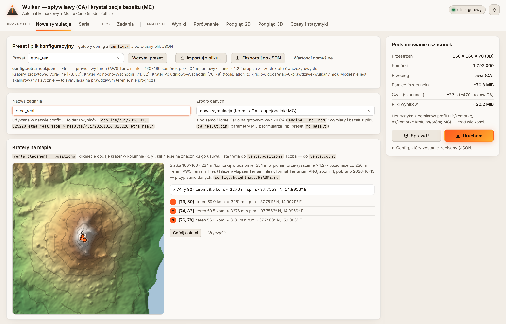
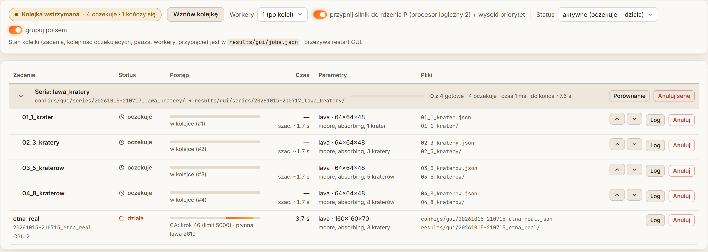
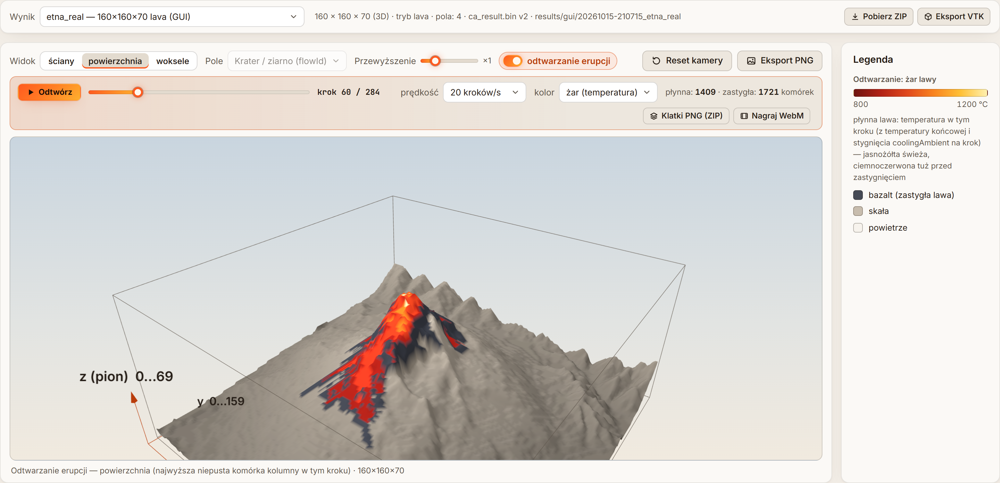
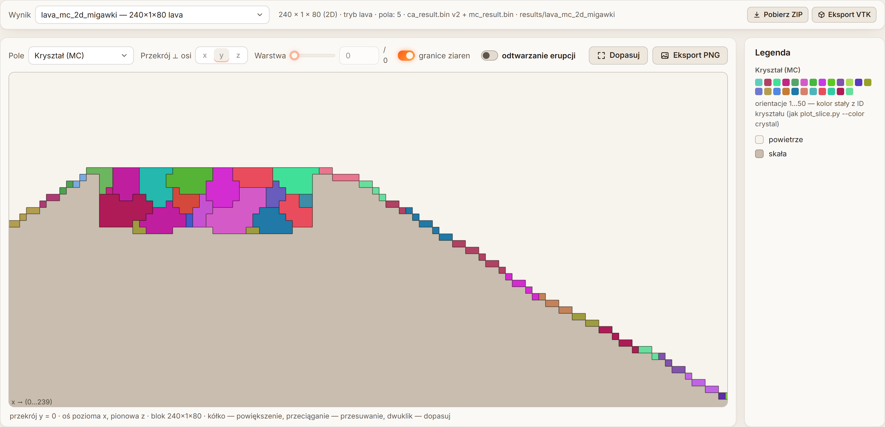
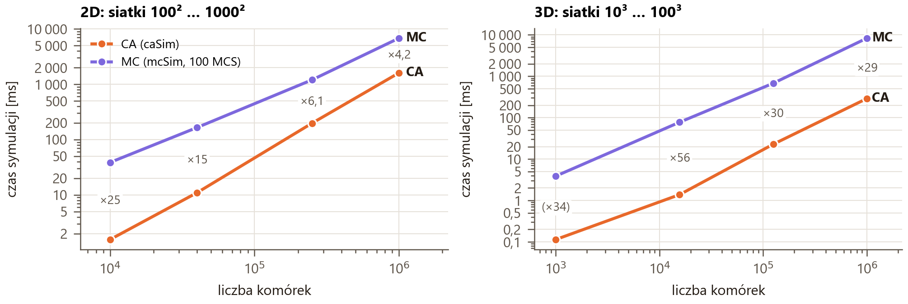
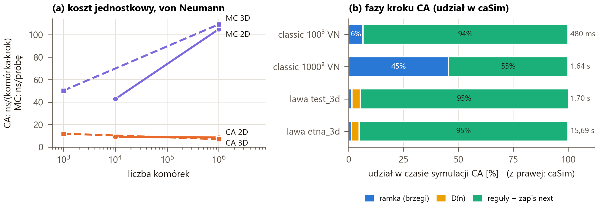

<div class="title-page">
<h1>Erupcja wulkanu: spływ lawy (CA) i&nbsp;krystalizacja bazaltu (MC)</h1>
<p class="tp-sub">volcano-ca-mc: silnik C++17 (wersja serwerowa) + GUI w przeglądarce</p>
<p class="tp-author">Bartosz Pajda</p>
<p class="intro">W projekcie zbudowałem symulację erupcji wulkanu w przestrzeni złożonej z sześciennych komórek, w wersji 2D i 3D. Automatem komórkowym opisałem spływ lawy jako rozrost ziaren: kratery są zarodkami, a lawa rośnie po terenie generowanym albo prawdziwym, pobranym z publicznych danych wysokościowych dla Etny i Wezuwiusza. Metodą Monte Carlo (model Pottsa) krystalizuję zastygły bazalt; rozmiar kryształów zależy od tego, jak długo lawa pozostawała płynna, więc wolno stygnące jezioro lawy daje duże kryształy, a szybko zastygłe zbocze drobne. Obliczenia wykonuje silnik C++ uruchamiany bez interfejsu, a GUI w przeglądarce przygotowuje konfiguracje, kolejkuje zadania i pokazuje wyniki w podglądzie 2D i 3D. Kolejne rozdziały opisują architekturę, oba modele, interfejs, wyniki oraz profil wydajności.</p>
</div>

## Architektura i technologie

Silnik to program C++17 budowany przez CMake (presety `msvc-release`, `gcc-release` i presety profilowania), bez zależności poza `json.hpp` i `doctest.h`. Działa jak „wersja serwerowa”: config JSON (wartości domyślne → plik → `--set klucz=wartość`, walidacja z komunikatami po polsku) → symulacja → pliki wyników i `times.json`. Kod kompiluje się bez ostrzeżeń w MSVC 19.38 (`/W4`) i GCC 11.4 (`-Wall -Wextra`, WSL2), a wyniki z obu kompilatorów są **bitowo identyczne** (porównanie `cmp` plików `ca_result.bin`, `mc_result.bin`). GUI to backend Python 3.12 + FastAPI (tylko 127.0.0.1, niczego nie liczy) i frontend HTML + moduły ES bez kroku budowania, z three.js r160 i Chart.js 4.4.1 trzymanymi lokalnie; silnik jest uruchamiany jako osobny proces (rys. 1).

<figure>
<svg viewBox="0 0 700 112" width="100%" xmlns="http://www.w3.org/2000/svg" font-family="Inter, Segoe UI, sans-serif" font-size="10" fill="#1f1a16">
<defs><marker id="ar" viewBox="0 0 8 8" refX="7.5" refY="4" markerWidth="6" markerHeight="6" orient="auto"><path d="M0,0 L8,4 L0,8 z" fill="#7a6d60"/></marker></defs>
<g stroke="#b9ac9c" stroke-width="1" fill="#f6f2ec">
<rect x="2" y="6" width="138" height="66" rx="5"/><rect x="176" y="6" width="176" height="66" rx="5" fill="#fbeee6" stroke="#e0a07c"/>
<rect x="388" y="6" width="150" height="66" rx="5"/><rect x="574" y="6" width="124" height="66" rx="5" fill="#efedf9" stroke="#b3a8e6"/></g>
<g font-weight="650"><text x="12" y="23">config JSON</text><text x="186" y="23">engine (C++17, bez GUI)</text><text x="398" y="23">results/&lt;id&gt;/</text><text x="584" y="23">GUI (przeglądarka)</text></g>
<g font-size="8.6" fill="#554b42"><text x="12" y="38">configs/*.json, configs/gui/</text><text x="12" y="51">+ argumenty: --set, --out,</text><text x="12" y="64">--mc-from, --batch</text>
<text x="186" y="38">Config::load → teren → kratery</text><text x="186" y="51">CA: LavaCA&lt;Storage&gt;, MC: PottsMC</text><text x="186" y="64">--progress: linie PROGRESS dla GUI</text>
<text x="398" y="38">ca_result.bin, mc_result.bin</text><text x="398" y="51">times.json, stats.json</text><text x="398" y="64">mc_stats.csv, engine.log</text>
<text x="584" y="38">FastAPI: wycinki</text><text x="584" y="51">(bajty + X-Meta)</text><text x="584" y="64">three.js, Chart.js</text></g>
<g stroke="#7a6d60" stroke-width="1.3" fill="none" marker-end="url(#ar)"><path d="M140 39 H174"/><path d="M352 39 H386"/><path d="M538 39 H572"/>
<path d="M636 72 V96 H71 V74"/></g>
<text x="350" y="108" font-size="8.6" fill="#554b42" text-anchor="middle">formularz / seria → engine --validate → zapis configu i folderu → kolejka → osobny proces silnika na zadanie</text>
</svg>
<figcaption><b>Rys. 1.</b> Przepływ danych. Backend GUI tylko zarządza plikami i procesami; do przeglądarki trafiają przekroje, ściany, powierzchnia albo woksele jako surowe bajty, nigdy cały blok.</figcaption>
</figure>

<div class="tab" markdown="1">
<p class="caption"><b>Tab. 1.</b> Moduły silnika (<code>engine/src/</code>).</p>

| Moduł | Zawartość |
|---|---|
| `core` | typy komórek, `VectorStorage` / `MatrixStorage`, sąsiedztwa (listy przesunięć), brzegi (wypełnianie ramki), `hashRand`, stoper, pamięć procesu i model pamięci, proces potomny |
| `terrain` | stożek z gładkim szumem, mapa wysokości z CSV, poziomy przelewu (priority-flood), rozmieszczenie kraterów |
| `ca` | `LavaCA<Storage>` (szablon automatu), `CaRules.hpp` (opis reguł i głosowanie `CandidateVote`) |
| `mc` | `PottsMC` (naiwny MC), `Grains` (union-find), `CoolingMobility`, `McRules.hpp` |
| `io` / `app` | config z walidacją, zapis/odczyt txt i bin, `TimingReport`; `Simulation`, `McStage`, `BatchRunner`, `Benchmark`, CLI |
</div>

**Siatka.** Każde pole komórki to osobna płaska tablica (SoA): `type` 1 B, `flowId` 4 B, `temp` 4 B, `solidStep` i `arrivalStep` po 2 B, czyli 13 B na komórkę w buforze. Dookoła siatki jest **ramka jednej komórki** (ghost cells): sąsiad komórki brzegowej zawsze istnieje, a warunek brzegowy to tylko wypełnienie ramki przed krokiem (`Boundary::apply()`: absorbujące to komórki `VOID`, periodyczne to kopia przeciwległej warstwy), więc w gorącej pętli nie ma warunków na brzegach. Dwie reprezentacje siatki do porównania to `VectorStorage` (jedna tablica na pole, indeks `x+1 + sx·(y+1 + sy·(z+1))`) i `MatrixStorage` (`vector<vector<vector<T>>>`) o wspólnym interfejsie. Automat jest szablonem `LavaCA<Storage>`; reprezentację wybiera się raz w `Simulation::run()`, bez funkcji wirtualnych w pętli.

<div class="tab" markdown="1">
<p class="caption"><b>Tab. 2.</b> Pliki wynikowe jednego przebiegu (little-endian; N = nx·ny·nz).</p>

| Plik | Zawartość |
|---|---|
| `ca_result.bin` (wersja 2) | `"VOLC"`, `uint32 2`, `int32 nx ny nz`, potem tablice `uint8 type[N]`, `int32 flowId[N]`, `float temp[N]`, `uint16 solidStep[N]`, `uint16 arrivalStep[N]`; 20 B + 13 B/komórkę; czytnik obsługuje też wersję 1 |
| `mc_result.bin` | `"VMC1"`, `int32 nx ny nz`, `int32 crystal[N]` (0 poza domeną MC); 16 B + 4 B/komórkę |
| `times.json` | czas każdego etapu [ms]: `readConfig, allocate, terrain, vents, caSim, save, mcInit, mcSim, mcStats, mcSave, total`; kroki, procesor, kompilator; `memory` (szczyt procesu + model z kodu), `files` (rozmiar i czas zapisu każdego pliku) |
| `stats.json` | objętość lawy i zasięg na krater, historia kroków (lawa płynna, zmiany), sekcja `mc`: ziarna, energia, efekt mobilności `byMobility` |
</div>

**Deterministyczna losowość.** W kroku CA i MC nie ma generatora ze stanem. Każda losowa decyzja (remis w głosowaniu, wariant sąsiedztwa losowego, kroki 1, 3 i 5 MC) to funkcja ziarna, numeru kroku, globalnego indeksu komórki (bez ramki) i „soli” rozdzielającej strumienie (listing 1). Wynik nie zależy więc od kolejności przetwarzania, reprezentacji siatki ani kompilatora. Generator `mt19937_64` służy tylko do rozmieszczenia kraterów, z własnym losowaniem z zakresu i tasowaniem Fishera–Yatesa, bo `std::uniform_int_distribution` i `std::shuffle` dają w MSVC i GCC inne wyniki.

<div class="listing" markdown="1">
<p class="lst-head"><b>Listing 1.</b> <code>engine/src/core/Rng.hpp</code>, linie 46–52, <code>hashRand()</code>: kaskada splitmix64</p>

```cpp
VOLCANO_NOINLINE inline std::uint64_t hashRand(std::uint64_t seed, std::uint64_t step,
                                               std::uint64_t globalIndex, std::uint64_t salt) {
    std::uint64_t h = splitmix64(seed ^ 0xA0761D6478BD642FULL);
    h = splitmix64(h ^ step);
    h = splitmix64(h ^ globalIndex);
    return splitmix64(h ^ salt);
}
```
</div>

## Model CA: spływ lawy jako rozrost ziaren

Komórka jest powietrzem (`AIR`), skałą (`ROCK`), płynną lawą (`LAVA`) albo bazaltem (`BASALT`); ramka absorbująca to `VOID`. Kratery są zarodkami z własnym `flowId` (jak ziarna), a lawa rosnącymi ziarnami. Krok jest **synchroniczny**: czyta tylko bufor `cur_`, pisze tylko `next_`, po kroku bufory zamienia `swap()` (O(1), bez kopiowania). Reguły trybu `lava` (pełny opis z uzasadnieniem każdej zmiany: `CaRules.hpp`):

1. **Przed regułami**: osobny przebieg `computeDescent()`: dla lawy leżącej na gruncie D(n) = największy spadek dostępny wśród sąsiednich komórek powietrza (potrzebny wielu sąsiadom, więc liczony raz na krok).
2. **Komórka AIR** zbiera kandydatów spośród sąsiadów-lawy: lawa *dokładnie nad nią* wpływa zawsze (swobodny spadek, stygnięcie `coolingFall`); lawa *wyżej po skosie*, gdy obie mają podparcie i D(n) = 1 (spływ po stoku); lawa *na tym samym poziomie* tylko w kierunku największego spadku, spadek(c) = D(n) (rozlewanie, `coolingLateral`); lawa *niżej* nie wpływa (lawa się nie wspina).
3. **Podparciem** są skała, bazalt, dno i płynna lawa leżąca w niecce; lawa spływająca po zboczu nie podpiera, bo inaczej „kurtyna” lawy zalewała całą przestrzeń pod nią.
4. **Głosowanie:** nowa komórka dostaje najczęstszy `flowId` kandydatów (remis: `hashRand`, remisujące identyfikatory posortowane, więc wynik nie zależy od kolejności sąsiadów), temperaturę max(T<sub>n</sub> − stygnięcie) i `arrivalStep` = t. Za zimna lawa (T < `solidusTemp`) nie wpływa.
5. **Komórka LAVA:** krater w trakcie erupcji ma stałe `eruptTemp`, reszta traci `coolingAmbient` na krok; poniżej `solidusTemp` → `BASALT`, `solidStep` = t.
6. **Wypełnianie krateru:** poziom przelewu każdej kolumny liczy algorytm priority-flood (`TerrainGenerator::fillDepressions()`, Barnes i in. 2014). Komórka nad lawą w niecce dostaje lawę, gdy lawa obok nie ma dokąd się rozlać, więc krater wypełnia się warstwami i przelewa przez najniższy punkt krawędzi.
7. **Stop:** brak płynnej lawy, krok bez zmian (tylko sąsiedztwa deterministyczne) albo `ca.maxSteps`.

Sąsiedztwa to prekomputowane listy przesunięć: von Neumann 4/6, Moore 8/26, losowe pentagonalne 5/17 i heksagonalne 6 (2D) z wariantem wybieranym przez `hashRand`. Brzegi: absorbujące albo periodyczne; w trybie `lava` oś pionowa jest zawsze absorbująca. Tryb `classic` to zwykły rozrost ziaren (najczęstszy `flowId` sąsiadów, koniec przy braku `AIR`), używany do porównań wydajności.

<div class="listing" markdown="1">
<p class="lst-head"><b>Listing 2.</b> <code>engine/src/ca/LavaCA.hpp</code>, linie 371–410, rdzeń <code>LavaCA::updateLava()</code> (pętle z, y, x w kolejności pamięci)</p>

```cpp
// … for (int z …) { for (int y …) {
for (int x = 0; x < dims_.nx; ++x, ++idx) {
    const CellType type = cur_.type(x, y, z);
    if (type == CellType::Air) {
        gatherLavaCandidates(x, y, z, t, idx, vote);
        if (!vote.empty()) {
            const int w = vote.winner(p_.seed, t, idx);
            const float temp = vote.maxTemp(w);
            if (temp >= p_.solidusTemp) {
                next_.setCell(x, y, z,
                              CellState{CellType::Lava, vote.flowId(w), temp, 0, stamp});
                // … ++lava; ++changed;
                continue;
            }
        }
        next_.setCell(x, y, z, cur_.cell(x, y, z));
        // … ++air;
    } else if (type == CellType::Lava) {
        CellState c = cur_.cell(x, y, z);
        // … krater w trakcie erupcji: c.temp = eruptTemp, reszta: c.temp -= coolingAmbient
        if (c.temp < p_.solidusTemp) {
            c.type = CellType::Basalt;
            c.solidStep = stamp;
            // …
        }
        next_.setCell(x, y, z, c);
    } else {
        next_.setCell(x, y, z, cur_.cell(x, y, z));  // ROCK, BASALT
    }
}
```
</div>

<div class="listing" markdown="1">
<p class="lst-head"><b>Listing 3.</b> <code>engine/src/ca/LavaCA.hpp</code>, linie 268–296, <code>LavaCA::gatherLavaCandidates()</code>: kiedy sąsiad-lawa wpływa do komórki c</p>

```cpp
if (o.dz > 0 && o.dx == 0 && o.dy == 0) {
    cooling = p_.coolingFall;  // swobodny spadek pionowo — zawsze
} else {
    const int d = descent_[static_cast<std::size_t>(globalIndex(dims_, sx, sy, sz))];
    // … d < 0 (źródło bez podparcia) → pomiń; cDrop = dropDepth(x, y, z), raz na komórkę c
    if (o.dz > 0) {
        if (cDrop != 0 || d != 1) {
            continue;
        }
        cooling = p_.coolingFall;
    } else {
        if (cDrop != d || (d == 1 && diagonalFalls_)) {
            continue;
        }
        cooling = p_.coolingLateral;
    }
}
vote.add(cur_.flowId(sx, sy, sz), cur_.temp(sx, sy, sz) - cooling);
```
</div>

**Prawdziwy teren.** `tools/fetch_dem.py` pobiera kafelki Terrarium z AWS Terrain Tiles (wysokość = R·256 + G + B/256 − 32768), skleja mozaikę i przepróbkowuje ją dwuliniowo, z wygładzeniem do rozmiaru komórki, na siatkę `nx × ny`; wynik to zwykła mapa CSV czytana przez `HeightmapLoader::loadCsv()`, więc silnik nie wymagał zmian. Etna: 160×160×70 komórek, 233,6 m/komórkę w poziomie i 55,1 m w pionie (przewyższenie ×4,24). Kratery leżą w zadanych kolumnach (`vents.placement = "positions"`: Voragine [73, 80], Krater Płn.-Wsch. [74, 82], Krater Płd.-Wsch. [76, 78]), ustawianych w GUI kliknięciem na mapie (rys. 2). **Odtwarzanie erupcji** nie wymaga nowego wyjścia silnika: komórka przechodzi powietrze → lawa → bazalt tylko raz, więc stan w kroku k wynika z `arrivalStep` i `solidStep`, a temperatura wynika z przeliczenia wstecz: T<sub>k</sub> = min(`eruptTemp`, T<sub>końc</sub> + `coolingAmbient`·(koniec − k)). Testy (`test_replay.cpp`, `test_replay.py`) porównują odtworzenie z migawkami stanu zapisanymi przez silnik.

<figure>

<figcaption><b>Rys. 2.</b> Nowa symulacja → preset <code>etna_real</code>: opis presetu, nazwa zadania, „Podsumowanie i szacunek” (heurystyka z pomiarów etapu profilowania) i „Kratery na mapie” z kursorem nad najwyższą komórką [74, 82] (3276 m n.p.m., szer./dł. z metadanych mapy). Karta mapy wysokości między nazwą zadania a mapą kraterów jest wycięta (linia przerywana). Identyfikator w podglądzie nazwy pochodzi z chwili wpisania nazwy, a zadanie dostaje znacznik z chwili „Uruchom” (rys. 3).</figcaption>
</figure>

## Model MC: krystalizacja bazaltu

**Domena** w trybie `basalt` to komórki `BASALT` (i pozostała płynna `LAVA`) z wyniku CA, w pamięci albo z pliku (`engine --mc-from <folder>`); w trybie `full` cała przestrzeń, a teren i CA są pomijane (do porównań czasu CA i MC). `PottsMC` ma własne płaskie tablice z ramką: orientacja `int32`, maska `uint8`, mobilność `float`; sąsiad to indeks + stałe przesunięcie liniowe, bez sprawdzania zakresu. Po zaakceptowanej zmianie komórki przy ścianie periodycznej `PottsMC::syncFrame()` odświeża jej kopie w ramce (do 7 w narożniku 3D). Parametry: Q orientacji (domyślnie 50), energia granicy J = 1, kT = 0 (wersja naiwna: ΔE > 0 nigdy nie jest akceptowane), 1 MCS = tyle prób, ile komórek w domenie; orientacja początkowa 1 + `hashRand(seed, 0, idx, kSaltMcInit)` mod Q. Pętlę prób pokazuje listing 4.

**Mobilność ze stygnięcia.** Czas w stanie płynnym t<sub>i</sub> = `solidStep` − `arrivalStep` (z CA) jest normalizowany min–max po domenie i liniowo zamieniany na mobilność (`CoolingMobility::fromCooling()`, linie 37–61):

<p class="formula">m<sub>i</sub> = m<sub>min</sub> + (1 − m<sub>min</sub>) · (t<sub>i</sub> − t<sub>min</sub>) / (t<sub>max</sub> − t<sub>min</sub>),   m<sub>min</sub> = <code>mobilityMin</code> (domyślnie 0,05);  przy równych czasach m = 1.</p>

Próba dla komórki i jest pomijana z prawdopodobieństwem 1 − m<sub>i</sub>: długo płynna lawa przebudowuje się swobodnie (duże kryształy), szybko zastygła prawie wcale (drobne; „chilled margin” skał wulkanicznych).

**Ziarna i statystyki.** Co `statsEvery` MCS `Grains::label()` liczy spójne składowe komórek o tej samej orientacji metodą union-find, ze spójnością von Neumanna dla MC z sąsiedztwem VN i Moore'a dla pozostałych (przy samym VN cienka, schodkowa warstwa bazaltu rozpadałaby się na jednokomórkowe ziarna niezależnie od MC). Do `mc_stats.csv` trafiają liczba ziaren, średnia wielkość, energia i współczynnik akceptacji; czas statystyk (`mcStats`) nie wlicza się do `mcSim`.

<div class="listing" markdown="1">
<p class="lst-head"><b>Listing 4.</b> <code>engine/src/mc/PottsMC.cpp</code>, linie 202–249, <code>PottsMC::sweep()</code>, kroki 1–5 wersji naiwnej (pominięte komentarze „OPTYMALIZACJA” i fragmenty <code>// …</code>)</p>

```cpp
for (std::uint64_t a = 0; a < n; ++a) {
    // Krok 1: losowa selekcja elementu — losowanie ZE ZWRACANIEM z listy komórek domeny.
    const std::size_t k = static_cast<std::size_t>(hashRand(p_.seed, t, a, kSaltMcPick) % n);
    const std::size_t i = domainFrame_[k];
    // … mobilność: próba pominięta z p = 1 − mobility_[i] (hashUniform, kSaltMcMobility)
    const std::vector<std::ptrdiff_t>& offsets = offsetsFor(t, domainGlobal_[k]);
    const std::int32_t current = spin_[i];
    // Krok 2: energia sieci otaczającej element przed zmianą: E = J · Σ (1 − δ(S_i, S_j)).
    const double energyBefore = p_.J * unlikeNeighbors(i, current, offsets);
    // Krok 3: nowa orientacja losowana z całego zbioru 1..Q, różna od obecnej
    std::int32_t proposed =
        1 + static_cast<std::int32_t>(hashRand(p_.seed, t, a, kSaltMcOrient) % otherStates);
    if (proposed >= current) {
        ++proposed;
    }
    // Krok 4: energia po zmianie i zmiana energii ΔE.
    const double energyAfter = p_.J * unlikeNeighbors(i, proposed, offsets);
    const double deltaE = energyAfter - energyBefore;
    // Krok 5: akceptacja Metropolisa — ΔE <= 0 zawsze; ΔE > 0 z prawdopodobieństwem
    // exp(−ΔE/kT) (kT > 0), a dla kT = 0 nigdy (p = 0, dokładnie jak w wariancie naiwnym).
    bool accept = deltaE <= 0.0;
    if (!accept && p_.kT > 0.0) {
        accept = hashUniform(p_.seed, t, a, kSaltMcAccept) < std::exp(-deltaE / p_.kT);
        // …
    }
    // … if (accept): spin_[i] = proposed; syncFrame(i) dla komórki przy ścianie periodycznej
}
```
</div>

## Interfejs i kolejkowanie

**Przebieg pracy.** Formularz „Nowa symulacja” powstaje z `engine --print-defaults` (te same klucze i wartości domyślne co silnik). „Sprawdź” wywołuje `engine --validate` (błędy po polsku przy polach), a „Uruchom” zapisuje `configs/gui/<id>.json`, tworzy `results/gui/<id>/` i dodaje zadanie do kolejki FIFO. Worker (wątek `JobManager._worker()`) bierze pierwsze oczekujące zadanie i w `JobManager._run()` uruchamia `engine … --progress` jako **osobny proces**; linie `PROGRESS` aktualizują pasek postępu, reszta wyjścia trafia do `engine.log`. Kolejka ma 1–16 workerów, pauzę, kolejność ▲▼, anulowanie zadania i serii, ponowienie oraz przypięcie silnika do rdzenia P (`JobManager._pin_process()`: procesory logiczne 2, 4, …, wysoki priorytet), a jej stan w `results/gui/jobs.json` przeżywa restart. Podglądy 2D/3D dostają od backendu przekrój, ściany, powierzchnię albo woksele wycięte z `np.memmap` jako surowe bajty z opisem w nagłówku `X-Meta`; koloruje je przeglądarka.

**Serie.** Generator `gui/series.py` (wspólny z `tools/make_series.py`) buduje iloczyn kartezjański 1–3 osi (lista, zakres, potęgi), z parowaniem kluczy w jednej osi (np. `space.nx, ny, nz` zmieniają się razem). Najpierw waliduje i zapisuje **wszystkie** configi, `series.json` i foldery, dopiero potem dodaje zadania do kolejki. Szablony: „CA vs MC: rozmiar siatki” (16 zadań), „Wpływ liczby zarodków” (8), „Wpływ sąsiedztwa (2D)” (8), „Lawa: liczba kraterów” (4). **Bez GUI:** `engine --batch <folder> --out <folder>` uruchamia każdy config w osobnym procesie (`CreateProcessW` / `posix_spawn`), bo szczyt pamięci procesu jest monotoniczny, a awaria jednego przebiegu nie przerywa wtedy serii. Po każdym przebiegu silnik zapisuje `batch_summary.csv` (kod wyjścia 5, gdy któryś się nie udał).

<figure>

<figcaption><b>Rys. 3.</b> Zadania (filtr „aktywne”): <code>etna_real</code> z rys. 2 liczy się na procesorze logicznym 2 (CA: krok 46), za nim czeka seria z szablonu „Lawa: liczba kraterów” (4 zadania, ▲▼, szacowany czas); kolejka wstrzymana: działające zadanie kończy się normalnie, nowe nie startują.</figcaption>
</figure>

## Wyniki

<div class="tab num nw t3" markdown="1">
<p class="caption"><b>Tab. 3.</b> Przykładowe przypadki, jedno uruchomienie, MSVC 19.38 Release, 15.10.2026, bez przypięcia; wartości z <code>times.json</code> i <code>stats.json</code> (<code>docs/wyniki.md</code>).</p>

| Przypadek | Config | Siatka | Kroki CA | `caSim` | `mcSim` (MCS) | Lawa [kom.] | Ziarna MC: start → koniec |
|---|---|---|---|---|---|---|---|
| Etna | `etna_real` | 160×160×70 | 284 | 21,39 s | – | 4 402 | – |
| Wezuwiusz | `wezuwiusz_real` | 140×140×50 | 128 | 4,43 s | – | 2 470 | – |
| przekrój 2D | `test_2d` | 200×1×100 | 351 | 107,7 ms | – | 99 | – |
| classic, 10 ziaren, VN | `classic_ref` | 100×100×100 | 71 | 499,6 ms | – | – | – |
| lawa 2D + MC | `lava_mc_2d` | 240×1×80 | 202 | 58,5 ms | 8,2 ms (300) | 516 | 486 → 74 |
| lawa 3D + MC | `lava_mc_3d` | 80×80×50 | 133 | 1,32 s | 94,3 ms (200) | 4 291 | 3 719 → 574 |
| MC full, Q = 50 | `mc_full_2d` | 200×200×1 | – | – | 185,4 ms (100) | – | 38 327 → 5 596 |
| kaldera z wyłomem | `heightmap_kaldera` | 100×100×45 | 234 | 3,04 s | 9,3 ms (100) | 1 511 | 1 404 → 551 |
</div>

<figure>

<figcaption><b>Rys. 4.</b> Podgląd 3D wyniku zadania z rys. 3 (<code>results/gui/…_etna_real</code>): powierzchnia, odtwarzanie erupcji, krok 60 z 284, paleta „żar” (świeża lawa jasnożółta, ciemna czerwień tuż przed zastygnięciem, bazalt grafitowy); licznik GUI: płynna 1 409, zastygła 1 721 komórek.</figcaption>
</figure>

**Etna i Wezuwiusz.** Największy zasięg lawy Etny to 46,2 komórki ≈ 10,8 km od krateru (stan w trakcie erupcji, rys. 4). Krater Płd.-Wsch. daje 2 860 komórek lawy, spływającej głównie na S i SW, oraz wąski lob na E po zachodniej ścianie Valle del Bove (lawa nie dochodzi do dna kotliny, bo kończy się budżet temperatury); Krater Płn.-Wsch. 1 250 komórek na N i NW, Voragine 292 komórki między nimi. Lawa Wezuwiusza najpierw wypełnia krater, przelewa się przez najniższy odcinek krawędzi na SW/W i zatrzymuje się na grzbiecie Monte Somma (zasięg 44 komórki ≈ 3,5 km). Kierunki wynikają z rzeźby terenu, ale **model nie jest skalibrowany fizycznie**: parametry dobrano pod czytelny obraz i czas obliczeń, a nie z własności lawy (rozdz. 7).

**Krystalizacja MC.** Liczba ziaren maleje z każdym MCS (tab. 3), a energia granic spada (`lava_mc_3d`: 27 959 → 13 649). Efekt stygnięcia widać w podziale na klasy mobilności (`stats.json`, `byMobility`): w `lava_mc_3d` średnie ziarno lawy długo płynnej (m ≥ 0,5) ma 25,8 komórki, a szybko zastygłej 5,2 (**×5,0**); w `lava_mc_2d` 10,9 wobec 3,4 (**×3,2**). Bez mobilności stosunek wynosi tylko 2,2× (3D) i 2,3× (2D), co wynika z samej geometrii cienkiej warstwy.

<figure>

<figcaption><b>Rys. 5.</b> Podgląd 2D wyniku <code>lava_mc_2d_migawki</code> (CA → MC, 516 komórek bazaltu, Q = 50, 300 MCS): pole „kryształ (MC)” z granicami ziaren, przybliżenie na krater i prawe zbocze. Długo płynne jezioro lawy w kraterze skrystalizowało w duże ziarna, cienka warstwa na zboczu w drobne.</figcaption>
</figure>

**CA vs MC.** Na tej samej siatce naiwne MC jest **4–56× wolniejsze** od CA (rys. 6). Krok CA to jedno sekwencyjne przejście po komórkach (stałe ~7–10 ns na komórkę i krok), a MCS to N losowych dostępów do pamięci, dwa przejścia po sąsiadach i kilka hashy na próbę (39–83 ns, więcej, gdy dane wychodzą poza L2/L3). MC robi zawsze 100 MCS i odrzuca 87% prób (akceptacja 13% w `mc_full_2d`), a CA kończy po 4–190 krokach. W 2D przewaga CA maleje z rozmiarem (×25 → ×4,2), bo kroki CA rosną jak bok siatki; w 3D rosną jak N<sup>1/3</sup>, więc stosunek zostaje ~30×.

<figure>

<figcaption><b>Rys. 6.</b> Czas symulacji CA (<code>caSim</code>, classic, 100 zarodków, VN) i MC (<code>mcSim</code>, full, Q = 50, 100 MCS) vs liczba komórek, z krotnością MC/CA. Seria GUI z 10.10.2026, 1 worker, przypięcie do CPU 2 (<code>docs/data/ca_vs_mc.csv</code>); w nawiasie: oba czasy &lt; 5 ms (zaszumione).</figcaption>
</figure>

## Profilowanie i wydajność

**Metodyka.** Release (MSVC `/O2`, GCC `-O3`), proces przypięty do procesora logicznego 2 (rdzeń P i9-13900HX; na rdzeniu E program jest 2,3–2,9× wolniejszy), wysoki priorytet, 3 powtórzenia, mediana [min–max], buildy przeplatane. `bench/run_profile.py` przechodzi całą macierz (siatki 100²–1000² i 10³–300³, zarodki 1/10/100, VN/Moore, brzegi, 7 buildów; 426 przebiegów w 25 min) → `bench/results/profile_2026-10-09*.csv`. Podział czasu między funkcje dały gprof i callgrind (GCC, WSL2) oraz profiler Visual Studio (VSDiagnostics + xperf), także w wariantach `*-noinline`. **Pomiar z 9.10 wykonano przy obciążonym tle** (15–26% CPU: stały `WmiPrvSE.exe` (zapytania WMI narzędzia producenta laptopa działającego w tle) i przeglądarka). Tło spowalnia MC znacznie bardziej niż CA: w serii z 10.10 przy tle 7–10% MC 1000² trwało 6,8 s zamiast 10,5 s.

<div class="tab nw t4" markdown="1">
<p class="caption"><b>Tab. 4.</b> Gorące miejsca: udział w czasie własnym funkcji (gprof, MSVC) albo w instrukcjach (callgrind); pomiar z 9.10, <code>bench/profiles/</code>.</p>

| Przypadek | Funkcja | Udział | Uwagi |
|---|---|---|---|
| CA lawa (`etna_3d`, `test_3d`) | `LavaCA::gatherLavaCandidates()` | **68–83%** | `etna_3d`: 424,7 mln wywołań, lawę znajduje 0,013% (55 tys. `CandidateVote::add()`) |
| | `LavaCA::updateLava()` | 9–23% | pętla po komórkach (warianty bez wstawiania) |
| | `LavaCA::computeDescent()` | 2,4–4,7% | przebieg D(n) |
| CA classic 100³, VN | `LavaCA::updateClassic()` | 87–95% | 46,8% instrukcji to odczyt/zapis komórek (`Storage.hpp`) |
| | `Boundary::apply()` | 1,4–7,1% | wypełnianie ramki (kopiowanie pamięci) |
| MC full 50³, Moore | `PottsMC::unlikeNeighbors()` | **60–67%** | energia przed i po zmianie, dwa przejścia po 26 sąsiadach |
| | `hashRand()` | 7–13% | wybór komórki, orientacji, mobilność |
| | `Grains::label()` | 9–20% | union-find w statystykach (poza `mcSim`) |
</div>

W lawie obliczenie indeksu sąsiada z (x, y, z) to ~29% wszystkich instrukcji (callgrind, `test_3d`), a prawie cała praca CA jest zbędna: przeszukiwanie sąsiadów każdej komórki powietrza w każdym kroku. Na rys. 7a koszt CA na komórkę i krok jest stały (czas = c·N·kroki, a kroki rosną z największą luką między zarodkami), a koszt próby MC rośnie 2,2–2,5× przy 10⁶ komórek, bo dane (orientacje + listy domeny) nie mieszczą się w pamięci podręcznej. Rys. 7b pokazuje drugą niespodziankę: w classic 1000² ramka 2D zajmuje 45% kroku, bo jest kopiowana także w nieużywanej osi z.

<figure>

<figcaption><b>Rys. 7.</b> Pomiar z 9.10 (MSVC <code>/O2</code>, mediana z 3, obciążone tło; <code>bench/results/profile_2026-10-09.csv</code>): (a) koszt jednostkowy CA classic (10 zarodków) i MC full (Q = 50, 100 MCS) vs liczba komórek; (b) fazy kroku CA z <code>--timing-detail</code> (D(n) w lawie: 3,8% i 3,5%).</figcaption>
</figure>

<div class="tab num nw" markdown="1">
<p class="caption"><b>Tab. 5.</b> Benchmark reprezentacji siatki (tabela porównawcza): <code>engine --benchmark --repeats 5</code>, mediana czasu samego automatu, MSVC <code>/O2</code>, przypięty; pomiar z 9.10 (<code>bench/results/profile_2026-10-09_benchmark.csv</code>). „Zgodne” = oba wyniki identyczne komórka po komórce.</p>

| Siatka | Komórki | Ziarna | Kroki | vector [ms] | macierz [ms] | mac/vec | Zgodne | Tryb |
|---|---|---|---|---|---|---|---|---|
| 10×10×10 | 1 000 | 10 | 9 | 0,072 | 0,098 | 1,37 | tak | classic/VN |
| 10×10×10 | 1 000 | 10 | 4 | 0,132 | 0,142 | 1,07 | tak | classic/Moore |
| 25×25×25 | 15 625 | 62 | 10 | 1,25 | 1,56 | 1,25 | tak | classic/VN |
| 25×25×25 | 15 625 | 62 | 6 | 2,12 | 2,22 | 1,05 | tak | classic/Moore |
| 50×50×50 | 125 000 | 100 | 19 | 16,3 | 21,4 | 1,31 | tak | classic/VN |
| 100×100×100 | 1 000 000 | 100 | 43 | 266 | 355 | 1,34 | tak | classic/VN |
| 100×100 | 10 000 | 10 | 39 | 3,33 | 5,45 | 1,64 | tak | classic/VN |
| 1000×1000 | 1 000 000 | 100 | 190 | 1 510 | 2 525 | 1,67 | tak | classic/VN |
| 200×1×100 | 20 000 | 1 | 351 | 94,9 | 112,2 | 1,18 | tak | lava/Moore |
| 64×64×48 | 196 608 | 3 | 284 | 1 643 | 1 864 | 1,13 | tak | lava/Moore |
</div>

Macierz jest wolniejsza w każdym przypadku (×1,05–1,67), najbardziej w dużym 2D (każdy wiersz to osobna alokacja i dodatkowe odczyty wskaźników); wyniki są zgodne, bo losowość zależy od indeksu globalnego, nie od reprezentacji. **GCC vs MSVC:** GCC jest szybszy w MC 2–3× na małych siatkach (100²: 2,1–2,4×, 10³: 2,9–3,3×) i 1,2–1,4× na 10⁶ komórek, w CA lawy o 10–35%. Asembler pokazał przyczynę w MC: MSVC kompiluje porównanie orientacji sąsiada do skoku warunkowego (`cmp` + `je`), który procesor źle przewiduje, gdy ziarna urosną, a GCC liczy je bez skoku (`setne`). Mikrobenchmark (bloki 3×3×3): MSVC 38,9 ns, GCC 15,6 ns. Przepisanie jednej linii na wersję bez skoku i wyciągnięcie stałej części hasha przed pętlę skraca MC 200² w MSVC ze 172 do 68 ms (GCC: 75–82 ms) przy bitowo tym samym wyniku.

**Model pamięci.** Każda duża tablica jest rejestrowana w `MemoryModel` (rozmiar z `sizeof`). Szczyt CA = 26·N<sub>f</sub> + 13·N (N<sub>f</sub>: komórki z ramką): ~40 B/komórkę w 3D, 91 B w 2D (ramka w nieużywanej osi), MC 3D ~42 B. Dla siatek ≥ 10⁶ komórek model zgadza się z pomiarem szczytu procesu z dokładnością 0–4% (300³: 1 018 vs 1 019 MiB). Siatka 1000³ wymagałaby ~40 GB (CA), a lawa + MC ~50 GB, czyli więcej niż 32 GB RAM laptopa. **Układ kodu:** pole-wektor dodane do `Config` przesunęło w pliku MSVC gorącą pętlę `updateLava` z 32 na 48 B w linii 64 B i spowolniło CA o 6–9% (`test_3d`: 1745 → 1871 ms) przy niezmienionym kodzie automatu; lista kraterów wróciła poza strukturę (`Config::ventColumns()`), a po każdej zmianie silnika robię test A/B starego i nowego programu.

## Wnioski

**Najważniejsze wyniki.** Spływ lawy zrealizowany jako rozrost ziaren z kraterów daje na prawdziwym terenie kierunki spływu zgodne z rzeźbą (Etna: S/SW i N/NW, do ~10,8 km; Wezuwiusz: przelew na SW/W, zatrzymanie na Monte Somma). Monte Carlo na bazalcie z CA zgrubia strukturę (`lava_mc_3d`: 3 719 → 574 ziaren), a mobilność ze stygnięcia daje kryształy ×5,0 (3D) i ×3,2 (2D) większe w wolno stygnącej lawie niż w szybko zastygłej. Na tej samej siatce MC jest 4–56× wolniejsze od CA. Profil pokazał, że w lawie 68–83% czasu zajmuje `gatherLavaCandidates()`, czyli przeszukiwanie sąsiadów komórek powietrza, które prawie zawsze nic nie znajduje, a w MC 60–67% czasu liczenie sąsiadów o innej orientacji. Płaska tablica jest szybsza od `vector<vector<vector>>` we wszystkich przypadkach (×1,05–1,67) przy bitowo identycznych wynikach, a różnice MSVC/GCC w MC wynikają z jednego skoku warunkowego w pętli energii. Model pamięci (~40–42 B/komórkę) zgadza się z pomiarem z dokładnością 0–4%.

**Ograniczenia modelu.** CA jest modelem wzrostu bez zachowania masy: zasięg wyznacza „budżet temperatury”, nie objętość wylewu. Przy 234 m/komórkę lawa tworzy płaty, a nie wąskie jęzory: teren jest skwantowany do schodów (55 m w pionie), a doliny Etny są płytsze niż jedna komórka. Mobilność mierzy czas płynięcia, a nie grubość warstwy. Losowe pentagonalne w MC prawie nie zgrubia struktury (decyzja widzi 5 z 8 sąsiadów; 40×40: 1 488 → 1 112 ziaren po 50 MCS).
