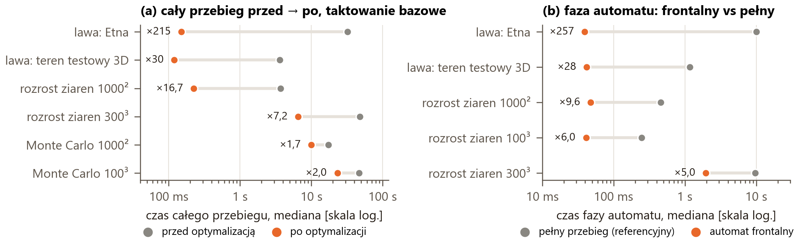
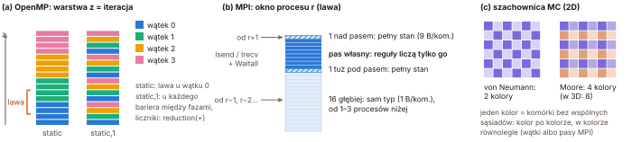
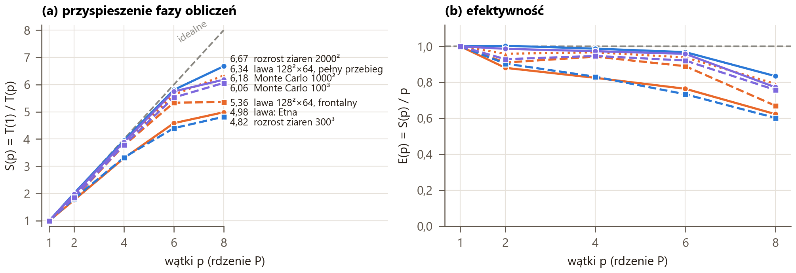
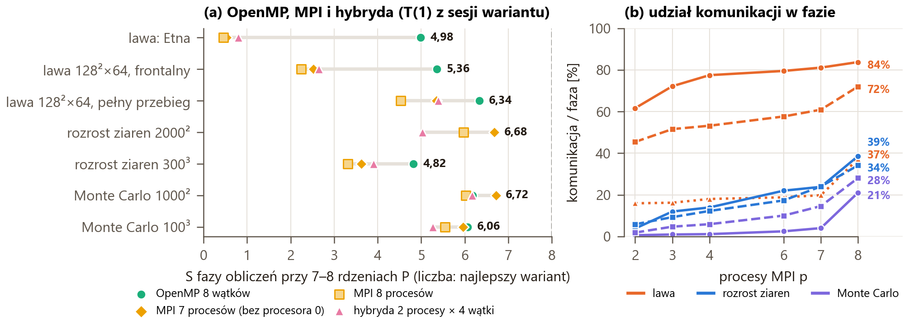
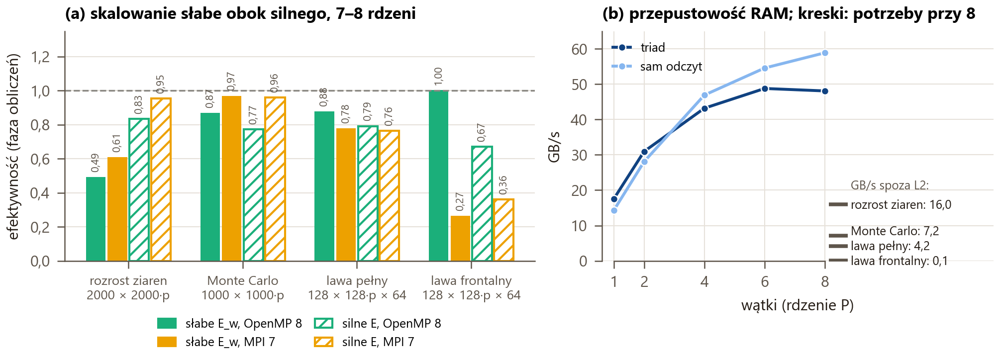
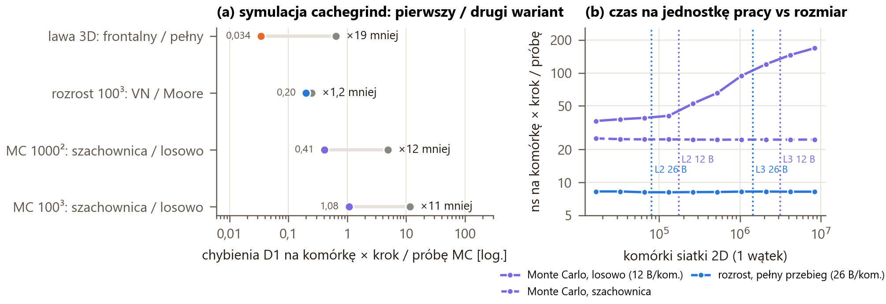
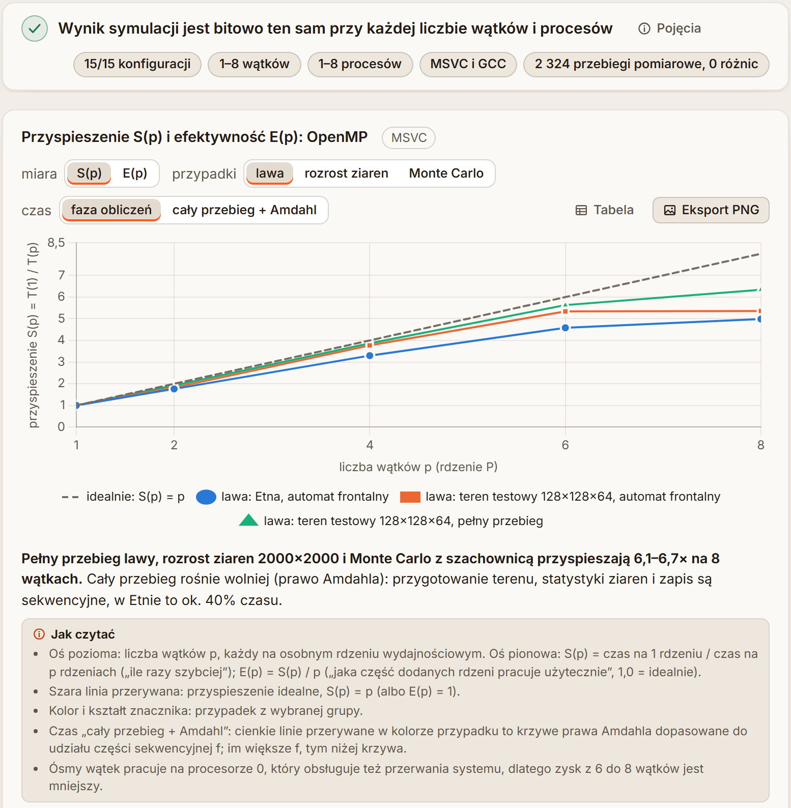

<div class="title-page">
<h1>Erupcja wulkanu: spływ lawy (CA) i&nbsp;krystalizacja bazaltu (MC)</h1>
<p class="tp-sub">volcano-ca-mc, część 2: optymalizacja i obliczenia równoległe (OpenMP, MPI)</p>
<p class="tp-author">Bartosz Pajda</p>
<p class="intro">Na podstawie profilu z pierwszej części zoptymalizowałem wersję sekwencyjną silnika; najwięcej dał automat frontalny, który w każdym kroku sprawdza tylko komórki mogące się zmienić. Potem zrównolegliłem automat i Monte Carlo w OpenMP, dzieląc przestrzeń na warstwy między wątki, a Monte Carlo przeniosłem na aktualizację szachownicą. Wersja rozproszona to osobny program MPI: przestrzeń dzielą pasy warstw z warstwami brzegowymi, parametry rozsyła jeden proces wszystkim pozostałym, wymianę i rozsyłanie opisują typy pochodne MPI, a wynik można zapisać równolegle przez MPI-IO. Wynik symulacji jest bitowo ten sam przy każdej liczbie wątków i procesów, więc każde przyspieszenie da się sprawdzić porównaniem plików. Zbadałem przyspieszenie, efektywność, skalowanie słabe, pamięć główną i podręczną; wyniki pokazuje też zakładka „Wydajność” w GUI.</p>
</div>

## Środowisko i metodyka pomiarów

Wszystkie pomiary pochodzą z laptopa z procesorem i9-13900HX i 32 GB RAM: 8 rdzeni wydajnościowych P z SMT (procesory logiczne 0–15) i 16 energooszczędnych E; rdzeń P ma L1d 48 KB i L2 2 MB, L3 36 MB jest wspólna (`bench/results/testy/procesor.md`). Pomiary równoległe idą **tylko na rdzeniach P, jeden wątek albo proces na rdzeń fizyczny, najwyżej 8** (program przypina je do procesorów 2, 4, …, 14, 0; `parallel.affinity = pcores`): rdzenie P i E mają różną wydajność, a drugi wątek SMT dzieli rdzeń z pierwszym, więc oba zaburzałyby S(p) i E(p). Każdy przebieg ma **wysoki priorytet**: przy normalnym program w tle wywłaszczał jeden z 8 wątków, a reszta czekała na barierze (pełny przebieg dużej lawy: 9,7 s zamiast 0,38 s). Procesor pracuje z **taktowaniem bazowym** (rdzeń P ok. 2,1 GHz zamiast ok. 4,3 GHz przy taktowaniu dynamicznym), co daje stabilne wyniki. Główne wyniki: MSVC 19.38 i MS-MPI 10.1 (Windows); porównawczo GCC 11.4 i OpenMPI 4.1.2 w WSL 2 (procesory wirtualne bez gwarancji rdzeni P).

**Metodyka.** Każdą zmianę wersji sekwencyjnej mierzy test A/B (`bench/ab.py`: stary i nowy program na przemian, przypięte, 5–11 powtórzeń, mediana [min–max]; zmiana bez zysku ponad ±3% nie wchodzi), a skalowanie skrypty `bench/scaling.py`, `scaling_mpi.py` i `mpi_io.py` (warianty naprzemiennie, ≥ 5 powtórzeń). **Każdy przebieg pomiarowy jest porównywany bitowo** z wariantem odniesienia (2 324 przebiegi, 0 różnic), a `bench/compare_results.py` porównuje bajt po bajcie wyniki 15 configów z `configs/` (15/15 przy 1–8 wątkach i 1–8 procesach, MSVC i GCC). S(p) = T(1)/T(p), E(p) = S(p)/p, a w skalowaniu słabym (przestrzeń p razy większa) E<sub>w</sub>(p) = T(1)/T(p); T(1) zawsze z tej samej sesji (ten sam wariant w dwóch sesjach różnił się o 13–29%). **Faza obliczeń** to sam automat albo samo MC (`caSim`, `mcSim`), **cały przebieg** (`total`) zawiera też przygotowanie, statystyki i zapis.

## Optymalizacja sekwencyjna

Profil z pierwszej części wskazał dwa gorące miejsca: w lawie 68–83% czasu zajmowało `gatherLavaCandidates()`, czyli przeszukiwanie sąsiadów każdej komórki powietrza, które w 99,99% przypadków nic nie znajdowało, a w MC 60–67% liczenie sąsiadów o innej orientacji, które MSVC kompilował do trudnego do przewidzenia skoku warunkowego. Optymalizację podzieliłem na kroki k1–k8 (tab. 1); każdy dał wyniki bitowo identyczne z programem sprzed zmian.

**Automat frontalny (k4)** dał najwięcej. W kroku może zmienić się tylko komórka lawy (stygnie, zastyga) i komórka powietrza, do której może wpłynąć sąsiad-lawa; resztę siatki pełny przebieg przepisywał bez zmian. Listy frontu są na warstwę z (`FrontLayer`: lawa `src`, kandydaci `cand` bez powtórzeń dzięki znacznikom `mark_`, zmiany). Krok ma cztery fazy: D(n) tylko dla lawy, kandydaci z sumy przesunięć wszystkich wariantów sąsiedztwa (listing 1), **te same funkcje reguł co pełny przebieg** (czytają stan z początku kroku) i zastosowanie zmian (`frontApply`). Wynik jest bitowo ten sam, bo każda komórka, która może się zmienić, przechodzi tę samą funkcję reguł na tym samym stanie, a `hashRand(seed, krok, globalIndex, sól)` nie zależy od kolejności. Pełny przebieg został wersją referencyjną (`ca.sweep = full`, test `test_front.cpp`), a jeden bufor siatki zamiast dwóch obniżył szczyt pamięci (Etna 76 → 55 MB).

<div class="tab nw" markdown="1">
<p class="caption"><b>Tab. 1.</b> Kroki optymalizacji: zysk = mediana czasu przed krokiem / po kroku, zakres po przypadkach zestawu A/B (13 przypadków, k8: 7), w mierze zmienionej części programu; każdy krok 15/15 configów bitowo zgodnych (<code>bench/results/ab/ab_k*.csv</code>, <code>zgodnosc_k*.md</code>). k1–k4 przy taktowaniu dynamicznym, k5–k8 przy bazowym.</p>

| Krok | Zmiana | Miara | MSVC | GCC |
|---|---|---|---|---|
| k1 | MC: sąsiedzi bez skoku warunkowego (`sameA += sj == a`), energia przed i po w jednym przejściu | `mcSim` | ×1,9–4,0 | ×1,2–2,3 |
| k2 | ramka tylko w osiach używanych przez sąsiedztwo | `caSim` 2D | ×1,6–1,8 (CA 3D o 10–12% wolniej) | ×1,6–1,7 |
| k3 | sąsiad = pozycja + stałe przesunięcie liniowe | `caSim` | rozrost ×1,8–1,9, lawa ×1,1 | rozrost ×1,7–2,2, lawa ×1,2–1,3 |
| k4 | **automat frontalny** (`ca.sweep = front`) | `caSim` | lawa ×16–334, rozrost ×3,8–9,5 | lawa ×12–272, rozrost ×2,9–8,5 |
| k5 | tańsze statystyki MC (etykiety ziaren, energia) | `mcStats` | ×1,3–2,2 | ×1,2–1,9 |
| k7 | zapis tekstu (bufor, `std::to_chars`, własne formatowanie) | `save` / `mcSave` | ×3,7 / ×3,0–3,1 | ×5,0–5,5 / ×3,0 |
| k8 | flagi `/arch:AVX2`, `-march=native` | `total` | bez zysku (−2…+2%) | bez zysku (−3…+2%) |
</div>

<div class="listing" markdown="1">
<p class="lst-head"><b>Listing 1.</b> <code>engine/src/ca/LavaCA.hpp</code>, linie 912–940, <code>LavaCA::frontCandidatesLayer()</code>: kandydaci warstwy k z list <code>src</code> warstw k − 1 … k + 1</p>

```cpp
void frontCandidatesLayer(int k, int nl) {
    FrontLayer& dst = layers_[static_cast<std::size_t>(k)];
    for (int d = -1; d <= 1; ++d) {
        int s = k + d;
        // … warstwa s poza zakresem: pominięta albo zawinięta (oś periodyczna)
        const std::vector<Offset>& group = rev_[d + 1];
        for (const Coord& l : layers_[static_cast<std::size_t>(s)].src) {
            for (const Offset& o : group) {
                // … x, y, z = l − o (int x = l.x - o.dx …); poza przestrzenią: pomiń
                std::uint8_t& m = mark_[static_cast<std::size_t>(globalIndex(dims_, x, y, z))];
                if (m != 0 || cur_.type(x, y, z) != CellType::Air) {
                    continue;
                }
                m = 1;
                dst.cand.push_back(Coord{x, y, z});
            }
        }
    }
}
```
</div>

Cały przebieg Etny skrócił się z 32,3 s do 0,150 s (rys. 1a; ×215, sama faza automatu ×375), rozrostu ziaren 1000² ×16,7, a MC tylko ×1,7–2,0, bo próba MC dalej wymaga losowego dostępu do pamięci. Zysk automatu frontalnego zależy od aktywnej części siatki (rys. 1b): lawa zajmuje ułamek procenta przestrzeni (Etna ×257), a front rozrostu ziaren obejmuje granice wszystkich ziaren (×5,0–9,6). **Profil po zmianach** (gprof, `bench/profiles/po_optymalizacji_gprof_*`): w lawie dominuje budowanie listy kandydatów (40% czasu Etny, 56% w `test_3d`), a w Etnie przygotowanie (mapa wysokości, wypełnianie tablic, początek frontu) to już ok. 25%, co ograniczy zrównoleglenie; w MC 83% zajmuje pętla prób `sweepTrials`, statystyki ziaren 14%. **Bez zysku** był k8: gorące pętle ogranicza dostęp do pamięci i skoki, nie arytmetyka. Pominąłem k6 (mniejsze typy pól) i warianty MC zmieniające proces losowy (losowanie bez powtórzeń, próby tylko na granicach ziaren).

<figure>

<figcaption><b>Rys. 1.</b> (a) Cały przebieg przed i po optymalizacji, MSVC, mediana z 3, taktowanie bazowe (<code>bench/results/profile_2026-10-17_przed2.csv</code>, <code>_po.csv</code>); (b) faza automatu <code>full</code> i <code>front</code> po kroku k4, taktowanie dynamiczne (<code>bench/results/ab/ab_k4_msvc_front_full.csv</code>).</figcaption>
</figure>

## OpenMP

**Podział przestrzeni.** Iteracją pętli równoległej jest jedna warstwa z (w przekroju 2D wiersz y), liczona w danej fazie w całości przez jeden wątek tą samą funkcją co w wersji sekwencyjnej (rys. 2a). Na krok przypada jeden region `#pragma omp parallel`, a fazy (D(n) lawy → kandydaci i reguły → zastosowanie zmian) rozdziela `ompBarrier()`. Faza pisze tylko elementy swojej warstwy (listy, znaczniki, komórki i ich kopie w ramce) i czyta stan z początku kroku, a liczniki kroku sumuje `reduction(+)` na liczbach całkowitych. Losowość pochodzi z `hashRand` z indeksem globalnym komórki, więc **wynik jest bitowo ten sam przy każdej liczbie wątków i każdym harmonogramie** (test `test_parallel.cpp`: 1, 2, 3, 4 i 8 wątków); nawet kolejność elementów list jest taka jak przy 1 wątku. Przy 1 wątku krok idzie ścieżką sekwencyjną bez regionów OpenMP (narzut ≤ 3% całego przebiegu w teście A/B). Sekwencyjne zostały wypełnianie zagłębień (priority-flood), rozmieszczenie kraterów i etykiety ziaren MC (union-find).

<figure>

<figcaption><b>Rys. 2.</b> Podział przestrzeni: (a) OpenMP, 4 wątki: <code>static</code> daje ciągłe pasy warstw, więc front lawy w dolnych warstwach trafia do jednego wątku, <code>static,1</code> przydziela warstwy cyklicznie; (b) MPI: okno procesu w lawie: pas własny, 1 warstwa brzegowa nad pasem i 17 pod nim (najgłębsze 16 tylko z typem komórki); w rozroście ziaren i MC po 1 warstwie z każdej strony; (c) kolory szachownicy MC w 2D.</figcaption>
</figure>

**Harmonogram z configu.** MSVC ma OpenMP 2.0 (`/openmp`; wariant `/openmp:llvm` zawiesił się w mikroteście) bez `omp_set_schedule`, więc `ompFor()` (`engine/src/parallel/Omp.hpp`) wybiera instrukcją `switch` jedną z sześciu dyrektyw `#pragma omp for schedule(…) nowait`: `static`, `dynamic` albo `guided`, z porcją `parallel.chunk` albo bez. Najlepszy harmonogram zależy od rozkładu pracy (tab. 2). Lawa spływa po kilku warstwach, więc równe ciągłe pasy (`static`) dają jednemu wątkowi prawie całą pracę (Etna: nierówność czasu pracy wątków ×3,19), a przydział cykliczny `static,1` wyrównuje ją do ×1,22 bez kosztu pobierania porcji. W pełnym przebiegu górne warstwy powietrza są droższe od dolnej skały, więc wygrywa `dynamic` / `guided`; w MC 3D Moore kolor zależy od parzystości z, więc przy `static,1` połowa wątków nie ma komórek danego koloru.

<div class="tab num t3" markdown="1">
<p class="caption"><b>Tab. 2.</b> Harmonogramy przy 8 wątkach: najlepszy (czas fazy, mediana) i najgorszy jako krotność najlepszego; MSVC (<code>bench/results/omp/harmonogramy_msvc.md</code>).</p>

| Przypadek | Najlepszy | Czas fazy | Najgorszy |
|---|---|---|---|
| lawa: Etna, frontalny | `static,1` | 23 ms | `dynamic` ×2,25 |
| lawa 128²×64, frontalny | `static,1` | 135 ms | `guided` ×1,79 |
| lawa 128²×64, pełny przebieg | `dynamic` | 1 874 ms | `static` ×1,33 |
| rozrost ziaren 2000² | `static` | 87 ms | `dynamic` ×3,74 |
| rozrost ziaren 300³ | `dynamic,4` | 686 ms | `static,1` ×1,32 |
| Monte Carlo 1000² | `guided,4` | 322 ms | `dynamic` ×1,31 |
| Monte Carlo 100³ | `guided` | 935 ms | `static,1` ×1,93 |
</div>

**Monte Carlo: szachownica.** Wariant naiwny losuje komórkę i od razu zmienia jej orientację, więc kolejność prób definiuje trajektorię i pętli nie da się podzielić bez zmiany wyniku. Tryb `mc.update = checkerboard` dzieli komórki na kolory, w których żadne dwie komórki nie są sąsiadami (von Neumann: 2 kolory, Moore: 4 w 2D i 8 w 3D; `PottsMC::buildColors()`, rys. 2c); 1 MCS to kolory po kolei, a w kolorze każda komórka domeny dokładnie raz, równolegle po warstwach (listing 2). Losowość `hashRand(seed, MCS, globalIndex, sól)` daje ten sam wynik przy każdej liczbie wątków. To inny proces losowy, więc `bench/mc_validation.py` porównał go z wariantem naiwnym (12 ziaren generatora): liczba ziaren po 100 MCS różni się o 1,1–2,3%, wykładnik wzrostu średniego ziarna w 2D jest ten sam (0,660 i 0,660), w 3D Moore niższy o 3,6% (`bench/results/omp/mc_walidacja.md`). Szachownica jest też ×4,0 (1000²) i ×3,3 (100³) szybsza już na jednym wątku, bo przegląda komórki po kolei (rozdz. 6).

<div class="listing" markdown="1">
<p class="lst-head"><b>Listing 2.</b> <code>engine/src/mc/PottsMC.cpp</code>, linie 474–502, <code>PottsMC::sweepColors()</code>: jeden region na MCS, kolor po kolorze, bariera po kolorze</p>

```cpp
#  pragma omp parallel num_threads(par_.threads) reduction(+ : attempts, accepted, uphill)
{
    const int tid = omp_get_thread_num();
    // … zegar faz wątku (--thread-stats)
    TrialCounts mine;
    for (int c = 0; c < colors_; ++c) {
        // … start: początki warstw koloru c na liście komórek (colorLayerStart_)
        ompFor(nl, sched, chunk, [&](std::ptrdiff_t k) {
            colorTrials<kMobility, kRandomNb>(prefix, start[k], start[k + 1], mine);
        });
        ompBarrier();
        // … pas MPI: wymiana warstw brzegowych przez wątek 0, bariera
    }
    attempts += mine.attempts;
    // … accepted, uphill tak samo
}
```
</div>

<figure>

<figcaption><b>Rys. 3.</b> Przyspieszenie i efektywność fazy obliczeń OpenMP, 1–8 wątków na rdzeniach P, MSVC, mediana z 5–11 powtórzeń, każdy przebieg bitowo zgodny z p = 1, harmonogramy jak w tab. 2 (<code>bench/results/omp/skalowanie_msvc.csv</code>).</figcaption>
</figure>

Faza obliczeń przyspiesza przy 8 wątkach 4,8–6,7× (rys. 3); najlepiej pełny przebieg lawy (6,34: dużo pracy na komórkę, równe fazy) i rozrost ziaren 2000² (6,67), najsłabiej rozrost 300³ (4,82; prosta reguła na 27 mln komórek, rozdz. 6) i Etna (4,98; krok frontu trwa ułamek milisekundy). **Cały przebieg** ogranicza prawo Amdahla: dopasowana część szeregowa f wynosi 0,027 w pełnym przebiegu lawy i 0,374 w Etnie, gdzie teren, alokacja i zapis to przy 8 wątkach 63% czasu, więc S(8) całości = 2,12, a S(∞) = 1/f ≈ 2,7. W MC przy 8 wątkach połowę czasu zajmują sekwencyjne etykiety ziaren (S całości 3,3–3,6). **Ósmy wątek** daje najmniej we wszystkich przypadkach: pracuje na procesorze 0, który obsługuje przerwania systemu (MC 1000², `static,1`: 416 ms pracy wobec 301–310 ms pozostałych wątków).

## MPI

**Program i rozsyłanie.** `engine_mpi` to osobny program na tej samej bibliotece silnika (`engine` i GUI się nie zmieniły); biblioteka nie zależy od MPI, komunikację dostarcza interfejs `StripLink` zaimplementowany w `engine/src/mpi/`. `MPI_Init_thread` z `MPI_THREAD_FUNNELED` pozwala na tryb hybrydowy, w którym MPI woła tylko wątek główny. **Proces 0 czyta config**, nakłada `--set`, waliduje i rozsyła scalony JSON przez `MPI_Bcast` (listing 4), potem tablicę wysokości terenu; pozostałe procesy niczego nie czytają z dysku. Rozesłanie configu (ok. 0,8 KB) i terenu (66–103 KB) trwa przy 8 procesach 0,6–0,8 ms.

**Pasy i warstwy brzegowe.** Przestrzeń dzielą równe pasy warstw z (w płaszczyźnie x–y: y), a okno procesu to pas własny z warstwami brzegowymi sąsiadów (rys. 2b). Grubość warstw brzegowych wynika z zasięgu reguł w osi z (`LavaCA::reachBelow/Above`): rozrost ziaren i MC czytają po 1 warstwie z każdej strony, ale lawa **17 pod pasem i 1 nad**: kierunek największego spadku (`dropDepth()`) schodzi kolumną do 16 poziomów w dół, a test podparcia czyta jeszcze komórkę pod spodem. Z 16 głębszych warstw reguły czytają tylko typ komórki, więc tylko on jest przesyłany (1 B na komórkę). Przy pasach cieńszych niż 17 warstw te warstwy przychodzą od kilku procesów naraz, dlatego wymiana to lista komunikatów `MPI_Irecv` / `MPI_Isend` do wszystkich sąsiadów i jedno `MPI_Waitall` (listing 3), a nie para `MPI_Sendrecv`. Wymiana idzie przed każdym krokiem CA i po każdym kolorze szachownicy; testy z 1 warstwą pod pasem zamiast 17 dają niezgodny wynik.

<div class="listing" markdown="1">
<p class="lst-head"><b>Listing 3.</b> <code>engine/src/mpi/MpiHalo.cpp</code>, linie 125–189, <code>MpiHalo::run()</code>: nieblokująca wymiana warstw brzegowych z ręcznym pakowaniem</p>

```cpp
for (std::size_t i = 0; i < nr; ++i) {
    const StripPlan::Message& m = plan_.recvs[i];
    // … cap = flagi + bajty pól warstw komunikatu
    MPI_Irecv(recvBuf_[i].data(), static_cast<int>(cap), MPI_BYTE, m.peer, tag_, comm_, &requests_[i]);
}
// 2. Pakowanie i wysyłka: flagi, potem dane warstw (pola po kolei, każde jednym memcpy).
for (std::size_t j = 0; j < ns; ++j) {
    // … pakowanie warstw do sendBuf_[j] (changed: bez niezmienionych)
    MPI_Isend(buf.data(), size, MPI_BYTE, m.peer, tag_, comm_, &requests_[nr + j]);
}
MPI_Waitall(static_cast<int>(nr + ns), requests_.data(), MPI_STATUSES_IGNORE);
// … rozpakowanie odebranych warstw do okna
```
</div>

<div class="listing" markdown="1">
<p class="lst-head"><b>Listing 4.</b> <code>engine/src/mpi/MpiSimulation.cpp</code>, linie 55–65, <code>bcastText()</code>: config z procesu 0 do wszystkich (długość, potem treść)</p>

```cpp
unsigned long long n = text.size();
MPI_Bcast(&n, 1, MPI_UNSIGNED_LONG_LONG, 0, ctx.comm);
// … n > INT_MAX: błąd; procesy ≠ 0: text.assign(n, '\0')
if (n > 0) {
    MPI_Bcast(&text[0], static_cast<int>(n), MPI_CHAR, 0, ctx.comm);
}
```
</div>

**Zarodkowanie i elementy globalne.** Kratery i zarodki wyznacza każdy proces tą samą funkcją z tego samego ziarna (`VentPlacer`), więc wszystkie mają tę samą globalną listę położeń i identyfikatorów, a każdy wstawia te, które leżą w jego oknie; identyfikator ziarna nie zależy od liczby procesów. Każda losowa decyzja w pasie to `hashRand(seed, krok, globalIndex, sól)` z indeksem globalnym (indeks w oknie + stała `hashBase`), a kolory szachownicy wynikają z położenia globalnego. Liczniki kroku i reguła końca (brak lawy, brak zmian) idą przez `MPI_Allreduce`, więc wszystkie procesy kończą w tym samym kroku; wynik zbiera `MPI_Gatherv` do procesu 0, który zapisuje te same pliki co `engine`. Testy `ctest` (`mpi_np1…8`) porównują wynik bitowo z `engine` na 1, 2, 3, 4, 5 i 8 procesach, a `compare_results.py --launch` daje 15/15 configów na 1, 3 i 8 procesach, w trybie hybrydowym i krzyżowo z GCC / OpenMPI. Wariant `mpi.exchange = changed` wysyła warstwę tylko, gdy się zmieniła: w lawie to 20–57% bajtów i o 22% krótsza faza Etny, a w rozroście ziaren 300³ porównanie 10 MB kosztuje więcej, niż oszczędza (+2–4%).

<figure>

<figcaption><b>Rys. 4.</b> (a) S fazy obliczeń przy 7–8 rdzeniach P: OpenMP 8 wątków (pomiar OpenMP), MPI 7 procesów bez procesora 0, MPI 8 procesów i hybryda 2 × 4 (pomiar MPI), każdy wariant względem T(1) swojej sesji (<code>bench/results/testy/zestawienie.csv</code>); (b) średni po procesach czas wymiany warstw i <code>MPI_Allreduce</code> w fazie przez czas fazy (<code>bench/results/mpi/skalowanie_mpi_msvc.csv</code>). MSVC / MS-MPI.</figcaption>
</figure>

**Wyniki** (rys. 4). Siatki z równą pracą na warstwę skalują prawie liniowo: rozrost ziaren 2000² i MC 1000² na 7 procesach S = 6,68 i 6,72 (E = 0,95–0,96), więcej niż OpenMP na 8 wątkach. Ósmy proces na procesorze 0 liczy swój pas 13–30% dłużej (MC 1000²: 332 ms wobec 255–260 ms), a pasy są stałe, więc czekają na niego wszystkie: S(8) < S(7) we wszystkich 7 przypadkach. Lawa skaluje słabo: front spływa po dolnych warstwach, więc przy 4 procesach praca pasów to 365 / 307 / 108 / 8 ms, a w pełnym przebiegu odwrotnie, górne pasy powietrza liczą więcej (2 210 … 4 093 ms). Udział komunikacji (rys. 4b) to głównie czekanie na najwolniejszy pas w `MPI_Allreduce`; sam przesył kosztuje 0,06–0,13 ms na MB. Krok Etny trwa 0,32 ms, więc wymiana 6 MB warstw brzegowych jest dłuższa od obliczeń i MPI ją spowalnia (S = 0,45). Najlepszy wariant MPI dla lawy to hybryda 2 × 4 (mniej warstw brzegowych), ale nie dogania OpenMP: na jednym komputerze wątki czytają warstwy sąsiadów wprost, a procesy je kopiują.

## Typy pochodne MPI i równoległy zapis

Trzy niezależne opcje leżą obok dotychczasowej ścieżki (`mpi.pack`, `mpi.bcast`, `mpi.io`) i dają **bajtowo te same pliki**: testy wszystkich 8 kombinacji na 1–8 procesach i tabele `bench/results/mpi_io/zgodnosc_mpi_io_*.md` (15/15 configów, MSVC i GCC).

**Wymiana bez pakowania** (`mpi.pack = datatype`). Warstwa okna jest ciągłym fragmentem każdej tablicy pola, więc typ warstwy pola to `MPI_Type_contiguous`, a typ komunikatu do jednego sąsiada to `MPI_Type_create_struct` z bloków „warstwa pola” o adresach bezwzględnych z `MPI_Get_address`; kolejne warstwy tego samego pola łączą się w jeden blok (listing 5). Wysyłka i odbiór idą od `MPI_BOTTOM` wprost z okna do okna, bez buforów i bez 19 kopii `memcpy` po każdej stronie (lawa). Typy budowane są raz (4–100 na przebieg, łącznie 0,01–0,17 ms); pełny przebieg zamienia bufory co krok, więc ma dwa zestawy typów.

**Parametry jako struktury** (`mpi.bcast = struct`): blok liczbowy configu `ConfigBlock` (232 B, 20 pól różnych typów, przesunięcia z `offsetof`, `MPI_Type_create_resized`) idzie jednym `MPI_Bcast` (219 B zamiast 881–980 B tekstu JSON), a kratery jako tablica struktur `Vent` z procesu 0. Całe rozsyłanie trwa < 1,2 ms, więc czas się nie zmienia.

<div class="listing" markdown="1">
<p class="lst-head"><b>Listing 5.</b> <code>engine/src/mpi/MpiHalo.cpp</code>, linie 243–259, <code>MpiHalo::messageType()</code>: typ komunikatu z bloków „warstwa pola”</p>

```cpp
unsigned char* const addr = src.at(f, g.local);
if (f == lastField && addr == nextAddr) {
    ++lens.back();
} else {
    MPI_Aint a = 0;
    MPI_Get_address(addr, &a);
    lens.push_back(1);
    displs.push_back(a);
    types.push_back(layerType_[f].get());
}
// … koniec pętli po warstwach komunikatu i ich polach
MPI_Type_create_struct(static_cast<int>(lens.size()), lens.data(), displs.data(), types.data(), &t);
MPI_Type_commit(&t);
```
</div>

**MPI-IO** (`mpi.io = mpiio`). Pas procesu jest w każdej z 5 tablic `ca_result.bin` ciągłym fragmentem, więc widok pliku to struktura z pięciu `MPI_Type_create_subarray` (L warstw × bajty warstwy, wycinek [lo, hi)), a zapis to jedno zbiorowe `MPI_File_write_all` (listing 6); nagłówek pisze proces 0, a `MPI_File_set_size` ucina stary plik. Wiersze pliku tekstowego mają zmienną długość, więc każdy proces formatuje swoje wiersze tym samym kodem co `engine`, przesunięcie w pliku daje `MPI_Exscan` długości, a zapis `MPI_File_write_at_all`. Odczyt `--mc-from` czyta przez `MPI_File_read_at_all` tylko pas trzech tablic potrzebnych MC. Typ pamięci jest liczony względem bufora zapisu, nie od `MPI_BOTTOM`: MS-MPI przy typie z jednym blokiem czytał wtedy od adresu 0.

<div class="listing" markdown="1">
<p class="lst-head"><b>Listing 6.</b> <code>engine/src/mpi/MpiIo.cpp</code>, linie 85–152, <code>writeStrips()</code> i <code>writeText()</code>: widok pliku binarnego i przesunięcie pliku tekstowego</p>

```cpp
for (const Array& a : arrays) {
    const int rowBytes = toInt(plane * a.elem, "warstwa tablicy");
    int sizes[2] = {L, rowBytes};
    int subsizes[2] = {hi - lo, rowBytes};
    int starts[2] = {lo, 0};
    MPI_Datatype s = MPI_DATATYPE_NULL;
    MPI_Type_create_subarray(2, sizes, subsizes, starts, MPI_ORDER_C, MPI_BYTE, &s);
    // … s = blok typu pliku (struct), przesunięcie = początek tablicy
}
// … MPI_File_set_view, MPI_File_write_all; plik tekstowy (writeText):
MPI_Exscan(&len, &off, 1, MPI_UNSIGNED_LONG_LONG, MPI_SUM, comm);
```
</div>

Typy pochodne skracają samą wymianę o 25–50% (tab. 3), ale cała faza zyskuje tylko 0–9%, bo wymiana to 4–24% fazy, a w MC czas wymiany to głównie czekanie na wolniejszy pas po kolorze (bez zysku). MPI-IO nie przyspiesza samego zapisu na jednym dysku SSD (plik binarny 286–328 ms wobec 278–288 ms jednym strumieniem); zysk daje brak zebrania na procesie 0 (`MPI_Gatherv` 164–175 ms), czterokrotnie mniejsza pamięć procesu 0 i równoległe formatowanie tekstu (1 614 → 208 ms przy 1 → 8 procesach). Pliki ≤ 52 MB zapisują się przez MPI-IO tak samo albo wolniej (stały koszt otwarcia i synchronizacji), a w OpenMPI implementacja ROMIO zapisywała tekst 300³ ×2,2 szybciej niż domyślne OMPIO (418 wobec 899 ms).

<div class="tab num nw t3" markdown="1">
<p class="caption"><b>Tab. 3.</b> Typy pochodne i MPI-IO, MSVC / MS-MPI, 8 procesów, mediana z 5–7 powtórzeń: wymiana = średni po procesach czas wymiany warstw w całej fazie, pakowanie → typ pochodny; zapis = <code>save</code> od końca fazy CA, zebranie na proces 0 → MPI-IO (<code>bench/results/mpi_io/pomiar_msvc.md</code>).</p>

| Co | Przypadek | Dotychczas | Typ pochodny / MPI-IO | Zysk |
|---|---|---|---|---|
| wymiana warstw | lawa 128²×64, frontalny (3,85 MB na wymianę) | 63,4 ms | 39,0 ms | ×1,6 |
| | lawa 128²×64, pełny przebieg | 116 ms | 73 ms | ×1,6 |
| | rozrost ziaren 300³ (10,21 MB) | 107 ms | 54 ms | ×2,0 |
| zapis wyniku | rozrost 300³, `.bin` 351 MB | 489 ms | 325 ms | ×1,5 |
| | rozrost 300³, `.txt` 562 MB | 1 843 ms | 728 ms | ×2,5 |
| | rozrost 2000², `.txt` 86 MB | 285 ms | 90 ms | ×3,2 |
| | rozrost 2000², `.bin` 52 MB | 58 ms | 60 ms | bez zysku |
| pamięć procesu 0 | rozrost 300³, `.bin` | 469 MB | 118 MB | ×4,0 |
| odczyt `--mc-from` (z rozdziałem pasów) | rozrost 300³ | 546 ms | 20 ms | ×27 |
</div>

## Testy wydajności

**Zestawienie.** Przyspieszenia i efektywności nie mierzyłem od nowa: `bench/zestawienie.py` zestawia CSV pomiarów OpenMP, MPI i MPI-IO (programy od tamtej pory nie zmieniły wyniku ani czasu, testy A/B), zawsze z T(1) tej samej sesji. Tab. 4 pokazuje najlepszy wariant na ≤ 8 rdzeniach P i **łączne przyspieszenie** od programu sprzed optymalizacji jako iloczyn czynników, każdy z jednej sesji.

<div class="tab nw" markdown="1">
<p class="caption"><b>Tab. 4.</b> Najlepszy wariant (faza obliczeń: S / E; S całego przebiegu tego wariantu) i łączne przyspieszenie fazy = algorytm × szachownica (1 wątek) × równoległość; MSVC, w nawiasie GCC (<code>bench/results/testy/zestawienie.csv</code>, <code>zestawienie_lacznie.csv</code>).</p>

| Przypadek | Najlepszy wariant | S / E fazy | S całości | Łącznie |
|---|---|---|---|---|
| lawa: Etna, frontalny | OpenMP 8, `static,1` | 4,98 / 0,62 | 2,12 | **×1 871** = ×375 · ×4,98 (×1 328) |
| lawa 128²×64, frontalny | OpenMP 8 | 5,36 / 0,67 | 4,59 | |
| lawa 128²×64, pełny przebieg | OpenMP 8 | 6,34 / 0,79 | 6,22 | |
| rozrost ziaren 2000² | MPI 7 (bez procesora 0) | 6,68 / 0,95 | 3,50 | |
| rozrost ziaren 300³ | OpenMP 8 | 4,82 / 0,60 | 3,22 | **×50** = ×10,4 · ×4,82 (×42) |
| Monte Carlo 1000² | MPI 7 (bez procesora 0) | 6,72 / 0,96 | 3,54 | **×47** = ×1,74 · ×4,04 · ×6,72 (×38) |
| Monte Carlo 100³ | MPI 7 z typami ≈ OpenMP 8 | 6,07 / 0,87 ≈ 6,06 / 0,76 | 3,55 (OpenMP) | **×39** = ×1,95 · ×3,28 · ×6,07 (×29) |
</div>

Tam, gdzie algorytm zmniejszył ilość pracy, dał więcej niż równoległość: w Etnie ×375 z automatu frontalnego i ×4,98 z 8 wątków (kontrola: iloraz czasów z różnych dni ×1 878). W MC algorytm dał ×1,7–2,0, szachownica ×3,3–4,0, a 7 procesów resztę. S całego przebiegu (2,1–6,2) jest niższe niż S fazy przez część szeregową: przygotowanie, statystyki MC i zapis. **Przyspieszenia ponadliniowego** poza rozrzutem nie ma: E > 1 wyszło tylko w rozroście 2000² na 2 rdzeniach (MPI 1,02, rozrzut 0,98–1,05), bo L3 jest wspólna i podział nie zwiększa jej pojemności, a pasy dużych siatek nie mieszczą się w L2.

**Skalowanie słabe** (rys. 5a, `scaling.py --weak`): w MC i lawie E<sub>w</sub>(8) w OpenMP wynosi 0,87–1,00, nie mniej niż przy silnym, jak przewiduje prawo Gustafsona. Wyjątki to MPI lawy frontalnej (0,27: dolny pas ma prawie całą lawę, a jego teren rośnie z p) i **rozrost ziaren 2D: 0,49** w OpenMP, mniej niż silne 0,83. Ten przypadek ogranicza przepustowość RAM (rys. 5b): mikrotest `bench/micro/bandwidth.cpp` (jądra STREAM) nasyca się przy 6 wątkach (triad 48,8 GB/s, jeden wątek 17,6 GB/s), a rozrost ziaren przy 8 wątkach potrzebuje co najmniej 16 GB/s ruchu spoza L2 (realnie do ok. 2× więcej), MC 7,2, a lawa ≤ 4,2 GB/s.

**Pamięć główna** (`bench/memory.py`, szczyt RSS): wątki prawie jej nie zwiększają (8 / 1 wątek = 0,96–1,05). Suma po procesach MPI rośnie o warstwy brzegowe: w rozroście ziaren o 0–14%, w lawie ×1,71–1,84 przy 8 procesach (8 warstw własnych i do 18 brzegowych na proces). Przy zebraniu wyniku proces 0 trzyma całą siatkę (rozrost 300³: 445 MB wobec 107 MB pozostałych), a MPI-IO wyrównuje procesy (110 MB). Model pamięci z kodu (`MemoryModel`, rozszerzony na okna procesów) zgadza się z pomiarem do 6% przy 1 wątku i do 8% dla sumy procesów CA.

<figure>

<figcaption><b>Rys. 5.</b> (a) E<sub>w</sub>(p) = T(1)/T(p) fazy przy przestrzeni p razy większej (OpenMP 8 wątków, MPI 7 procesów z typami pochodnymi; <code>slabe_omp_msvc.csv</code>, <code>slabe_mpi_msvc.csv</code>) obok silnego E podobnego przypadku (<code>zestawienie.csv</code>); (b) przepustowość STREAM, najlepsza z 20 (<code>przepustowosc_msvc.csv</code>), i zapotrzebowanie przy 8 wątkach = jednostki pracy na sekundę × chybienia L2 z cachegrind × 64 B (<code>cachegrind.csv</code>). Pliki w <code>bench/results/testy/</code>, MSVC.</figcaption>
</figure>

<figure>

<figcaption><b>Rys. 6.</b> (a) Chybienia D1 jądra (funkcje kroku) na komórkę × krok albo próbę MC, symulacja cachegrind, GCC <code>-O3</code>, 1 wątek (<code>bench/results/testy/cachegrind.csv</code>); (b) czas na komórkę × krok albo próbę, 1 wątek na rdzeniu P, MSVC, mediana z 5; linie pionowe: pojemność L2 / L3 przez bajty dotykane na komórkę w kroku (<code>bench/results/testy/krzywa_msvc.csv</code>).</figcaption>
</figure>

**Pamięć podręczna.** Liczników sprzętowych nie ma (WSL bez `perf`, w Windows wymagają uprawnień administratora), więc chybienia liczy symulacja `cachegrind` (`bench/cachegrind.py`: 1 wątek, bez prefetchera), a pośrednio czas na komórkę w funkcji rozmiaru siatki (`bench/cell_time.py`). Najważniejszy wynik (rys. 6a): szachownica ma przy tej samej liczbie odwołań **11–12× mniej chybień D1** niż losowa kolejność prób, bo kolejne komórki koloru leżą obok siebie, a losowa próba trafia w linię spoza D1; to tłumaczy jej przewagę na jednym wątku. Automat frontalny ma 19× mniej chybień D1 niż pełny przebieg (front mieści się w L2). Losowe MC zwalnia ×4,6 od siatki w L2 do siatki w RAM (36 → 169 ns na próbę, rys. 6b), z pierwszym skokiem tuż za progiem L2 przewidzianym dla 12 B na komórkę, a rozrost ziaren i szachownica nie mają progu: czytają pamięć po kolei i opóźnienia ukrywa prefetcher sprzętowy.

## Wyniki w GUI i wnioski

Zakładka **„Wydajność”** (rys. 7) pokazuje te wyniki na interaktywnych wykresach z wnioskiem, „Jak czytać”, warunkami, źródłem i linkiem do PDF dokumentu pod każdym. Dane przygotowuje `tools/wydajnosc_gui.py` z `bench/results/`; w JS nie ma liczb z pomiarów.

<figure>

<figcaption><b>Rys. 7.</b> Zakładka „Wydajność”, sekcja OpenMP (motyw jasny, okno 1600×900): nagłówek z zasadą zgodności i plakietkami oraz karta S(p) dla lawy z wnioskiem i „Jak czytać”; plakietki przeniesione pod tytuł, „Warunki” i „Skąd dane” poza kadrem (<code>gui/tests/raport2_shots.py</code>).</figcaption>
</figure>

**Wnioski.** Najwięcej dał algorytm: automat frontalny przyspieszył Etnę ×375, a równoległość dołożyła ×5; w MC optymalizacja i szachownica dały ×6,4–7,0 na jednym wątku, a 7 procesów ×6,1–6,7. Na jednym komputerze OpenMP wygrywa w lawie (cykliczny przydział warstw), a MPI na 7 procesach w siatkach o równej pracy na warstwę (E = 0,95–0,96). Lawę ogranicza nierówne obciążenie pasów, rozrost ziaren przepustowość RAM, a cały przebieg szeregowe przygotowanie, statystyki ziaren i zapis.

**Dalszy rozwój:** pasy MPI ważone pracą albo podział w poziomie dla lawy, równoległe etykiety ziaren, mniejszy ruch do pamięci w rozroście ziaren (mniejsze typy pól), tańsza lista kandydatów frontu, pomiar na klastrze z równoległym systemem plików.
