# Testy wydajności

Testy wydajności nie zmieniają silnika. Zestawiają i uzupełniają pomiary wersji równoległych (OpenMP, MPI, typy
pochodne i MPI-IO) o to, czego dotąd nie było:

- **zestawienie przyspieszenia i efektywności** wszystkich wariantów w jednej tabeli i łączne przyspieszenie od programu
  sprzed optymalizacji (punkt 2),
- **pamięć główna** wersji równoległych: wątki, procesy, warstwy brzegowe, zebranie wyniku vs MPI-IO, model vs pomiar
  (punkt 3),
- **pamięć podręczna**: symulacja `cachegrind` (punkt 4), krzywa czasu na komórkę w funkcji rozmiaru siatki,
  przepustowość pamięci i fałszywe współdzielenie,
- **skalowanie słabe** (prawo Gustafsona): dotąd mierzone było tylko silne (punkt 2.4).

**Zasada: nie powtarzamy pomiarów, które już są.** Przyspieszenie OpenMP, MPI i trybu hybrydowego oraz
typów pochodnych i MPI-IO zmierzono z bitową zgodnością każdego przebiegu, a programy później nie zmieniły ani
wyników, ani czasu (testy A/B wersji MPI i typów MPI), więc te dane są tu zestawione, nie mierzone od nowa. Testy mają dwie części:
pierwsza nie wymaga wolnego komputera (zestawienie, pamięć: szczyt pamięci nie zależy od tła, symulacja pamięci
podręcznej liczy zdarzenia, nie czas), druga to krótki pomiar czasu w ciszy wg
[`PLAN_POMIARU.md`](../bench/results/testy/PLAN_POMIARU.md) (skalowanie słabe, czas na komórkę vs rozmiar siatki,
przepustowość pamięci). Dziennik: [`bench/results/testy/POSTEP.md`](../bench/results/testy/POSTEP.md). Podsumowanie
wszystkich wersji równoległych: punkt 5.

**W skrócie:**

- Najlepsze przyspieszenie fazy obliczeń na ≤ 8 rdzeniach P (MSVC): lawa: OpenMP (`etna_real` ×4,98, lawa `full`
  ×6,34), classic 2D i MC 2D: MPI na 7 procesach (×6,68 i ×6,72, E = 0,95–0,96), classic 300³: OpenMP ×4,82.
  **Łącznie od programu sprzed optymalizacji:** Etna ×1 871 (algorytm ×375 × OpenMP ×4,98), classic 300³ ×50, MC 1000² ×47,
  MC 100³ ×39; w lawie prawie cały zysk dał algorytm, w MC równoległość i szachownica.
- **Pamięć:** wątki jej prawie nie zwiększają (8 / 1 wątek = 0,96–1,05); suma po procesach MPI rośnie przez warstwy
  brzegowe: classic +0–14%, lawa +71–84% przy 8 procesach (17 warstw pod pasem); zebranie wyniku trzyma całą siatkę
  na procesie 0 (classic 300³: 445 MB wobec 107 MB pozostałych), MPI-IO wyrównuje procesy (110 / 107 MB).
  Model pamięci z kodu zgadza się z pomiarem z dokładnością 0–8% (CA).
- **Pamięć podręczna:** liczników sprzętowych nie ma (WSL bez `perf`, w Windows wymagają administratora), więc symulacja
  `cachegrind`. Szachownica MC ma **×10–12 mniej chybień D1** niż losowa kolejność prób (to tłumaczy, czemu już przy
  1 wątku jest 3–4× szybsza), automat frontalny lawy ×19 mniej niż pełny przebieg; progi L2 / L3 / RAM wypadają tam,
  gdzie przewiduje model pamięci. Przyspieszenia ponadliniowego (E > 1) poza rozrzutem pomiaru nie ma (punkt 4.6).
- **Skalowanie słabe** (przestrzeń p razy większa): przy 8 rdzeniach E_w = 0,87–1,00 w OpenMP dla MC i lawy (lepiej
  niż silne, jak przewiduje Gustafson), ale **classic 2D tylko 0,49** (OpenMP i MPI): ogranicza go przepustowość
  pamięci, nie część szeregowa. MPI lawy `front` 0,25: podział w z, lawa w dolnym pasie.
- **Pamięć podręczna w czasie:** MC random zwalnia ×4,6 od siatki w L2 do siatki w RAM (36 → 169 ns na próbę, próg
  L2 tam, gdzie przewiduje 12 B na komórkę); classic `full` i szachownica MC bez progu (dostęp po kolei).
  **Przepustowość RAM** nasyca się przy 6 wątkach (~48 GB/s triad, 1 wątek 18 GB/s); classic przy 8 wątkach potrzebuje
  ≥ 16 GB/s ruchu spoza L2, stąd spadek E, MC i lawa (≤ 7 GB/s) nie są ograniczone pamięcią.

## 1. Metodyka

### 1.1 Skąd dane

| Co | Źródło | Nowy pomiar? |
|---|---|---|
| S(p), E(p), f (Amdahl) OpenMP | wersja OpenMP: `bench/results/omp/skalowanie_{msvc,gcc}.csv` | nie, zestawienie |
| S(p), E(p) MPI, hybryda, `changed`, OpenMP dla porównania | wersja MPI: `bench/results/mpi/skalowanie_mpi_{msvc,gcc}.csv` | nie, zestawienie |
| typy pochodne, zapis gather / MPI-IO | typy MPI i MPI-IO: `bench/results/mpi_io/pomiar_*_raw.csv` | nie, zestawienie |
| program przed / po optymalizacji sekwencyjnej | optymalizacja sekwencyjna: `bench/results/profile_2026-10-17_{przed2,po}.csv` | nie, zestawienie |
| szczyt pamięci (RSS) wątków i procesów, model | `bench/memory.py` → `bench/results/testy/pamiec_*.md` | **tak** (część 1) |
| chybienia D1 / L2 / L3 | `bench/cachegrind.py` → `bench/results/testy/cachegrind.md` | **tak** (część 1) |
| skalowanie słabe, czas na komórkę vs rozmiar, przepustowość | `scaling.py --weak`, `scaling_mpi.py --weak`, `cell_time.py`, mikrotest `bandwidth` | **tak** (część 2) |

### 1.2 Warunki

Wszystkie pomiary czasu w zestawieniu: **taktowanie bazowe procesora** (podwyższanie częstotliwości wyłączone od optymalizacji sekwencyjnej: maksymalny stan procesora
99% dla rdzeni P i E; licznik „% wydajności procesora” pod obciążeniem 97%, przy taktowaniu dynamicznym ~197%), wątki i procesy przypięte
do rdzeni P (po jednym na rdzeń fizyczny, najwyżej 8), wysoki priorytet, warianty naprzemiennie, ≥ 5 powtórzeń,
mediana [min–max]. Dane pierwszych kroków optymalizacji (taktowanie dynamiczne) **nie** weszły do zestawienia; czasy przed / po
optymalizacji pochodzą z profilu zmierzonego przy taktowaniu bazowym. GCC w WSL 2: procesory wirtualne bez gwarancji rdzeni P,
wyniki porównawcze.

Pomiar części 2 (21.10.2026, 18:34–18:52, ~18 min): te same programy co w pomiarach wersji równoległych (SHA-256 sprawdzone), taktowanie bazowe
(licznik 96–97%), rdzenie P (`pcores`, w WSL wiąże libgomp / program), wysoki priorytet, 5 powtórzeń (mikrotest: 20,
najlepszy wynik), tło 9–22% CPU (głównie WmiPrvSE, inny program w tle), bez skoków; żadnej części nie powtarzano.

Ustawienia pomiarów MPI w testach (wnioski z pomiaru typów MPI i MPI-IO): typy pochodne w wymianie (`mpi.pack = datatype`), w WSL
ROMIO (`mpiexec --mca io romio321`) tam, gdzie jest zapis MPI-IO, w testach skalowania `output.format = none` albo
`bin` (zapis zestawiony osobno w dokumencie „Typy pochodne MPI i równoległy zapis”).

### 1.3 Procesor i pamięć podręczna

Odczyt z systemu (`bench/cache_info.py`: Windows `GetLogicalProcessorInformationEx`, Linux `/sys/devices/system/cpu`)
→ [`procesor.md`](../bench/results/testy/procesor.md):

| Poziom | Rdzeń P | Rdzeń E | Wspólny dla |
|---|---|---|---|
| L1d | 48 KB, 12-drożna | 32 KB | 1 rdzeń (2 wątki SMT na rdzeniu P) |
| L2 | 2 MB, 16-drożna | 4 MB | rdzeń P / grupa 4 rdzeni E |
| L3 | 36 MB, 12-drożna | | wszystkie 32 procesory logiczne |

Linia 64 B. WSL 2 widzi 4 rdzenie × 2 wątki z parametrami rdzenia P.

### 1.4 Liczniki sprzętowe

Nie ma ich po żadnej stronie: w WSL brak programu `perf` (nie instalujemy go tutaj; maszyna wirtualna WSL 2
i tak zwykle nie udostępnia liczników PMU), w Windows sesja jądra z licznikami (`xperf -pmcprofile`, `wpr`) wymaga
uprawnień administratora. Dlatego pamięć podręczna jest badana **symulacją** (`valgrind --tool=cachegrind`, punkt 4)
i **pośrednio, czasem** (krzywa czasu na komórkę, przepustowość, część 2).

## 2. Przyspieszenie i efektywność (zestawienie wszystkich wersji)

Skrypt `bench/zestawienie_e12.py` (bez przebiegów) czyta CSV optymalizacji sekwencyjnej, OpenMP, MPI i typów MPI i tworzy
[`zestawienie.md`](../bench/results/testy/zestawienie.md) (233 wiersze: przypadek × kompilator × wariant, T / S / E / f,
źródło, warunki). Zasada: **S zawsze z T(1) tej samej sesji pomiarowej.**

### 2.1 Najlepsze warianty przy 7–8 rdzeniach (faza obliczeń, MSVC / MS-MPI)

| Przypadek | OpenMP 8: S / E | MPI 7 (bez procesora 0) | MPI 8 | hybryda 2 × 4 | najlepszy | S całego przebiegu najlepszego |
|---|---|---|---|---|---|---|
| lawa `etna_real`, front | **4,98** / 0,62 | 0,53 / 0,08 | 0,45 / 0,06 | 0,80 / 0,10 | OpenMP 8 | 2,12 |
| lawa 3D 128² × 64, front | **5,36** / 0,67 | 2,52 / 0,36 | 2,24 / 0,28 | 2,64 / 0,33 | OpenMP 8 | 4,47 |
| lawa 3D 128² × 64, full | **6,34** / 0,79 | 5,35 / 0,76 | 4,53 / 0,57 | 5,39 / 0,67 | OpenMP 8 | 6,22 |
| classic 2000², VN | 6,67 / 0,83 | **6,68** / 0,95 | 5,97 / 0,75 | 5,02 / 0,63 | MPI 7 | 3,50 |
| classic 300³, VN | **4,82** / 0,60 | 3,62 / 0,52 | 3,32 / 0,41 | 3,90 / 0,49 | OpenMP 8 | 3,22 |
| MC szachownica 1000², VN | 6,18 / 0,77 | **6,72** / 0,96 | 6,03 / 0,75 | 6,17 / 0,77 | MPI 7 | 3,54 |
| MC szachownica 100³, Moore | **6,06** / 0,76 | 5,96 / 0,85 | 5,55 / 0,69 | 5,27 / 0,66 | OpenMP 8 | 3,66 |

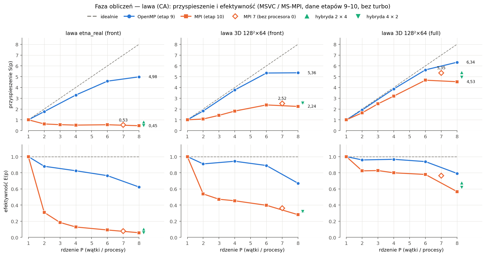

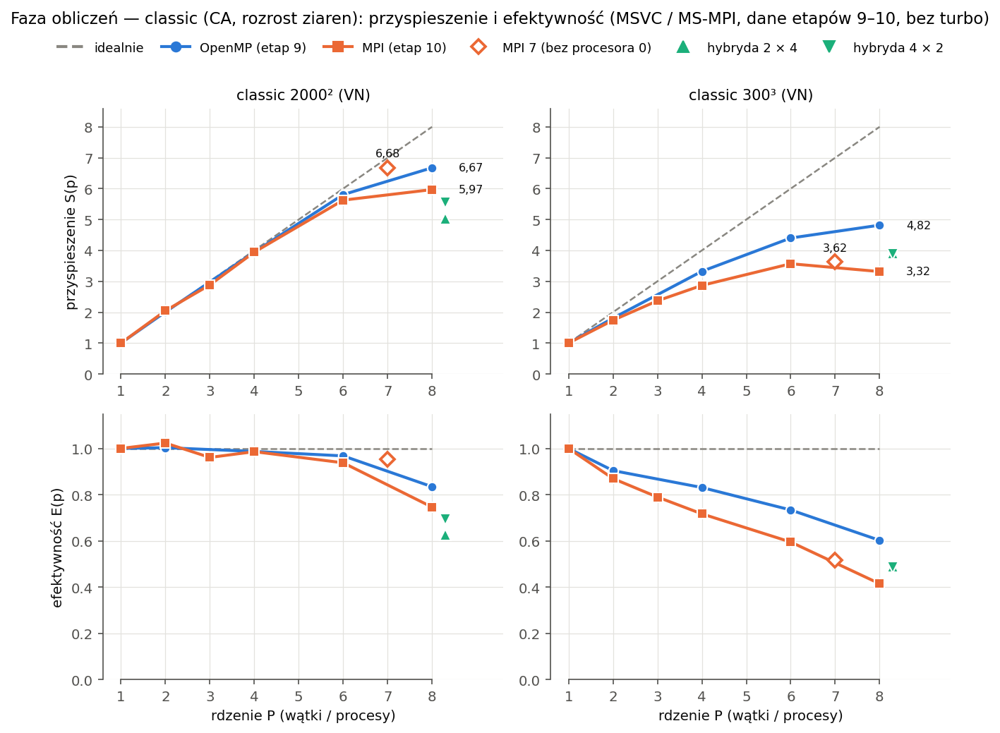

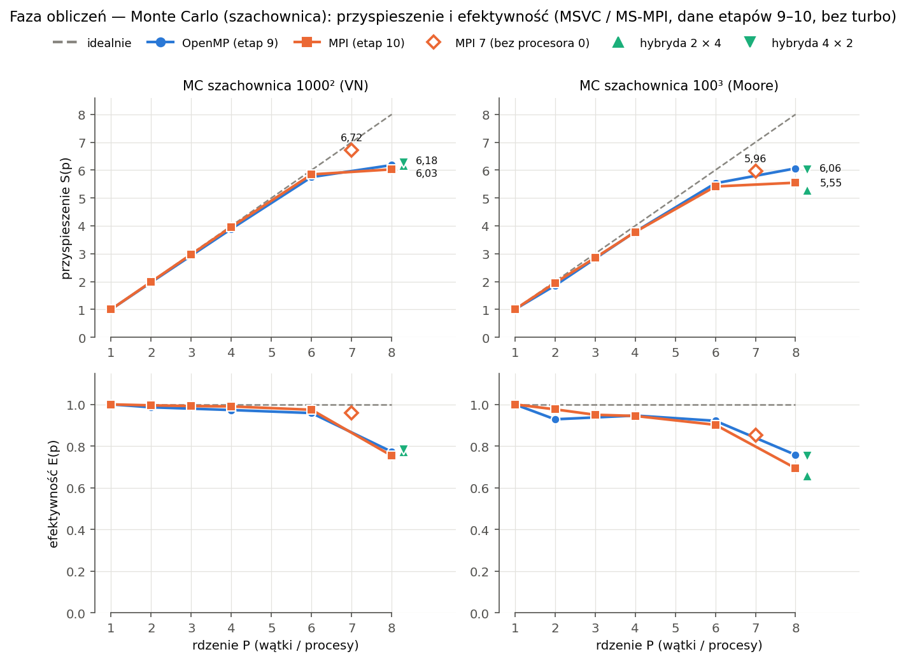

- **Lawa: OpenMP.** Front lawy żyje w kilku dolnych warstwach z; OpenMP przydziela warstwy cyklicznie (`static,1`),
  MPI dzieli przestrzeń na ciągłe pasy, więc dolny pas dostaje prawie całą lawę (dokument „Wersja rozproszona MPI”: nierównomierność pasów).
  W `etna_real` MPI jest wolniejsze niż 1 proces (S < 1): krok trwa < 1 ms, a komunikacja to 62–84% czasu fazy
  (dokument „Wersja rozproszona MPI”, punkt 9.7).
- **Siatki o równej pracy na komórkę (classic 2D, MC 2D): MPI na 7 procesach**, E = 0,95–0,96: pasy są równe,
  wymiana mała, a procesy nie dzielą pamięci programu (każdy ma swoją). Ósmy proces na procesorze 0 (przerwania
  systemu) wyznacza krok wszystkich, więc m8 jest gorsze niż m7 we wszystkich przypadkach.
- **Część szeregowa f (Amdahl, faza, OpenMP 8):** 0,012 (classic 2000²) … 0,08 (`etna_real`, classic 300³); dla
  całego przebiegu 0,03–0,37: zapis, przygotowanie i statystyki MC to część szeregowa, stąd S całego przebiegu
  2,1–6,2 przy S fazy 4,8–6,7.
- GCC / OpenMPI (WSL): ten sam obraz, S niższe (OpenMP 8: 2,86–6,26), procesory wirtualne; tabela w
  [`zestawienie.md`](../bench/results/testy/zestawienie.md).

**Porównywalność:** ten sam wariant w dwóch sesjach różni się o 13–29% (OpenMP 8 lawy front: S 5,36 w pomiarze OpenMP,
6,03 w kontroli przy pomiarze MPI; MPI 8 classic 300³: 3,32 vs 3,84 w pomiarze typów MPI), więc wariantów z różnych sesji nie dzielimy
wprost; typy pochodne są przeliczone przez stosunek m / d z jednej sesji × S z pomiaru MPI. Zapis wyniku
(typy MPI i MPI-IO) zestawiony osobno: classic 300³ / 2000² `.txt` przy 8 procesach S całego przebiegu 1,93 / 2,11 przy
zebraniu na proces 0, 3,43 / 4,34 przy MPI-IO.

### 2.2 Łączne przyspieszenie od programu sprzed optymalizacji

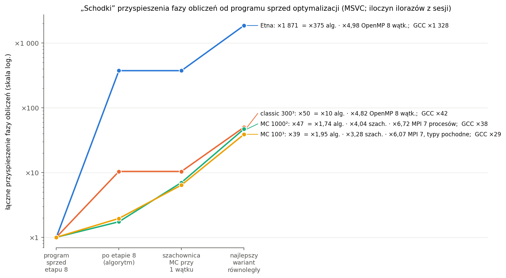

| Przypadek (MSVC) | przed optymalizacją | po optymalizacji | algorytm | szachownica przy 1 wątku | najlepszy wariant | równoległość | **łącznie** | GCC |
|---|---|---|---|---|---|---|---|---|
| lawa `etna_real` | 32,2 s | 85,8 ms | ×375 | — | OpenMP 8 | ×4,98 | **×1 871** | ×1 328 |
| classic 300³ | 38,1 s | 3,66 s | ×10,4 | — | OpenMP 8 | ×4,82 | **×50** | ×42 |
| MC szachownica 1000² | 16,3 s | 9,40 s | ×1,74 | ×4,04 | MPI 7 | ×6,72 | **×47** | ×38 |
| MC szachownica 100³ | 42,8 s | 21,9 s | ×1,95 | ×3,28 | MPI 7 + typy | ×6,07 | **×39** | ×29 |

Łącznie = iloczyn ilorazów, każdy z jednej sesji (kontrola: iloraz czasów z różnych dni ×1 878 / 54 / 53 / 46).
**Algorytm dał więcej niż równoległość tam, gdzie zmienił ilość pracy** (automat frontalny, lawa ×375: liczy tylko
brzeg potoku zamiast całej przestrzeni); w MC algorytm (optymalizacja sekwencyjna) dał ×1,7–2,0, a resztę szachownica (lepsza lokalność,
punkt 4.2) i 6–7 rdzeni.

### 2.3 Przyspieszenie ponadliniowe

E > 1 jest tylko w classic 2000² przy 2 rdzeniach (OpenMP 1,003, MPI 1,023) i 4 wątkach w kontroli przy pomiarze MPI
(1,005); wszystkie w granicy rozrzutu (MPI 2: faza 263 [259–272] ms wobec 539 [532–543] ms przy 1 procesie, czyli
E od 0,98 do 1,05). Wyjaśnienie z pamięcią podręczną: punkt 4.6.

### 2.4 Skalowanie słabe (Gustafson)

Silne skalowanie (stały problem, rosnące p) ogranicza część szeregowa (Amdahl). W słabym rozmiar rośnie z p, praca na
rdzeń jest stała, a efektywność słaba E_w(p) = T(1) / T(p) (ideał 1). Przypadki (`python bench/scaling.py --weak
--list`):

| Przypadek | Rozmiar przy p | Co pokazuje |
|---|---|---|
| `weak_classic_2d` | classic 2000 × 2000·p, 400·p zarodków | równa praca na komórkę; liczba kroków zależy od położenia zarodków (199 / 223 / 247 przy p = 1 / 2 / 8), więc obok E_w jest E_w znormalizowana z czasu na komórkę × krok |
| `weak_mc_cb_2d` | MC szachownica 1000 × 1000·p, 30 MCS | MC wielowątkowo / wieloprocesowo |
| `weak_lava_full` | lawa `full` 128 × 128·p × 64, 24·p kraterów, 20 kroków | lawa, praca na komórkę równa |
| `weak_lava_front` | lawa `front` 128 × 128·p × 64, 24·p kraterów | przypadek trudny: lawa skupiona w dolnych warstwach z |

Teren lawy to p takich samych kafli 128 × 128 wzdłuż y z kraterami w tych samych miejscach każdego kafla
(`vents.placement = positions`): każda warstwa z ma przy każdym p ten sam skład, a przestrzeń rośnie w płaszczyźnie
warstw podziału (2D: y; lawa: x–y, warstwy to z). OpenMP i MPI (`mpi.pack = datatype`), `output.format = none`.
W MPI lawy podział jest w z, a przestrzeń rośnie w y: pas procesu ma stałą liczbę komórek, ale warstwy brzegowe
(17 + 1 warstw × 128 × 128·p) rosną z p, więc dla MPI lawy ten test nie jest w pełni „słaby”.

Wyniki: [`slabe_omp_msvc.md`](../bench/results/testy/slabe_omp_msvc.md),
[`slabe_mpi_msvc.md`](../bench/results/testy/slabe_mpi_msvc.md), GCC: `slabe_{omp,mpi}_gcc.md`. E_w fazy obliczeń
(w nawiasie classic znormalizowana na komórkę × krok, bo kroków jest 199 → 247):

| Przypadek | OpenMP 8 (MSVC) | MPI 7 / 8 (MSVC) | OpenMP 8 / MPI 8 (GCC) | silne E(8) OpenMP / E(7) MPI (pomiary OpenMP i MPI) |
|---|---|---|---|---|
| classic 2000 × 2000·p | **0,49** (0,61) | 0,61 / 0,49 (0,66 / 0,61) | 0,42 / 0,40 | 0,83 / 0,95 (classic 2000²) |
| MC szachownica 1000 × 1000·p | 0,87 | **0,97** / 0,84 | 0,79 / 0,65 | 0,77 / 0,96 (MC 1000²) |
| lawa `full` 128 × 128·p × 64 | **0,88** | 0,78 / 0,67 | — | 0,79 / 0,76 (lawa 128² × 64) |
| lawa `front` 128 × 128·p × 64 | **1,00** | 0,27 / 0,25 | 0,76 / 0,22 | 0,67 / 0,36 |

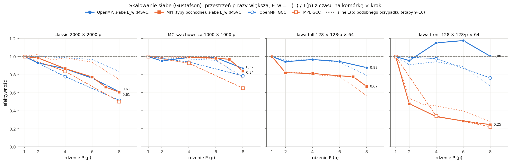

- **Amdahl vs Gustafson.** Przy części szeregowej f z silnego skalowania (OpenMP 8, faza: 0,012 classic 2000² …
  0,08) Gustafson przewiduje E_w(8) = 1 − f · 7/8 ≈ 0,93–0,99. Tak jest w MC (MPI 7: 0,97) i w lawie `full` / `front`
  w OpenMP (0,88 / 1,00, wyżej niż silne 0,79 / 0,67: więcej pracy na krok rozmywa koszt synchronizacji
  i nierównomierności). **Classic 2D jest wyjątkiem: 0,49 w OpenMP i w MPI 8**, gorzej niż silne (0,83 / 0,75), mimo
  że MPI nie dzieli żadnych danych między procesami; wspólna jest tylko pamięć podręczna L3 i RAM. E_w spada
  stopniowo od p = 2 (MPI: 0,88 → 0,76 → 0,66 → 0,61 → 0,49), a zapotrzebowanie classic na przepustowość jest
  największe ze wszystkich przypadków (punkt 4.4): ogranicza go przepustowość pamięci, nie część szeregowa. Przy
  silnym 2000² (112 MB) część siatki zostaje w L3 (36 MB), przy słabym (0,9 GB przy p = 8) nic.
- **MPI 8 < MPI 7** wszędzie (MC 0,84 vs 0,97, lawa `full` 0,67 vs 0,78): procesor 0, jak w pomiarach MPI.
- **MPI lawy `front`: 0,25**: dolny pas ma prawie całą lawę, a jego teren rośnie z p; czas rośnie z p (523 → 1 093 →
  2 125 ms), jak przewidywały pomiary MPI (nierównomierność pasów). OpenMP (`static,1`, warstwy cyklicznie) tego nie ma.
  E_w > 1 w OpenMP lawy `front` przy p = 4 / 6 (1,15 / 1,18, MSVC) nie powtarza się w GCC (p = 4: 0,98):
  przy 1 wątku działa ścieżka sekwencyjna frontu (`frontStepSequential`), przy p > 1 równoległa warstwami; nie
  badane dalej (zbiór roboczy frontu mieści się w L2 już przy 1 wątku, więc to nie efekt pamięci podręcznej).
- **MPI lawy `full`** traci już przy p = 2 (0,82), potem prawie płasko (0,78 przy m7d): wymiana 18 warstw brzegowych
  o powierzchni rosnącej z p.
- GCC (WSL): ten sam obraz, o 0,05–0,2 niżej (procesory wirtualne).

## 3. Pamięć główna

### 3.1 Metoda

Silnik raportuje już wszystko, co potrzebne (bez zmian w kodzie): `times.json` → `memory` (proces 0: szczyt RSS,
Windows `PeakWorkingSetSize`, Linux `ru_maxrss`; model `MemoryModel`: duże tablice × `sizeof` i skład szczytu),
a w `engine_mpi` `mpi.peakRssBytes` (min / średnia / maks po procesach), granice pasów i liczby warstw brzegowych.
Model w silniku liczy tylko proces 0; `bench/memory.py` rozszerza go na wszystkie procesy: okno procesu = pas
własny + warstwy brzegowe (lawa do 17 pod pasem i 1 nad, classic i MC po 1), bajty na komórkę okna z modelu procesu 0,
kopia pasa do zapisu (13 B na komórkę), na procesie 0 przy zebraniu cały wynik, przy MPI-IO bufor zapisu zbiorowego.
Narzut stały procesu (program, biblioteki, środowisko MPI) mierzony na siatce 16³.

Przebiegi krótkie, 1 powtórzenie (szczyt pamięci jest powtarzalny): classic 2D 1000² / 2000² / 4000², classic 3D
100³ / 200³ / 300³, lawa 64² / 128² / 256² × 64 (front), MC 3D 50³ / 100³ / 200³ (szachownica), `etna_real`; engine
1 / 2 / 4 / 8 wątków, `engine_mpi` 1 / 2 / 3 / 4 / 8 procesów z zebraniem wyniku i z MPI-IO. Tabele:
[`pamiec_msvc.md`](../bench/results/testy/pamiec_msvc.md), [`pamiec_gcc.md`](../bench/results/testy/pamiec_gcc.md)
(GCC: 3 przypadki).

### 3.2 Wątki

Szczyt pamięci przy 8 wątkach / przy 1: **0,96–1,05** (MSVC), 0,99–1,10 (GCC); narzut stały 6,3 MB, przy 8 wątkach
6,7 MB (stosy wątków). OpenMP dzieli pracę, nie dane: jedna siatka w pamięci współdzielonej.

### 3.3 Procesy: suma i warstwy brzegowe

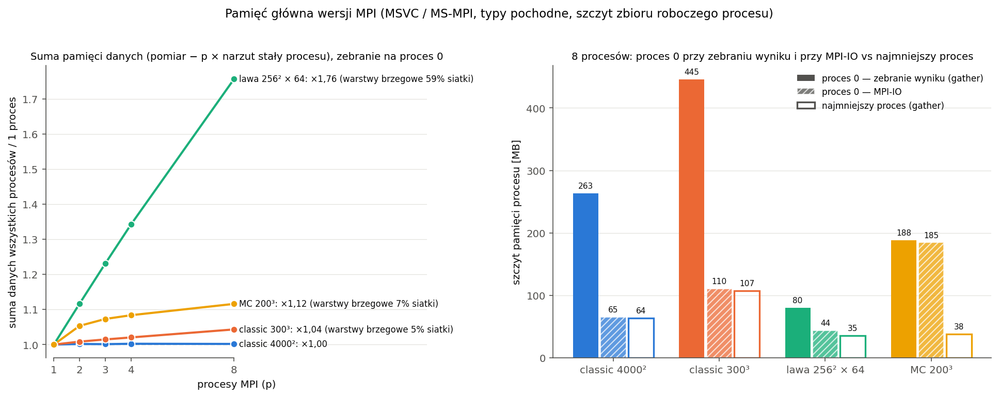

| Przypadek | dane: suma przy 8 procesach / przy 1 | warstwy brzegowe przy 2 / 4 / 8 procesach (udział w siatce okien) |
|---|---|---|
| classic 2D 1000² … 4000² | 1,00–1,02 | ≤ 1% |
| classic 3D 100³ / 200³ / 300³ | 1,14 / 1,07 / 1,04 | 4–12% / 2–7% / 1–5% |
| MC 3D 50³ … 200³ | 1,04–1,16 | 4–20% |
| lawa 64² … 256² × 64, `etna_real` | **1,71–1,84** | **21 / 42 / 59%** |

„Dane” = pomiar − p × narzut stały procesu MPI. **Lawa:** 64 warstwy z podzielone na 8 procesów to 8 warstw własnych
i do 18 brzegowych na proces, czyli więcej kopii niż danych. Udział zależy tylko od liczby warstw (te same 21 / 42 / 59%
dla 64², 128² i 256²), więc lawa w MPI potrzebuje pasów o wiele grubszych niż 18 warstw. **Narzut stały procesu MPI:**
MS-MPI 9,6–10,1 MB na proces (engine 6,3 MB), OpenMPI ~21 MB; przy 8 procesach 78 / 165 MB samego środowiska;
w małych siatkach to większość pamięci (classic 1000², 8 procesów: 119 MB, z czego dane 41 MB).

### 3.4 Proces 0: zebranie wyniku vs MPI-IO

| 8 procesów (MSVC) | proces 0, zebranie | proces 0, MPI-IO | najmniejszy proces |
|---|---|---|---|
| classic 4000² | 263 MB | 65 MB | 64 MB |
| classic 300³ | 445 MB | 110 MB | 107 MB |
| lawa 256² × 64 | 80 MB | 44 MB | 35 MB |
| MC 200³ | 188 MB | 185 MB | 38 MB |

- Przy zebraniu proces 0 trzyma cały wynik (13 B na komórkę) obok swojego pasa: **MPI-IO zmniejsza jego szczyt czterokrotnie
  i wyrównuje procesy.** W MC nie: statystyki ziaren dalej zbierają mapę kryształów na procesie 0 (dokument „Typy pochodne MPI i równoległy zapis”, punkt 4.3).
- **MPI-IO też kosztuje pamięć:** przy p > 1 zapis jest zbiorowy i dwufazowy, a proces 0 (jedyny agregator na
  jednym komputerze) zbiera dane innych w buforze do 16 MB (ROMIO, wskazówka `cb_buffer_size`; MPI-IO w MS-MPI
  wywodzi się z ROMIO). W małych siatkach to widać: classic 1000², proces 0 26 MB przy MPI-IO wobec 13 MB pozostałych.
  W dużych siatkach bufor nie podnosi szczytu (zapis idzie po zwolnieniu siatki okna).
- Przy 1 procesie MPI-IO zużywa w CA ×0,69–0,73 pamięci wersji z zebraniem, bo nie składa osobnej kopii wyniku.

### 3.5 Model vs pomiar

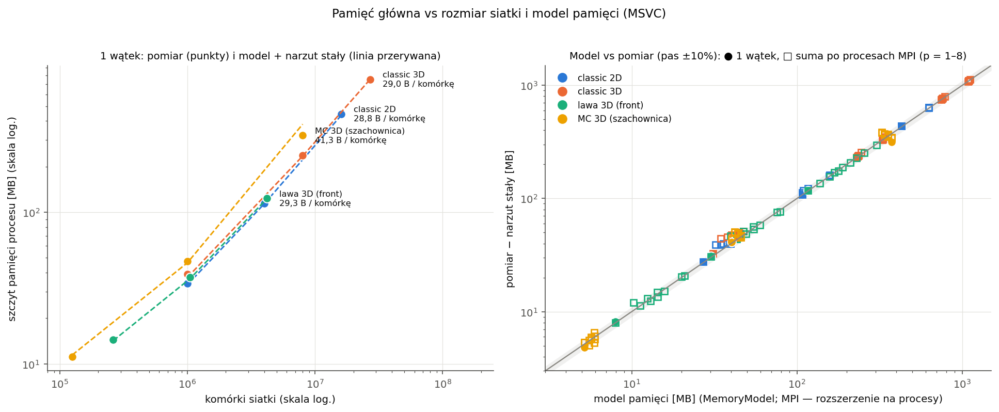

- 1 wątek: (szczyt − narzut stały) / model = **1,00–1,06** dla CA; B na komórkę: classic 2D 28,4–29,0, classic 3D
  29,0–34,3 (mniejsze siatki mają większy udział ramki), lawa 29–33, MC 3D 41–45. MC 200³: model zawyża o 16%
  (część zarezerwowanej pamięci statystyk nie jest dotykana, więc nie wchodzi do zbioru roboczego).
- MPI, suma po procesach: zebranie 0,96–1,08 (MC do 1,20: bufory zbierania mapy kryształów nie są w modelu);
  MPI-IO po dodaniu bufora agregatora 0,99–1,08 dla siatek > 2 mln komórek, do 1,29 dla małych (wewnętrzne bufory
  zapisu biblioteki).
- GCC (Linux): 1,01–1,08. W Linuksie `ru_maxrss` bardzo małego procesu pokazuje szczyt procesu, który go uruchomił
  (dziedziczy się przez fork / exec: Python ~15–17 MB), więc narzut stały liczony jest tam z RSS na końcu przebiegu.

### 3.6 Kiedy MPI pozwala policzyć większą siatkę

Na jednym komputerze nie: suma pamięci procesów jest co najmniej taka jak jednego procesu (+ narzut stały, + warstwy
brzegowe), a wszystkie procesy dzielą tę samą pamięć RAM (tu 32 GB). Zysk jest na klastrze, gdzie każdy węzeł ma swoją
pamięć i trzyma tylko swój pas:

- **MPI-IO:** szczyt procesu ≈ 29,6 B × N / p × (1 + udział warstw brzegowych) + narzut stały; liczba komórek,
  którą da się policzyć, rośnie liniowo z p;
- **zebranie na proces 0:** proces 0 potrzebuje dodatkowo 13 B × N niezależnie od p i to on wyznacza granicę.

Przykład (classic 3D, węzły po 8 GB, 8 procesów, bez narzutu stałego): zebranie: N ≤ 8 GB / (29,6 / 8 + 13) B ≈ 0,51
mld komórek (~800³); MPI-IO: N ≤ 8 × 8 GB / 29,6 B ≈ 2,3 mld (~1 320³), **×4,5 więcej**. Lawa w podziale w osi z
potrzebuje warstw własnych ≫ 18 na proces, inaczej warstwy brzegowe zajmują większość pamięci.

## 4. Pamięć podręczna

### 4.1 Symulacja cachegrind

`bench/cachegrind.py` (WSL, `valgrind --tool=cachegrind` 3.18) na programie GCC z presetu `gcc-release-g` (Release -O3
z informacją dla debuggera; sekcja `.text` identyczna z `gcc-release`, więc symulacja dotyczy tego samego kodu
maszynowego co pomiary), 1 wątek. Parametry rdzenia P: I1 32 KB, D1 48 KB 12-drożna, ostatni poziom (LL) = L2 2 MB
16-drożna albo L3 36 MB; cachegrind modeluje dwa poziomy, więc każdy przypadek liczony jest dwa razy. L3 symulowana
jako **18-drożna zamiast 12** (wymóg potęgi 2 liczby zbiorów; ten sam rozmiar). Valgrind 3.18 nie umie włączać
zbierania w trakcie programu, a w małych przypadkach większość chybień L3 to pierwsze dotknięcie pamięci przy
alokacji, dlatego tabela główna liczy **jądro** (funkcje kroku), obok cały program i najgorętsze funkcje
(`cg_annotate`). Tabele: [`cachegrind.md`](../bench/results/testy/cachegrind.md), raporty funkcji:
`bench/profiles/cachegrind/`.

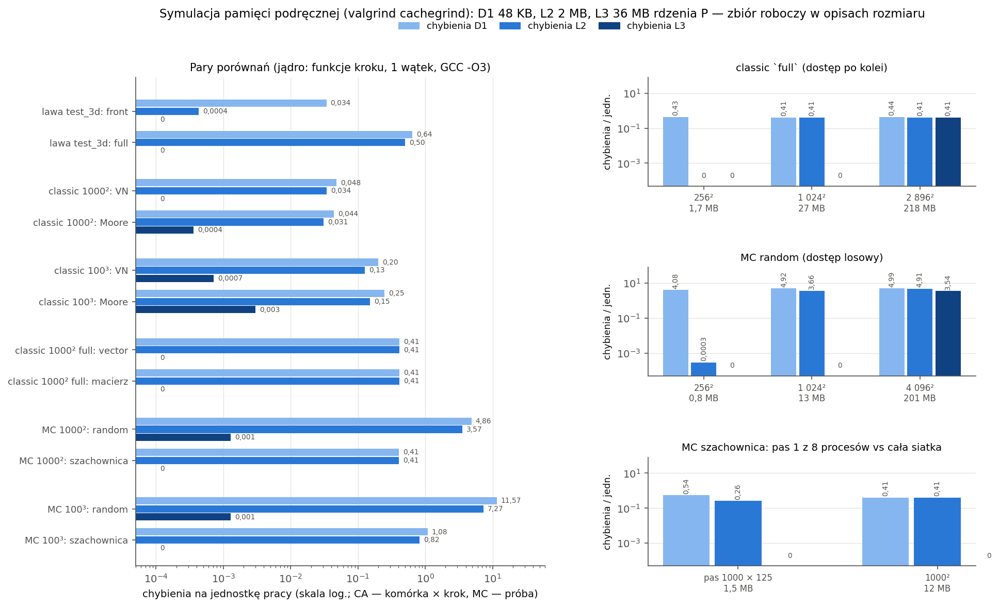

### 4.2 Wyniki

Chybienia jądra na jednostkę pracy (CA: komórka × krok, MC: próba):

| Porównanie | odwołania do danych / jedn. | D1 | L2 | L3 | wniosek |
|---|---|---|---|---|---|
| lawa `test_3d`: front / full | 4,7 / 186,8 | 0,034 / 0,64 | 0,000 / 0,50 | 0 / 0 | front ×40 mniej odwołań, ×19 mniej chybień D1, L2 prawie zero |
| classic 1000²: VN / Moore | 1,3 / 2,4 | 0,048 / 0,044 | 0,034 / 0,031 | 0 | Moore: więcej odwołań, tyle samo chybień |
| classic 100³: VN / Moore | 6,2 / 30,2 | 0,20 / 0,25 | 0,13 / 0,15 | ~0 | ×4,9 odwołań, ×1,24 chybień |
| classic 1000² full: vector / macierz | 35,6 / 92,4 | 0,41 / 0,41 | 0,41 / 0,41 | 0 | macierz: ×2,6 odwołań, chybienia te same |
| MC 1000²: random / szachownica | 21,7 / 21,7 | **4,86 / 0,41** | 3,57 / 0,41 | ~0 | szachownica ×12 mniej chybień D1 |
| MC 100³: random / szachownica | 66,8 / 67,0 | **11,6 / 1,08** | 7,27 / 0,82 | ~0 | ×11 mniej chybień D1 |

- **Front vs full:** miss rate frontu jest wyższy (0,73% vs 0,34%: rozproszony dostęp przez listę kandydatów), ale
  liczy się liczba chybień, nie ich udział: front dotyka tylko aktywnego brzegu potoku (mieści się w L2), pełny
  przebieg co krok przechodzi całą siatkę (~6 MB, poza L2). Gorące funkcje: front: `frontStepSequential` 37%,
  `frontRulesLayer` 17%, `gatherLavaCandidates` 11% chybień D1; full: `updateLava` 63%, `Boundary::applyWith` 16%
  (odświeżanie ramki).
- **VN vs Moore:** chybienia zależą od liczby różnych wierszy / warstw dotykanych przez sąsiedztwo (y ± 1, z ± 1,
  tych samych dla obu), nie od liczby sąsiadów; dodatkowe odwołania Moore trafiają w D1.
- **Układ danych:** `MatrixStorage` (dokument „Automat komórkowy: spływ lawy i rozrost ziaren”) jest wolniejsza przez adresowanie (pośrednie odwołania do wierszy), nie
  przez pamięć podręczną: wiersze są ciągłe i przechodzone w tej samej kolejności.
- **Random vs szachownica, najważniejszy wynik:** ta sama liczba odwołań na próbę, ale losowa próba trafia w losową
  komórkę, której linia i linie sąsiednich wierszy / warstw nie są w D1 (~5 chybień na próbę w 2D), a szachownica
  idzie po kolei i używa tych samych linii dla kolejnych komórek koloru. **To tłumaczy, czemu szachownica już przy
  1 wątku jest 3–4× szybsza** (×4,04 MC 1000², ×3,28 MC 100³, punkt 2.2); w pomiarach OpenMP było to tylko obserwacją czasu.

**Progi L2 / L3 / RAM** (zbiór roboczy kroku: classic `full` 26 B na komórkę: oba bufory automatu; MC 12 B: lista
domeny i orientacje):

| Przypadek | siatka w L2 | w L3 | poza L3 (RAM) |
|---|---|---|---|
| classic `full` (po kolei) | 256², 1,7 MB: L2 0 | 1 024², 27 MB: L2 0,41, L3 0 | 2 896², 218 MB: **L3 0,41** (każda linia z RAM co krok) |
| MC random (losowo) | 256², 0,8 MB: L2 0 | 1 024², 13 MB: L2 3,7, L3 0 | 4 096², 201 MB: **L3 3,5 na próbę** (16% odwołań) |

Progi wypadają tam, gdzie przewiduje rozmiar zbioru roboczego. Classic przechodzi siatkę po kolei; w procesorze
większość tych chybień ukrywa prefetcher sprzętowy (symulator go nie ma); MC random losowo, każde chybienie L3 to
pełne opóźnienie RAM, stąd MC najbardziej wrażliwe na rozmiar siatki i na programy w tle (wspólna L3, dokument „Kolejka zadań, serie, dane wejściowe”).

- **Pas MPI przy 8 procesach** (MC szachownica 1000 × 125, 1,5 MB, mieści się w L2; wobec całej siatki 1000², 12 MB):
  chybień L2 0,26 vs 0,41 na próbę (−37%), L3 zero w obu, D1 nieco więcej (0,54 vs 0,41, większy udział ramki
  w małym pasie).
- **Cały program:** w małych przypadkach większość chybień L3 to pierwsze dotknięcie pamięci (`_M_fill_assign`
  60–87%, `memset`, `memcpy`, `PottsMC::initialize`), w MC szachownicy 16–22% chybień D1 to statystyki ziaren
  (`Grains::label`, union-find).

### 4.3 Czas na komórkę w funkcji rozmiaru siatki

`bench/cell_time.py`: 1 wątek na rdzeniu P, siatki 2D o boku 128 … 2896 co √2, ta sama gęstość zarodków i liczba
kroków / MCS; zmienia się tylko rozmiar danych względem pamięci podręcznej; krzywe `classic_full`, `mc_random`,
`mc_cb`. Progi = pojemność / bajty dotykane na komórkę w kroku: classic (26 B): L2 przy ~81 tys. komórek (bok ≈ 280),
L3 przy ~1,45 mln (≈ 1 200); MC (12 B): ~175 tys. (≈ 420) i ~3,1 mln (≈ 1 770). Wyniki:
[`krzywa_msvc.md`](../bench/results/testy/krzywa_msvc.md), `krzywa_gcc.md`.

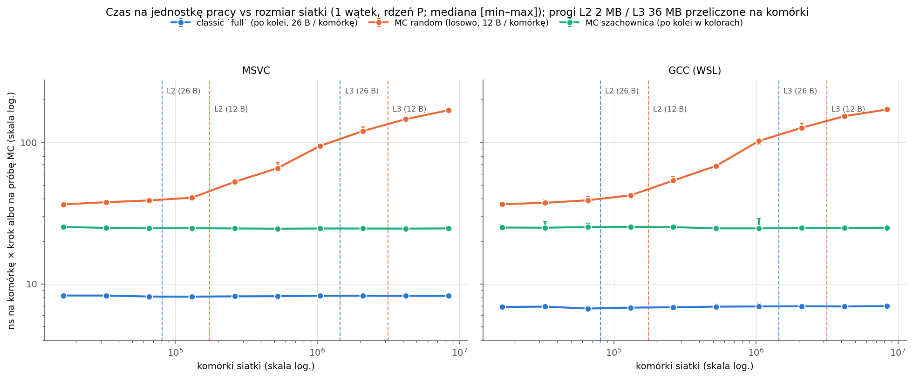

| Krzywa (MSVC; GCC) | w L2 | po progu L2 | blisko progu L3 | poza L3 (RAM) |
|---|---|---|---|---|
| MC random [ns / próbę] | 36–41 (16–131 tys. komórek) | 53 (262 tys.) | 94–120 (1–2,1 mln) | **146–169** (4,2–8,4 mln), ×4,6; GCC ×4,7 |
| MC szachownica | 24,6–25,3 | 24,6 | 24,6 | 24,6, bez progu |
| classic `full` [ns / komórkę × krok] | 8,1–8,3 (GCC 6,7–6,9) | 8,1 | 8,3 | 8,2, bez progu |

- **MC random:** pierwszy skok dokładnie za progiem L2 z modelu 12 B na komórkę (131 → 262 tys. komórek: 41 → 53 ns),
  potem wzrost ciągły, nie schodek; w zakresie L3 rośnie też liczba chybień TLB (strony 4 KB), a L3 jest wspólna
  i wolniejsza niż prywatna L2; poza L3 każda próba to ~3,5 chybienia L3 (cachegrind, punkt 4.2) i ~130 ns nadwyżki.
  Zgodne z cachegrind: 0 chybień L2 przy 256², 3,7 L2 przy 1 024², 3,5 L3 przy 4 096².
- **Classic i szachownica bez progu**, choć cachegrind liczy przy 2 896² 0,41 chybienia L3 na komórkę × krok:
  dostęp po kolei, prefetcher sprzętowy pobiera linie z wyprzedzeniem. Classic przy 1 wątku przenosi ~26 B / 8,2 ns
  ≈ 3,2 GB/s, a jeden rdzeń ma 15–18 GB/s (punkt 4.4), więc jeden wątek jest ograniczony obliczeniami, nie pamięcią.
  Szachownica (25 ns na próbę: generator losowy, `exp`) tym bardziej.
- Dlatego szachownica jest 1,4× szybsza od losowej kolejności w małej siatce (L2), a 6,8× w siatce poza L3; zysk
  szachownicy (×3–4 w przypadkach wersji równoległych) to w większości pamięć podręczna.

### 4.4 Przepustowość pamięci

Mikrotest `bench/micro/bandwidth.cpp` (cel CMake `bandwidth`): jądra jak w STREAM (copy, scale, add, triad, odczyt;
tablice 160 MB > 4 × L3) dla 1–8 wątków na rdzeniach P, przepustowość w funkcji zbioru roboczego (32 KB … 512 MB)
i test fałszywego współdzielenia. Wyniki: `przepustowosc_{msvc,gcc}.csv`, tabela z ekranu w dzienniku.

| Wątki (MSVC, najlepsze z 20) | 1 | 2 | 4 | 6 | 8 |
|---|---|---|---|---|---|
| triad [GB/s] | 17,6 | 30,9 | 43,2 | **48,8** | 48,1 |
| copy | 15,6 | 26,6 | 39,9 | 45,1 | 46,0 |
| odczyt | 14,4 | 28,1 | 46,9 | 54,5 | **58,9** |

GCC: triad 19,3 → 53,6 (6) → 47,5 (8), odczyt do 58,7 GB/s. **RAM nasyca się przy 6 wątkach (~48–50 GB/s zapisu
i odczytu, ~59 GB/s samego odczytu); jeden wątek bierze ~1/3 tego.** W funkcji zbioru roboczego (1 wątek): triad
54–66 GB/s do 2 MB (L2), ~22 GB/s w L3 (4–32 MB), ~18 GB/s z RAM; przy 1 wątku L3 przy taktowaniu bazowym jest niewiele szybsza
niż RAM; przy 8 wątkach zbiór ≤ 8 MB (1 MB na wątek, czyli L2 każdego rdzenia) daje 240–420 GB/s.

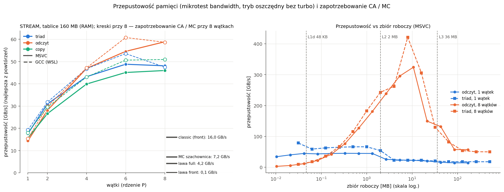

**Zapotrzebowanie przy 8 wątkach** (kreski na wykresie): jednostki pracy na sekundę ze skalowania słabego (OpenMP,
p = 8) × ruch spoza L2 na jednostkę = chybienia L2 jądra z cachegrind × 64 B. Bajty z modelu pamięci (wszystkie
dotykane bajty) zawyżałyby ruch, bo większość odwołań trafia w L1 / L2; liczba chybień L2 jest dolną granicą ruchu do
L3 / RAM (bez zapisów zwrotnych zmienionych linii i bez nadmiarowych pobrań prefetchera, realnie do ~2×).

| Przypadek (p = 8) | ruch spoza L2 [GB/s] | E_w(8) OpenMP |
|---|---|---|
| classic 2000 × 16 000 (front) | **16,0** (realnie do ~30) | 0,49 |
| MC szachownica 1000 × 8 000 | 7,2 | 0,87 |
| lawa `full` | 4,2 | 0,88 |
| lawa `front` | 0,1 | 1,00 |

Kolejność zapotrzebowania jest dokładnie kolejnością E_w. **Classic przy 8 wątkach zbliża się do granicy
przepustowości** (16–30 z ~48 GB/s; opóźnienie RAM rośnie już przed nasyceniem); to wyjaśnia spadek E_w do 0,49
i prawdopodobnie niższą E silnego skalowania classic 300³ (0,60, siatka ~700 MB). **MC i lawa nie są ograniczone pamięcią** (≤ 15% przepustowości):
ich E < 1 to synchronizacja, nierównomierność i procesor 0.

### 4.5 Fałszywe współdzielenie

Przegląd kodu równoległego (OpenMP i MPI):

- **Liczniki** w pętlach równoległych są lokalne w wątku i łączone przez `reduction(+)` (w wersji OpenMP licznik w strukturze
  przekazanej przez referencję MSVC zapisywał do pamięci w każdej iteracji: ×3 w `countLayers`; od tamtej pory liczniki
  w gorących pętlach są zmiennymi lokalnymi); liczniki prób MC (`TrialCounts`): zmienna lokalna wątku.
- **Czasy faz wątków** (`ThreadStats`, `--thread-stats`): wiersze `alignas(64)`, każdy wątek w swojej linii.
- **Sumy statystyk lawy** (`Simulation::flowSums`): osobne tablice na wątek, poza fazą obliczeń.
- **Listy frontu** (`LavaCA::FrontLayer`: 4 × `std::vector`, 96 B w ciągłej tablicy warstw): przy `static,1`
  sąsiednie warstwy liczą różne wątki, a nagłówki warstw k i k + 1 leżą częściowo w tej samej linii 64 B
  (`push_back` zapisuje wskaźnik końca listy); to jedyne miejsce, gdzie fałszywe współdzielenie jest możliwe.

Krótka obserwacja mikrotestem (priorytet normalny, przy tle, tylko kierunek): licznik zapisywany do pamięci
w każdej iteracji w sąsiednich 8 B vs co 64 B: ×1,1; **licznik atomowy (`fetch_add`): ×3–12** (28 / 9,8 ns przy 2
wątkach, 117 / 16 ns przy 8); listy jak `FrontLayer` (nagłówki co 96 B vs co 128 B): bez stałej różnicy (4,4–4,7 ns
w obu). Front zapisuje do list kilka razy na komórkę frontu, a nagłówki sąsiednich warstw dzielą najwyżej jedną linię,
koszt ginie w pracy reguł.

**Powtórka w ciszy (część 2, mediany z 20):**

| Wątki | 2 | 4 | 8 | GCC (2 / 8) |
|---|---|---|---|---|
| licznik atomowy `fetch_add`: sąsiednie 8 B / co 64 B [ns] | 35,0 / 8,7 (×4,0) | 64,7 / 8,7 (×7,5) | 122 / 8,8 (**×14**) | 27,0 / 8,3 … 98,0 / 10,1 |
| zwykły zapis licznika w każdej iteracji | 0,53 / 0,48 | 0,52 / 0,48 | 0,76 / 0,65 | 0,49 / 0,41 … 0,60 / 0,53 |
| listy warstw: nagłówki 96 B / co 128 B | 4,12 / 3,88 | 3,94 / 3,91 | 4,45 / 4,07 | 1,80 / 1,82 … 2,97 / 3,22 |

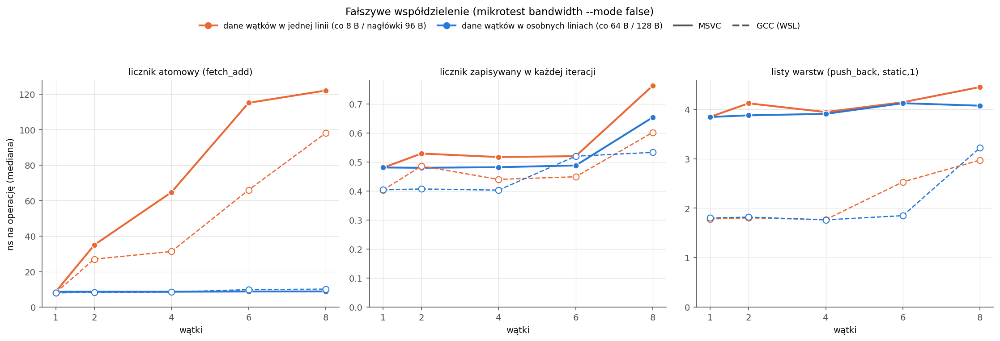

Fałszywe współdzielenie boli tam, gdzie każda operacja musi przejąć linię na wyłączność (atomowe: ×4–14 i rośnie
z liczbą wątków); zwykły zapis kompilator i bufor zapisu łączą (×1,1–1,2). Listy warstw jak `FrontLayer`: MSVC
o 1–9% wolniej przy nagłówkach co 96 B, GCC bez stałej różnicy; w silniku to ułamek czasu kroku frontu, więc
wyrównanie nagłówków do 128 B dałoby najwyżej pojedyncze procenty (silnik w testach bez zmian). W kodzie silnika
nie ma liczników atomowych ani wspólnych w gorących pętlach.

### 4.6 Przyspieszenie ponadliniowe: dlaczego go nie ma

E > 1 pojawia się, gdy po podziale dane każdego rdzenia mieszczą się w pamięci podręcznej, a całość nie. Na tym
procesorze L3 (36 MB) jest **wspólna** dla wszystkich rdzeni; podział nie zwiększa jej pojemności, więc zysk może dać
tylko prywatna L2 (2 MB × 8 rdzeni = 16 MB). W przypadkach skalowania:

- classic 2000² (siatka ~112 MB), classic 300³ (~700 MB), lawa 128² × 64 `full` (~30 MB): pas jednego rdzenia
  (14–88 MB, lawa ~4 MB) nie mieści się w L2 nawet przy 8 rdzeniach;
- lawa front, classic front: zbiór roboczy kroku to front, który mieści się w L2 już przy 1 wątku;
- MC 1000² (12 MB): pas przy 8 procesach (1,5 MB) mieści się w L2 i cachegrind pokazuje −37% chybień L2, ale
  szachownica ma 98% trafień w D1, a L3 jest szybka, więc zysk jest mniejszy niż koszt wymiany i procesora 0 (E(m7) = 0,96,
  nie > 1).

Stąd E > 1 tylko w granicy rozrzutu (classic 2000² przy 2 rdzeniach, punkt 2.3).

## 5. Wersje równoległe: podsumowanie

**Najlepszy wariant dla każdego typu przypadku** (faza obliczeń, ≤ 8 rdzeni P, MSVC; punkt 2.1):

| Typ przypadku | Najlepszy wariant | S / E | Dlaczego |
|---|---|---|---|
| lawa na prawdziwym terenie, front (`etna_real`) | OpenMP 8, `static,1` | 4,98 / 0,62 | front żyje w kilku warstwach z; tylko przydział cykliczny warstw rozkłada go równo; krok < 1 ms, więc wymiana MPI kosztuje więcej niż obliczenia |
| lawa, pełny przebieg (`full`) | OpenMP 8 | 6,34 / 0,79 | równa praca, wspólna pamięć, bez 18 warstw brzegowych MPI |
| siatki 2D o równej pracy (classic, MC szachownica) | MPI 7 (bez procesora 0) | 6,68–6,72 / 0,95–0,96 | równe pasy, mała wymiana, osobna pamięć procesów; procesor 0 obsługuje przerwania systemu |
| classic 3D (300³) | OpenMP 8 | 4,82 / 0,60 | w MPI wymiana całych warstw x–y (warstwy brzegowe 5% siatki) i procesor 0; siatka ~700 MB poza L3 |
| MC 3D (100³) | OpenMP 8 ≈ MPI 7 z typami pochodnymi | 6,06 / 6,07 | remis: szachownica dobrze dzieli się obiema metodami |
| zapis wyniku (MPI) | MPI-IO zamiast zebrania na proces 0 | S całości 3,43–4,34 zamiast 1,93–2,11; pamięć procesu 0 ×0,25 | zapis równoległy, bez kopii całej siatki na procesie 0 |

**Łączne przyspieszenie od programu sprzed optymalizacji** (punkt 2.2): lawa `etna_real` **×1 871** (algorytm
frontalny ×375 × OpenMP ×4,98), classic 300³ ×50, MC 2D ×47, MC 3D ×39 (GCC: ×1 328 / ×42 / ×38 / ×29). Tam, gdzie
algorytm zmniejszył ilość pracy, dał więcej niż równoległość; w MC połowę zysku dała szachownica (pamięć podręczna,
punkt 4.3), resztę 6–7 rdzeni.

**Co ogranicza dalej:**

- **Amdahl (cały przebieg):** f = 0,03–0,37: przygotowanie, zapis i statystyki MC są szeregowe, stąd S całego
  przebiegu 2,1–6,2 przy S fazy 4,8–6,7. Rozmiar zadania pomaga (Gustafson): przy rosnącej przestrzeni E_w(8) w MC
  i lawie 0,87–1,00.
- **Nierównomierność lawy:** lawa skupia się w dolnych warstwach z, więc MPI z podziałem na pasy w z traci (E_w lawy
  `front` 0,25, silne E(7) 0,36); OpenMP `static,1` to omija.
- **Przepustowość pamięci:** RAM nasyca się przy 6 wątkach (~48 GB/s); classic przy 8 wątkach potrzebuje 16–30 GB/s
  ruchu spoza L2 i ma E_w(8) 0,49 (punkt 4.4). Dalszy zysk tylko z mniejszego ruchu (np. mniejsze typy komórek, praca
  na blokach mieszczących się w L2), nie z większej liczby rdzeni.
- **Procesor 0:** ósmy proces lub wątek na rdzeniu z przerwaniami systemu wyznacza krok wszystkich: MPI 8 < MPI 7
  w każdym przypadku.
- **Jeden komputer:** procesy MPI dzielą L3, RAM i jego przepustowość, więc MPI nie daje tu ani więcej pamięci (suma
  procesów ≥ jeden proces, punkt 3.6), ani więcej przepustowości.

## 6. Ograniczenia i co dałby klaster

- **Brak liczników sprzętowych**: pamięć podręczna z symulacji (liczy zdarzenia, nie czas) i pośrednio z czasu
  (krzywa, przepustowość). Cachegrind: L3 18-drożna zamiast 12, dwa poziomy naraz, 1 wątek (bez współdzielenia L3, bez ruchu
  koherencji między rdzeniami), bez prefetchera sprzętowego, kod GCC (MSVC może się różnić liczbą odwołań, nie
  układem danych).
- **Jeden komputer:** procesy MPI dzielą pamięć RAM i L3, komunikacja przez pamięć współdzieloną; wnioski o pamięci
  na klastrze (punkt 3.6) to przewidywanie z modelu.
- **Zestawienie z różnych sesji:** S zawsze z T(1) tej samej sesji; ten sam wariant w dwóch sesjach różni się o 13–29%.
- **Pamięć:** szczyt zbioru roboczego (RSS), nie pamięć zarezerwowana; w Linuksie `ru_maxrss` małych procesów
  zawyżony przez proces uruchamiający (punkt 3.5).
- GCC w WSL 2: procesory wirtualne bez gwarancji rdzeni P.
- Zapotrzebowanie na przepustowość z chybień L2 cachegrind (1 wątek, bez prefetchera i zapisów zwrotnych): dolna
  granica ruchu, nie pomiar.

**Klaster** (bez pomiaru, przewidywanie z wyników testów): każdy węzeł ma własną pamięć, L3 i przepustowość RAM,
więc przypadki ograniczone przepustowością (classic) skalowałyby się między węzłami lepiej niż na jednym komputerze,
a suma pamięci węzłów pozwala policzyć siatkę większą niż pamięć jednego (przy MPI-IO, punkt 3.6). Wymiana przez sieć
jest wolniejsza niż przez pamięć współdzieloną, więc koszt warstw brzegowych rośnie, najbardziej w lawie (18 warstw);
lawa `front` wymagałaby innego podziału (np. w x–y albo dynamicznego), bo pasy w z zostawiają lawę jednemu procesowi.
Najrozsądniejszy układ to hybryda: MPI między węzłami, OpenMP w węźle.

## 7. Pliki

| Plik | Co |
|---|---|
| `bench/zestawienie_e12.py` | zestawienie S / E / f wszystkich wersji z CSV (bez przebiegów) → `zestawienie.{md,csv}`, `zestawienie_lacznie.csv` |
| `bench/memory.py` | szczyt pamięci: engine 1–8 wątków, `engine_mpi` 1–8 procesów (zebranie / MPI-IO), model rozszerzony na procesy, `--wsl`, `--from-raw` |
| `bench/cachegrind.py` | symulacja cachegrind (WSL), jądro vs cały program, najgorętsze funkcje → `cachegrind.{md,csv}`, `bench/profiles/cachegrind/` |
| `bench/cache_info.py` | parametry pamięci podręcznej z systemu (Windows, Linux) → `procesor.md` |
| `bench/cell_time.py` | czas na komórkę × krok / na próbę vs rozmiar siatki → `krzywa_{msvc,gcc}.*` |
| `bench/scaling.py`, `bench/scaling_mpi.py` | tryb `--weak` (skalowanie słabe, przypadki `weak_cases()`, kafle terenu lawy) |
| `bench/micro/bandwidth.cpp` | mikrotest przepustowości (STREAM), zbiór roboczy, fałszywe współdzielenie; cel CMake `bandwidth` |
| `bench/plot_etap12.py` | wykresy `docs/img/etap12_*.png` |
| `CMakePresets.json` | preset `gcc-release-g` (Release + `-g`, katalog `build-gcc-release-g/`) |
| `bench/results/testy/` | dziennik `POSTEP.md`, `PLAN_POMIARU.md`, `procesor.md`, `zestawienie*`, `pamiec_{msvc,gcc}*`, `cachegrind.*`, `slabe_{omp,mpi}_{msvc,gcc}.*`, `krzywa_{msvc,gcc}.*`, `przepustowosc_{msvc,gcc}.csv` |
