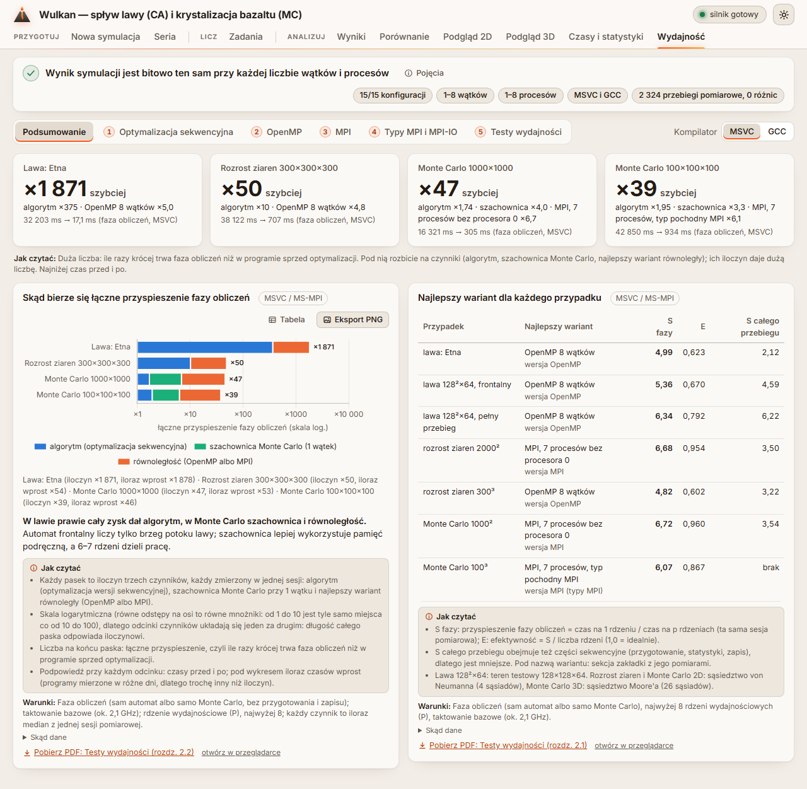
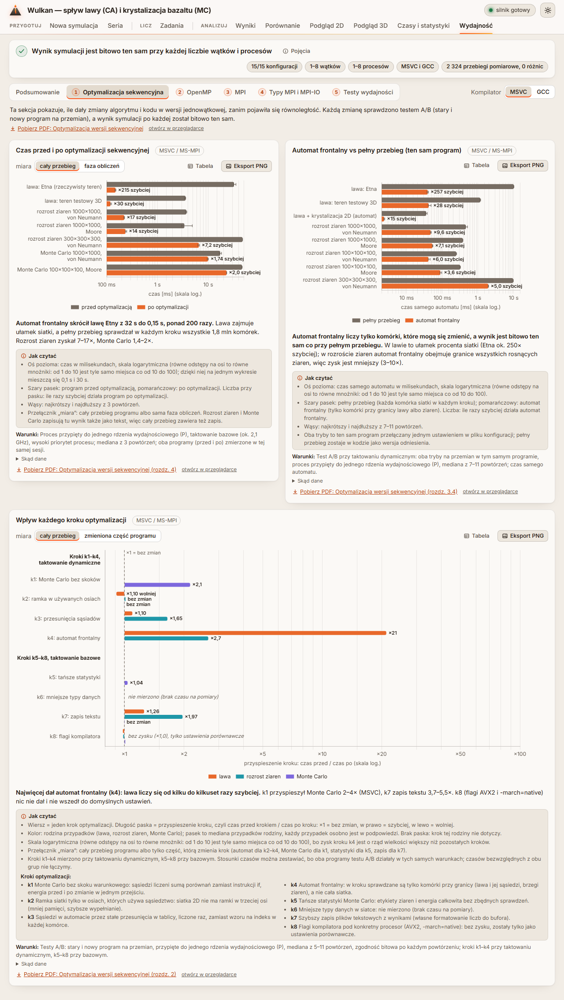
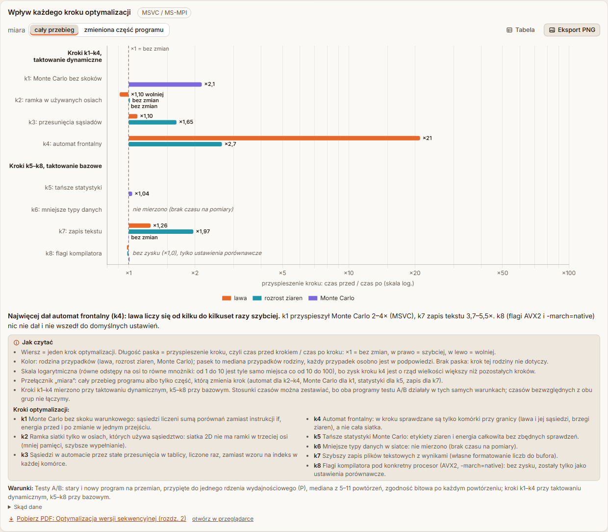
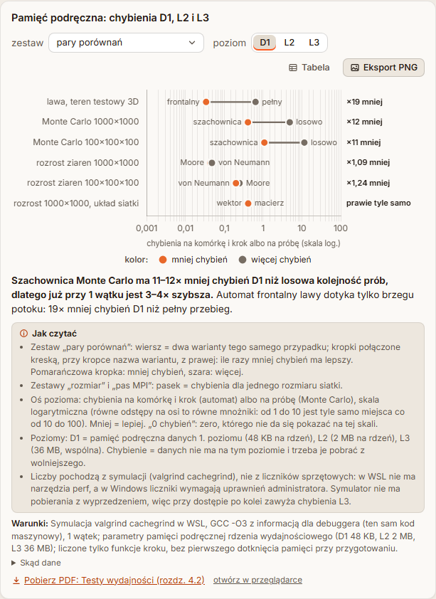
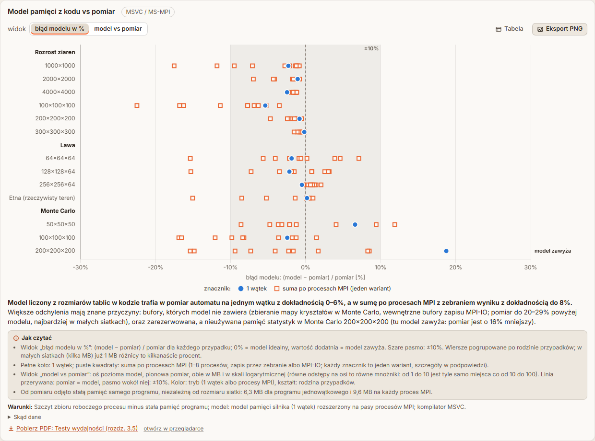
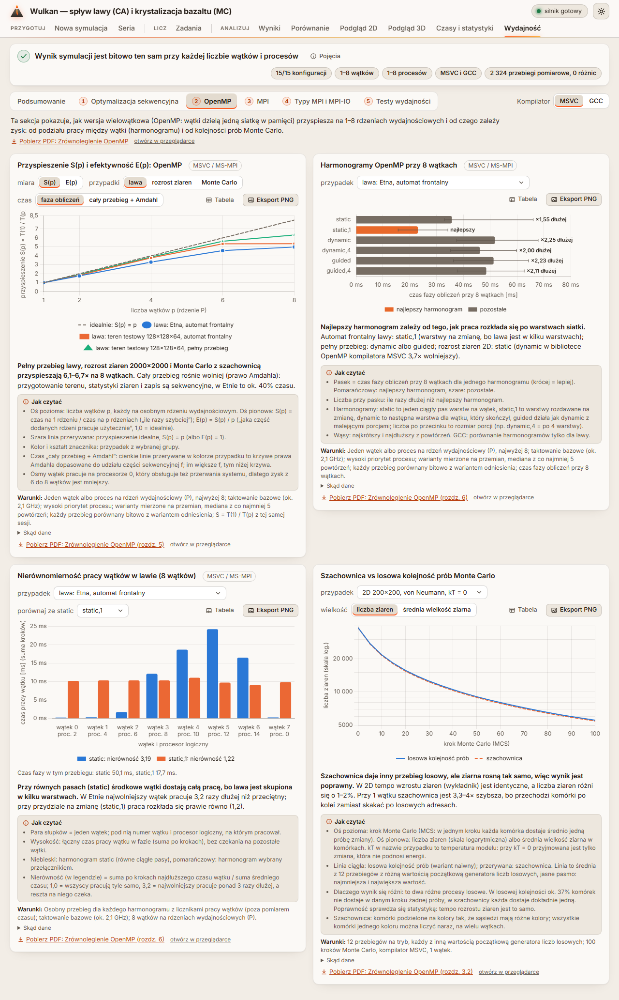
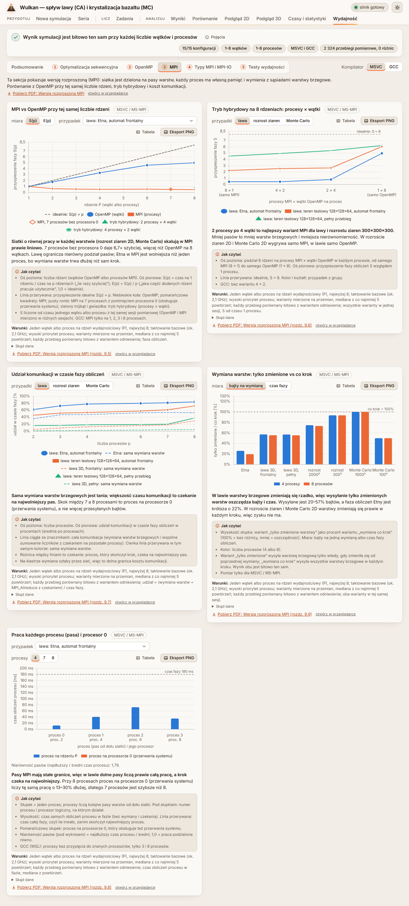
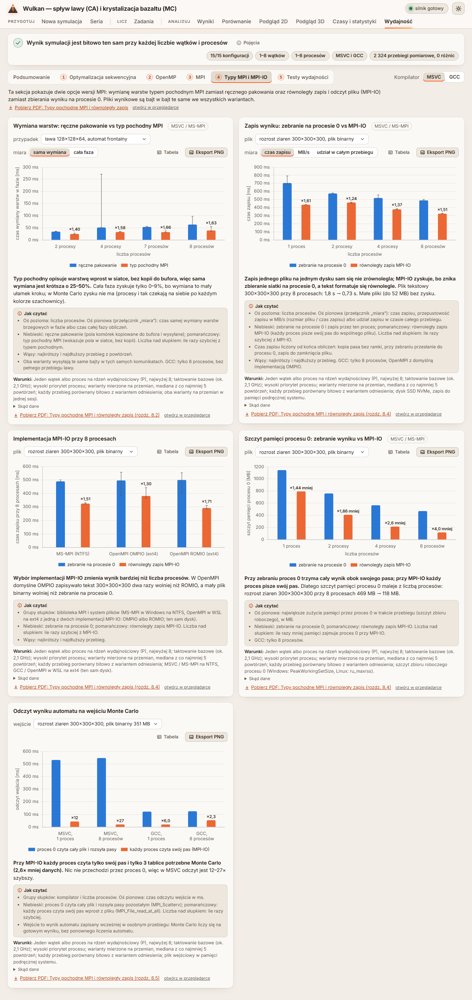
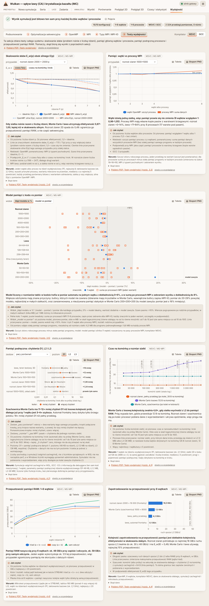

# Zakładka „Wydajność” w interfejsie

Wyniki optymalizacji sekwencyjnej, OpenMP, MPI, typów pochodnych MPI z MPI-IO i testów wydajności w jednym miejscu
GUI: interaktywne wykresy zamiast tabel Markdown i obrazków PNG, opisane tak, żeby dało się je przeczytać bez znajomości
historii projektu. Stan na 22.10.2026.

Zakładka nie zmienia silnika i nie robi nowych pomiarów: **każda liczba pochodzi z istniejących plików
`bench/results/`** (CSV i tabele Markdown pomiarów). Dane i wszystkie teksty (wnioski, „Jak czytać”, warunki, źródła)
przygotowuje skrypt `tools/wydajnosc_gui.py` w jednym pliku `gui/static/data/wydajnosc.json`, a zakładka
(`gui/static/js/perf.js`) tylko go rysuje; w JS nie ma ani jednej liczby z pomiarów.



## 1. Co pokazuje zakładka

Przycisk **Wydajność** jest w grupie *Analizuj*, po „Czasy i statystyki” (`data-tab="perf"`). U góry:

- **nagłówek z zasadą** „Wynik symulacji jest bitowo ten sam przy każdej liczbie wątków i procesów” i plakietkami
  z plików zgodności: **15/15 konfiguracji**, **1–8 wątków**, **1–8 procesów**, **MSVC i GCC**, **2 324 przebiegi
  pomiarowe, 0 różnic**. Skrypt liczy je z tabel `bench/results/*/zgodnosc_*.md` (24 tabele, każdy config w każdej
  kolumnie „tak”) i z kolumny `identical` pomiarów skalowania, harmonogramów, MPI i MPI-IO (każde powtórzenie porównane
  bitowo z wariantem odniesienia). Podpowiedź plakietki mówi, z czego wynika;
- przycisk **Pojęcia**: rozwijany słowniczek 20 pojęć, które pojawiają się w zakładce (S(p), E(p), E_w(p), skalowanie
  silne i słabe, faza obliczeń, rodziny przypadków i zapis rozmiarów 1000² / 300³, sąsiedztwa, automat frontalny,
  szachownica, harmonogramy OpenMP, pas i warstwy brzegowe, tryb hybrydowy, typ pochodny MPI, MPI-IO, procesor 0,
  pamięć podręczna D1 / L2 / L3 i chybienie, taktowanie bazowe i dynamiczne, rdzenie P i E, mediana i test A/B,
  zgodność bitowa), jedno, dwa zdania na pojęcie;
- **zakładki wewnętrzne** (Podsumowanie i pięć sekcji; na ekranie jest jedna sekcja naraz) i przełącznik
  **Kompilator: MSVC | GCC** (domyślnie MSVC; działa na wykresach z danymi obu kompilatorów, wybór zapamiętuje
  przeglądarka). Pod przełącznikiem sekcji: jedno, dwa zdania wprowadzenia prostym językiem i link
  **„Pobierz PDF: <tytuł dokumentu>”**.

| Sekcja | Wykresy | Przełączniki |
|---|---|---|
| **Podsumowanie** | 4 kafelki: łączne przyspieszenie fazy obliczeń względem programu sprzed optymalizacji (lawa Etny ×1 871, rozrost ziaren 300×300×300 ×50, Monte Carlo 1000×1000 ×47, Monte Carlo 100×100×100 ×39) z rozbiciem na czynniki; wykres „Skąd bierze się łączne przyspieszenie” (algorytm × szachownica Monte Carlo × równoległość); tabela „Najlepszy wariant dla każdego przypadku” (7 przypadków: wariant, wersja, S i E fazy, S całego przebiegu) | kompilator |
| **1. Optymalizacja sekwencyjna** | czas przed i po optymalizacji (7 przypadków); automat frontalny vs pełny przebieg; wpływ każdego kroku k1–k8 (szeroki wykres z listą kroków) | miara: cały przebieg / faza obliczeń, zmieniona część programu |
| **2. OpenMP** | S(p) i E(p) dla 1, 2, 4, 6 i 8 wątków z linią idealną (faza obliczeń albo cały przebieg z krzywą prawa Amdahla); harmonogramy przy 8 wątkach; nierównomierność pracy wątków w lawie; szachownica vs losowa kolejność prób Monte Carlo | miara S / E, grupa przypadków, przypadek, harmonogram, wielkość |
| **3. MPI** | MPI vs OpenMP przy tej samej liczbie rdzeni (z wariantem 7 procesów bez procesora 0 i trybem hybrydowym); tryb hybrydowy 8 × 1 … 1 × 8; udział komunikacji w czasie fazy; wymiana warstw: tylko zmienione vs co krok; praca każdego procesu (pasa) z wyróżnionym procesorem 0 | miara, przypadek, grupa, liczba procesów |
| **4. Typy MPI i MPI-IO** | wymiana warstw: ręczne pakowanie vs typ pochodny MPI; zapis wyniku: zebranie na procesie 0 vs MPI-IO (czas, MB/s, udział w całym przebiegu, plik binarny i tekstowy); implementacje MPI-IO przy 8 procesach (MS-MPI, OpenMPI z OMPIO i ROMIO); szczyt pamięci procesu 0; odczyt wyniku automatu na wejściu Monte Carlo | przypadek / plik, miara |
| **5. Testy wydajności** | skalowanie słabe E_w(p) obok silnego E(p); pamięć: wątki vs procesy MPI; model pamięci z kodu vs pomiar; chybienia pamięci podręcznej D1 / L2 / L3; czas na komórkę a rozmiar siatki z progami L2 / L3; przepustowość RAM dla 1–8 wątków; zapotrzebowanie na przepustowość przy 8 wątkach | przypadek, miara, zestaw, poziom, widok |

Razem **25 wykresów** i tabela.

### 1.1 Karta wykresu

Każda karta ma ten sam układ, od góry:

1. **tytuł** i znacznik kompilatora, przełączniki wykresu, przyciski **Tabela** (te same dane w tabeli: dostępna
   alternatywa dla podpowiedzi i koloru) i **Eksport PNG** (tytuł, wykres i warunki w kolorach bieżącego motywu);
2. **wykres** z podpowiedzią po najechaniu (dokładna wartość, rozrzut [min–max], liczba powtórzeń, czasy; tu i tylko
   tu mogą się pojawić klucze techniczne, np. „automat (caSim)”);
3. **wniosek**: pogrubiona myśl przewodnia i jedno zdanie wyjaśnienia;
4. **Jak czytać** (2–5 punktów w ramce): co jest na osiach i w jakich jednostkach, co znaczy skala logarytmiczna
   („równe odstępy na osi to równe mnożniki”), co oznaczają kolory, kształty znaczników, linie przerywane, wąsy
   i pasma, definicje wielkości (S(p), E(p), E_w(p), nierówność, błąd modelu);
5. **Warunki** słownie: co i jak mierzono (kompilator, taktowanie, rdzenie, priorytet, liczba powtórzeń, miara), bez
   nazw plików i ścieżek;
6. **Skąd dane** (zwinięte, mała czcionka): pliki `bench/results/…`, z których pochodzą liczby;
7. **„Pobierz PDF: <tytuł dokumentu> (rozdz. X.Y)”** i mały link „otwórz w przeglądarce”. W kopii projektu bez
   `docs/pdf/` zamiast linku jest zdanie „Dokument „…” jest w pełnym repozytorium projektu” (żadnych martwych linków).

### 1.2 Taktowanie procesora

Prawie wszystkie pomiary szły przy **taktowaniu bazowym** (ok. 2,1 GHz, podwyższanie częstotliwości wyłączone: czasy
ok. 2,3× dłuższe, ale stabilniejsze). Wyjątek to kroki k1–k4 optymalizacji sekwencyjnej i porównanie automatu
frontalnego z pełnym przebiegiem: mierzone przy **taktowaniu dynamicznym** (Intel Turbo Boost, ok. 4,3 GHz na rdzeniu
P). Wykres kroków pokazuje tylko stosunki czasów z testów A/B (oba programy w tych samych warunkach, więc porównywalne)
w dwóch podpisanych grupach wierszy: „Kroki k1–k4, taktowanie dynamiczne” i „Kroki k5–k8, taktowanie bazowe”.



## 2. Przebudowane wykresy

**Wpływ każdego kroku optymalizacji.** Poziome słupki, jeden wiersz na krok (k1…k8 z pełną nazwą, np. „k4: automat
frontalny”), wartość = przyspieszenie kroku (czas przed krokiem / czas po kroku), rośnie w prawo od ×1. W wierszu
osobny słupek dla każdej rodziny przypadków (lawa, rozrost ziaren, Monte Carlo), tylko gdy krok jej dotyczy; brak
słupka = „krok nie dotyczy”. Rozrzut przypadków jest w podpowiedzi. k6 ma napis „nie mierzono (brak czasu na
pomiary)”, k8 „bez zysku (×1,0), tylko ustawienia porównawcze”. Pod wykresem w „Jak czytać” lista kroków, po jednym
zdaniu na krok. Przełącznik „miara”: cały przebieg albo tylko zmieniona część programu.



**Pamięć podręczna: chybienia D1, L2 i L3.** Domyślnie wykres hantlowy: wiersz na parę porównań (lawa: automat
frontalny vs pełny przebieg; Monte Carlo 1000×1000 i 100×100×100: szachownica vs losowa kolejność; rozrost ziaren:
von Neumann vs Moore; układ siatki: wektor vs macierz), dwa punkty połączone kreską, przy punktach nazwy wariantów,
z prawej „×19 mniej”. Przełącznik **poziom: D1 / L2 / L3** zamiast trzech słupków naraz; zera (na skali logarytmicznej
niewidoczne) są opisane tekstem „0 chybień”. Zestawy „rozmiar” i „pas MPI” pokazują chybienia dla kilku rozmiarów
siatki. Oś: „chybienia na komórkę i krok albo na próbę”.



**Model pamięci z kodu vs pomiar.** Domyślny widok to **błąd modelu w %** ((model − pomiar) / pomiar): wiersz na
przypadek, pogrupowany po rodzinie (rozrost ziaren, lawa, Monte Carlo), pełne koło = 1 wątek, puste kwadraty = suma po
procesach MPI (jeden wariant na znacznik), szare pasmo ±10%, przy Monte Carlo 200×200×200 dopisek „model zawyża”. Drugi
widok, „model vs pomiar”, to wykres punktowy w skali logarytmicznej z linią „pomiar = model” i pasmem ±10%, z legendą
w dwóch podpisanych rzędach (kolor: tryb, kształt: rodzina). Stała pamięć programu odjęta od pomiaru jest opisana
słownie w „Jak czytać” (6,3 MB dla programu jednowątkowego, 9,6 MB na każdy proces MPI).



## 3. Poprawki czytelności

Zakładkę przeredagowano tak, żeby była zrozumiała dla osoby, która zna podstawy obliczeń równoległych, ale nie zna
historii projektu. Zasady wspólne dla wszystkich kart:

- pełne zdania bez skrótów myślowych; każde pojęcie wyjaśnione w „Jak czytać” albo w „Pojęciach”;
- bez długich pauz, bez numeracji kolejnych części prac („przed / po optymalizacji” zamiast numeru), taktowanie opisane słownie;
- czytelne nazwy przypadków i wariantów zamiast wewnętrznych („lawa: Etna (rzeczywisty teren)” zamiast
  `lawa etna_real`, „rozrost ziaren 1000×1000, von Neumann” zamiast `classic 1000², VN`, „Monte Carlo” zamiast „MC”,
  „ręczne pakowanie / typ pochodny MPI” zamiast `manual` / `datatype`, „zebranie na procesie 0 / MPI-IO” zamiast
  `gather` / `mpiio`, „wymiana co krok / tylko zmienionych warstw” zamiast `always` / `changed`); klucze techniczne
  najwyżej w podpowiedzi;
- mnożniki zysku zawsze jako przyspieszenie większe od 1 („×215 szybciej”, „×1,10 wolniej”, „bez zmian”), także
  w podpowiedziach; liczby po polsku (przecinek dziesiętny, spacja tysięcy, znak minus „−”);
- „Warunki” bez nazw plików, pliki w zwiniętym „Skąd dane”; link „Pobierz PDF” zamiast otwierania dokumentu Markdown
  jako zwykłego tekstu.

| Karta | Przed | Po |
|---|---|---|
| Nagłówek | Plakietka „15/15 configów”; linijka pod sekcjami z nazwą pliku dokumentu i skrótami warunków. | „15/15 konfiguracji”, „2 324 przebiegi pomiarowe, 0 różnic”; przycisk „Pojęcia”; wprowadzenie do sekcji prostym językiem i „Pobierz PDF”. |
| Podsumowanie: kafelki i tabela | Kolumna z numerem części prac zamiast nazwy wersji, skróty przypadków. | Kolumna „wersja” (np. „wersja MPI (typy MPI)”), czytelne nazwy; „Jak czytać” rozbicia na czynniki. |
| Podsumowanie: łączne przyspieszenie | Bez opisu skali i czynników. | „Jak czytać”: iloczyn trzech czynników na skali logarytmicznej, iloraz czasów wprost pod wykresem. |
| Czas przed i po | Etykiety „×0,005”, legenda „przed / po etapie 8”, nazwy `etna_real`, `classic 1000², VN`. | „×215 szybciej”, legenda „przed / po optymalizacji”, czytelne nazwy przypadków. |
| Wpływ każdego kroku | Słupki w dół od ×1 na skali logarytmicznej, długie wąsy, cieniowane tło „z turbo”, skróty pod osią. | Poziome słupki rosnące w prawo, wiersz na krok z pełną nazwą, dwie grupy taktowania, rozrzut w podpowiedzi, lista kroków (rozdz. 2). |
| Automat frontalny vs pełny przebieg | Etykiety „×0,004”, legenda z `ca.sweep = full` / `front`. | „×257 szybciej”, opis automatu frontalnego i zgodności bitowej w „Jak czytać”, bez kluczy configu. |
| OpenMP: S(p) i E(p) | Definicje tylko w dokumencie; krzywe Amdahla z nazwami „MC 1000²”. | Definicje S(p), E(p) i linii idealnej w „Jak czytać”, pełne nazwy przypadków. |
| OpenMP: harmonogramy | Oś „czas fazy caSim”, najlepszy harmonogram z etykietą „×1,00”, harmonogramy bez wyjaśnienia. | „Najlepszy” i „×1,55 dłużej”; każdy harmonogram opisany jednym zdaniem w „Jak czytać”. |
| OpenMP: nierównomierność wątków | Podpisy „w0 / CPU 2”, nierówność jako „×3,19”, definicja tylko w warunkach. | „wątek 0 / proc. 2”, definicja z przykładem w „Jak czytać” (1,0 = równo, 3,2 = najwolniejszy ponad 3× dłużej). |
| OpenMP: szachownica vs losowa kolejność | „12 ziaren generatora” (mylące przy ziarnach kryształu), wariant `random`, bez wyjaśnienia, dlaczego przebiegi się różnią. | „Dwa różne procesy losowe”, poprawność sprawdzana statystyką; 12 przebiegów z różną wartością początkową generatora. |
| MPI vs OpenMP | Legenda „OpenMP (etap 9)”, „MPI (etap 10)”, przypadki `lawa etna_real (front)`, definicje S(p) i E(p) tylko w dokumencie. | „OpenMP (wątki)”, „MPI (procesy)”, czytelne przypadki, definicje i opis znaczników w „Jak czytać”; S < 1 w podpowiedzi z dopiskiem „wolniej niż na 1 rdzeniu”. |
| Tryb hybrydowy | Przypadki `lawa 3D 128²×64 (front)`, wnioski ze skrótami („czyste MPI”, „classic 2D”). | Czytelne przypadki, oś od „samo MPI” do „samo OpenMP”, linia idealna opisana. |
| Udział komunikacji | Serie „lawa front: sama wymiana warstw”, znaczenie różnicy linii tylko w przypisie. | „Jak czytać”: ciągła = cała komunikacja, przerywana = sama wymiana warstw, różnica = czekanie na najwolniejszy pas. |
| Wymiana warstw: tylko zmienione vs co krok | Tytuł `changed` / `always`, podpisy osi „MC 1000²”. | Opis słowny wariantów, procent względem „co krok”, pełne podpisy osi. |
| Praca każdego procesu | Podpisy „CPU 2”, nierówność jako „×1,79”. | „proces 0 / proc. 2”, nierówność 1,79 z definicją, opis procesora 0 (przerwania systemu). |
| Typy MPI: wymiana warstw | Etykiety „×0,72” (stosunek mniejszy od 1), legenda z `manual` / `datatype`, oś „p = 2”. | „×1,40” szybciej z typem pochodnym, „bez zmian” przy różnicy poniżej 0,5%, „ręczne pakowanie / typ pochodny MPI”, „2 procesy”. |
| Zapis wyniku | Etykiety „×0,62”, legenda z `gather` / `mpiio`, plik „classic 300³ — .bin”. | „×1,61”, „zebranie na procesie 0 / równoległy zapis MPI-IO”, „rozrost ziaren 300×300×300, plik binarny”. |
| Implementacje MPI-IO | Etykiety „×0,66”, skróty OMPIO / ROMIO bez wyjaśnienia. | „×1,51”, opis grup: biblioteka MPI, system plików, implementacja MPI-IO. |
| Szczyt pamięci procesu 0 | Etykiety „×0,25”. | „×4,0 mniej”, miara („szczyt zbioru roboczego”) opisana w „Jak czytać”. |
| Odczyt wyniku na wejściu Monte Carlo | Tytuł z `--mc-from`, etykiety „×0,082”, legenda z nazwami funkcji MPI. | „×12”, opis słowny („wynik automatu zapisany wcześniej w osobnym przebiegu”), nazwy funkcji tylko w nawiasie w „Jak czytać”. |
| Skalowanie słabe | Definicja E_w tylko w warunkach, nazwy `classic`, silne E(p) opisane numerami części prac. | Definicja E_w(p) i opis linii (słabe ze znacznikami, silne cienkie przerywane) w „Jak czytać”. |
| Pamięć: wątki vs procesy | Przypadki `classic 1000²`, nazwa skryptu w przypisie. | Czytelne przypadki, warunki słownie, udział warstw brzegowych w podpowiedzi. |
| Model pamięci | Rozrzut log-log bez linii y = x, legenda mieszająca kolor i kształt, oś „pomiar − narzut stały”. | Widok „błąd modelu w %” z pasmem ±10% (domyślny), drugi widok z linią „pomiar = model”, legenda w dwóch rzędach. |
| Chybienia D1 / L2 / L3 | 12 par × 3 poziomy na skali logarytmicznej przez 5 rzędów, niewidoczne zera L3, oś „na jednostkę pracy”. | Wykres hantlowy par z „×19 mniej”, przełącznik poziomu, „0 chybień” tekstem, oś „na komórkę i krok albo na próbę”. |
| Czas na komórkę | Tytuł „na jednostkę pracy”. | „Czas na komórkę a rozmiar siatki”, progi L2 / L3 opisane w „Jak czytać”. |
| Przepustowość RAM | Ścieżka mikrotestu w warunkach. | Opis pętli triad / copy / sam odczyt i nasycenia przy 6 wątkach w „Jak czytać”, warunki słownie. |
| Zapotrzebowanie na przepustowość | Nazwy `classic 2000 × 16 000 (front)`, `lawa full`. | Pełne nazwy, opis szacunku (dolna granica) w „Jak czytać”. |

Wygląd: nowe elementy („Jak czytać”, „Skąd dane”, „Pojęcia”, przełączniki) w stylistyce motywu „Bazalt i lawa”
w obu motywach; lista wyboru wykresu ma do 400 px szerokości, żeby długie nazwy przypadków się mieściły; w sekcji
optymalizacji sekwencyjnej szeroki wykres kroków stoi na końcu, a dwie zwykłe karty obok siebie.

## 4. Dane: `tools/wydajnosc_gui.py` → `gui/static/data/wydajnosc.json`

```powershell
python tools\wydajnosc_gui.py            # zapis gui\static\data\wydajnosc.json (25 wykresów, 99 plików źródłowych)
python tools\wydajnosc_gui.py --check    # tylko sprawdzenie, czy plik jest aktualny (kod 1: uruchom bez --check)
```

- Skrypt czyta pliki pomiarów i zestawia je tymi samymi funkcjami co skrypty pomiarowe: zestawienie S / E i łączne
  przyspieszenie z `bench/zestawienie_e12.py` (`collect()`, S zawsze od T(1) tej samej sesji), pamięć z `bench/memory.py`
  (`med_rows()`, `mpi_model()`), części pomiarów typów MPI i MPI-IO: ostatnia wersja każdej części. Nie uruchamia
  silnika. Po nowym pomiarze wystarczy uruchomić skrypt ponownie.
- **Plik JSON jest w repozytorium**: GUI działa bez skryptu i bez danych `bench/results/*/`, także w wersji minimalnej.
  Test `test_json_is_fresh` porównuje plik ze świeżo wygenerowanym.
- **Format 2** (opis w nagłówku skryptu): `format`, `generated`, `generator`, `sources`, `compilers`, `header` (zasada
  i plakietki), `glossary` (Pojęcia: `term`, `def`), `conditions`, `summary` (kafelki, tabela, wykres rozbicia,
  „Jak czytać”), `sections[]` (`id`, `title`, `intro`, `doc`, `charts[]`). Wykres: `id`, `title`, `kind` (`line`,
  `bar`, `hbar`, `scatter`, `dots`), `selectors`, `compilers`, `views` (klucz = kompilator i wartości przełączników
  połączone „|”), `lead` (myśl przewodnia), `conclusion`, `howto[]` (Jak czytać), `steps` (lista kroków k1–k8),
  `conditions` (słownie), `sources` (Skąd dane), `doc` (`pdf`, `title`, `section`). Widok: osie (tytuł, skala log.,
  format, zakres), serie (`name`, `role`: znaczenie koloru, znacznik, linia przerywana, dane, `lo` / `hi`, podpowiedzi
  `tips`, etykiety, etykiety punktów), wiersze-nagłówki i notatki wierszy, linie i pasma odniesienia, legenda w rzędach.
  Liczby: 4 cyfry znaczące, teksty podpowiedzi gotowe (po polsku).
- Rozmiar: ~550 KB (wszystkie kombinacje przełączników obu kompilatorów z gotowymi podpowiedziami); wczytywany raz,
  przy pierwszym wejściu w zakładkę.

## 5. Jak to działa w przeglądarce

- `gui/static/js/perf.js` (`PerfView`): przy pierwszym wejściu w zakładkę pobiera `/data/wydajnosc.json` (plik
  statyczny) i listę dokumentów PDF (`/api/doc/list`); **wykresy sekcji tworzy dopiero przy pierwszym wejściu
  w sekcję**. Zmiana motywu albo kompilatora rysuje od nowa wykresy widocznej sekcji, pozostałe przy następnym wejściu.
  Wybrana sekcja i kompilator są w `localStorage` (`volcano.perf.*`, w `try/catch`).
- Widok wykresu wybierają kompilator i przełączniki (segmenty dla krótkich list, lista rozwijana dla dłuższych). Opcje
  bez danych dla bieżących wyborów są wyłączone; gdy pomiaru nie ma (np. GCC: MPI tylko na 1, 2, 3 i 8 procesach),
  zakładka bierze najbliższy widok i pisze to pod wykresem.
- Chart.js 4.4.1 z `gui/static/vendor/chartjs/` i małe wtyczki w `perf.js`: wąsy min–max, etykiety przy końcu słupka,
  linie i pasma odniesienia (×1 „bez zmian”, S = 8, progi L2 / L3, ±10%), wiersze-nagłówki, notatki wierszy i wykres
  hantlowy (punkty połączone kreską, etykiety punktów, tekst z prawej strony wiersza).
- **Dokumenty PDF:** `GET /api/doc/list` zwraca listy `docs` (`.md`) i `pdf` (`docs/pdf/*.pdf`);
  `GET /api/doc/pdf?name=<plik>.pdf` zwraca plik `application/pdf` z `Content-Disposition: attachment;
  filename="volcano-ca-mc - Testy wydajnosci.pdf"; filename*=UTF-8''…` (z polskimi znakami w drugiej formie), a z
  `&inline=1` otwiera go w przeglądarce. Dozwolone są tylko nazwy z listy plików `docs/pdf/` (wzorzec
  `[A-Za-z0-9_.-]+.pdf`, plik w tym folderze); `..`, ścieżki i inne pliki dają 404 / 422. Link w karcie powstaje tylko,
  gdy lista zna plik. PDF-y buduje `python tools\build_docs_pdf.py` (rozdz. 7).
- **Kolory** tylko z motywu (`theme.js`): rola serii z pliku danych wybiera zmienną CSS. Przypadki i warianty:
  `--series-1…3` z drugim kodem w kształcie znacznika; algorytmy CA / MC / CA+MC jak w Porównaniu; przed / po
  i „najlepszy / pozostałe”: szarość `--muted` i lawa; poziomy pamięci podręcznej: rampa jednego odcienia `--seq-1…3`.
  Tekst nigdy w kolorze serii.



## 6. Sprawdzenie

**Testy pytest:** `python -m pytest gui\tests` (146 testów, w tym 44 w `gui/tests/test_perf.py`):

- schemat pliku: format 2, nagłówek (plakietki), „Pojęcia” (co najmniej 15 pojęć, w tym S(p), E(p), automat
  frontalny, szachownica, MPI-IO, typ pochodny MPI, taktowanie, rdzenie P i E), dokładnie pięć sekcji o stałych
  nazwach; każdy wykres z myślą przewodnią, wnioskiem, 2–6 punktami „Jak czytać”, warunkami i źródłami, klucze widoków
  zgodne z opcjami przełączników, długości serii, podpowiedzi i wąsów zgodne z etykietami;
- przebudowane wykresy: wiersze kroków z grupami taktowania i k6 „nie mierzono”, przełącznik poziomu D1 / L2 / L3
  i wykres hantlowy z „mniej” i „0 chybień”, widok błędu modelu z pasmem ±10% i widok z linią „pomiar = model”;
- zasady tekstów (plik danych i napisy w `perf.js`): brak długich pauz, brak „etap”, „turbo” tylko w opisie
  taktowania, brak mnożników „×0,…” (także w podpowiedziach), brak kluczy configu (`ca.sweep`, `mpi.*`, `--mc-from`);
  warunki bez nazw plików i ścieżek; etykiety zysku ≥ ×1;
- każdy PDF z pliku danych istnieje w `docs/pdf/`, ma tytuł w `docs/pdf/index.json` i daje się pobrać przez
  `/api/doc/pdf`; odrzucanie nazw spoza listy, `..`, ścieżek i innych rozszerzeń;
- wartości kontrolne czytane w teście niezależnie z plików pomiarów: Etna przed i po optymalizacji
  (32 281 → 150 ms, „×215 szybciej”), S(8) OpenMP lawy w pełnym przebiegu (6,34), MPI na 7 procesach dla Monte Carlo
  1000×1000 (6,72), zapis rozrostu ziaren 300×300×300 przy 8 procesach (zebranie vs MPI-IO), E_w(8) rozrostu ziaren
  2D w OpenMP (0,49), łączne przyspieszenie Etny ×1 871;
- „dane aktualne”: plik w repozytorium = świeżo wygenerowany (bez pola `generated`).

Testy wymagające `bench/results/*/` albo skryptu są w kopii bez nich pomijane.

**Przeglądarka (Playwright, Chromium):** skrypt kontrolny poza repozytorium, motyw jasny i ciemny, okna 1280×720
i 1024×576 przy `device_scale_factor` 1,25 (= 1280×720 ze skalowaniem 125%): każda sekcja rysuje wszystkie wykresy,
szerokość dokumentu = szerokość okna (bez poziomego przewijania), każda opcja każdego przełącznika (w tym D1 / L2 / L3
i widok modelu pamięci) daje niepusty wykres, przełącznik MSVC / GCC działa w każdej sekcji, „Pojęcia” i „Skąd dane”
się rozwijają, link „Pobierz PDF” pobiera plik `%PDF`, 0 błędów i ostrzeżeń konsoli JS.

**Kontrast i daltonizm:** `python gui\tests\palette_check.py --wykresy` (kolory z `style.css`, próbki w Chromium
z emulacją DevTools, ΔE OKLab ×100: najmniejsza para w zestawie; kontrast elementu graficznego z kartą):

| Zestaw (motyw) | kontrast z kartą | normalne | protanopia | deuteranopia | tritanopia |
|---|---|---|---|---|---|
| przypadki `--series-1…3` (ciemny) | 4,7 / 4,4 / 5,0 | 20,9 | 12,8 | 9,4 | 4,0 |
| przypadki (jasny) | 4,2 / 3,0 / **2,7** | 24,0 | 12,5 | 9,3 | 9,5 |
| algorytmy CA / MC / CA+MC (ciemny) | 5,3 / 4,0 / 4,9 | 18,3 | 14,8 | 11,8 | 9,6 |
| algorytmy (jasny) | 3,1 / 4,1 / 3,3 | 18,3 | 14,8 | 11,8 | 9,6 |
| przed / po, najlepszy / pozostałe (ciemny) | 4,7 / 5,3 | 16,3 | 9,7 | 12,4 | 20,2 |
| przed / po (jasny) | 4,8 / 3,1 | 20,0 | 10,7 | 17,7 | 23,5 |
| poziomy D1 / L2 / L3 (ciemny) | 3,7 / 6,8 / 11,1 | 15,0 | 14,1 | 15,5 | 13,7 |
| poziomy D1 / L2 / L3 (jasny) | 2,7 / 4,2 / 8,3 | 11,1 | 10,9 | 11,7 | 8,8 |

Wszystkie pary są rozróżnialne przy proto- i deuteranopii (ΔE ≥ 8). Dwa miejsca wymagają drugiego kodu i go mają:
zieleń `--series-3` w motywie jasnym ma 2,7:1 z kartą (znacznik trójkąta, legenda, widok tabeli), a para
niebieski–zieleń przy tritanopii (~0,01% osób) ma ΔE 4,0 w motywie ciemnym (kształt znacznika).







## 7. Dokumenty: nowe nazwy i PDF

Dokumenty tematyczne mają nazwy od tematu, a nie od kolejności prac. Odnośniki w całym repozytorium wskazują nowe
nazwy (sprawdzone skryptem: pliki docelowe i kotwice nagłówków).

| Stara nazwa | Nowa nazwa | Tytuł |
|---|---|---|
| `etap-1-automat-komorkowy.md` | `automat-komorkowy.md` | Automat komórkowy: spływ lawy i rozrost ziaren |
| `etap-2-monte-carlo.md` | `monte-carlo.md` | Monte Carlo: krystalizacja (model Pottsa) |
| `etap-3-profilowanie.md` | `profilowanie.md` | Profil aplikacji |
| `etap-4-gui.md` | `interfejs-graficzny.md` | Interfejs graficzny |
| `etap-5-kolejka-serie-dane.md` | `kolejka-serie-dane.md` | Kolejka zadań, serie, dane wejściowe |
| `etap-6-prawdziwe-wulkany.md` | `prawdziwe-wulkany.md` | Prawdziwy teren i odtwarzanie erupcji |
| `etap-7-wyglad-gui.md` | `wyglad-interfejsu.md` | Wygląd interfejsu |
| `etap-8-optymalizacja-sekwencyjna.md` | `optymalizacja-sekwencyjna.md` | Optymalizacja wersji sekwencyjnej |
| `etap-9-openmp.md` | `openmp.md` | Zrównoleglenie OpenMP |
| `etap-10-mpi.md` | `mpi.md` | Wersja rozproszona MPI |
| `etap-11-mpi-typy-io.md` | `mpi-typy-i-zapis.md` | Typy pochodne MPI i równoległy zapis |
| `etap-12-testy-wydajnosci.md` | `testy-wydajnosci.md` | Testy wydajności |
| `etap-13-gui-wydajnosc.md` | `zakladka-wydajnosc.md` | Zakładka „Wydajność” w interfejsie |

**PDF każdego dokumentu** (bez raportu, który ma własny skrypt, i bez spisu `docs/README.md`) leży w `docs/pdf/` (w
repozytorium, GUI działa bez budowania); tytuły i liczby stron: `docs/pdf/index.json`. Styl jak w raporcie: A4, tekst
~11 pt, pierwsza strona z tytułem, podtytułem „volcano-ca-mc: dokumentacja techniczna”, autorem i datą wygenerowania,
u góry każdej strony tytuł, na dole numer strony; obrazki z `docs/img/`, tabele i listingi zawijane; odnośniki do
innych dokumentów jako tekst „(zob. dokument „Tytuł”)”, do plików jako sama ścieżka. Odświeżenie po zmianie
dokumentu: `python tools\build_docs_pdf.py` (wszystkie) albo `python tools\build_docs_pdf.py openmp mpi` (wybrane);
skrypt sprawdza po wyrenderowaniu wczytane obrazki i elementy szersze niż strona.

## 8. Ograniczenia

- Plik danych odświeża się ręcznie (`python tools\wydajnosc_gui.py`); po nowym pomiarze test „dane aktualne” to wychwyci.
  PDF-y też odświeża się ręcznie, po każdej zmianie dokumentu.
- Część wykresów ma dane tylko jednego kompilatora: wymiana tylko zmienionych warstw, model pamięci vs pomiar
  i zapotrzebowanie na przepustowość (MSVC); GCC ma mniej wariantów MPI (1, 2, 3, 8 procesów; zapis i wymiana typami
  tylko przy 8 procesach). Wyniki GCC w WSL są porównawcze (procesory wirtualne).
- Wnioski, „Jak czytać” i warunki są skrótem dokumentów; zmiana wniosków wymaga edycji tekstów w skrypcie.

## 9. Pliki

| Plik | Co |
|---|---|
| `tools/wydajnosc_gui.py` | dane i teksty zakładki z `bench/results/` → JSON (`--check`) |
| `gui/static/data/wydajnosc.json` | dane zakładki (w repozytorium) |
| `gui/static/js/perf.js` | zakładka: sekcje, „Pojęcia”, karty („Jak czytać”, „Skąd dane”, „Pobierz PDF”), wykresy Chart.js, przełączniki, tabela, eksport PNG |
| `gui/static/index.html`, `js/main.js` | przycisk „Wydajność” (`data-tab="perf"`) i panel `#tab-perf` |
| `gui/static/css/style.css`, `js/theme.js` | style zakładki; rampa `--seq-1…3` w obu motywach |
| `gui/app.py` | `GET /api/doc/list`, `GET /api/doc?name=`, `GET /api/doc/pdf?name=` |
| `tools/build_docs_pdf.py` | PDF dokumentów `docs/*.md` → `docs/pdf/` (+ `index.json`) |
| `docs/pdf/` | PDF-y dokumentów (w repozytorium) |
| `gui/tests/test_perf.py` | schemat, zasady tekstów, przebudowane wykresy, wartości kontrolne, „dane aktualne”, dokumenty i PDF |
| `gui/tests/palette_check.py` | tryb `--wykresy` (kontrast i daltonizm kolorów wykresów) |
| `docs/img/gui_wydajnosc_*.png` | zrzuty: podsumowanie i pięć sekcji (motyw jasny, 1280×720) oraz zbliżenia trzech przebudowanych wykresów |
